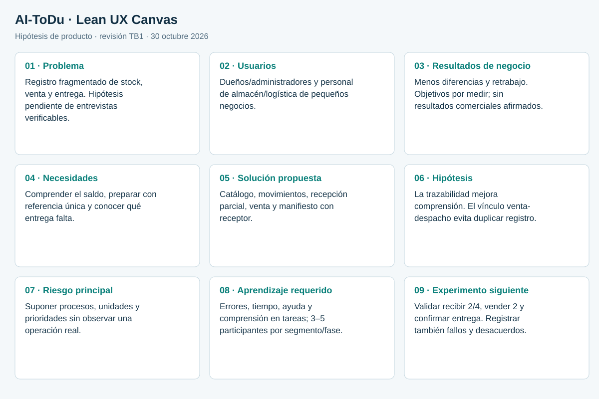

# Capítulo I: Introducción

## 1.1. Startup Profile

### 1.1.1. Descripción de la startup

IA-INNOVATION desarrolla **AI-ToDu**, una propuesta de software para pequeños negocios que necesitan conectar el inventario de almacén con compras, ventas y despachos. La unidad de valor es una operación trazable: conocer qué artículo entró, por qué cambió su saldo, qué venta comprometió unidades y qué entrega utilizó esa venta.

TB1 demuestra esta cadena con datos ficticios y una Fake REST API. El nombre del producto no acredita modelos de inteligencia artificial implementados. Predicción de demanda, optimización automática de rutas y decisiones basadas en IA permanecen fuera de la versión actual.

### 1.1.2. Perfiles de integrantes del equipo

Perfiles académicos declarados en el informe base, conservados como presentación del equipo. Las acciones verificadas por entrega se registran por separado en Student Outcome.

| Integrante | Perfil académico declarado |
| --- | --- |
| Bernal Torres, Carlos Alberto | Estudiante con sólidos conocimientos en el desarrollo frontend y backend. Aporta al equipo habilidades en la implementación de arquitecturas orientadas a dominio (DDD). |
| Chui Kcomt, Luis Carlos | Estudiante responsable con conocimientos en Python, C++, HTML. Aporta calidad y buen rendimiento en trabajos en equipo así como buen ambiente y compromiso. |
| Condezo Pacheco, Fernando André | Estudiante con conocimientos en C++ y Python. Aporta colaboración con el equipo y buen ambiente. |
| Salazar Marquina, Kevin Junior | Estudiante con sólidos conocimientos en el desarrollo frontend y backend. Aporta al equipo habilidades en el uso de frameworks como Angular y Spring Boot, enfocado en asegurar la escalabilidad del sistema B2B. |
| Salazar Quiche, Darikson Bill | [Pendiente de redacción] |

## 1.2. Solution Profile

### 1.2.1. Antecedentes y problemática

La hipótesis de problema es que el registro fragmentado entre cuadernos, hojas de cálculo y mensajes dificulta conciliar existencias y entregas. Se propone un flujo compartido entre quien administra y quien opera el almacén. La frecuencia, costo y severidad del problema deberán contrastarse con entrevistas verificables; no se presentan porcentajes de pérdida como datos medidos.

| Situación por validar | Consecuencia esperada | Respuesta de diseño |
| --- | --- | --- |
| Entradas y salidas sin motivo ni responsable | Conciliación difícil | Historial persistente y movimientos tipificados. |
| Venta sin comprobación del saldo/conservación | Sobreventa o artículo bloqueado | Validación completa y descuento atómico. |
| Despacho separado de la venta | Doble registro y pérdida de referencia | Manifiesto enlazado con líneas de venta reales. |
| Uso de números manuales como indicadores | Decisiones con información desactualizada | Métricas derivadas del registro, con límites contables explícitos. |

### 1.2.2. Lean UX Process

#### 1.2.2.1. Lean UX Problem Statements

Un pequeño negocio necesita coordinar recepción, venta y reparto con una vista común de las existencias. Suponemos que la fragmentación actual exige conciliaciones manuales y retrabajo. Sabremos que el problema fue atendido cuando usuarios de ambos segmentos completen un recorrido con saldo y entrega conciliados, con menos errores que en su proceso de referencia.

#### 1.2.2.2. Lean UX Assumptions

- El dueño considera útil un sistema que explica el origen del saldo y de sus métricas.
- El operario dispone de un dispositivo y conexión compatibles con la aplicación web.
- El negocio acepta un catálogo por SKU y cantidades enteras en la primera versión.
- Roles y lenguaje claro reducen errores sin exigir capacitación extensa.

Estas son suposiciones. La demo no prueba disposición de pago, tamaño de mercado, retención ni ahorro de tiempo en una empresa real.

#### 1.2.2.3. Lean UX Hypothesis Statements

| Hipótesis | Experimento propuesto | Criterio objetivo, aún no medido |
| --- | --- | --- |
| H1 · Un saldo acompañado por historial genera comprensión. | Pedir a 3–5 operarios que expliquen un cambio de saldo después de una recepción y una venta. | Al menos 80% identifica cantidad y motivo sin ayuda. |
| H2 · El manifiesto enlazado evita pérdida de referencia. | Dueños y operarios preparan el mismo despacho desde una venta. | 80% completa el flujo sin duplicar venta ni descontar stock nuevamente. |
| H3 · La interfaz bilingüe conserva comprensión del flujo. | Repetir una tarea en el idioma preferido, observar etiquetas y errores. | Sin mensajes clave sin traducir; 80% comprende el rechazo de sobreventa. |

Los porcentajes son umbrales de decisión del experimento, no resultados del producto. Registrar tamaño muestral, tiempo, errores y ayuda del moderador antes de compararlos.

#### 1.2.2.4. Lean UX Canvas

El canvas representa hipótesis actuales. Reemplaza la imagen heredada de otro producto y se actualiza con hallazgos trazables, no con conclusiones anticipadas.

## 1.3. Segmentos objetivo

### 1.3.1. Dueños y administradores de pequeños negocios

Deciden la adopción y necesitan comprender existencias, ventas registradas y despachos pendientes. La entrevista debe contrastar frecuencia de conciliación, consecuencias de errores y quién autoriza ajustes o devoluciones. La versión actual ofrece un resumen operativo; contribución bruta no equivale a utilidad neta.

### 1.3.2. Jefes de logística y personal de almacén

Ejecutan recepción, movimientos, preparación y entrega. Se priorizan lectura clara, acciones por rol y acceso móvil. Las restricciones del primer corte son cantidades enteras, una ubicación operativa de referencia y un destino por despacho. Operaciones por lote, múltiples almacenes y rutas con varias paradas requieren evolución y validación.
