# Capítulo II: Requirements Elicitation & Analysis

## 2.1. Competidores

### 2.1.1. Análisis competitivo

Revisión documental de fuentes primarias realizada el **13/11/2026**. Se distingue una capacidad publicada por el proveedor de una prueba realizada por el proyecto. No se comparan precios ni se atribuye una función ausente por no encontrarla en una página.

| Referente y fuente | Capacidad documentada por el proveedor | Relación con la necesidad de AI-ToDu |
| --- | --- | --- |
| [Odoo Inventory 19 · gestión de inventario](https://www.odoo.com/documentation/19.0/applications/inventory_and_mrp/inventory/warehouses_storage/inventory_management.html) | Distingue almacenes físicos y ubicaciones internas para organizar existencias. | La separación por sedes solicitada por Junior exige un modelo de ubicaciones; AV2 todavía mantiene una referencia operativa única. |
| [Alegra Perú](https://www.alegra.com/peru/) | Presenta contabilidad, facturación electrónica y punto de venta; su página describe inventario, reportes y terminales de venta. | Es un referente comercial para venta e inventario. AI-ToDu usa comprobantes de demostración y no declara equivalencia tributaria. |
| [Wally · sitio oficial](https://miwally.com/) | Presenta control de inventario, facturación y punto de venta en la nube. El dominio histórico wallypos.com redirige a miwally.com. | Permite contrastar la presentación de una operación comercial. No se realizó una prueba comparativa de usabilidad ni de desempeño. |
| AI-ToDu · repositorios y pruebas AV2 | Recepción parcial, movimientos, venta atómica y despacho vinculado; reglas y permisos probados con datos ficticios. | Propuesta académica de un recorrido compacto para administración y operación. Sus límites actuales incluyen sedes, lotes, pagos y fiscalidad. |

**Inferencia de diseño:** los referentes muestran que inventario/venta e integración administrativa son capacidades establecidas. La oportunidad propuesta es la comprensión de un recorrido acotado para los segmentos estudiados; su superioridad, preferencia y disposición de pago no han sido demostradas.

#### SWOT de AI-ToDu

| Factor | Análisis y respaldo | Respuesta propuesta |
| --- | --- | --- |
| Strengths | Flujo consistente, restricciones transaccionales y API documentada, respaldados por pruebas técnicas. Junior valora reunir funciones (12:01–13:08). | Conservar el vínculo recepción–saldo–venta–entrega y mostrar sus referencias. |
| Weaknesses | Recorridos guiados; vocabulario mezclado, acciones poco visibles e historial sin responsable en la versión evaluada. | Corregir H-01–H-09 y comprobar nuevamente con participantes; no sustituir esta comprobación por pruebas técnicas. |
| Opportunities | Solicitudes de separar sedes (Junior) y clasificar productos/identificar alertas (Shirley). Son señales cualitativas, no tamaño de mercado. | Evaluar marcas y ubicaciones con reglas de stock y nuevas tareas de validación. |
| Threats | Los referentes publican capacidades comerciales amplias; además, el alojamiento académico tiene límites de disponibilidad y continuidad. | Explicar alcance sin prometer equivalencia comercial; preparar continuidad de datos y operación. |

### 2.1.2. Estrategias y tácticas frente a competidores

La diferenciación propuesta es la comprensión del recorrido de una operación, no la cantidad de pantallas. Se probarán tres tácticas: historial visible para explicar el saldo, despacho a partir de una venta ya registrada e indicadores con definición comprensible. La preferencia y disposición de adopción requieren investigación; no se afirman como ventaja validada.

## 2.2. Entrevistas

### 2.2.1. Diseño de entrevistas

La elicitación inicial se registra por segmento objetivo. Preparar consentimiento, guion, ficha de contexto y registro accesible. Evitar preguntas que sugieran una respuesta favorable al producto. El plan y los registros de validación del incremento AV2 se presentan por separado en la sección 5.3.

| Etapa | Preguntas y actividad | Registro requerido |
| --- | --- | --- |
| Contexto | ¿Qué rol cumple? ¿Cómo fue su última recepción, venta o entrega? | Rol/segmento, fecha, consentimiento y entorno. |
| Proceso actual | Muestre cómo registra un cambio de stock. ¿Cómo descubre una diferencia? | Secuencia y ejemplo concreto, sin datos privados innecesarios. |
| Dificultad | ¿Cuándo ocurrió por última vez? ¿Cómo la resolvió y qué costo tuvo? | Cita con minuto; separar estimación del participante de medición. |
| Prioridad | ¿Qué necesita resolver primero y por qué? | Clasificación de problemas, incluyendo desacuerdos. |
| Cierre | ¿Qué condición le impediría usar una solución? | Riesgos y permiso para una sesión de validación posterior. |

### 2.2.2. Registro de entrevistas

**Estado:** existen diferencias entre las fichas del capítulo separado y el README remoto más reciente. El primero conserva cuatro rutas inexistentes; el segundo referencia seis archivos fotográficos existentes y cambia dos nombres, manteniendo textos alternativos anteriores. Se conservan ambas fuentes para revisión, sin reasignar fotografías ni descartar respuestas del equipo. La correspondencia entre identidad, imagen, consentimiento y grabación requiere confirmación.

| Registro del README remoto | Diferencia con el capítulo separado | Archivo localizado; correspondencia por confirmar |
| --- | --- | --- |
| Carlos Mendoza | Mismo nombre; segmento de decisión | `Images/Carlos_Mendoza.jpeg` |
| Lucía Valdivia | Mismo nombre; segmento de decisión | `Images/Lucia_Valdivia1.jpeg` |
| Roberto Sánchez | El capítulo apunta a un archivo ausente | `Images/Entrevista_ Sebastian.jpg`; nombre de archivo distinto de la ficha |
| Miguel Rojas | El capítulo apunta a un archivo ausente | `Images/Raul_Delgado.jpeg`; nombre de archivo distinto de la ficha |
| Maria Morales | El capítulo registra Andrea Gómez; el README conserva ese alt | `Images/Entrevista_Maria_Morales.jpg` |
| Diego Ramirez | El capítulo registra Jorge Quispe; el README conserva ese alt | `Images/Entrevista_Diego_Ramirez.jpg` |

Las fichas y respuestas de **ambas versiones** están en el [archivo de investigación](research/README.md). La presencia de archivos no resuelve estas diferencias ni acredita por sí sola las entrevistas. Confirmar cada registro con el equipo y completar responsable real, fecha, enlace autorizado, duración, transcripción y marcas de tiempo antes de contabilizarlo como evidencia.

#### Archivo visual de la elicitación inicial

Estas imágenes ya formaban parte de TB1. Se recuperan como archivo histórico, con el nombre del archivo como referencia y sin asignar una identidad cuando la ficha y la imagen difieren. No son participantes adicionales de la validación del Sprint 3.

| Archivo conservado | Evidencia visual original |
| --- | --- |
| `Carlos_Mendoza.jpeg` |  |
| `Lucia_Valdivia1.jpeg` |  |
| `Entrevista_ Sebastian.jpg` |  |
| `Raul_Delgado.jpeg` |  |
| `Entrevista_Maria_Morales.jpg` |  |
| `Entrevista_Diego_Ramirez.jpg` |  |

En las versiones del informe revisadas no se localizó una URL reproducible de las entrevistas iniciales: el enlace de Stream era un marcador de ejemplo. Se conserva el material visual disponible; los videos de esa etapa requieren su fuente auténtica.

### 2.2.3. Análisis de entrevistas

Se conserva un **mapa provisional de temas**, pendiente de codificar con citas auténticas: conciliación de saldos, visibilidad de pendientes, control de pérdidas y coordinación del despacho. Para cada hallazgo, registrar participante anonimizado, cita/minuto, interpretación, requisito relacionado y evidencia contradictoria. No se calculan porcentajes de aceptación con estas fichas sin verificar.

## 2.3. Needfinding

### 2.3.1. User Personas

| Persona provisional | Objetivo | Necesidad y decisión de diseño | Validación pendiente |
| --- | --- | --- | --- |
| Administrador de negocio | Saber qué puede vender y qué falta entregar | Resumen de transacciones, stock y despachos; definiciones de métricas visibles. | Confirmar prioridades y frecuencia de consulta. |
| Operario de almacén | Registrar y preparar sin duplicar el trabajo | Recepción parcial, movimientos con motivo, navegación móvil y acciones por rol. | Observar el proceso real, conectividad y unidades que utiliza. |

Son arquetipos de diseño, no personas reales adicionales. La actualización cualitativa usa las cinco validaciones sin añadir participantes ni datos demográficos inferidos.

| Arquetipo | Comportamiento descrito y fuente | Necesidad observada | Límite de la síntesis |
| --- | --- | --- | --- |
| Administración de negocio | Kimberlin recibe materiales y supervisa compras/ventas (00:37–00:57); Junior valora concentrar registros (12:01–13:08). | Comprender el recorrido y diferenciar sedes; lenguaje en español. | No se midió presupuesto, adopción ni frecuencia de uso. |
| Operación de almacén | Fabiana registra en hoja compartida y sistema (00:35–00:47); Diego usa portapapeles y computadora (00:36–00:48). | Acciones accesibles, saldo claro, responsable y espera visible. | Contexto declarado en entrevista; no se observó la jornada real. |

### 2.3.2. User Task Matrix

Consideramos dos segmentos: administrador del negocio y operario de almacén. Las tareas existen independientemente de AI-ToDu. **Frecuencias e importancias son hipótesis**, todavía no mediciones de entrevistas verificadas; se sustituirán por los resultados reales.

| Tarea del negocio | Administrador · frecuencia | Administrador · importancia | Operario · frecuencia | Operario · importancia |
| --- | --- | --- | --- | --- |
| Conciliar mercadería disponible | Diaria, por validar | Alta, por validar | Diaria, por validar | Alta, por validar |
| Contrastar pedido y entrega del proveedor | Por recepción, por validar | Alta, por validar | Por recepción, por validar | Alta, por validar |
| Registrar entradas, salidas y pérdidas | Diaria, por validar | Alta, por validar | Por movimiento, por validar | Alta, por validar |
| Comprobar que se puede atender una venta | Por venta, por validar | Alta, por validar | Por preparación, por validar | Alta, por validar |
| Coordinar recursos y confirmar entrega | Por reparto, por validar | Alta, por validar | Por pedido, por validar | Media/alta, por validar |
| Explicar diferencias de saldo e importes | Periódica, por validar | Alta, por validar | Al detectar diferencia, por validar | Alta, por validar |

La coincidencia propuesta es conciliar saldo y registrar movimientos. La diferencia por validar está en la supervisión global frente a la comprobación física. Esta matriz no representa permisos de software. Fichas, capturas y matriz en UXPressia, con las fuentes que sustenten sus valores: pendientes.

### 2.3.3. User Journey Mapping

El recorrido **As-Is**, anterior a nuestra solución, abarca recepción, preparación de entrega y conciliación. Los escenarios son hipótesis; no observaciones verificadas. Los mapas por persona y capturas en UXPressia quedan pendientes.

| Persona | Etapa actual sin AI-ToDu | Acción del negocio por validar | Fricción hipotética | Fuente |
| --- | --- | --- | --- | --- |
| Administrador | Comprueba disponibilidad | Contrasta pedido, registro y confirmación del almacén | Información distribuida entre registros y mensajes | Entrevista pendiente |
| Administrador | Coordina reparto | Asigna responsable y pide confirmación | Venta y entrega difíciles de relacionar | Entrevista pendiente |
| Administrador | Concilia jornada | Compara ventas, mercadería y entregas | Diferencias sin referencia compartida | Entrevista pendiente |
| Operario | Recibe mercadería | Cuenta unidades y compara con pedido | Entrega parcial o dato incompleto | Entrevista pendiente |
| Operario | Prepara salida | Ubica, separa y vuelve a contar unidades | Saldo desactualizado o doble anotación | Entrevista pendiente |
| Operario | Informa diferencias | Comunica pérdida o faltante y busca la causa | Motivo y responsable sin vincular | Entrevista pendiente |

El recorrido recepción → venta → despacho del prototipo corresponde a la solución **To-Be**; se documenta en diseño e implementación y no sustituye el Journey As-Is.

### 2.3.4. Empathy Mapping

El mapa separa lo expresado de lo inferido. Las paráfrasis remiten a sus fuentes; no se inventan citas ni emociones.

| Dimensión | Administración | Operación | Naturaleza de la evidencia |
| --- | --- | --- | --- |
| Dice | Kimberlin pide cambiar palabras en inglés (09:59–10:16); Junior solicita separar tiendas (13:19–13:40). | Diego pide quién registró y espera visible (06:45–07:35); Fabiana pide acciones accesibles (08:59–09:11). | Paráfrasis del feedback grabado. |
| Hace | Kimberlin ejecuta recepción, venta y despacho con indicaciones (04:15–08:16). | Fabiana recibe parcialmente con ayuda (05:47–06:58). | Actividad observada en la demo, sin extrapolar al trabajo real. |
| Piensa | Podría necesitar distinguir el estado de cada sede y el significado de sus registros. | Podría necesitar confiar en la cantidad antes de confirmar una salida. | Inferencias de diseño por contrastar; no pensamientos declarados. |
| Siente | No se aplicó un instrumento para medir confianza, satisfacción o frustración. | La conectividad es una preocupación descrita; no se midió estrés ni frecuencia del problema. | No se asignan emociones o puntuaciones sin evidencia. |

Shirley combina ambos perfiles y aporta dudas sobre la acción de venta y las alertas (11:22–12:23). El mapa no transforma una valoración favorable en aceptación del producto.

## 2.4. Big Picture Event Storming

El recorrido del dominio se ordena por el core: **mercadería recibida → saldo actualizado → venta confirmada → manifiesto creado → ruta iniciada → entrega confirmada**. Compras y ventas soportan el flujo; IAM limita quién puede ejecutar cada comando. Se distinguen comandos (registrar recepción), hechos (recepción registrada), política (crear alerta de stock mínimo), lectura (saldo) e interrogante (¿cómo tratar una entrega fallida?).

Cada fila muestra la secuencia local de un contexto; se presentan primero los contextos core y después el soporte comercial. La venta confirmada es una precondición del despacho. Este modelo de análisis requiere revisión del equipo; no acredita un taller colaborativo ya realizado. Los hechos nombran conceptos del dominio, no mensajes publicados por un bus. La implementación TB1 ejecuta políticas de forma síncrona y conserva registros transaccionales; no implementa broker ni event sourcing.

## 2.5. Ubiquitous Language

| Término | Definición y regla compartida |
| --- | --- |
| SKU | Identificador normalizado del artículo, único en una empresa. No representa saldo ni ubicación. |
| Stock (saldo) | Cantidad entera disponible. Nunca negativa. |
| Conservation condition (conservación) | Condición del artículo independiente de su cantidad; puede bloquear una venta. |
| Stock movement (movimiento) | Cambio de saldo con tipo, cantidad, motivo y responsable. |
| Purchase order (orden de compra) | Compromiso con un proveedor que conserva cantidades pedidas y pendientes. |
| Goods receipt (recepción) | Hecho de recibir mercadería; una recepción de compra puede ser parcial. |
| Sale (venta) | Transacción confirmada que descuenta stock una vez. |
| Dispatch manifest (manifiesto de despacho) | Asignación de venta, recursos y destino; no vuelve a descontar inventario. |
| Delivery confirmation (confirmación de entrega) | Finalización con receptor y fecha; los intentos fallidos quedan para una extensión futura. |
| Return (devolución) | Retorno limitado por la línea vendida; reincorpora stock o registra pérdida según disposición. |
| Gross contribution (contribución bruta) | Venta neta de devoluciones menos costo registrado y pérdidas; excluye otros gastos e impuestos. |
| Business (empresa) | Organización a la que pertenecen los registros y los usuarios autorizados. |
