# Capítulo IV: Product Design

## 4.1. Style Guidelines

### 4.1.1. General Style Guidelines

La identidad utiliza azul profundo para estructura, verde azulado para acción y superficies claras para lectura de datos. Se priorizan contraste, jerarquía tipográfica y consistencia entre landing y workspace. La aplicación usa **Angular Material y Material Design**; la landing emplea HTML/CSS/JavaScript semánticos. La revisión utiliza la skill `ui-ux-pro-max` como apoyo de evaluación, sin reemplazar pruebas con usuarios.

| Token | Valor / uso |
| --- | --- |
| Estructura | Azul profundo `#112f43` y tonos próximos definidos en CSS. |
| Acción | Verde azulado; botón primario contrastado y estado de foco visible. |
| Tipografía | Familia de sistema sans serif; sin dependencia de fuentes remotas. |
| Superficies | Fondo claro, bordes suaves y espacios consistentes. |
| Estados | Texto explícito además de color: pendiente, tránsito, entregado, error y vacío. |

### 4.1.2. Web Style Guidelines

Inglés predeterminado (`en_US`) y español latinoamericano (`es_419`). Se traducen mensajes, formularios, estados, navegación y errores del dominio. Los nombres de artículos/proveedores son datos del usuario y no se alteran automáticamente. Importes en PEN y fechas se formatean por idioma.

La navegación móvil usa panel superpuesto; tablas amplias desplazan dentro de su contenedor. Formularios muestran validación, deshabilitan doble envío y conservan el error de API. Material administra foco del diálogo, cierre y selectores; existen etiquetas accesibles, enlace para saltar al contenido y preferencia de movimiento reducido. La accesibilidad se ha revisado por implementación y recorrido, pendiente de evaluación con usuarios y auditoría automatizada dedicada.

## 4.2. Information Architecture

### 4.2.1. Organization Systems

El workspace sigue el flujo operativo: inventario/historial, abastecimiento, ventas, despacho, devolución y notificaciones. Overview deriva el estado, Team provisiona registros e IAM controla sesión. Las rutas se cargan por dominio. La landing presenta propósito, capacidades, recorrido, segmentos, equipo y CTA a la demo.

### 4.2.2. Labeling Systems

Las etiquetas distinguen venta de despacho y stock de conservación. `Demo receipt · not a fiscal document` informa el alcance del comprobante. `Gross contribution` se acompaña de definición y exclusiones; no se traduce como utilidad neta. Los códigos de error de API se convierten a mensajes localizados.

### 4.2.3. SEO Tags and Meta Tags

Landing declara título, descripción, idioma, viewport y marca. El selector actualiza título, descripción e idioma del documento. La aplicación autenticada es un espacio de trabajo, no una estrategia de posicionamiento de páginas privadas. No se agregan testimonios, métricas comerciales o etiquetas estructuradas de reseñas sin fuente.

### 4.2.4. Searching Systems

La búsqueda implementada filtra catálogo por nombre/SKU en el cliente sobre datos obtenidos por API. Paginación, filtros avanzados de servidor y búsqueda entre almacenes/lotes permanecen pendientes. Un estado vacío distingue ausencia de coincidencias de un error de carga.

### 4.2.5. Navigation Systems

Las rutas protegidas verifican sesión y permisos. Un usuario autenticado que abre login es enviado a su primera ruta autorizada. Las llamadas a API aplican el mismo rol/tenant, con el límite explícito de seguridad propio de una Fake API. La landing pasa preferencia de idioma y perfil demo al acceso del workspace.

## 4.3. Landing Page UI Design

### 4.3.1. Landing Page Wireframe

La estructura de lectura es: encabezado con navegación/idioma → propuesta principal y muestra identificada → capacidades → recorrido de cuatro pasos → segmentos → equipo/alcance → CTA y contacto del proyecto → términos y privacidad. En móvil se apilan columnas y el menú se controla por botón con `aria-expanded`.

### 4.3.2. Landing Page Mock-up

El diseño vigente es la implementación de [ai-todu-platform](https://github.com/AI-ToDu/ai-todu-platform/tree/fix/tb1-readiness). Las capturas antiguas del repositorio son material histórico y no acreditan esta revisión. El mock visual de la landing se identifica como ilustrativo; los resultados del recorrido real constan en la verificación de implementación.

## 4.4. Web Applications UX/UI Design

### 4.4.1. Web Applications Wireframes

Acceso usa una composición de propósito y formulario. El workspace presenta navegación lateral, encabezado con rol/idioma y área central. Inventario usa tabla y diálogos; ventas usa catálogo/carrito; logística agrupa por estado. Los mensajes de carga/error/vacío conservan el contexto de la tarea.

### 4.4.2. Web Applications Wireflow Diagrams

### 4.4.3. Web Applications Mock-ups

La fuente de la vista vigente son los componentes Material y `src/styles.css`. Las [instrucciones de demostración](https://github.com/AI-ToDu/ai-todu-webapp/tree/fix/tb1-readiness) permiten reproducir el diseño con datos ficticios. El formato 375 px se revisa para navegación, formularios y tablas; no se afirma una matriz exhaustiva de todos los dispositivos.

### 4.4.4. Web Applications User Flow Diagrams

El camino principal sigue recibir → consultar saldo → vender → revisar comprobante → crear despacho → iniciar ruta → identificar receptor → confirmar entrega. Los caminos alternativos incluyen credencial inválida, stock insuficiente, artículo bloqueado, recepción excesiva y recurso ocupado. La matriz de pruebas distingue observación de navegador de pruebas del contrato.

## 4.5. Web Applications Prototyping

TB1 es un prototipo funcional con dos transportes que comparten motor: HTTP local con archivo persistente y Service Worker con IndexedDB para hosting estático. La demo no emite documentos fiscales, realiza cobros, envía invitaciones ni comparte datos entre navegadores. El prototipo permite revisar interacción y consistencia antes del servidor AV2.

## 4.6. Domain-Driven Software Architecture

### 4.6.1. Design-Level Event Storming

Primero se presentan **Inventory y Logistics (core)**; después Procurement, Commercial/Returns, Reporting y Notifications (soporte); finalmente Identity and Access (genérico). El [análisis arquitectónico](design/architecture.md) define relaciones y tecnología. La [revisión DDD de todo el alcance](design/ddd-review.md) evalúa límites de agregados, objetos de valor, reglas y deuda de cada contexto; diferencia lo implementado del modelo AV2. Eventos como `StockReceived` o `DeliveryConfirmed` son vocabulario de diseño, no mensajes publicados por un broker en esta versión.

### 4.6.2. Software Architecture Context Diagram

C1 muestra personas y propósito del sistema. No incluye pasarelas fiscales o proveedores de IA que el prototipo no integra.

### 4.6.3. Software Architecture Container Diagrams

TB1 sirve archivos estáticos y ejecuta la Fake API en el navegador; el adaptador Node/archivo es una alternativa de desarrollo local. Se separa de la **propuesta AV2** siguiente:

Para AV2 se propone un monolito modular Spring Boot y PostgreSQL. Un bounded context no se convierte automáticamente en microservicio. La elección preserva transacciones y permite separar responsabilidades antes de sumar despliegues.

### 4.6.4. Software Architecture Components Diagrams

El dispatcher es un servicio de aplicación compartido. Los tres objetos de dominio están en módulos independientes de Angular, HTTP y almacenamiento. Los adaptadores deciden cómo confirmar la transacción. La separación posterior en servicios de aplicación por contexto y repositorios JPA es trabajo explícito de AV2.

## 4.7. Software Object-Oriented Design

### 4.7.1. Class Diagrams

| Objeto | Semántica implementada | Representación en frontera |
| --- | --- | --- |
| Sku | Normalización y validación; inmutable. | Cadena JSON / columna `sku` única por empresa. |
| Quantity | Entero no negativo, positivo cuando el comando lo exige; límite explícito. | Número JSON / entero SQL con restricción. |
| Money | PEN, precisión de centavos, valor finito/no negativo; inmutable. | Número de importe en API de demo; centavos enteros en diseño SQL. |
| Address | Texto normalizado con longitud válida; inmutable. | DTO / columna de dirección. |
| InventoryItem | Identidad estable; entrada/salida y aptitud de venta. | DTO de producto y repositorio futuro. |
| SaleSummary | Total validado en centavos, sin aritmética acumulada de decimales. | Total serializado; snapshot de líneas. |
| DispatchManifest | Destino y transición PENDING → IN_TRANSIT → DELIVERED. | Estado serializado y entidad futura. |

JSON y SQL requieren tipos de transporte/persistencia; eso no elimina el valor semántico del dominio. No se afirma que todas las filas JSON sean agregados DDD completos. Los precios/costos históricos se conservan en la venta y no se recalculan desde un catálogo modificado.

## 4.8. Database Design

### 4.8.1. Database Diagrams

El [DDL](design/database/schema.sql) contiene **35 tablas** con nombres físicos en minúsculas y `snake_case`, claves, unicidad, restricciones y referencias por empresa. [El diccionario](design/database/dictionary.md) enumera cada columna. Se ejecutó en SQLite para validar estructura y restricciones; su migración PostgreSQL/JPA aún no se implementa. La demo usa 35 **colecciones JSON**, no una base relacional operativa.

| Área lógica | Tablas | Capacidad operativa actual y brecha |
| --- | --- | --- |
| Identidad y empresa | 7 | Registro, roles, sesión y provisión de empleado. Activación, recuperación e invitación pendientes; suscripciones fuera del modelo actual. |
| Inventario | 8 | Catálogo, saldo, entradas/salidas, pérdidas e historial. Categorías/unidades/ubicación de referencia; variantes, lotes y múltiples ubicaciones sin flujo completo. |
| Abastecimiento | 5 | Maestro de proveedores, orden y recepción parcial. API admite varias líneas; formulario inicial trabaja un SKU por orden. Aprobación pendiente. |
| Ventas | 5 | Venta, detalle, pago demo y comprobante histórico. Consulta de cliente de referencia; maestro de clientes sin flujo de UI completo. Sin cobros/fiscalidad real. |
| Logística | 7 | Maestros de conductor/vehículo, manifiesto, líneas, una parada, estados, receptor, intento exitoso e incidencias. Varias paradas, intentos fallidos/capacidad/rutas pendientes. |
| Devoluciones | 2 | Flujo por línea con disposición reintegrar/pérdida y límite de cantidad. Sin reembolso real, cambio ni reexpedición. |
| Notificaciones | 1 | Generación por movimiento bajo mínimo, bandeja y lectura. Sin correo/push ni alertas de vencimiento operativas. |
| **Total** | **35** | **La existencia de una tabla o colección no acredita una funcionalidad completa.** |

Los ERD se dividen para conservar legibilidad: [Inventario](design/diagrams/rendered/erd-inventory.svg), [Logística](design/diagrams/rendered/erd-logistics.svg), [Abastecimiento](design/diagrams/rendered/erd-procurement.svg), [Ventas](design/diagrams/rendered/erd-sales.svg), [Devoluciones](design/diagrams/rendered/erd-returns.svg), [Notificaciones](design/diagrams/rendered/erd-notifications.svg) e [Identidad](design/diagrams/rendered/erd-identity.svg). El DDL es la referencia completa para relaciones entre áreas.

**Reglas de consistencia:** saldo no negativo; recepción acumulada no supera orden; venta confirma todo o nada; anulación restituye una vez; despacho conserva referencia sin doble salida; devolución no excede línea; referencias del tenant se validan en aplicación y se modelan con FK compuestas en SQL. La serialización camelCase del demo se mapeará explícitamente a columnas snake_case en AV2; no se promete una migración automática ni se expone el esquema físico como contrato HTTP.
