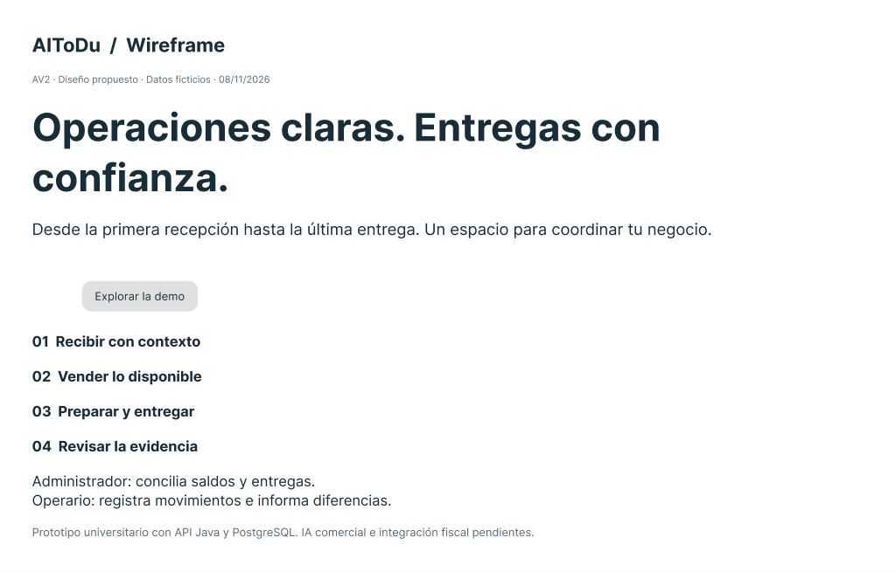
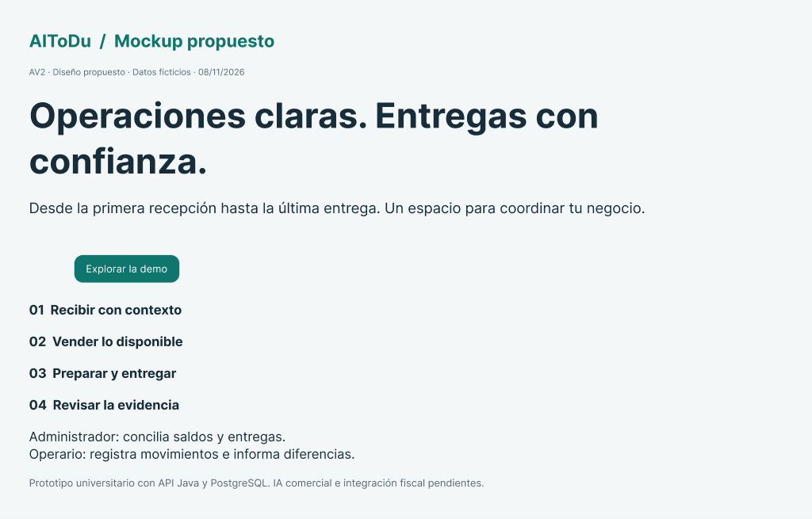
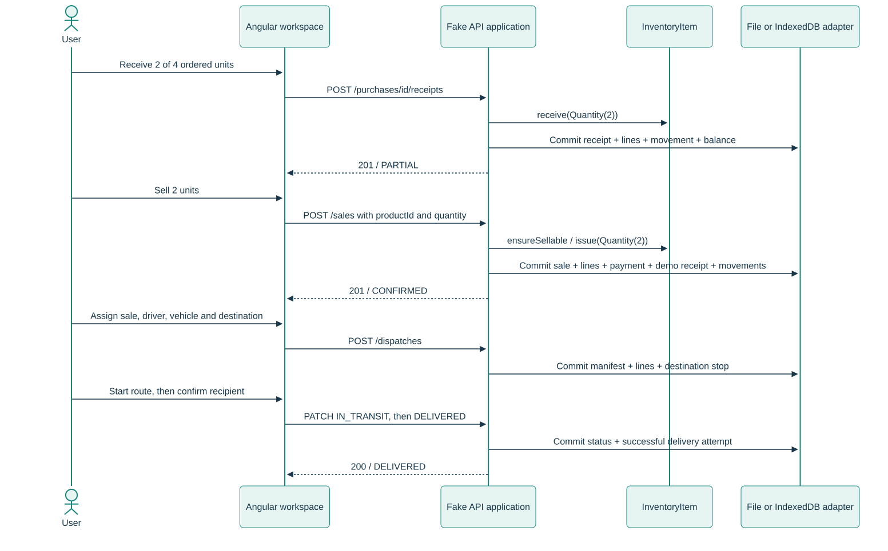
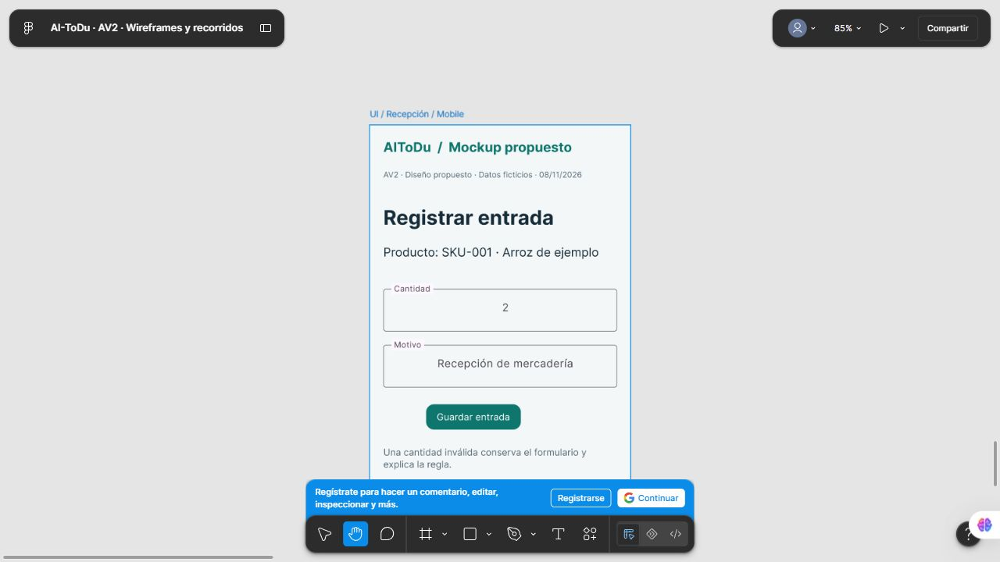

# Capítulo IV: Product Design

## 4.1. Style Guidelines

### 4.1.1. General Style Guidelines

La identidad utiliza azul profundo para estructura, verde azulado para acción y superficies claras para lectura de datos. Se priorizan contraste, jerarquía tipográfica y consistencia entre landing y workspace. La aplicación usa **Angular Material y Material Design**; la landing emplea HTML/CSS/JavaScript semánticos. La revisión utiliza la skill `ui-ux-pro-max` como apoyo de evaluación, sin reemplazar pruebas con usuarios.

| Token | Valor / uso |
| --- | --- |
| Estructura | Azul profundo `#112f43` y tonos próximos definidos en CSS. |
| Acción | Verde azulado; botón primario contrastado y estado de foco visible. |
| Tipografía | Familia de sistema sans serif; sin dependencia de fuentes remotas. |
| Superficies | Fondo claro, bordes suaves y espacios consistentes. |
| Estados | Texto explícito además de color: pendiente, tránsito, entregado, error y vacío. |

### 4.1.2. Web Style Guidelines

Inglés predeterminado (`en_US`) y español latinoamericano (`es_419`). Se traducen mensajes, formularios, estados, navegación y errores del dominio. Los nombres de artículos/proveedores son datos del usuario y no se alteran automáticamente. Importes en PEN y fechas se formatean por idioma.

La navegación móvil usa panel superpuesto; tablas amplias desplazan dentro de su contenedor. Formularios muestran validación, deshabilitan doble envío y conservan el error de API. Material administra foco del diálogo, cierre y selectores; existen etiquetas accesibles, enlace para saltar al contenido y preferencia de movimiento reducido. La accesibilidad se ha revisado por implementación y recorrido, pendiente de evaluación con usuarios y auditoría automatizada dedicada.

## 4.2. Information Architecture

### 4.2.1. Organization Systems

El workspace sigue el flujo operativo: inventario/historial, abastecimiento, ventas, despacho, devolución y notificaciones. Overview deriva el estado, Team provisiona registros e IAM controla sesión. Las rutas se cargan por dominio. La landing presenta propósito, capacidades, recorrido, segmentos, equipo y CTA a la demo.

### 4.2.2. Labeling Systems

Las etiquetas distinguen venta de despacho y stock de conservación. `Demo receipt · not a fiscal document` informa el alcance del comprobante. `Gross contribution` se acompaña de definición y exclusiones; no se traduce como utilidad neta. Los códigos de error de API se convierten a mensajes localizados.

### 4.2.3. SEO Tags and Meta Tags

Landing declara título, descripción, idioma, viewport y marca. El selector actualiza título, descripción e idioma del documento. La aplicación autenticada es un espacio de trabajo, no una estrategia de posicionamiento de páginas privadas. No se agregan testimonios, métricas comerciales o etiquetas estructuradas de reseñas sin fuente.

### 4.2.4. Searching Systems

La búsqueda implementada filtra catálogo por nombre/SKU en el cliente sobre datos obtenidos por API. Paginación, filtros avanzados de servidor y búsqueda entre almacenes/lotes permanecen pendientes. Un estado vacío distingue ausencia de coincidencias de un error de carga.

### 4.2.5. Navigation Systems

Las rutas protegidas verifican sesión y permisos. Un usuario autenticado que abre login es enviado a su primera ruta autorizada. En AV2, el servidor verifica el rol y la empresa de cada solicitud. La landing pasa idioma y modo servidor; el perfil sugerido solo pertenece a la demo local.

## 4.3. Landing Page UI Design

### 4.3.1. Landing Page Wireframe

La estructura de lectura es: encabezado con navegación/idioma → propuesta principal y muestra identificada → capacidades → recorrido de cuatro pasos → segmentos → equipo/alcance → CTA y contacto del proyecto → términos y privacidad. En móvil se apilan columnas y el menú se controla por botón con `aria-expanded`.

[Archivo Figma de propuestas AV2](https://www.figma.com/design/Kxkl1QhgvRiFthAN9O6CuW): 32 vistas editables, diez wireframes y 22 mockups para desktop/mobile; 38 conexiones definidas. Son propuestas simplificadas de interacción creadas durante esta revisión, no capturas de la aplicación ni evidencia de un taller previo. Los nodos usan texto Inter, auto-layout y componentes Material 3, con colores del producto. La validación con usuarios y el video de prototipo siguen pendientes.

### 4.3.2. Landing Page Mock-up

El diseño publicado se encuentra en [ai-todu-platform](https://github.com/AI-ToDu/ai-todu-platform/tree/develop). El mockup de Figma siguiente conserva propósito, jerarquía y estilo como propuesta simplificada; la aplicación publicada conserva una composición más amplia. Se distingue el diseño propuesto de la captura de ejecución del capítulo V.

Versión móvil editable: [wireframe](https://www.figma.com/design/Kxkl1QhgvRiFthAN9O6CuW?node-id=3-2530) y [mockup](https://www.figma.com/design/Kxkl1QhgvRiFthAN9O6CuW?node-id=3-2874).

## 4.4. Web Applications UX/UI Design

### 4.4.1. Web Applications Wireframes

Acceso usa una composición de propósito y formulario. El workspace presenta navegación lateral, encabezado con rol/idioma y área central. Inventario usa tabla y diálogos; ventas usa catálogo/carrito; logística agrupa por estado. Los mensajes de carga/error/vacío conservan el contexto de la tarea.

Propuesta Figma: [inventario desktop](https://www.figma.com/design/Kxkl1QhgvRiFthAN9O6CuW?node-id=3-2459), [recepción desktop](https://www.figma.com/design/Kxkl1QhgvRiFthAN9O6CuW?node-id=3-2481), [inventario móvil](https://www.figma.com/design/Kxkl1QhgvRiFthAN9O6CuW?node-id=3-2579) y [recepción móvil](https://www.figma.com/design/Kxkl1QhgvRiFthAN9O6CuW?node-id=3-2601). El camino del operario conserva cada estado: saldo inicial, formulario y saldo actualizado; el regreso al inventario evita perder el contexto.

### 4.4.2. Web Applications Wireflow Diagrams

User goal del operario: registrar dos unidades y explicar el saldo. En el wireflow Figma: Acceso → Inventario → Registrar movimiento → Recepción → Saldo actualizado → Inventario. Hay puntos de inicio desktop/mobile; las conexiones son de diseño y no escriben en la base real.

### 4.4.3. Web Applications Mock-ups

La fuente de la vista publicada son los componentes Material y `src/styles.css`. La propuesta simplificada tiene frames de 1120 px y 390 px, con campos rotulados, acciones explícitas y textos que explican el estado. [Mockup de recepción móvil](https://www.figma.com/design/Kxkl1QhgvRiFthAN9O6CuW?node-id=3-2945). No se afirma una matriz exhaustiva de dispositivos ni equivalencia visual exacta con la implementación.

### 4.4.4. Web Applications User Flow Diagrams

El camino principal sigue recibir → consultar saldo → vender → revisar comprobante → crear despacho → iniciar ruta → identificar receptor → confirmar entrega. Los caminos alternativos incluyen credencial inválida, stock insuficiente, artículo bloqueado, recepción excesiva y recurso ocupado. La matriz de pruebas distingue observación de navegador de pruebas del contrato.

User goal del administrador: relacionar una venta con la entrega. En los mockups conectados: Saldo actualizado → Venta → Venta confirmada → Despacho pendiente → Confirmar entrega → Entregado. La alternativa «Ver alternativa sin stock» lleva a Venta rechazada y permite corregir cantidad. Se conservan versiones desktop/mobile en el mismo archivo. Los otros rechazos se documentan en los criterios y las pruebas, sin atribuirles una conexión que no se creó en Figma.

## 4.5. Web Applications Prototyping

TB1 es un prototipo funcional con dos transportes que comparten motor: HTTP local con archivo persistente y Service Worker con IndexedDB para hosting estático. La demo no emite documentos fiscales, realiza cobros, envía invitaciones ni comparte datos entre navegadores. El prototipo permite revisar interacción y consistencia antes del servidor AV2.

AV2 añade la webapp conectada al servidor y la propuesta navegable Figma con cuatro puntos de inicio (wireflow/prototipo, desktop/mobile). Las conexiones de diseño se registraron estructuralmente y se revisaron vistas representativas; la grabación y validación completa del prototipo se mantienen pendientes. El límite de consultas del conector Figma impidió completar todas las exportaciones individuales en esta revisión.

## 4.6. Domain-Driven Software Architecture

### 4.6.1. Design-Level Event Storming

Primero revisamos **Inventory y Logistics (core)**; luego Procurement, Sales/Returns, Reporting y Notifications (soporte); finalmente IAM (genérico). El [análisis arquitectónico](design/architecture.md) registra decisiones. El modelo distingue comandos, agregados, eventos internos, traducción pública, Outbox e inbox. Es un diseño contrastado con código; no acredita un taller colaborativo realizado.

Los mensajes públicos se añaden al Outbox en la transacción del comando. El relay reintenta entregas y Notifications evita duplicados por ID del evento.

StockBelowMinimum, SaleConfirmed y DeliveryConfirmed son eventos internos del contexto propietario. Su application publisher los traduce al Published Language v1. Notifications consume únicamente mensajes públicos. La coordinación Inventory–Sales–Logistics usa fachadas/gateways dentro de la transacción del monolito; no un broker distribuido. [Context map](design/diagrams/rendered/context-map.svg).

### 4.6.2. Software Architecture Context Diagram

C1 muestra personas y propósito del sistema. No incluye pasarelas fiscales o proveedores de IA que el prototipo no integra.

### 4.6.3. Software Architecture Container Diagrams

TB1 sirve archivos estáticos y ejecuta la Fake API en el navegador; el adaptador Node/archivo es una alternativa de desarrollo local. Se separa de la **implementación AV2** siguiente:

AV2 implementa un monolito modular Spring Boot y PostgreSQL. La SPA usa HTTPS hacia Render; la API conecta su base aislada por red privada y consulta Open-Meteo mediante un gateway. Un bounded context no equivale a un microservicio.

### 4.6.4. Software Architecture Components Diagrams

El diagrama anterior describe TB1. En AV2, los handlers coordinan puertos y agregados propios; adaptadores JPA y assemblers mantienen entidades persistentes separadas. Las consultas no ejecutan comandos.

## 4.7. Software Object-Oriented Design

### 4.7.1. Class Diagrams

La tabla siguiente corresponde al modelo histórico de TB1. En AV2, `Money` conserva centavos en un `long`, `Quantity` es un entero y `DispatchManifest` valida su destino como texto y contiene `DeliveryEvidence` (receptor/fecha). `Sale` y `PurchaseOrder` son agregados independientes. La separación entre clases Java de dominio y entidades JPA se comprueba en el repositorio API; `Address` y `SaleSummary` del dibujo histórico no se presentan como clases actuales del backend.

| Objeto TB1 | Semántica del prototipo | Representación en frontera TB1 |
| --- | --- | --- |
| Sku | Normalización y validación; inmutable. | Cadena JSON / columna `sku` única por empresa. |
| Quantity | Entero no negativo, positivo cuando el comando lo exige; límite explícito. | Número JSON / entero SQL con restricción. |
| Money | PEN, precisión de centavos, valor finito/no negativo; inmutable. | Número de importe en API de demo; centavos enteros en diseño SQL. |
| Address | Texto normalizado con longitud válida; inmutable. | Recurso de frontera / columna del prototipo. |
| InventoryItem | Identidad estable; entrada/salida y aptitud de venta. | Recurso de producto y adaptador de demo. |
| SaleSummary | Total validado en centavos, sin aritmética acumulada de decimales. | Total serializado; snapshot de líneas. |
| DispatchManifest | Destino y transición PENDING → IN_TRANSIT → DELIVERED. | Recurso de despacho y adaptador de demo. |

JSON y SQL requieren tipos de transporte/persistencia; eso no elimina el valor semántico del dominio. El servidor usa InventoryItem, Sale, PurchaseOrder y DispatchManifest con operaciones e invariantes; no trata cada fila persistente como agregado independiente. Los precios/costos históricos se conservan en la venta y no se recalculan desde un catálogo modificado.

## 4.8. Database Design

### 4.8.1. Database Diagrams

El [DDL](design/database/schema.sql) contiene **35 tablas** con nombres físicos en minúsculas y `snake_case`, claves, unicidad, restricciones y referencias por empresa. [El diccionario](design/database/dictionary.md) enumera cada columna. Se ejecutó en SQLite como referencia; TB1 usa 35 colecciones JSON. **AV2 implementa 19 tablas de negocio/infraestructura**, además de flyway_schema_history, definidas por sus [migraciones PostgreSQL](https://github.com/AI-ToDu/ai-todu-api/tree/main/src/main/resources/db/migration). No se declara implementada automáticamente toda la referencia de 35 tablas.

| Área lógica | Tablas | Capacidad operativa actual y brecha |
| --- | --- | --- |
| Identidad y empresa | 7 | Registro, roles, sesión y provisión de empleado. Activación, recuperación e invitación pendientes; suscripciones fuera del modelo actual. |
| Inventario | 8 | Catálogo, saldo, entradas/salidas, pérdidas e historial. Categorías/unidades/ubicación de referencia; variantes, lotes y múltiples ubicaciones sin flujo completo. |
| Abastecimiento | 5 | Maestro de proveedores, orden y recepción parcial. API admite varias líneas; formulario inicial trabaja un SKU por orden. Aprobación pendiente. |
| Ventas | 5 | Venta, detalle, pago demo y comprobante histórico. Consulta de cliente de referencia; maestro de clientes sin flujo de UI completo. Sin cobros/fiscalidad real. |
| Logística | 7 | Maestros de conductor/vehículo, manifiesto, líneas, una parada, estados, receptor, intento exitoso e incidencias. Varias paradas, intentos fallidos/capacidad/rutas pendientes. |
| Devoluciones | 2 | Flujo por línea con disposición reintegrar/pérdida y límite de cantidad. Sin reembolso real, cambio ni reexpedición. |
| Notificaciones | 1 | Generación por movimiento bajo mínimo, bandeja y lectura. Sin correo/push ni alertas de vencimiento operativas. |
| **Total** | **35** | **La existencia de una tabla o colección no acredita una funcionalidad completa.** |

Los ERD se dividen para conservar legibilidad: [Inventario](design/diagrams/rendered/erd-inventory.svg), [Logística](design/diagrams/rendered/erd-logistics.svg), [Abastecimiento](design/diagrams/rendered/erd-procurement.svg), [Ventas](design/diagrams/rendered/erd-sales.svg), [Devoluciones](design/diagrams/rendered/erd-returns.svg), [Notificaciones](design/diagrams/rendered/erd-notifications.svg) e [Identidad](design/diagrams/rendered/erd-identity.svg). El DDL es la referencia completa para relaciones entre áreas.

**Reglas de consistencia:** saldo no negativo; recepción acumulada no supera orden; venta confirma todo o nada; anulación restituye una vez; despacho conserva referencia sin doble salida; devolución no excede línea; referencias del tenant se validan en aplicación y se modelan con FK compuestas en SQL. AV2 usa nombres snake_case, centavos enteros, converters para valores simples y embeddables para valores compuestos. No hay migración automática de datos ficticios del navegador al servidor; cada modo mantiene su almacenamiento. El esquema físico no es el contrato HTTP.

#### 4.8.1.1. Esquema ejecutado del incremento AV2

| Área | Tablas PostgreSQL implementadas |
| --- | --- |
| IAM y coordinación | workspaces, workspace_locks, users, sessions |
| Inventario | inventory_items, stock_movements |
| Ventas | sales, sale_lines |
| Logística | drivers, vehicles, dispatches, dispatch_lines, delivery_incidents |
| Compras | suppliers, purchase_orders, purchase_lines |
| Devoluciones | customer_returns |
| Integración | integration_outbox, notifications |

Flyway aplica V1–V4 y Hibernate valida el esquema sin generarlo en producción. CI ejecuta las pruebas con PostgreSQL 17. El saldo, su movimiento y la venta se confirman en una transacción. No se implementa event sourcing ni un ledger fiscal.
