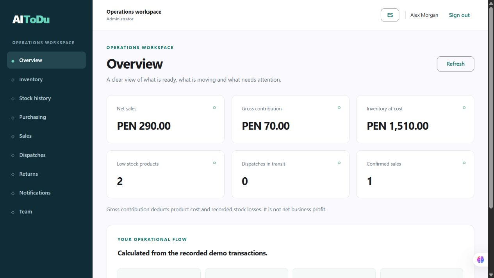
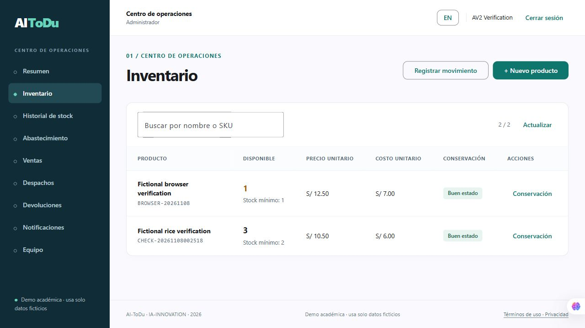
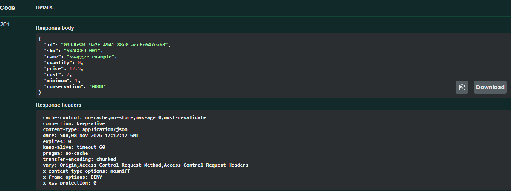
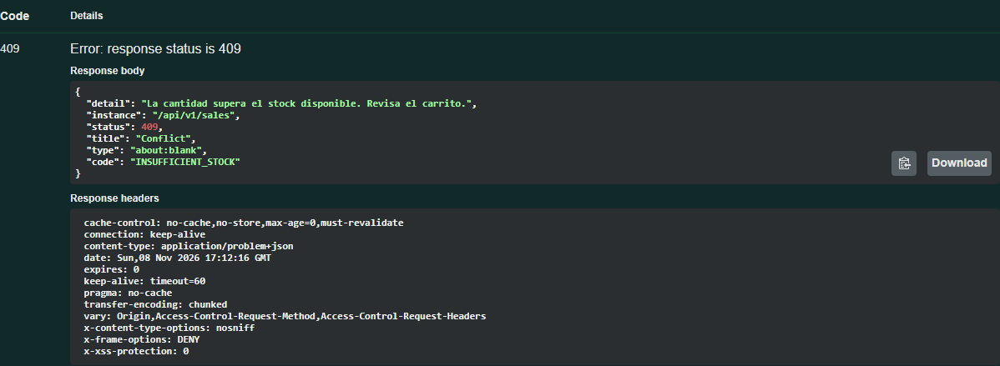
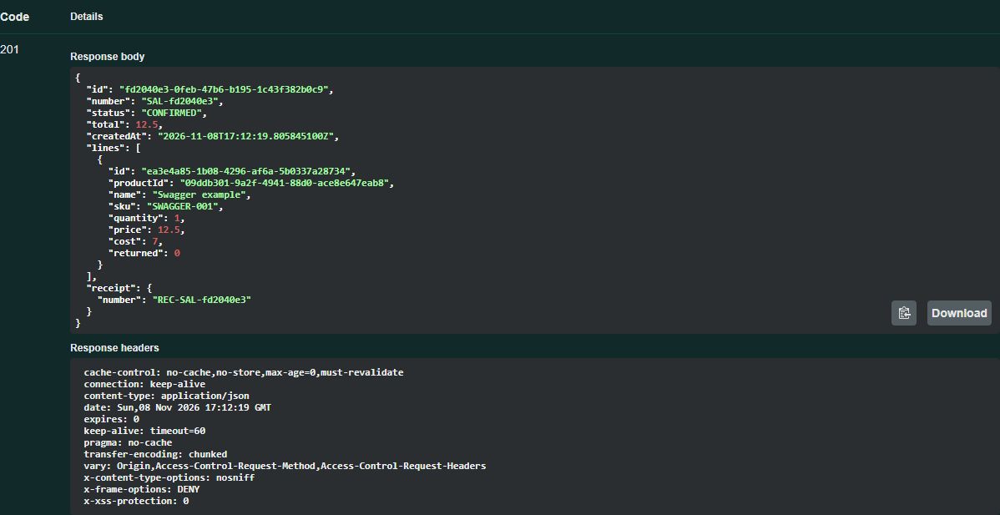

# Capítulo V: Product Implementation, Validation & Deployment

## 5.1. Software Configuration Management

### 5.1.1. Software Development Environment Configuration

| Producto / artefacto | Tecnología efectiva | Responsabilidad |
| --- | --- | --- |
| Frontend | Angular 22, TypeScript, Angular Material/CDK, CSS | Workspace responsive, UI/i18n y adaptador HttpClient. |
| Landing | HTML, CSS y JavaScript nativos | Propósito, capacidades, recorrido, CTA y contacto del proyecto. |
| Fake API | JavaScript ESM, Node 24 `node:http`; Service Worker e IndexedDB | Contrato de demo, invariantes y persistencia. |
| Pruebas | `node:test`, SQLite integrado de Node, compilador Angular | Dominio, HTTP real, concurrencia/persistencia, esquema y cobertura de traducciones. |
| Informe | Markdown, Mermaid/SVG y generadores versionados | README completo, fuentes únicas, comprobación y exportación. |
| Backend AV2 | Java 21 / Spring Boot 4.1.2 / JPA / PostgreSQL 17 / Flyway | API con dominio agnóstico, JWT, roles, transacciones y Outbox. |

El repositorio incluye lockfile cuando instala dependencias. La Fake API y landing no requieren paquetes de ejecución. Se usan datos ficticios y archivos de estado excluidos de Git. El equipo debe confirmar su tablero de gestión; se retiraron referencias a nombres de repositorios inexistentes, enlaces de ejemplo y herramientas declaradas sin evidencia de uso.

### 5.1.2. Source Code Management

| Repositorio individual | Artefacto | Rama para esta revisión |
| --- | --- | --- |
| [ai-todu-webapp](https://github.com/AI-ToDu/ai-todu-webapp) | Frontend y transporte AV2 | `fix/av2-api-integration` |
| [ai-todu-platform](https://github.com/AI-ToDu/ai-todu-platform) | Landing y acceso al servidor AV2 | `fix/av2-platform-scope` |
| [ai-todu-fake-api](https://github.com/AI-ToDu/ai-todu-fake-api) | Fuente canónica de Fake API, contrato y pruebas | `fix/tb1-readiness` |
| [ai-todu-report](https://github.com/AI-ToDu/ai-todu-report) | Informe, arquitectura y datos | `fix/av2-report-alignment` |
| [ai-todu-api](https://github.com/AI-ToDu/ai-todu-api) | Backend, contratos, migraciones y CI | `fix/av2-domain-foundation` y `fix/av2-runtime-configuration` |

**Workflow:** `main` conserva la línea estable; `develop` integra trabajo; las ramas nuevas usan `fix/<scope>`. AV2 se integra mediante PR con comprobaciones de CI antes del merge. No se reescriben commits históricos ni se atribuyen las correcciones asistidas a otros integrantes. Para el frontend se incorpora `develop` desde la base original de `main`. En landing, la rama predeterminada original ya era `develop`; se documenta esta transición antes de normalizar una futura rama estable, sin mover la publicación durante la revisión.

Los cuatro bloques de corrección son: **(1) integración funcional con Fake API; (2) interfaz, landing e idiomas; (3) DDD/C4/datos; (4) informe, trazabilidad y guía de revisión**. Cada repositorio registra un commit por bloque aplicable; no se crean commits vacíos para aumentar un contador. El paquete nuevo registra además su inicialización real. Los hashes y PR vigentes se consultan en Git, sin duplicar un historial que pueda quedar desactualizado.

El frontend conserva un manifiesto de procedencia y hashes del motor vendorizado desde la Fake API. Su prueba de integridad detecta cambios no sincronizados. Esta decisión permite servir el demo desde hosting estático y mantener un repositorio individual revisable para el contrato.

### 5.1.3. Source Code Style Guide & Conventions

TypeScript/JavaScript usan identificadores en inglés, `PascalCase` para clases y `camelCase` para funciones/DTOs. Nombres físicos SQL usan **minúsculas snake_case**. Objetos de valor y reglas de dominio se separan de UI, transporte y almacenamiento. Las vistas se agrupan por contexto; nuevas funcionalidades se exponen mediante servicio de aplicación y contrato, evitando introducir reglas de stock en el componente.

Los mensajes visibles se resuelven por clave en `en_US`/`es_419`; el API emite códigos de error estables. Un mensaje nuevo requiere ambas traducciones y revisión de accesibilidad. No se utilizan números inventados en Overview ni testimonios no autenticados en la landing.

### 5.1.4. Software Deployment Configuration

| Acceso | URL / comando | Estado y límite |
| --- | --- | --- |
| Landing pública existente | [GitHub Pages](https://ai-todu.github.io/ai-todu-platform/) | Canal estático público y CTA hacia la webapp. |
| Webapp pública existente | [GitHub Pages](https://ai-todu.github.io/ai-todu-webapp/) | GitHub Actions desde main; PR AV2 #5 integrado con CI aprobado. |
| Workspace + Fake API HTTP | `npm ci` y `npm run demo`, frontend | Sirve interfaz compilada y API en `http://127.0.0.1:8850/?api=http`. |
| Fake API independiente | `npm test`; `npm start -- --port 8853` | API local `/api/v1`, sin frontend compilado. |
| Modo estático | Build Pages y origen HTTPS o localhost | Worker/IndexedDB por origen/perfil; no servidor público REST. |

El workflow de verificación revisa ramas `fix/**` y PR. El workflow Pages de la webapp se restringe a `main` después de revisión; exige configurar GitHub Pages como **GitHub Actions** al publicar. Actions y la publicación de webapp se comprobaron; el servidor AV2 se verifica por separado. La navegación usa hash para rutas estáticas y el build fija `base-href` `/ai-todu-webapp/`. Se conserva el selector de idioma y CTA de la landing.

## 5.2. Landing Page, Services & Applications Implementation

La estructura siguiente recupera **Sprint 1 y Sprint 2**. La reconstrucción documental no acredita reuniones, horas ni transiciones históricas que no fueron registradas. La corrección técnica se ejecuta el 30/10/2026; las fechas/participantes de la planificación original y el tablero deben completarse con evidencia del equipo.

### 5.2.1. Sprint 1

#### 5.2.1.1. Sprint Planning 1

**Hito:** AV1 / primera landing y diseño. **Fuente temporal:** historial de landing y report. **Planning original:** fecha, duración, asistentes y decisiones pendientes de confirmar. **Goal propuesto para corregir el formato**, según enunciado p. 24:

> Our focus is on helping potential business owners and warehouse operators understand the traceable inventory-to-delivery proposal. We believe it delivers a clear basis for deciding whether to try the product to these two user segments. This will be confirmed when visitors can identify the product purpose, find the relevant capabilities and reach the demo entry point from the landing.

**Cobertura propuesta:** US05, US06, US08, US33, US34; suma de 12 SP de backlog. Velocity histórica y compromiso original: sin registro verificado.

La meta describe outcome, impacto, clientes y evento de confirmación. La implementación actual permite revisar el recorrido; su comprensión por usuarios reales requiere sesión de validación.

#### 5.2.1.2. Aspect Leaders and Collaborators

El historial de landing contiene aportes de los cinco integrantes. El nombramiento formal de leaders/collaborators por Development, Execution, Documentation y Deployment no quedó acreditado por una lista firmada o acta accesible. Se debe ratificar la matriz del equipo; no se reconstruye liderazgo a partir de una cantidad de commits.

#### 5.2.1.3. Sprint Backlog 1

Descomposición de referencia para recuperar el alcance, con **estimaciones propuestas**, no horas trabajadas. Story points se consultan en el backlog canónico y no se convierten a horas.

| Task | Historia | Engineering task | Est. | Evidencia / estado actual |
| --- | --- | --- | --- | --- |
| S1-T01 | US05 | Implementar estructura semántica de propósito y navegación. | 4 h | Landing actual; trazabilidad histórica por confirmar. |
| S1-T02 | US06 | Implementar capacidades y flujo del producto con alcance explícito. | 4 h | Secciones actuales y CTA. |
| S1-T03 | US08 | Conectar contacto real y revisar destinos de navegación. | 4 h | Enlace al proyecto; formulario B2B pendiente. |
| S1-T04 | US33–US34 | Incorporar idiomas, términos y privacidad accesibles. | 6 h | Implementación actual; validar con usuarios. |
| S1-T05 | US05–US06 | Revisar móvil/teclado y publicar versión revisada. | 4 h | Revisión local; merge y publicación pendientes de aprobación. |

**Seguimiento histórico To Do / In Process / To Review / Done:** pendiente de tablero exportado o enlace accesible. Esta tabla no simula transiciones históricas.

#### 5.2.1.4. Development Evidence for Sprint Review

Los commits originales de [landing](https://github.com/AI-ToDu/ai-todu-platform/commits/develop/) y capítulos AV1 enlazados en Student Outcome acreditan cambios de archivos. El rediseño de esta corrección tiene su propio commit de bloque 2. Se evita asociar capturas de otro producto con la versión actual.

#### 5.2.1.5. Execution Evidence for Sprint Review

La landing se sirve localmente y se revisan navegación, selector de idioma, CTA, términos y móvil. Se debe adjuntar video de exposición AV1 con fecha/audiencia si se usa como evidencia de ejecución histórica. Las pruebas actuales de enlaces e idiomas corresponden a la corrección.

#### 5.2.1.6. Services Documentation Evidence for Sprint Review

Sprint 1 no acredita un servidor productivo. El alcance documentado es landing/diseño. Los servicios de TB1 se describen con Fake API/OpenAPI en Sprint 2; Spring Boot/PostgreSQL queda para AV2.

#### 5.2.1.7. Software Deployment Evidence for Sprint Review

La URL pública de landing figura en configuración. El historial público y configuración de Pages son evidencia distinta del navegador local. El rediseño se integró en una revisión posterior; el [PR #4 de AV2](https://github.com/AI-ToDu/ai-todu-platform/pull/4) ajusta el alcance y el acceso al servidor, sin atribuir esta revisión a la entrega histórica de Sprint 1.

#### 5.2.1.8. Team Collaboration Insights during Sprint

Hay contribuciones históricas de los cinco integrantes en landing. Hace falta vincular cada acción con tarea y revisión. Una captura de Insights o un contador no demuestra por sí solo planificación, colaboración continua ni revisión cruzada. Se solicita el tablero real y enlaces de PR de la entrega original.

### 5.2.2. Sprint 2

#### 5.2.2.1. Sprint Planning 2

**Hito:** TB1, frontend integrado con Fake REST API. **Corrección actual:** 30/10/2026. **Planning histórico:** calendario/asistentes pendientes. **Sprint Goal de corrección:**

> Our focus is on enabling a traceable receiving-to-delivery workflow in the TB1 prototype. We believe it delivers confidence in stock and delivery records to business owners, warehouse operators and logistics operators. This will be confirmed when receiving two of four ordered units, selling two units and delivering that sale leaves a reconciled stock balance, historical demo receipt and delivery recipient that survive a page reload.

**Cobertura de corrección referenciada:** 25 historias, 99 SP de backlog. No representa velocity medida ni un compromiso histórico de capacidad. El equipo debe acordar capacidad y selección final con su calendario real.

La confirmación técnica se observa en el recorrido local. El impacto de confianza es una hipótesis que debe validarse con usuarios. **Fuera de este goal:** cobros reales, SUNAT, IA, rutas optimizadas y servidor Java de producción.

#### 5.2.2.2. Aspect Leaders and Collaborators

| Aspecto | Evidencia histórica disponible | Validación pendiente |
| --- | --- | --- |
| Development | Carlos/IAM, Fernando/inventario, Darikson/POS-reporting, Luis/logística y Kevin/base-documentación; commits en Student Outcome. | Ratificar leaders/collaborators y enlazar tareas. |
| Execution | Pruebas automatizadas y recorrido local de la corrección. | Evidencia individual de ejecución y demostración original. |
| Documentation | Contribuciones AV1 y nueva revisión asistida autorizada por Kevin. | Revisión cruzada y reflexión individual por entrega. |
| Deployment | URLs/configuración de Pages y workflows preparados. | Responsable real, aprobación y evidencia del despliegue de la versión revisada. |

#### 5.2.2.3. Sprint Backlog 2

Las tareas siguientes son la descomposición **actualizada de corrección**; las horas son estimaciones propuestas entre 4 y 8 horas, no una declaración retroactiva de esfuerzo. El ejecutor técnico de esta corrección es trabajo asistido autorizado por Kevin; no se distribuye autoría ficticia entre integrantes.

| Task | Historias | Engineering task | Est. | Evidencia de aceptación |
| --- | --- | --- | --- | --- |
| S2-T01 | US01–US03, US29 | Implementar sesión, rol y consultas por tenant en la Fake API. | 6 h | Pruebas de autenticación, autorización y aislamiento. |
| S2-T02 | US09–US14 | Persistir catálogo/movimientos y validar SKU, saldo y conservación. | 6 h | Pruebas de SKU, cantidades y producto bloqueado. |
| S2-T03 | US35 | Implementar proveedor/orden/recepción parcial atómica. | 6 h | Recepción 2/4 y rechazo de exceso/duplicación. |
| S2-T04 | US15–US18 | Integrar carrito, stock y comprobante histórico; anulación única. | 8 h | Sobreventa/concurrencia y reintegro una vez. |
| S2-T05 | US19–US22, US37 | Integrar venta, recursos, transición e identificación del receptor. | 8 h | Recorrido de entrega y conflicto de recursos. |
| S2-T06 | US23, US26, US36 | Integrar devolución, métricas derivadas y bandeja de alertas. | 6 h | Límites de devolución y consistencia del resumen. |
| S2-T07 | US33–US34 | Aplicar Material/responsive, localización y estados accesibles. | 6 h | Compilación, cobertura de traducciones y revisión móvil. |
| S2-T08 | Transversal | Revisar DDD, VO, C4, DDL/ERD y alcance real de 35 tablas. | 8 h | Diagramas renderizados y restricciones SQL ejecutadas. |
| S2-T09 | Transversal | Corregir informe, evidencias, versiones y guía de revisión. | 6 h | README reproducible, enlaces/imágenes y matriz de pendientes. |
| S2-T10 | Transversal | Ejecutar verificación y preparar PR/CI de cada producto. | 4 h | Resultados locales y PR de revisión; merge posterior. |

La tabla no reemplaza el tablero con transiciones y responsables reales. El equipo debe incorporar estos items a su herramienta y conservar la evidencia progresiva, sin backdating.

#### 5.2.2.4. Development Evidence for Sprint Review

Los seis commits iniciales de la webapp se conservan íntegros. La rama de corrección registra bloques de cambios concretos; la nueva Fake API dispone de repositorio propio. El front usa HttpClient y llamadas por contrato: los componentes no modifican directamente un arreglo en memoria como persistencia final.

Los objetos de valor son inmutables y los agregados/servicios de aplicación validan el comando antes de confirmar el draft. La copia de demo del frontend se verifica por hash frente al paquete canónico. El modelo SQL sigue siendo una base de diseño AV2; no se presenta como JPA desplegado.

#### 5.2.2.5. Execution Evidence for Sprint Review

| Verificación | Observación y límite |
| --- | --- |
| Dominio/API | Pruebas automatizadas de cantidades, SKU, conservación, sobreventa, anulación, recepción parcial, despacho, devolución, roles y tenant. |
| HTTP real | Dos solicitudes concurrentes contra stock 8, cada una por 5: una aceptada y otra rechazada; saldo 3 conserva persistencia después de reiniciar servidor. |
| Datos | DDL ejecutado en SQLite; saldo negativo y referencia cruzada entre empresas rechazados. No valida aún PostgreSQL/JPA. |
| Integración por navegador | Compra de 4 unidades de arroz, recepción de 2, venta de 2 por PEN 290 y despacho hasta entrega con receptor. Overview derivó contribución PEN 70 y stock valorizado PEN 1,510. |
| Sesión ante fallo | Fixture aislado respondió 503 en logout; la UI eliminó la sesión local y mostró acceso. La sesión del servidor no se declaró revocada cuando este falló. |
| Hosting estático | Acceso y creación de MEM-001 mediante worker/IndexedDB sin backend; al recargar el registro permanece. Worker empaquetado en un solo .js para evitar dependencia de MIME .mjs. |
| Internacionalización | Inglés predeterminado y claves cubiertas en español latinoamericano; revisión del cambio de idioma. |
| Compilación | Build de producción y build Pages, sin relajar el presupuesto original de 500 kB para el bundle inicial. |
| Despliegue | Pruebas locales de la revisión; versión pública posterior al merge/aprobación. |



Son datos ficticios de prueba, no ventas reales ni un estudio de eficiencia de negocio. El recibo es explícitamente no fiscal. La compilación y las pruebas no prueban por sí solas usabilidad ni colaboración del equipo.

#### 5.2.2.6. Services Documentation Evidence for Sprint Review

El [OpenAPI de la Fake API](https://github.com/AI-ToDu/ai-todu-fake-api/blob/fix/tb1-readiness/openapi.json) especifica rutas, cuerpos, errores y sesión demo. Contiene solo operaciones implementadas. Recuperación de contraseña, cambio de perfil/contraseña, planes y captación B2B siguen pendientes. Cambios frente a los Technical Stories se listan en el capítulo III.

El transporte HTTP local y el worker consumen el mismo motor. La URL de Pages `/api/v1` se intercepta en navegador después de instalar el worker; no es un backend remoto accesible mediante curl. El archivo JSON local y el IndexedDB no sincronizan dispositivos.

#### 5.2.2.7. Software Deployment Evidence for Sprint Review

El workflow de verificación ejecuta checks en fix/PR. El frontend incluye build con ruta base Pages y un workflow de despliegue para versión revisada. Pages cambió a GitHub Actions el 7/11; el incremento AV2 se publica desde main el 8/11. La existencia de un PR no se registra como despliegue completado.

#### 5.2.2.8. Team Collaboration Insights during Sprint

Los aportes originales se enlazan por integrante y módulo. La corrección no intenta suplir colaboración con volumen de commits: registra trabajo asistido y deja revisión cruzada pendiente. Para completar la evidencia, cada integrante debe revisar su contexto, ejecutar un caso principal/alternativo, comentar un PR y explicar una decisión en la exposición con marca de tiempo.

### 5.2.3. Sprint 3

#### 5.2.3.1. Sprint Planning 3

**Hito:** AV2, semana 12. **Registro técnico:** 7–8/11/2026. Calendario, asistentes, duración de ceremonia y compromiso de capacidad no están acreditados. La selección siguiente documenta el incremento trabajado; no reconstruye una reunión.

> Our focus is on enabling an authorized workspace to reconcile receiving, sales and delivery through the deployed API. We believe it delivers a shared and traceable operational record to business owners and warehouse operators. This will be confirmed when a sale and its delivery preserve stock, historical amounts and recipient across sessions, concurrent sales cannot oversell, and invalid or unauthorized operations leave no partial changes.

El criterio técnico se prueba con datos ficticios; la confianza del usuario sigue como hipótesis. Product Owner y Scrum Master: pendientes de confirmar. Se conserva la atribución histórica sin asignar aportes nuevos no verificados.

| Sprint Planning Background | Registro |
| --- | --- |
| Sprint | 3 / AV2 / semana 12 |
| Date / Time / Location | Pendiente: fecha, hora y lugar reales de la ceremonia |
| Prepared by | Preparación técnica asistida solicitada por Kevin; validación del responsable pendiente |
| Attendees | Pendiente de acta o tablero; no se presume asistencia de integrantes retirados |
| Review of previous Sprint | Evidencias TB1 y AV1 conservadas; conclusiones de la reunión pendientes |
| Retrospective of previous Sprint | Pendiente de registro real y acciones acordadas |
| Sprint Goal | Conciliar recepción, venta y entrega mediante API, conservando saldo e importes históricos |
| Sprint Goal Metric | Flujo persistente y rechazos atómicos; cobertura HTTP de las 34 operaciones; aceptación humana pendiente |
| Sprint Velocity | No medida: falta fuente de puntos completados de sprints anteriores |
| Sum of Story Points | Pendiente de estimación del equipo; horas de tareas no equivalen a story points |

#### 5.2.3.2. Aspect Leaders and Collaborators

| Aspecto | Actividad verificada | Responsable y límite |
| --- | --- | --- |
| Development | Backend Java e integración Angular en PR | Trabajo asistido autorizado por Kevin; sin atribuirlo a otros integrantes |
| Execution | Pruebas locales, CI PostgreSQL y recorrido HTTP público | Ejecución técnica asistida; demostración/reflexión individual pendientes |
| Documentation | Informe, OpenAPI y README | Revisión asistida; aprobación académica y reflexiones pendientes |
| Deployment | Pages y API gratuita con PostgreSQL aislado | Autorización de Kevin; evidencias técnicas enlazadas |

Matriz LACX formal y aprobación: pendientes. Los aportes históricos de los integrantes se mantienen con sus fuentes.

#### 5.2.3.3. Sprint Backlog 3

Estimaciones de referencia, no horas registradas ni capacidad medida. La prioridad sigue core → soporte → genérico; autenticación es una dependencia técnica, no el primer objetivo del negocio.

| Story Id | Story Title | Task Id | Task Title | Task Description | Estimation (Hours) | Assigned To | Status |
| --- | --- | --- | --- | --- | --- | --- | --- |
| US09 | Registro de artículo | S3-T01 | Implementar InventoryItem, VOs, movimientos y persistencia separada | Implementar InventoryItem, VOs, movimientos y persistencia separada. Evidencia: Reglas, migraciones y rollback. Cobertura asociada: US10–US14. | 8 h | Pendiente de confirmar | To-Review |
| US15 | Creación de venta | S3-T02 | Confirmar/anular ventas atómicas con concurrencia e idempotencia | Confirmar/anular ventas atómicas con concurrencia e idempotencia. Evidencia: Solo una de seis ventas de la última unidad se acepta. Cobertura asociada: US16–US18, TS35. | 8 h | Pendiente de confirmar | To-Review |
| US19 | Manifiesto de despacho | S3-T03 | Preparar/iniciar/entregar manifiesto con recursos existentes | Preparar/iniciar/entregar manifiesto con recursos existentes. Evidencia: Receptor y saldo sin doble descuento. Cobertura asociada: US20–US22, US37. | 8 h | Pendiente de confirmar | To-Review |
| US35 | Abastecimiento y recepción parcial | S3-T04 | Implementar compra y recepción parcial acotada | Implementar compra y recepción parcial acotada. Evidencia: Exceso y líneas repetidas rechazados. Cobertura asociada: TS28–TS30. | 8 h | Pendiente de confirmar | To-Review |
| US36 | Devolución trazable | S3-T05 | Conciliar devoluciones e indicadores | Conciliar devoluciones e indicadores. Evidencia: Restock/loss y límite de devolución. Cobertura asociada: US23. | 4 h | Pendiente de confirmar | To-Review |
| US26 | Alerta de stock mínimo | S3-T06 | Traducir eventos internos a PL v1 con Outbox e inbox | Traducir eventos internos a PL v1 con Outbox e inbox. Evidencia: Fallo/reintento y reentrega sin duplicación. Cobertura asociada: TS34. | 8 h | Pendiente de confirmar | To-Review |
| TS33 | Clima regional | S3-T07 | Integrar Open-Meteo mediante gateway y caché | Integrar Open-Meteo mediante gateway y caché. Evidencia: Traducción/caché/fallo probados y llamada real. Cobertura asociada: Integración externa de Logistics. | 4 h | Pendiente de confirmar | To-Review |
| US01 | Registro de cuenta | S3-T08 | Implementar JWT revocables, BCrypt, roles y aislamiento | Implementar JWT revocables, BCrypt, roles y aislamiento. Evidencia: Sesión y denegaciones verificadas. Cobertura asociada: US02–US03, US28–US29. | 8 h | Pendiente de confirmar | To-Review |
| US33 | Idioma de aplicación | S3-T09 | Integrar Angular con API y separar sesiones demo/servidor | Integrar Angular con API y separar sesiones demo/servidor. Evidencia: 21 pruebas y build Pages aprobados. Cobertura asociada: Integración del transporte AV2. | 8 h | Pendiente de confirmar | To-Review |
| Enabler AV2 | Despliegue | S3-T10 | Desplegar API/DB/webapp y comprobar recorrido | Desplegar API/DB/webapp y comprobar recorrido. Evidencia: Render live, health UP y Pages. | 8 h | Pendiente de confirmar | To-Review |
| Enabler AV2 | Documentación | S3-T11 | Alinear informe, diagramas y servicios | Alinear informe, diagramas y servicios. Evidencia: Fuentes y exportación de esta versión. | 8 h | Pendiente de confirmar | To-Review |
| Enabler AV2 | Validación y comunicación | S3-T12 | Incorporar entrevistas, tablero, videos y reflexión | Incorporar entrevistas, tablero, videos y reflexión. Evidencia: Pendiente de evidencia humana real. | 8 h | Pendiente de confirmar | To-do |

Las filas identifican una historia principal por tarea; las historias asociadas se indican en Task Description. Los enablers transversales corresponden a publicación, documentación y evaluación. El tablero externo y sus responsables siguen pendientes de recibir. Status utiliza To-do / In-Process / To-Review / Done. To-Review indica artefacto técnico disponible para revisión; no acredita transición histórica del tablero, aceptación del equipo ni tiempo trabajado. Assigned To sigue pendiente de confirmación.

#### 5.2.3.4. Development Evidence for Sprint Review

| Repository | Branch | Commit Id | Commit Message | Commit Message Body | Commited on (Date) |
| --- | --- | --- | --- | --- | --- |
| [ai-todu-api](https://github.com/AI-ToDu/ai-todu-api) | `fix/av2-api-contracts` | [067abc7bd258](https://github.com/AI-ToDu/ai-todu-api/commit/067abc7bd2583d0286dc1cc4e84c17d292c0afc2) | fix: align HTTP contracts and CQRS boundaries | Document all 34 service operations with concrete success and ProblemDetail schemas. Map expected failures directly to HTTP, validate transport resources and keep response status consistent.<br><br>Separate command/query and session contracts from implementation classes, move REST transformation into assemblers and exercise every operation with sanitized evidence. Verification: 15 local tests pass with H2; CI independently verifies PostgreSQL 17 and Java 21.<br> | 2026-11-08T13:44:13-05:00 |
| [ai-todu-webapp](https://github.com/AI-ToDu/ai-todu-webapp) | `fix/av2-readme-consistency` | [36944ba02bf2](https://github.com/AI-ToDu/ai-todu-webapp/commit/36944ba02bf23218cb1222bd8fc6852aa01993e7) | docs: align README with the published AV2 increment | Preserve the original structure and historical team attribution while linking current branches and distinguishing server contracts from the demonstration API.<br> | 2026-11-08T13:45:09-05:00 |
| [ai-todu-platform](https://github.com/AI-ToDu/ai-todu-platform) | `fix/av2-readme-consistency` | [737a4f09820c](https://github.com/AI-ToDu/ai-todu-platform/commit/737a4f09820cd463f7b551f8b35a57b7cb39b8b9) | docs: align README with the published AV2 increment | Preserve the original structure and historical team attribution while linking current branches and distinguishing server contracts from the demonstration API.<br> | 2026-11-08T13:45:10-05:00 |
| [ai-todu-fake-api](https://github.com/AI-ToDu/ai-todu-fake-api) | `fix/av2-readme-consistency` | [2b4c05a89593](https://github.com/AI-ToDu/ai-todu-fake-api/commit/2b4c05a89593bbc281eeeaf559f2296ba44d9525) | docs: align README with the published AV2 increment | Preserve the original structure and historical team attribution while linking current branches and distinguishing server contracts from the demonstration API.<br> | 2026-11-08T13:45:10-05:00 |
| [ai-todu-report](https://github.com/AI-ToDu/ai-todu-report) | `fix/av2-design-evidence` | [0ac9c2e78391](https://github.com/AI-ToDu/ai-todu-report/commit/0ac9c2e783918efc1dd0d53d085060e8ed48fdef) | docs: add measurable goals and editable AV2 design evidence | Sin cuerpo adicional | 2026-11-08T09:35:50-05:00 |
| [ai-todu-report](https://github.com/AI-ToDu/ai-todu-report) | `fix/av2-report-evidence` | [968efcafa0f4](https://github.com/AI-ToDu/ai-todu-report/commit/968efcafa0f43519b78cc1e0b0b72cad5a16739a) | docs: align AV2 service evidence and DDD views with the rubric | Document all 34 service operations with sanitized HTTP examples and Swagger captures. Make current AV2 architecture, Transactional Outbox Pattern and 19-table physical views primary while preserving the historical design.<br><br>Complete Sprint Planning, backlog and commit evidence columns, refine 37 alternative scenarios, and describe screen states and user flows. Keep unknown human evidence pending. Validation: synchronized report, local assets, endpoint catalogue and physical dictionary checks pass. | 2026-11-08T13:59:44-05:00 |

Los hashes y fechas proceden del historial Git local de los repositorios identificados. Las filas del informe identifican la evidencia de diseño previa y el commit de documentación que incorpora esta revisión. La anotación de trazabilidad posterior no modifica la autoría de esos cambios. Un commit no acredita una reunión Scrum ni participación de un integrante.

[Backend PR #1](https://github.com/AI-ToDu/ai-todu-api/pull/1) implementa contextos, agregados, recursos, migraciones y Outbox. [PR #2](https://github.com/AI-ToDu/ai-todu-api/pull/2) retira administración del runtime y prueba el gateway externo. [Frontend PR #5](https://github.com/AI-ToDu/ai-todu-webapp/pull/5) integra API, sesiones, idioma, provisión y clima.

El dominio no importa Spring/JPA. Las entidades de persistencia son separadas; converters, embeddables y assemblers pertenecen a infraestructura. Los agregados conservan sus invariantes y los errores esperados se devuelven mediante Result.

#### 5.2.3.5. Execution Evidence for Sprint Review

| Verificación | Resultado y evidencia | Límite |
| --- | --- | --- |
| Backend local | 15 pruebas aprobadas; 34 operaciones y rechazos HTTP contrastados | H2 de desarrollo; clima fixture en el recorrido de contratos; gateway probado por separado |
| Backend CI | 15 pruebas aprobadas con PostgreSQL 17 / Java 21, commit 067abc7 | [Run 42511549771](https://github.com/AI-ToDu/ai-todu-api/actions/runs/42511549771); datos aislados, no mide carga empresarial |
| Webapp | 21 pruebas y bundle inicial 443.85 kB | Incluye regresión demo y selección de transporte |
| HTTP público | Entrada 5 → venta 2 / PEN 21 → entrega → saldo 3 | Datos ficticios; no equivale a aceptación de usuarios |
| Open-Meteo/CORS | Respuesta real Lima y origen GitHub Pages autorizado | Clima regional de referencia |
| Outbox | Fallo/reintento y reentrega sin duplicación | Relay e inbox en el monolito, sin broker externo |

[CI backend](https://github.com/AI-ToDu/ai-todu-api/actions) · [CI/Pages frontend](https://github.com/AI-ToDu/ai-todu-webapp/actions).



Evidencia del 8/11/2026: desde Angular se crea el producto ficticio BROWSER-20261108, se reciben dos unidades y se vende una por PEN 12,50. La recarga y el nuevo inicio de sesión conservan una unidad. El otro artículo corresponde al recorrido HTTP anterior. Los datos son sintéticos y no representan resultados comerciales.

#### 5.2.3.6. Services Documentation Evidence for Sprint Review

**Versión documentada:** [067abc7](https://github.com/AI-ToDu/ai-todu-api/commit/067abc7bd2583d0286dc1cc4e84c17d292c0afc2), rama fix/av2-api-contracts, [PR #3](https://github.com/AI-ToDu/ai-todu-api/pull/3). CI Java 21/PostgreSQL 17 aprobado en [run 42511549771](https://github.com/AI-ToDu/ai-todu-api/actions/runs/42511549771). El Swagger público conserva la versión desplegada anterior hasta integrar y desplegar esta revisión.

[Swagger UI](https://ai-todu-api-av2.onrender.com/swagger-ui.html) · [OpenAPI](https://ai-todu-api-av2.onrender.com/v3/api-docs) · [Repositorio Web Services](https://github.com/AI-ToDu/ai-todu-api) · [Published Language v1](https://github.com/AI-ToDu/ai-todu-api/blob/main/contracts/integration-messages.v1.schema.json).

La API `/api/v1` es el **Open Host Service**. Recursos JSON y OpenAPI definen el contrato HTTP; los esquemas versionados definen el Published Language de integración. Los eventos internos se traducen dentro de su bounded context antes de cruzarlo. Tenant y rol provienen de la identidad autenticada; no se reciben desde el cuerpo. Las colecciones usan `{"items":[]}`.

**Bases:** desarrollo `http://localhost:8080/api/v1`; despliegue `https://ai-todu-api-av2.onrender.com/api/v1`. Se anexa el path de cada ficha a la base correspondiente. No hay parámetros query de paginación ni filtros de servidor implementados. Todo `{id}` es UUID de un recurso del espacio autenticado.

**Headers:** `Content-Type: application/json` cuando hay cuerpo; `Authorization: Bearer <token>` en operaciones protegidas; `Accept-Language: en-US` o `es-419` para mensajes localizados. `POST /sales` admite además `Idempotency-Key` opcional. Los ejemplos usan identidades ficticias y ocultan contraseña/token. Los UUID de respuesta deben sustituir las referencias ilustrativas de la siguiente petición.

**Origen y límites:** las solicitudes y respuestas siguientes provienen de ServicesContractIntegrationTest, ejecutado localmente con H2 en modo PostgreSQL y datos sintéticos. El ejemplo de clima usa un fixture determinista; WeatherGatewayTest verifica traducción/caché/fallo y la integración pública previa documenta Open-Meteo real. Esta ejecución local no acredita despliegue ni validación con personas. La verificación CI PostgreSQL se identifica separadamente por commit y run.

| Código | Significado y contrato |
| --- | --- |
| 200 | Consulta o transición aceptada; devuelve el recurso descrito |
| 201 | Creación aceptada; devuelve el recurso; replay idempotente de venta conserva 201 |
| 204 | Sesión revocada; respuesta sin cuerpo |
| 400 | JSON ilegible, parámetro inválido o validación de entrada incompleta |
| 401 / 403 | Sesión ausente/inválida/revocada o rol sin permiso |
| 404 | Identificador/referencia no encontrado en el espacio autenticado |
| 409 | Duplicado o conflicto de negocio, como stock insuficiente |
| 422 | Regla del dominio rechaza valores válidos a nivel de transporte |
| 503 | Proveedor climático no disponible |
| 500 | Fallo inesperado; no expone detalles internos |

Los errores usan `application/problem+json` con `type`, `title`, `status`, `detail` y `code`. HTTP y `status` del cuerpo coinciden. Cada ficha lista únicamente los códigos declarados para esa operación; una declaración no implica haber provocado todos sus fallos.

[OpenAPI de esta versión](assets/services-openapi-av2.json) · [Solicitudes y respuestas sanitizadas](assets/service-http-examples-av2.json).

##### Interacción real con Swagger UI

Capturas locales del 8/11/2026, con datos ficticios y base H2 en memoria. Las imágenes documentan respuestas observadas y se distinguen del despliegue público.



POST /products crea un artículo con saldo cero. El identificador retornado permite registrar la recepción posterior.



Sin saldo, POST /sales devuelve 409. La prueba de integración comprueba que no quedan venta, salidas ni Outbox parciales.



Después de recibir dos unidades, vender una devuelve 201 con líneas históricas, total PEN 12,50 y referencia de recibo académico.

##### Catálogo de las 34 operaciones

| Verbo | Ruta | Acción / contexto | Éxito | Roles |
| --- | --- | --- | --- | --- |
| POST | `/api/v1/auth/register` | Register a workspace / IAM | 201 | Public |
| POST | `/api/v1/auth/login` | Create a session / IAM | 200 | Public |
| GET | `/api/v1/auth/me` | Read the current identity / IAM | 200 | Any active role |
| POST | `/api/v1/auth/logout` | Revoke the current session / IAM | 204 | Any active role |
| GET | `/api/v1/employees` | List employees / IAM | 200 | ADMIN |
| POST | `/api/v1/employees` | Create an employee / IAM | 201 | ADMIN |
| GET | `/api/v1/products` | List products / Inventory | 200 | Any active role |
| POST | `/api/v1/products` | Register a product / Inventory | 201 | ADMIN, WAREHOUSE |
| PATCH | `/api/v1/products/{id}` | Change conservation status / Inventory | 200 | ADMIN, WAREHOUSE |
| GET | `/api/v1/movements` | List stock movements / Inventory | 200 | ADMIN, WAREHOUSE |
| POST | `/api/v1/movements` | Record a stock movement / Inventory | 201 | ADMIN, WAREHOUSE |
| GET | `/api/v1/suppliers` | List suppliers / Procurement | 200 | ADMIN, WAREHOUSE |
| POST | `/api/v1/suppliers` | Register a supplier / Procurement | 201 | ADMIN, WAREHOUSE |
| GET | `/api/v1/purchases` | List purchase orders / Procurement | 200 | ADMIN, WAREHOUSE |
| POST | `/api/v1/purchases` | Place a purchase order / Procurement | 201 | ADMIN, WAREHOUSE |
| POST | `/api/v1/purchases/{id}/receipts` | Receive a purchase partially or fully / Procurement | 201 | ADMIN, WAREHOUSE |
| GET | `/api/v1/sales` | List sales / Sales | 200 | ADMIN, SALES |
| POST | `/api/v1/sales` | Confirm a sale / Sales | 201 | ADMIN, SALES |
| POST | `/api/v1/sales/{id}/cancel` | Cancel a sale / Sales | 200 | ADMIN, SALES |
| GET | `/api/v1/returns` | List customer returns / Returns | 200 | ADMIN, SALES |
| POST | `/api/v1/returns` | Record a customer return / Returns | 201 | ADMIN, SALES |
| GET | `/api/v1/dispatches` | List dispatch manifests / Logistics | 200 | ADMIN, LOGISTICS |
| POST | `/api/v1/dispatches` | Prepare a dispatch / Logistics | 201 | ADMIN, LOGISTICS |
| PATCH | `/api/v1/dispatches/{id}` | Transition a dispatch / Logistics | 200 | ADMIN, LOGISTICS |
| POST | `/api/v1/dispatches/{id}/incidents` | Record a delivery incident / Logistics | 201 | ADMIN, LOGISTICS |
| GET | `/api/v1/dispatch-candidates` | List eligible sales / Logistics | 200 | ADMIN, LOGISTICS |
| GET | `/api/v1/drivers` | List drivers / Logistics | 200 | ADMIN, LOGISTICS |
| POST | `/api/v1/drivers` | Register a driver / Logistics | 201 | ADMIN, LOGISTICS |
| GET | `/api/v1/vehicles` | List vehicles / Logistics | 200 | ADMIN, LOGISTICS |
| POST | `/api/v1/vehicles` | Register a vehicle / Logistics | 201 | ADMIN, LOGISTICS |
| GET | `/api/v1/logistics/weather` | Read regional Lima weather / Logistics | 200 | ADMIN, LOGISTICS |
| GET | `/api/v1/notifications` | List notifications / Notifications | 200 | Any active role |
| PATCH | `/api/v1/notifications/{id}` | Mark a notification as read / Notifications | 200 | Any active role |
| GET | `/api/v1/metrics` | Read operational metrics / Reporting | 200 | ADMIN |

##### Servicio 01. Register a workspace

**POST `/api/v1/auth/register`** · Contexto IAM · Permisos: Public.

Create a company and its first administrator; email must be unique.

**Recurso de solicitud:** `RegistrationResource`.

| Campo | Tipo | Validación / semántica |
| --- | --- | --- |
| `name` | `string` | Obligatorio |
| `company` | `string` | Obligatorio |
| `email` | `string` | Obligatorio; email |
| `password` | `string` | Obligatorio; registro: mínimo 8 caracteres y máximo 72 bytes UTF-8 |

Solicitud de ejemplo:

```json
{"name":"Contract review","company":"Synthetic company","email":"contracts-5efd17ae-8420-4d3f-8ac4-b796fe5dbad3@example.test","password":"[REDACTED]"}
```

**Respuesta:** 201 con `UserResource`.

Ejemplo observado:

```json
{"id":"97ff2372-db30-4ee4-a376-382cadc6f234","tenantId":"d60e39fe-f1d0-4d1e-8a40-b8540ed537c6","name":"Contract review","email":"contracts-5efd17ae-8420-4d3f-8ac4-b796fe5dbad3@example.test","role":"ADMIN"}
```

**Interpretación:** El objeto conserva los identificadores y valores aceptados. Los importes monetarios están expresados en PEN y las cantidades en unidades enteras.

**Errores aplicables:** 400 Malformed request, missing required input or invalid parameter; 422 A domain invariant rejects the supplied values; 409 Duplicate identity or conflicting business state; 500 Unexpected server failure; internal details are not disclosed.

##### Servicio 02. Create a session

**POST `/api/v1/auth/login`** · Contexto IAM · Permisos: Public.

Authenticate an active account and return a revocable JWT.

**Recurso de solicitud:** `LoginResource`.

| Campo | Tipo | Validación / semántica |
| --- | --- | --- |
| `email` | `string` | Obligatorio; email |
| `password` | `string` | Obligatorio; registro: mínimo 8 caracteres y máximo 72 bytes UTF-8 |

Solicitud de ejemplo:

```json
{"email":"contracts-5efd17ae-8420-4d3f-8ac4-b796fe5dbad3@example.test","password":"[REDACTED]"}
```

**Respuesta:** 200 con `SessionResource`.

Ejemplo observado:

```json
{"token":"[REDACTED]","user":{"id":"97ff2372-db30-4ee4-a376-382cadc6f234","tenantId":"d60e39fe-f1d0-4d1e-8a40-b8540ed537c6","name":"Contract review","email":"contracts-5efd17ae-8420-4d3f-8ac4-b796fe5dbad3@example.test","role":"ADMIN"}}
```

**Interpretación:** El objeto conserva los identificadores y valores aceptados. Los importes monetarios están expresados en PEN y las cantidades en unidades enteras.

**Errores aplicables:** 401 Invalid credentials or inactive account; 400 Malformed request, missing required input or invalid parameter; 422 A domain invariant rejects the supplied values; 409 Duplicate identity or conflicting business state; 500 Unexpected server failure; internal details are not disclosed.

##### Servicio 03. Read the current identity

**GET `/api/v1/auth/me`** · Contexto IAM · Permisos: Any active role.

Read the authenticated identity; tenant is derived from the token.

**Solicitud:** sin cuerpo. No admite filtros query de servidor.

**Respuesta:** 200 con `UserResource`.

Ejemplo observado:

```json
{"id":"97ff2372-db30-4ee4-a376-382cadc6f234","tenantId":"d60e39fe-f1d0-4d1e-8a40-b8540ed537c6","name":"Contract review","email":"contracts-5efd17ae-8420-4d3f-8ac4-b796fe5dbad3@example.test","role":"ADMIN"}
```

**Interpretación:** El objeto conserva los identificadores y valores aceptados. Los importes monetarios están expresados en PEN y las cantidades en unidades enteras.

**Errores aplicables:** 401 Missing, invalid, expired or revoked session; 500 Unexpected server failure; internal details are not disclosed.

##### Servicio 04. Revoke the current session

**POST `/api/v1/auth/logout`** · Contexto IAM · Permisos: Any active role.

Revoke the presented token; later access with it returns 401.

**Solicitud:** sin cuerpo. El token que se revoca es el presentado en Authorization.

**Respuesta:** 204 sin cuerpo.

**Interpretación:** La sesión deja de autorizar solicitudes; el cuerpo vacío es intencional.

**Errores aplicables:** 401 Missing, invalid, expired or revoked session; 500 Unexpected server failure; internal details are not disclosed.

##### Servicio 05. List employees

**GET `/api/v1/employees`** · Contexto IAM · Permisos: ADMIN.

List employees in the authenticated workspace.

**Solicitud:** sin cuerpo. No admite filtros query de servidor.

**Respuesta:** 200 con `CollectionResourceEmployeeResource`.

Ejemplo observado:

```json
{"items":[{"id":"97ff2372-db30-4ee4-a376-382cadc6f234","name":"Contract review","email":"contracts-5efd17ae-8420-4d3f-8ac4-b796fe5dbad3@example.test","role":"ADMIN","active":true},{"id":"689715f7-8d90-40ca-800d-4c26784e1186","name":"Operator","email":"employee-c2a127d9-0c5e-43e2-938d-eb5cbfdf9f4f@example.test","role":"WAREHOUSE","active":true}]}
```

**Interpretación:** El objeto conserva los identificadores y valores aceptados. `items` contiene los recursos del espacio autenticado; una lista vacía es un resultado válido.

**Errores aplicables:** 401 Missing, invalid, expired or revoked session; 403 Role does not permit this operation; 500 Unexpected server failure; internal details are not disclosed.

##### Servicio 06. Create an employee

**POST `/api/v1/employees`** · Contexto IAM · Permisos: ADMIN.

Provision a role and initial password; no password or hash is returned.

**Recurso de solicitud:** `CreateEmployeeResource`.

| Campo | Tipo | Validación / semántica |
| --- | --- | --- |
| `name` | `string` | Obligatorio |
| `email` | `string` | Obligatorio; email |
| `role` | `string` | Obligatorio; Valores: ADMIN, WAREHOUSE, SALES, LOGISTICS |
| `password` | `string` | Obligatorio; registro: mínimo 8 caracteres y máximo 72 bytes UTF-8 |

Solicitud de ejemplo:

```json
{"name":"Operator","email":"employee-c2a127d9-0c5e-43e2-938d-eb5cbfdf9f4f@example.test","role":"WAREHOUSE","password":"[REDACTED]"}
```

**Respuesta:** 201 con `EmployeeResource`.

Ejemplo observado:

```json
{"id":"689715f7-8d90-40ca-800d-4c26784e1186","name":"Operator","email":"employee-c2a127d9-0c5e-43e2-938d-eb5cbfdf9f4f@example.test","role":"WAREHOUSE","active":true}
```

**Interpretación:** El objeto conserva los identificadores y valores aceptados. Los importes monetarios están expresados en PEN y las cantidades en unidades enteras.

**Errores aplicables:** 401 Missing, invalid, expired or revoked session; 403 Role does not permit this operation; 400 Malformed request, missing required input or invalid parameter; 422 A domain invariant rejects the supplied values; 409 Duplicate identity or conflicting business state; 500 Unexpected server failure; internal details are not disclosed.

##### Servicio 07. List products

**GET `/api/v1/products`** · Contexto Inventory · Permisos: Any active role.

List products in the authenticated workspace; no server-side pagination or filters.

**Solicitud:** sin cuerpo. No admite filtros query de servidor.

**Respuesta:** 200 con `CollectionResourceProductResource`.

Ejemplo observado:

```json
{"items":[{"id":"71633291-7316-43de-a084-7473e47bc466","sku":"CONTRACT-001","name":"Example item","quantity":0,"price":12.5,"cost":7.0,"minimum":1,"conservation":"GOOD"}]}
```

**Interpretación:** El objeto conserva los identificadores y valores aceptados. `items` contiene los recursos del espacio autenticado; una lista vacía es un resultado válido.

**Errores aplicables:** 401 Missing, invalid, expired or revoked session; 500 Unexpected server failure; internal details are not disclosed.

##### Servicio 08. Register a product

**POST `/api/v1/products`** · Contexto Inventory · Permisos: ADMIN, WAREHOUSE.

Register a unique workspace SKU with zero initial stock. Amounts are PEN.

**Recurso de solicitud:** `CreateProductResource`.

| Campo | Tipo | Validación / semántica |
| --- | --- | --- |
| `sku` | `string` | Obligatorio |
| `name` | `string` | Obligatorio |
| `price` | `number` | Obligatorio; PEN ≥ 0; precisión de centavos |
| `cost` | `number` | Obligatorio; PEN ≥ 0; precisión de centavos |
| `minimum` | `integer` | Obligatorio; int32 |

Solicitud de ejemplo:

```json
{"sku":"CONTRACT-001","name":"Example item","price":12.5,"cost":7,"minimum":1}
```

**Respuesta:** 201 con `ProductResource`.

Ejemplo observado:

```json
{"id":"71633291-7316-43de-a084-7473e47bc466","sku":"CONTRACT-001","name":"Example item","quantity":0,"price":12.5,"cost":7.0,"minimum":1,"conservation":"GOOD"}
```

**Interpretación:** El objeto conserva los identificadores y valores aceptados. Los importes monetarios están expresados en PEN y las cantidades en unidades enteras.

**Errores aplicables:** 401 Missing, invalid, expired or revoked session; 403 Role does not permit this operation; 400 Malformed request, missing required input or invalid parameter; 422 A domain invariant rejects the supplied values; 409 Duplicate identity or conflicting business state; 500 Unexpected server failure; internal details are not disclosed.

##### Servicio 09. Change conservation status

**PATCH `/api/v1/products/{id}`** · Contexto Inventory · Permisos: ADMIN, WAREHOUSE.

Change conservation; this action does not edit price or stock.

**Path:** `id` UUID obligatorio; identificador de artículo.

**Recurso de solicitud:** `ConservationResource`.

| Campo | Tipo | Validación / semántica |
| --- | --- | --- |
| `conservation` | `string` | Obligatorio; Valores: GOOD, DAMAGED, QUARANTINED |

Solicitud de ejemplo:

```json
{"conservation":"GOOD"}
```

**Respuesta:** 200 con `ProductResource`.

Ejemplo observado:

```json
{"id":"71633291-7316-43de-a084-7473e47bc466","sku":"CONTRACT-001","name":"Example item","quantity":0,"price":12.5,"cost":7.0,"minimum":1,"conservation":"GOOD"}
```

**Interpretación:** El objeto conserva los identificadores y valores aceptados. Los importes monetarios están expresados en PEN y las cantidades en unidades enteras.

**Errores aplicables:** 401 Missing, invalid, expired or revoked session; 403 Role does not permit this operation; 400 Malformed request, missing required input or invalid parameter; 422 A domain invariant rejects the supplied values; 404 Reference not found in the authenticated workspace; 500 Unexpected server failure; internal details are not disclosed.

##### Servicio 10. List stock movements

**GET `/api/v1/movements`** · Contexto Inventory · Permisos: ADMIN, WAREHOUSE.

Read the audit history of signed stock movements.

**Solicitud:** sin cuerpo. No admite filtros query de servidor.

**Respuesta:** 200 con `CollectionResourceMovementResponseResource`.

Ejemplo observado:

```json
{"items":[{"id":"55e61117-905e-4f6f-bab4-453d55b55f62","productId":"71633291-7316-43de-a084-7473e47bc466","delta":5,"type":"RECEIPT","reason":"Initial receipt","actorId":"97ff2372-db30-4ee4-a376-382cadc6f234","createdAt":"2026-11-08T18:43:19.085409Z"}]}
```

**Interpretación:** El objeto conserva los identificadores y valores aceptados. `items` contiene los recursos del espacio autenticado; una lista vacía es un resultado válido.

**Errores aplicables:** 401 Missing, invalid, expired or revoked session; 403 Role does not permit this operation; 500 Unexpected server failure; internal details are not disclosed.

##### Servicio 11. Record a stock movement

**POST `/api/v1/movements`** · Contexto Inventory · Permisos: ADMIN, WAREHOUSE.

Apply RECEIPT or ISSUE in whole positive units; an issue cannot exceed available stock.

**Recurso de solicitud:** `MovementResource`.

| Campo | Tipo | Validación / semántica |
| --- | --- | --- |
| `productId` | `string` | Obligatorio; uuid |
| `quantity` | `number` | Obligatorio; entero positivo |
| `type` | `string` | Obligatorio; Valores: RECEIPT, ISSUE, LOSS |
| `reason` | `string` | Obligatorio |

Solicitud de ejemplo:

```json
{"productId":"71633291-7316-43de-a084-7473e47bc466","quantity":5,"type":"RECEIPT","reason":"Initial receipt"}
```

**Respuesta:** 201 con `ProductResource`.

Ejemplo observado:

```json
{"id":"71633291-7316-43de-a084-7473e47bc466","sku":"CONTRACT-001","name":"Example item","quantity":5,"price":12.5,"cost":7.0,"minimum":1,"conservation":"GOOD"}
```

**Interpretación:** El objeto conserva los identificadores y valores aceptados. Los importes monetarios están expresados en PEN y las cantidades en unidades enteras.

**Errores aplicables:** 401 Missing, invalid, expired or revoked session; 403 Role does not permit this operation; 400 Malformed request, missing required input or invalid parameter; 422 A domain invariant rejects the supplied values; 409 Duplicate identity or conflicting business state; 404 Reference not found in the authenticated workspace; 500 Unexpected server failure; internal details are not disclosed.

##### Servicio 12. List suppliers

**GET `/api/v1/suppliers`** · Contexto Procurement · Permisos: ADMIN, WAREHOUSE.

Read suppliers belonging to this workspace.

**Solicitud:** sin cuerpo. No admite filtros query de servidor.

**Respuesta:** 200 con `CollectionResourceSupplierResource`.

Ejemplo observado:

```json
{"items":[{"id":"ea689c0b-798f-4295-a250-bc5b3cea91aa","name":"Example supplier","contact":"supplier@example.test"}]}
```

**Interpretación:** El objeto conserva los identificadores y valores aceptados. `items` contiene los recursos del espacio autenticado; una lista vacía es un resultado válido.

**Errores aplicables:** 401 Missing, invalid, expired or revoked session; 403 Role does not permit this operation; 500 Unexpected server failure; internal details are not disclosed.

##### Servicio 13. Register a supplier

**POST `/api/v1/suppliers`** · Contexto Procurement · Permisos: ADMIN, WAREHOUSE.

Register supplier name and contact information.

**Recurso de solicitud:** `CreateSupplierResource`.

| Campo | Tipo | Validación / semántica |
| --- | --- | --- |
| `name` | `string` | Obligatorio |
| `contact` | `string` | Obligatorio |

Solicitud de ejemplo:

```json
{"name":"Example supplier","contact":"supplier@example.test"}
```

**Respuesta:** 201 con `SupplierResource`.

Ejemplo observado:

```json
{"id":"ea689c0b-798f-4295-a250-bc5b3cea91aa","name":"Example supplier","contact":"supplier@example.test"}
```

**Interpretación:** El objeto conserva los identificadores y valores aceptados. Los importes monetarios están expresados en PEN y las cantidades en unidades enteras.

**Errores aplicables:** 401 Missing, invalid, expired or revoked session; 403 Role does not permit this operation; 400 Malformed request, missing required input or invalid parameter; 422 A domain invariant rejects the supplied values; 409 Duplicate identity or conflicting business state; 500 Unexpected server failure; internal details are not disclosed.

##### Servicio 14. List purchase orders

**GET `/api/v1/purchases`** · Contexto Procurement · Permisos: ADMIN, WAREHOUSE.

Read orders and ordered/received quantities.

**Solicitud:** sin cuerpo. No admite filtros query de servidor.

**Respuesta:** 200 con `CollectionResourcePurchaseResource`.

Ejemplo observado:

```json
{"items":[{"id":"2bcf4876-2b0e-4421-9000-6963f4a965bd","number":"PO-2bcf4876","supplierId":"ea689c0b-798f-4295-a250-bc5b3cea91aa","status":"OPEN","createdAt":"2026-11-08T18:43:19.161628Z","lines":[{"id":"1e7d4586-e255-408f-a763-e102fa4c57b0","productId":"71633291-7316-43de-a084-7473e47bc466","quantity":3,"received":0}]}]}
```

**Interpretación:** El objeto conserva los identificadores y valores aceptados. `items` contiene los recursos del espacio autenticado; una lista vacía es un resultado válido.

**Errores aplicables:** 401 Missing, invalid, expired or revoked session; 403 Role does not permit this operation; 500 Unexpected server failure; internal details are not disclosed.

##### Servicio 15. Place a purchase order

**POST `/api/v1/purchases`** · Contexto Procurement · Permisos: ADMIN, WAREHOUSE.

Create an order for an existing supplier and distinct workspace products.

**Recurso de solicitud:** `PlacePurchaseResource`.

| Campo | Tipo | Validación / semántica |
| --- | --- | --- |
| `supplierId` | `string` | Obligatorio; uuid |
| `lines` | `List<RequestedPurchaseLineResource>` | Obligatorio |

Solicitud de ejemplo:

```json
{"supplierId":"ea689c0b-798f-4295-a250-bc5b3cea91aa","lines":[{"productId":"71633291-7316-43de-a084-7473e47bc466","quantity":3}]}
```

Elementos `RequestedPurchaseLineResource`:

| Campo | Tipo | Validación / semántica |
| --- | --- | --- |
| `productId` | `string` | Obligatorio; uuid |
| `quantity` | `number` | Obligatorio; entero positivo |

**Respuesta:** 201 con `PurchaseResource`.

Ejemplo observado:

```json
{"id":"2bcf4876-2b0e-4421-9000-6963f4a965bd","number":"PO-2bcf4876","supplierId":"ea689c0b-798f-4295-a250-bc5b3cea91aa","status":"OPEN","createdAt":"2026-11-08T18:43:19.161628400Z","lines":[{"id":"1e7d4586-e255-408f-a763-e102fa4c57b0","productId":"71633291-7316-43de-a084-7473e47bc466","quantity":3,"received":0}]}
```

**Interpretación:** El objeto conserva los identificadores y valores aceptados. Los importes monetarios están expresados en PEN y las cantidades en unidades enteras.

**Errores aplicables:** 401 Missing, invalid, expired or revoked session; 403 Role does not permit this operation; 400 Malformed request, missing required input or invalid parameter; 422 A domain invariant rejects the supplied values; 409 Duplicate identity or conflicting business state; 404 Reference not found in the authenticated workspace; 500 Unexpected server failure; internal details are not disclosed.

##### Servicio 16. Receive a purchase partially or fully

**POST `/api/v1/purchases/{id}/receipts`** · Contexto Procurement · Permisos: ADMIN, WAREHOUSE.

Receive positive quantities by order line; exceeding outstanding units rolls back the entire receipt.

**Path:** `id` UUID obligatorio; identificador de compra.

**Recurso de solicitud:** `ReceivePurchaseResource`.

| Campo | Tipo | Validación / semántica |
| --- | --- | --- |
| `lines` | `List<ReceivedPurchaseLineResource>` | Obligatorio |

Solicitud de ejemplo:

```json
{"lines":[{"lineId":"1e7d4586-e255-408f-a763-e102fa4c57b0","quantity":2}]}
```

Elementos `ReceivedPurchaseLineResource`:

| Campo | Tipo | Validación / semántica |
| --- | --- | --- |
| `lineId` | `string` | Obligatorio; uuid |
| `quantity` | `number` | Obligatorio; entero positivo |

**Respuesta:** 201 con `PurchaseResource`.

Ejemplo observado:

```json
{"id":"2bcf4876-2b0e-4421-9000-6963f4a965bd","number":"PO-2bcf4876","supplierId":"ea689c0b-798f-4295-a250-bc5b3cea91aa","status":"PARTIAL","createdAt":"2026-11-08T18:43:19.161628Z","lines":[{"id":"1e7d4586-e255-408f-a763-e102fa4c57b0","productId":"71633291-7316-43de-a084-7473e47bc466","quantity":3,"received":2}]}
```

**Interpretación:** El objeto conserva los identificadores y valores aceptados. Los importes monetarios están expresados en PEN y las cantidades en unidades enteras.

**Errores aplicables:** 401 Missing, invalid, expired or revoked session; 403 Role does not permit this operation; 400 Malformed request, missing required input or invalid parameter; 422 A domain invariant rejects the supplied values; 409 Duplicate identity or conflicting business state; 404 Reference not found in the authenticated workspace; 500 Unexpected server failure; internal details are not disclosed.

##### Servicio 17. List sales

**GET `/api/v1/sales`** · Contexto Sales · Permisos: ADMIN, SALES.

Read sales, immutable commercial line snapshots and academic receipt references.

**Solicitud:** sin cuerpo. No admite filtros query de servidor.

**Respuesta:** 200 con `CollectionResourceSaleResource`.

Ejemplo observado:

```json
{"items":[{"id":"b55c8a8c-73d7-4210-8555-f8481861c01a","number":"SAL-b55c8a8c","status":"CONFIRMED","total":25.0,"createdAt":"2026-11-08T18:43:19.238105Z","lines":[{"id":"d92e2b7f-4acb-4b83-bca2-4c5ef287e8c8","productId":"71633291-7316-43de-a084-7473e47bc466","name":"Example item","sku":"CONTRACT-001","quantity":2,"price":12.5,"cost":7.0,"returned":0}],"receipt":{"number":"REC-SAL-b55c8a8c"}}]}
```

**Interpretación:** El objeto conserva los identificadores y valores aceptados. `items` contiene los recursos del espacio autenticado; una lista vacía es un resultado válido.

**Errores aplicables:** 401 Missing, invalid, expired or revoked session; 403 Role does not permit this operation; 500 Unexpected server failure; internal details are not disclosed.

##### Servicio 18. Confirm a sale

**POST `/api/v1/sales`** · Contexto Sales · Permisos: ADMIN, SALES.

Atomically record sale, stock issues and integration messages. An identical Idempotency-Key replay returns the existing sale with 201; a conflicting payload returns 409.

**Recurso de solicitud:** `ConfirmSaleResource`.

| Campo | Tipo | Validación / semántica |
| --- | --- | --- |
| `lines` | `List<LineRequest>` | Obligatorio |

Solicitud de ejemplo:

```json
{"lines":[{"productId":"71633291-7316-43de-a084-7473e47bc466","quantity":2}]}
```

Elementos `LineRequest`:

| Campo | Tipo | Validación / semántica |
| --- | --- | --- |
| `productId` | `string` | Obligatorio; uuid |
| `quantity` | `number` | Obligatorio; entero positivo |

**Header opcional:** `Idempotency-Key`; repetirlo con iguales productos/cantidades conserva la venta y devuelve 201; con otro contenido devuelve 409.

**Respuesta:** 201 con `SaleResource`.

Ejemplo observado:

```json
{"id":"b55c8a8c-73d7-4210-8555-f8481861c01a","number":"SAL-b55c8a8c","status":"CONFIRMED","total":25.0,"createdAt":"2026-11-08T18:43:19.238105100Z","lines":[{"id":"d92e2b7f-4acb-4b83-bca2-4c5ef287e8c8","productId":"71633291-7316-43de-a084-7473e47bc466","name":"Example item","sku":"CONTRACT-001","quantity":2,"price":12.5,"cost":7.0,"returned":0}],"receipt":{"number":"REC-SAL-b55c8a8c"}}
```

**Interpretación:** El objeto conserva los identificadores y valores aceptados. Los importes monetarios están expresados en PEN y las cantidades en unidades enteras.

**Errores aplicables:** 401 Missing, invalid, expired or revoked session; 403 Role does not permit this operation; 400 Malformed request, missing required input or invalid parameter; 422 A domain invariant rejects the supplied values; 409 Duplicate identity or conflicting business state; 404 Reference not found in the authenticated workspace; 500 Unexpected server failure; internal details are not disclosed.

##### Servicio 19. Cancel a sale

**POST `/api/v1/sales/{id}/cancel`** · Contexto Sales · Permisos: ADMIN, SALES.

Cancel a sale that has not been dispatched and restore its stock once.

**Path:** `id` UUID obligatorio; identificador de venta.

**Recurso de solicitud:** `CancelResource`.

| Campo | Tipo | Validación / semántica |
| --- | --- | --- |
| `reason` | `string` | Obligatorio |

Solicitud de ejemplo:

```json
{"reason":"Example cancellation"}
```

**Respuesta:** 200 con `SaleResource`.

Ejemplo observado:

```json
{"id":"2cfe9035-b68f-4ad4-8612-032cb36272bf","number":"SAL-2cfe9035","status":"CANCELLED","total":12.5,"createdAt":"2026-11-08T18:43:19.516651Z","lines":[{"id":"4ce64e5e-a745-44f4-b655-64d36fc9c645","productId":"71633291-7316-43de-a084-7473e47bc466","name":"Example item","sku":"CONTRACT-001","quantity":1,"price":12.5,"cost":7.0,"returned":0}],"receipt":{"number":"REC-SAL-2cfe9035"}}
```

**Interpretación:** El objeto conserva los identificadores y valores aceptados. Los importes monetarios están expresados en PEN y las cantidades en unidades enteras.

**Errores aplicables:** 401 Missing, invalid, expired or revoked session; 403 Role does not permit this operation; 400 Malformed request, missing required input or invalid parameter; 422 A domain invariant rejects the supplied values; 409 Duplicate identity or conflicting business state; 404 Reference not found in the authenticated workspace; 500 Unexpected server failure; internal details are not disclosed.

##### Servicio 20. List customer returns

**GET `/api/v1/returns`** · Contexto Returns · Permisos: ADMIN, SALES.

Read previously recorded returns and disposition.

**Solicitud:** sin cuerpo. No admite filtros query de servidor.

**Respuesta:** 200 con `CollectionResourceReturnResource`.

Ejemplo observado:

```json
{"items":[{"id":"ec84466b-9ff4-432f-b042-986b6d0b4bb3","saleId":"b55c8a8c-73d7-4210-8555-f8481861c01a","saleLineId":"d92e2b7f-4acb-4b83-bca2-4c5ef287e8c8","quantity":1,"disposition":"RESTOCK","reason":"Example return","createdAt":"2026-11-08T18:43:19.480300Z"}]}
```

**Interpretación:** El objeto conserva los identificadores y valores aceptados. `items` contiene los recursos del espacio autenticado; una lista vacía es un resultado válido.

**Errores aplicables:** 401 Missing, invalid, expired or revoked session; 403 Role does not permit this operation; 500 Unexpected server failure; internal details are not disclosed.

##### Servicio 21. Record a customer return

**POST `/api/v1/returns`** · Contexto Returns · Permisos: ADMIN, SALES.

Return units against one sale line. RESTOCK restores stock; LOSS records loss. Previously returned quantities limit the remaining return.

**Recurso de solicitud:** `RecordReturnResource`.

| Campo | Tipo | Validación / semántica |
| --- | --- | --- |
| `saleId` | `string` | Obligatorio; uuid |
| `saleLineId` | `string` | Obligatorio; uuid |
| `quantity` | `number` | Obligatorio; entero positivo |
| `disposition` | `string` | Obligatorio; Valores: RESTOCK, LOSS |
| `reason` | `string` | Obligatorio |

Solicitud de ejemplo:

```json
{"saleId":"b55c8a8c-73d7-4210-8555-f8481861c01a","saleLineId":"d92e2b7f-4acb-4b83-bca2-4c5ef287e8c8","quantity":1,"disposition":"RESTOCK","reason":"Example return"}
```

**Respuesta:** 201 con `ReturnResource`.

Ejemplo observado:

```json
{"id":"ec84466b-9ff4-432f-b042-986b6d0b4bb3","saleId":"b55c8a8c-73d7-4210-8555-f8481861c01a","saleLineId":"d92e2b7f-4acb-4b83-bca2-4c5ef287e8c8","quantity":1,"disposition":"RESTOCK","reason":"Example return","createdAt":"2026-11-08T18:43:19.480300200Z"}
```

**Interpretación:** El objeto conserva los identificadores y valores aceptados. Los importes monetarios están expresados en PEN y las cantidades en unidades enteras.

**Errores aplicables:** 401 Missing, invalid, expired or revoked session; 403 Role does not permit this operation; 400 Malformed request, missing required input or invalid parameter; 422 A domain invariant rejects the supplied values; 409 Duplicate identity or conflicting business state; 404 Reference not found in the authenticated workspace; 500 Unexpected server failure; internal details are not disclosed.

##### Servicio 22. List dispatch manifests

**GET `/api/v1/dispatches`** · Contexto Logistics · Permisos: ADMIN, LOGISTICS.

Read manifests, lines, incidents and recipient evidence.

**Solicitud:** sin cuerpo. No admite filtros query de servidor.

**Respuesta:** 200 con `CollectionResourceDispatchResource`.

Ejemplo observado:

```json
{"items":[{"id":"86410196-6937-4ccc-b971-efcf11d06ce4","number":"DSP-86410196","driverId":"06449429-0047-481d-9f1c-b1d1e37cc7a1","vehicleId":"569f1cb0-cb5b-4482-98ae-d941d425508c","destination":"Example Lima warehouse","status":"PENDING","createdAt":"2026-11-08T18:43:19.364757Z","lines":[{"id":"bf8817fa-a350-4432-aa8c-67e23446b700","saleId":"b55c8a8c-73d7-4210-8555-f8481861c01a","saleLineId":"d92e2b7f-4acb-4b83-bca2-4c5ef287e8c8","productId":"71633291-7316-43de-a084-7473e47bc466","name":"Example item","quantity":2}],"incidents":[],"recipient":null}]}
```

**Interpretación:** El objeto conserva los identificadores y valores aceptados. `items` contiene los recursos del espacio autenticado; una lista vacía es un resultado válido.

**Errores aplicables:** 401 Missing, invalid, expired or revoked session; 403 Role does not permit this operation; 500 Unexpected server failure; internal details are not disclosed.

##### Servicio 23. Prepare a dispatch

**POST `/api/v1/dispatches`** · Contexto Logistics · Permisos: ADMIN, LOGISTICS.

Assign confirmed undispatched sales, a driver, a vehicle and destination. Stock is not deducted again.

**Recurso de solicitud:** `PrepareDispatchResource`.

| Campo | Tipo | Validación / semántica |
| --- | --- | --- |
| `saleIds` | `List<string>` | Obligatorio |
| `driverId` | `string` | Obligatorio; uuid |
| `vehicleId` | `string` | Obligatorio; uuid |
| `destination` | `string` | Obligatorio |

Solicitud de ejemplo:

```json
{"saleIds":["b55c8a8c-73d7-4210-8555-f8481861c01a"],"driverId":"06449429-0047-481d-9f1c-b1d1e37cc7a1","vehicleId":"569f1cb0-cb5b-4482-98ae-d941d425508c","destination":"Example Lima warehouse"}
```

**Respuesta:** 201 con `DispatchResource`.

Ejemplo observado:

```json
{"id":"86410196-6937-4ccc-b971-efcf11d06ce4","number":"DSP-86410196","driverId":"06449429-0047-481d-9f1c-b1d1e37cc7a1","vehicleId":"569f1cb0-cb5b-4482-98ae-d941d425508c","destination":"Example Lima warehouse","status":"PENDING","createdAt":"2026-11-08T18:43:19.364757100Z","lines":[{"id":"bf8817fa-a350-4432-aa8c-67e23446b700","saleId":"b55c8a8c-73d7-4210-8555-f8481861c01a","saleLineId":"d92e2b7f-4acb-4b83-bca2-4c5ef287e8c8","productId":"71633291-7316-43de-a084-7473e47bc466","name":"Example item","quantity":2}],"incidents":[],"recipient":null}
```

**Interpretación:** El objeto conserva los identificadores y valores aceptados. Los importes monetarios están expresados en PEN y las cantidades en unidades enteras.

**Errores aplicables:** 401 Missing, invalid, expired or revoked session; 403 Role does not permit this operation; 400 Malformed request, missing required input or invalid parameter; 422 A domain invariant rejects the supplied values; 409 Duplicate identity or conflicting business state; 404 Reference not found in the authenticated workspace; 500 Unexpected server failure; internal details are not disclosed.

##### Servicio 24. Transition a dispatch

**PATCH `/api/v1/dispatches/{id}`** · Contexto Logistics · Permisos: ADMIN, LOGISTICS.

Transition PENDING to IN_TRANSIT, then DELIVERED with recipient evidence; invalid transitions preserve the previous state.

**Path:** `id` UUID obligatorio; identificador de manifiesto.

**Recurso de solicitud:** `TransitionResource`.

| Campo | Tipo | Validación / semántica |
| --- | --- | --- |
| `status` | `string` | Obligatorio; Valores: IN_TRANSIT, DELIVERED |
| `recipient` | `string` | obligatorio al entregar |

Solicitud de ejemplo:

```json
{"status":"IN_TRANSIT"}
```

**Respuesta:** 200 con `DispatchResource`.

Ejemplo observado:

```json
{"id":"86410196-6937-4ccc-b971-efcf11d06ce4","number":"DSP-86410196","driverId":"06449429-0047-481d-9f1c-b1d1e37cc7a1","vehicleId":"569f1cb0-cb5b-4482-98ae-d941d425508c","destination":"Example Lima warehouse","status":"IN_TRANSIT","createdAt":"2026-11-08T18:43:19.364757Z","lines":[{"id":"bf8817fa-a350-4432-aa8c-67e23446b700","saleId":"b55c8a8c-73d7-4210-8555-f8481861c01a","saleLineId":"d92e2b7f-4acb-4b83-bca2-4c5ef287e8c8","productId":"71633291-7316-43de-a084-7473e47bc466","name":"Example item","quantity":2}],"incidents":[{"id":"3feefe20-adad-4a6c-92ca-499d18f8dabc","description":"Recipient contacted before delivery","createdAt":"2026-11-08T18:43:19.411362Z"}],"recipient":null}
```

**Interpretación:** El objeto conserva los identificadores y valores aceptados. Los importes monetarios están expresados en PEN y las cantidades en unidades enteras.

**Errores aplicables:** 401 Missing, invalid, expired or revoked session; 403 Role does not permit this operation; 400 Malformed request, missing required input or invalid parameter; 422 A domain invariant rejects the supplied values; 404 Reference not found in the authenticated workspace; 500 Unexpected server failure; internal details are not disclosed.

##### Servicio 25. Record a delivery incident

**POST `/api/v1/dispatches/{id}/incidents`** · Contexto Logistics · Permisos: ADMIN, LOGISTICS.

Append an incident description to the selected manifest.

**Path:** `id` UUID obligatorio; identificador de manifiesto.

**Recurso de solicitud:** `IncidentResource`.

| Campo | Tipo | Validación / semántica |
| --- | --- | --- |
| `description` | `string` | Obligatorio |

Solicitud de ejemplo:

```json
{"description":"Recipient contacted before delivery"}
```

**Respuesta:** 201 con `DispatchResource`.

Ejemplo observado:

```json
{"id":"86410196-6937-4ccc-b971-efcf11d06ce4","number":"DSP-86410196","driverId":"06449429-0047-481d-9f1c-b1d1e37cc7a1","vehicleId":"569f1cb0-cb5b-4482-98ae-d941d425508c","destination":"Example Lima warehouse","status":"PENDING","createdAt":"2026-11-08T18:43:19.364757Z","lines":[{"id":"bf8817fa-a350-4432-aa8c-67e23446b700","saleId":"b55c8a8c-73d7-4210-8555-f8481861c01a","saleLineId":"d92e2b7f-4acb-4b83-bca2-4c5ef287e8c8","productId":"71633291-7316-43de-a084-7473e47bc466","name":"Example item","quantity":2}],"incidents":[{"id":"3feefe20-adad-4a6c-92ca-499d18f8dabc","description":"Recipient contacted before delivery","createdAt":"2026-11-08T18:43:19.411361500Z"}],"recipient":null}
```

**Interpretación:** El objeto conserva los identificadores y valores aceptados. Los importes monetarios están expresados en PEN y las cantidades en unidades enteras.

**Errores aplicables:** 401 Missing, invalid, expired or revoked session; 403 Role does not permit this operation; 400 Malformed request, missing required input or invalid parameter; 422 A domain invariant rejects the supplied values; 409 Duplicate identity or conflicting business state; 404 Reference not found in the authenticated workspace; 500 Unexpected server failure; internal details are not disclosed.

##### Servicio 26. List eligible sales

**GET `/api/v1/dispatch-candidates`** · Contexto Logistics · Permisos: ADMIN, LOGISTICS.

Read confirmed sales that can be assigned to a dispatch.

**Solicitud:** sin cuerpo. No admite filtros query de servidor.

**Respuesta:** 200 con `CollectionResourceCandidateResource`.

Ejemplo observado:

```json
{"items":[{"id":"b55c8a8c-73d7-4210-8555-f8481861c01a","number":"SAL-b55c8a8c"}]}
```

**Interpretación:** El objeto conserva los identificadores y valores aceptados. `items` contiene los recursos del espacio autenticado; una lista vacía es un resultado válido.

**Errores aplicables:** 401 Missing, invalid, expired or revoked session; 403 Role does not permit this operation; 500 Unexpected server failure; internal details are not disclosed.

##### Servicio 27. List drivers

**GET `/api/v1/drivers`** · Contexto Logistics · Permisos: ADMIN, LOGISTICS.

Read drivers registered in this workspace.

**Solicitud:** sin cuerpo. No admite filtros query de servidor.

**Respuesta:** 200 con `CollectionResourceDriverResponseResource`.

Ejemplo observado:

```json
{"items":[{"id":"06449429-0047-481d-9f1c-b1d1e37cc7a1","name":"Example driver","license":"LIC-CONTRACT"}]}
```

**Interpretación:** El objeto conserva los identificadores y valores aceptados. `items` contiene los recursos del espacio autenticado; una lista vacía es un resultado válido.

**Errores aplicables:** 401 Missing, invalid, expired or revoked session; 403 Role does not permit this operation; 500 Unexpected server failure; internal details are not disclosed.

##### Servicio 28. Register a driver

**POST `/api/v1/drivers`** · Contexto Logistics · Permisos: ADMIN, LOGISTICS.

Register a driver and unique license.

**Recurso de solicitud:** `DriverResource`.

| Campo | Tipo | Validación / semántica |
| --- | --- | --- |
| `name` | `string` | Obligatorio |
| `license` | `string` | Obligatorio |

Solicitud de ejemplo:

```json
{"name":"Example driver","license":"LIC-CONTRACT"}
```

**Respuesta:** 201 con `DriverResponseResource`.

Ejemplo observado:

```json
{"id":"06449429-0047-481d-9f1c-b1d1e37cc7a1","name":"Example driver","license":"LIC-CONTRACT"}
```

**Interpretación:** El objeto conserva los identificadores y valores aceptados. Los importes monetarios están expresados en PEN y las cantidades en unidades enteras.

**Errores aplicables:** 401 Missing, invalid, expired or revoked session; 403 Role does not permit this operation; 400 Malformed request, missing required input or invalid parameter; 422 A domain invariant rejects the supplied values; 409 Duplicate identity or conflicting business state; 500 Unexpected server failure; internal details are not disclosed.

##### Servicio 29. List vehicles

**GET `/api/v1/vehicles`** · Contexto Logistics · Permisos: ADMIN, LOGISTICS.

Read vehicles registered in this workspace.

**Solicitud:** sin cuerpo. No admite filtros query de servidor.

**Respuesta:** 200 con `CollectionResourceVehicleResponseResource`.

Ejemplo observado:

```json
{"items":[{"id":"569f1cb0-cb5b-4482-98ae-d941d425508c","name":"Example van","plate":"CON-001"}]}
```

**Interpretación:** El objeto conserva los identificadores y valores aceptados. `items` contiene los recursos del espacio autenticado; una lista vacía es un resultado válido.

**Errores aplicables:** 401 Missing, invalid, expired or revoked session; 403 Role does not permit this operation; 500 Unexpected server failure; internal details are not disclosed.

##### Servicio 30. Register a vehicle

**POST `/api/v1/vehicles`** · Contexto Logistics · Permisos: ADMIN, LOGISTICS.

Register a vehicle and unique plate.

**Recurso de solicitud:** `VehicleResource`.

| Campo | Tipo | Validación / semántica |
| --- | --- | --- |
| `name` | `string` | Obligatorio |
| `plate` | `string` | Obligatorio |

Solicitud de ejemplo:

```json
{"name":"Example van","plate":"CON-001"}
```

**Respuesta:** 201 con `VehicleResponseResource`.

Ejemplo observado:

```json
{"id":"569f1cb0-cb5b-4482-98ae-d941d425508c","name":"Example van","plate":"CON-001"}
```

**Interpretación:** El objeto conserva los identificadores y valores aceptados. Los importes monetarios están expresados en PEN y las cantidades en unidades enteras.

**Errores aplicables:** 401 Missing, invalid, expired or revoked session; 403 Role does not permit this operation; 400 Malformed request, missing required input or invalid parameter; 422 A domain invariant rejects the supplied values; 409 Duplicate identity or conflicting business state; 500 Unexpected server failure; internal details are not disclosed.

##### Servicio 31. Read regional Lima weather

**GET `/api/v1/logistics/weather`** · Contexto Logistics · Permisos: ADMIN, LOGISTICS.

Read fixed central-Lima conditions from Open-Meteo, cached for ten minutes. Provider failure returns 503; dispatch commands remain usable.

**Solicitud:** sin cuerpo. No admite filtros query de servidor.

**Respuesta:** 200 con `WeatherResource`.

Ejemplo observado:

```json
{"location":"Lima fixture","temperatureC":21.0,"precipitationMm":0.0,"windKmh":8.0,"observedAt":"2026-11-08T12:00:00Z","fetchedAt":"2026-11-08T12:00:00Z","source":"Open-Meteo","attributionUrl":"https://open-meteo.com/"}
```

**Interpretación:** El objeto conserva los identificadores y valores aceptados. Los importes monetarios están expresados en PEN y las cantidades en unidades enteras.

**Errores aplicables:** 401 Missing, invalid, expired or revoked session; 403 Role does not permit this operation; 503 Weather provider unavailable; 500 Unexpected server failure; internal details are not disclosed.

##### Servicio 32. List notifications

**GET `/api/v1/notifications`** · Contexto Notifications · Permisos: Any active role.

Read workspace notifications produced by committed integration messages.

**Solicitud:** sin cuerpo. No admite filtros query de servidor.

**Respuesta:** 200 con `CollectionResourceNotificationResource`.

Ejemplo observado:

```json
{"items":[{"id":"5c21a07f-de0d-4091-b492-ce1dacd8126c","type":"SALE_CONFIRMED","createdAt":"2026-11-08T18:43:19.516651Z","read":false},{"id":"ba5a8ad2-adc8-4f9c-ad76-40b6d9f749e5","type":"DELIVERY_CONFIRMED","createdAt":"2026-11-08T18:43:19.452569Z","read":false},{"id":"6ed61054-e5e0-429a-b064-2ce2fd2058f0","type":"SALE_CONFIRMED","createdAt":"2026-11-08T18:43:19.238105Z","read":false}]}
```

**Interpretación:** El objeto conserva los identificadores y valores aceptados. `items` contiene los recursos del espacio autenticado; una lista vacía es un resultado válido.

**Errores aplicables:** 401 Missing, invalid, expired or revoked session; 500 Unexpected server failure; internal details are not disclosed.

##### Servicio 33. Mark a notification as read

**PATCH `/api/v1/notifications/{id}`** · Contexto Notifications · Permisos: Any active role.

Mark a workspace notification as read; repeating it preserves the read state.

**Path:** `id` UUID obligatorio; identificador de notificación.

**Solicitud:** sin cuerpo. No admite filtros query de servidor.

**Respuesta:** 200 con `NotificationResource`.

Ejemplo observado:

```json
{"id":"5c21a07f-de0d-4091-b492-ce1dacd8126c","type":"SALE_CONFIRMED","createdAt":"2026-11-08T18:43:19.516651Z","read":true}
```

**Interpretación:** El objeto conserva los identificadores y valores aceptados. Los importes monetarios están expresados en PEN y las cantidades en unidades enteras.

**Errores aplicables:** 401 Missing, invalid, expired or revoked session; 400 Malformed request, missing required input or invalid parameter; 422 A domain invariant rejects the supplied values; 404 Reference not found in the authenticated workspace; 500 Unexpected server failure; internal details are not disclosed.

##### Servicio 34. Read operational metrics

**GET `/api/v1/metrics`** · Contexto Reporting · Permisos: ADMIN.

Read revenue, gross contribution, inventory valuation, low-stock count and dispatch/sale counts. Gross contribution is not net profit.

**Solicitud:** sin cuerpo. No admite filtros query de servidor.

**Respuesta:** 200 con `Metrics`.

Ejemplo observado:

```json
{"revenue":12.5,"grossMargin":5.5,"inventoryValue":42.0,"lowStock":0,"dispatches":0,"sales":1}
```

**Interpretación:** El objeto conserva los identificadores y valores aceptados. Los importes monetarios están expresados en PEN y las cantidades en unidades enteras.

**Errores aplicables:** 401 Missing, invalid, expired or revoked session; 403 Role does not permit this operation; 500 Unexpected server failure; internal details are not disclosed.

##### Ejemplos de rechazo observados

**POST /api/v1/products → 400**

```json
{"detail":"Revisa la longitud del texto y los campos obligatorios.","instance":"/api/v1/products","status":400,"title":"Bad Request","type":"about:blank","code":"INVALID_TEXT"}
```

**POST /api/v1/products → 400**

```json
{"detail":"Revisa la longitud del texto y los campos obligatorios.","instance":"/api/v1/products","status":400,"title":"Bad Request","type":"about:blank","code":"INVALID_TEXT"}
```

**POST /api/v1/sales → 400**

```json
{"detail":"Revisa la longitud del texto y los campos obligatorios.","instance":"/api/v1/sales","status":400,"title":"Bad Request","type":"about:blank","code":"INVALID_TEXT"}
```

**PATCH /api/v1/products/not-a-uuid → 400**

```json
{"detail":"Revisa la longitud del texto y los campos obligatorios.","instance":"/api/v1/products/not-a-uuid","status":400,"title":"Bad Request","type":"about:blank","code":"INVALID_TEXT"}
```

**POST /api/v1/sales → 409**

```json
{"detail":"La cantidad supera el stock disponible. Revisa el carrito.","instance":"/api/v1/sales","status":409,"title":"Conflict","type":"about:blank","code":"INSUFFICIENT_STOCK"}
```

**POST /api/v1/movements → 422**

```json
{"detail":"Ingresa una cantidad entera positiva.","instance":"/api/v1/movements","status":422,"title":"Unprocessable Content","type":"about:blank","code":"INVALID_QUANTITY"}
```

**GET /api/v1/metrics → 403**

```json
{"detail":"Tu rol no tiene acceso a esta operación.","instance":"/api/v1/metrics","status":403,"title":"Forbidden","type":"about:blank","code":"FORBIDDEN"}
```

**GET /api/v1/products → 401**

```json
{"detail":"Vuelve a iniciar sesión para continuar.","code":"UNAUTHENTICATED","title":"Unauthorized","type":"about:blank","status":401}
```

#### 5.2.3.7. Software Deployment Evidence for Sprint Review

| Artefacto | Publicación | Estado |
| --- | --- | --- |
| Landing | [Pages](https://ai-todu.github.io/ai-todu-platform/) | Canal estático y CTA |
| Frontend | [Pages](https://ai-todu.github.io/ai-todu-webapp/) | Workflow main aprobado |
| API | [Render / health](https://ai-todu-api-av2.onrender.com/actuator/health) | Servicio gratuito live y UP |
| PostgreSQL | Base aislada aitodu_av2 / usuario aitodu_app | Red privada y sin lectura sobre tablas de otros proyectos |

El runtime recibe solo credenciales propias. La provisión administrativa se ejecutó desde el equipo local con una regla /32 temporal, ya retirada. La instancia gratuita comparte capacidad y caducidad: Dashboard indica 28/11/2026 y la API de Render devuelve su expiración UTC equivalente al 29/11. Se requiere continuidad/exportación antes del vencimiento. El servicio gratuito puede tardar en reactivarse tras inactividad.

#### 5.2.3.8. Team Collaboration Insights during Sprint

PR y CI muestran el incremento técnico asistido autorizado por Kevin. No prueban reuniones, revisión cruzada o participación reciente de todos. Se conservan aportes AV1/TB1 y se espera el tablero y los videos existentes. La entrega distingue autoría histórica, trabajo actual, reflexión individual y comunicación.

## 5.3. Validation Interviews

### 5.3.1. Diseño de entrevistas

Validación es una fase distinta de elicitación: **3–5 personas por segmento**, con consentimiento y grabación autorizada. Para dos segmentos: 6–10 sesiones. Cada persona intenta recibir parcialmente, explicar saldo, vender y seguir entrega sin instrucciones de cada paso. Registrar éxito, errores, tiempo, ayuda y feedback contrario. No afirmar ahorro porcentual sin una referencia medida.

### 5.3.2. Registro de entrevistas

**Pendiente de recibir/verificar videos.** Los registros heredados de Carlos Mendoza y Miguel Rojas no se cuentan sin fuente. Por sesión se requiere ID anonimizado, segmento, fecha, consentimiento, enlace, minutos, tareas, resultado y mejora. Un registro no se cuenta automáticamente como elicitación y validación.

### 5.3.3. Evaluación heurística

| Principio | Criterio de revisión | Evidencia técnica | Pendiente |
| --- | --- | --- | --- |
| Visibilidad | Espera, error y resultado claros | Formularios bloquean doble envío y usan códigos | Comprensión y espera con usuarios |
| Correspondencia | Referencias entre recepción, venta y entrega | Flujo transaccional verificado | Vocabulario con ambos segmentos |
| Prevención | Cantidad, stock y estados válidos | Invariantes y rollback probados | Errores de uso no previstos |
| Control | Anulación y devolución con restricciones | Restitución una vez y retorno acotado | Comprensión y recuperación |
| Consistencia | Material, idioma y PEN | Traducciones y build | Evaluador externo |
| Accesibilidad | Teclado, foco, etiquetas y contraste | Implementación semántica y revisión navegador | Auditoría completa y usuarios |

La inspección técnica no sustituye una evaluación heurística independiente. Evaluador, fecha, severidad y hallazgos requieren registro real.

## 5.4. Video About-the-Product

La versión promocional disponible se titula **PROMO: Ai ToDu**, fue publicada por **Kevin Salazar Marquina** y tiene una duración verificada de **00:10**. El enlace estaba conservado en el registro histórico y fue confirmado nuevamente el 13/11/2026. [Ver video en YouTube](https://youtu.be/NXNWTw8_6GY).

Para completar la versión requerida en AV2, queda ampliar el video a **1–3 minutos**, incluir escenas de uso del producto y al menos una opinión autorizada de cada segmento objetivo, conforme al Anexo C. También quedan por incorporar el enlace de Microsoft Stream, una captura representativa, los tiempos de las secciones y el video embebido en la landing. El registro de esta versión permite seguir la evolución del material promocional.

## 5.5. Video About-the-Team

**Pendiente de evidencia real.** Mostrar trabajo, aportes y reflexión de cada participante que corresponda. Las grabaciones históricas se atribuyen con contexto verificable. No se simulan reuniones, integrantes activos ni contribuciones recientes. Enlace, duración, participantes y minutos se completarán al recibir videos.
