<!-- GENERATED: edit report-front.md, chapters and report-closing.md; npm run report -->

<div class="report-cover" align="center">


**Universidad Peruana de Ciencias Aplicadas · Ingeniería de Software**<br>
Desarrollo de Aplicaciones Open Source · **1ASI0729 · NRC 7750**<br>
Docente: **Efraín Ricardo Bautista Ubillús**<br>
Startup **IA-INNOVATION** · Período **2026-2**

# Informe del Trabajo Final · AI-ToDu

**AV2 · Sprint 3 · Semana 12**<br>
Versión **0.3.2 · 13 de noviembre de 2026**<br>
Lima, Perú · Noviembre de 2026

<div class="cover-team">

| Integrante | Código |
| --- | --- |
| Carlos Alberto Bernal Torres | U202420071 |
| Luis Carlos Chui Kcomt | U20241i327 |
| Fernando André Condezo Pacheco | U202411324 |
| Kevin Junior Salazar Marquina | U202417747 |
| Darikson Bill Salazar Quiche | U202422620 |

</div>

[Producto](#capítulo-i-introducción) · [Investigación](#capítulo-ii-requirements-elicitation--analysis) · [Requisitos](#capítulo-iii-requirements-specification) · [Diseño](#capítulo-iv-product-design) · [Implementación](#capítulo-v-product-implementation-validation--deployment) · [Pendientes](#pendientes-de-evidencia-y-próxima-entrega)

</div>

> **Alcance AV2.** Presentamos el incremento técnico del Sprint 3: backend Java/Spring Boot con PostgreSQL, dominio independiente de frameworks, recursos REST, roles, transacciones, Outbox e integración Open-Meteo. La Fake API conserva el alcance histórico de TB1. Se incorporan cinco sesiones de validación guiada, sus fichas, capturas y hallazgos. Las correcciones del 13/11 están en ramas de revisión; los tres videos editados están en YouTube y Stream, con lectura concedida al docente. La grabación About-the-Team y la comprobación posterior con usuarios siguen pendientes.

## Cómo leer y mantener este informe

Este README es el informe completo **generado** desde `report-front.md`, los cinco capítulos y `report-closing.md`. Se edita cada fuente una sola vez y se ejecuta `npm run report`; `npm run check` detecta divergencias e imágenes locales rotas. Los diagramas se entregan en SVG y Mermaid editable. La exportación HTML/PDF comparte el mismo contenido.

| Estado documental | Significado |
| --- | --- |
| Implementado y verificado | Comportamiento observado en prueba automatizada o recorrido local, con alcance indicado. |
| Diseñado | Modelo, contrato o decisión revisada cuya implementación productiva aún falta. |
| Evidencia pendiente | Dato que el equipo debe sustentar con una fuente real. |

## Registro de versiones

Las fechas se apoyan en commits existentes; no se reconstruyen reuniones ni aprobaciones sin registro.

| Versión / hito | Fecha verificable | Autor | Descripción de modificación |
| --- | --- | --- | --- |
| AV1 · línea histórica | 19/09/2026 | Equipo, según historial | Capítulos aportados por los cinco integrantes; véase Student Outcome. No se afirma que esta fecha represente la ceremonia de entrega. |
| TB1 · frontend inicial | 08/10/2026 | Equipo, según historial | Seis commits originales de la webapp; módulos y README en [historial](https://github.com/AI-ToDu/ai-todu-webapp/commits/main/). |
| TB1 · informe base | 09/10/2026 | Equipo, según historial | Baseline `fd8d611` del report; fuente anterior conservada en Git. |
| Corrección TB1 · v0.2.0 | 30/10/2026 | Kevin Salazar, revisión asistida | Fake API, UI/i18n, arquitectura/datos e informe en bloques de commits de `fix/tb1-readiness`. Revisión asistida ejecutada con autorización de Kevin; no atribuida a otros integrantes. |
| AV2 · v0.3.0 | 08/11/2026 | Kevin Salazar, con implementación asistida autorizada | API Java, pruebas PostgreSQL, integración, despliegue e informe. [Revisiones del backend](https://github.com/AI-ToDu/ai-todu-api/pulls?q=is%3Apr+is%3Aclosed). |
| Revisión AV2 · v0.3.1 | 08/11/2026 | Revisión técnica asistida autorizada por Kevin | Contratos CQRS/REST y errores, documentación de 34 operaciones, diagramas AV2/Transactional Outbox, formatos Scrum y criterios específicos. |
| Evidencias AV2 · v0.3.2 | 13/11/2026 | Kevin Salazar, con revisión asistida | Cinco fichas de validación con capturas y tiempos; recuperación de fotos históricas; ocho hallazgos heurísticos, seguimiento actual y correcciones técnicas en PR. |

## Student Outcome · ABET 3

El curso contribuye al cumplimiento del Student Outcome ABET: **ABET – EAC - Student Outcome 3**.

**Criterio: Capacidad de comunicarse efectivamente con un rango de audiencias.**

En el siguiente cuadro se describe las acciones realizadas y enunciados de conclusiones por parte del grupo, que permiten sustentar el haber alcanzado el logro del ABET – EAC - Student Outcome 3.

| Criterio específico | Acciones realizadas | Conclusiones |
| --- | --- | --- |
| Comunica oralmente con efectividad a diferentes rangos de audiencia. | AV1/TB1: intervenciones y minutos individuales pendientes de verificar. AV2: Kevin modera cinco sesiones con administración y operación: plantea tareas, explica navegación y solicita mejoras (§5.3.2). La guía frecuente y los términos poco claros son límites observados. Exposición técnica y reflexión individual grabada pendientes. | Las sesiones evidencian comunicación con usuarios y feedback específico; no acreditan por sí solas toda la competencia ni una sustentación técnica individual. Se debe contrastar la comprensión sin ayuda y grabar la reflexión. |
| Comunica por escrito con efectividad a diferentes rangos de audiencia. | AV1: aportes de los cinco integrantes a los capítulos enlazados abajo. TB1: frontend por contexto y documentación. AV2: Kevin coordina la revisión asistida de API, contratos, límites y ejecución para docentes/desarrolladores. Nuevos aportes de otros integrantes requieren evidencia. | Los artefactos permiten examinar decisiones y límites. La comprensión individual y la claridad requieren feedback y reflexión; no se declara alcanzado todo el resultado. |

### Registro de acciones y fuentes

Cada fila distingue una contribución respaldada por Git de la evidencia oral pendiente. Un commit acredita un cambio de archivo; no prueba por sí solo aprendizaje individual ni sustentación.

| Integrante | Entrega | Acción escrita realizada y fuente | Acción oral / evidencia requerida |
| --- | --- | --- | --- |
| Carlos | AV1 | Aportó el capítulo de elicitación: [e69f9e4](https://github.com/AI-ToDu/ai-todu-report/commit/e69f9e478750c3a3b981292e13bf13293c63cf93). | Adjuntar intervención, audiencia, enlace y minuto; sin registro verificado. |
| Luis | AV1 | Aportó el capítulo de implementación: [9940325](https://github.com/AI-ToDu/ai-todu-report/commit/9940325d09eef173c137a82a76201dcc5c64f345). | Adjuntar intervención y cómo explicó decisiones; sin registro verificado. |
| Fernando | AV1 | Aportó requisitos: [cf0f8c4](https://github.com/AI-ToDu/ai-todu-report/commit/cf0f8c4c93e7e789dad29682be9b851b8c618379). | Adjuntar intervención sobre requisitos y audiencia. |
| Kevin | AV1 | Aportó introducción: [93b6d8e](https://github.com/AI-ToDu/ai-todu-report/commit/93b6d8ed07031e62fa73336328b4a256cd6511d1). | Adjuntar intervención sobre problema/propuesta y minuto. |
| Darikson | AV1 | Aportó diseño: [eb5d628](https://github.com/AI-ToDu/ai-todu-report/commit/eb5d62850b1a987af937b42844c4d93be72f8020). | Adjuntar intervención sobre diseño y decisión comunicada. |
| Carlos | TB1 | Implementó IAM en frontend: [9aa7dae](https://github.com/AI-ToDu/ai-todu-webapp/commit/9aa7dae4236da015632ec7e8990e162cc4ed6654). | Adjuntar explicación de acceso/roles en sustentación TB1. |
| Luis | TB1 | Implementó logística en frontend: [b6bb6a3](https://github.com/AI-ToDu/ai-todu-webapp/commit/b6bb6a35bc04643ed1f24adcdc77ac580887c787). | Adjuntar demostración y minuto de despacho. |
| Fernando | TB1 | Implementó inventario: [9d10d5a](https://github.com/AI-ToDu/ai-todu-webapp/commit/9d10d5ac4f26c1982f0c668d9e22efd81fc65fa5). | Adjuntar demostración y explicación de reglas de stock. |
| Kevin | TB1 | Creó base de aplicación [e090d1f](https://github.com/AI-ToDu/ai-todu-webapp/commit/e090d1fda11606dc53aec8096c5feb5118a91f4d) y documentación [b05f4d7](https://github.com/AI-ToDu/ai-todu-webapp/commit/b05f4d7864c9fb07d1d80357c4649bf185622a3b). | Adjuntar explicación de integración y límites de la entrega. |
| Darikson | TB1 | Implementó POS/reporting: [427375e](https://github.com/AI-ToDu/ai-todu-webapp/commit/427375e4f19cd5a7ba481523642e01bcc194acfa). | Adjuntar demostración de venta/métricas y minuto. |

**AV2:** Kevin continúa con el incremento actual y conduce las cinco sesiones enlazadas en §5.3.2. La revisión de código, pruebas y documentación incorpora asistencia técnica autorizada. Se conservan las contribuciones históricas de los demás integrantes, sin asignarles nuevas actividades. El seguimiento actual se registra en un tablero público creado el 13/11/2026; no acredita ceremonias históricas.

| Acción de comunicación de Kevin | Audiencia y evidencia | Feedback y ajuste |
| --- | --- | --- |
| Plantea tareas de recepción e historial | Operación: Fabiana 05:47–06:58 y Diego 05:28–07:07 | Se requieren acciones visibles y responsable del registro; H-01/H-03. |
| Explica el recorrido comercial y solicita mejoras | Administración: Kimberlin 01:07–02:43, 09:59–10:16 | La propuesta se comprende, pero persisten términos en inglés; H-02. |
| Contrasta compra, venta y alertas con funciones combinadas | Shirley 11:22–12:23 | Falta descubrir la acción de venta y reconocer el artículo de la alerta; H-08/H-09. |

Las marcas se refieren a las grabaciones originales, no al consolidado editado. Las reflexiones en un guion son propuestas para preparar la grabación; no se presentan como testimonios ya pronunciados.

## Collaboration Insights

[Backend](https://github.com/AI-ToDu/ai-todu-api/commits/main/) · [Frontend](https://github.com/AI-ToDu/ai-todu-webapp/commits/main/) · [Landing](https://github.com/AI-ToDu/ai-todu-platform/commits/develop/) · [Informe](https://github.com/AI-ToDu/ai-todu-report/commits/main/). Los PR muestran cambios y comprobaciones; no equivalen a colaboración de todo el equipo. Las cinco fuentes audiovisuales están en §5.3.2 y la relación entre el tablero actual y las tareas en §5.2.3.3.

## Tabla de contenidos

- [Informe del Trabajo Final · AI-ToDu](#informe-del-trabajo-final--ai-todu)
  - [Cómo leer y mantener este informe](#cómo-leer-y-mantener-este-informe)
  - [Registro de versiones](#registro-de-versiones)
  - [Student Outcome · ABET 3](#student-outcome--abet-3)
    - [Registro de acciones y fuentes](#registro-de-acciones-y-fuentes)
  - [Collaboration Insights](#collaboration-insights)
- [Capítulo I: Introducción](#capítulo-i-introducción)
  - [1.1. Startup Profile](#11-startup-profile)
    - [1.1.1. Descripción de la startup](#111-descripción-de-la-startup)
      - [Misión, visión y valores propuestos](#misión-visión-y-valores-propuestos)
    - [1.1.2. Perfiles de integrantes del equipo](#112-perfiles-de-integrantes-del-equipo)
  - [1.2. Solution Profile](#12-solution-profile)
    - [1.2.1. Antecedentes y problemática](#121-antecedentes-y-problemática)
      - [Análisis de la problemática · 5W2H](#análisis-de-la-problemática--5w2h)
    - [1.2.2. Lean UX Process](#122-lean-ux-process)
      - [1.2.2.1. Lean UX Problem Statements](#1221-lean-ux-problem-statements)
      - [1.2.2.2. Lean UX Assumptions](#1222-lean-ux-assumptions)
      - [1.2.2.3. Lean UX Hypothesis Statements](#1223-lean-ux-hypothesis-statements)
      - [1.2.2.4. Lean UX Canvas](#1224-lean-ux-canvas)
  - [1.3. Segmentos objetivo](#13-segmentos-objetivo)
    - [1.3.1. Dueños y administradores de pequeños negocios](#131-dueños-y-administradores-de-pequeños-negocios)
    - [1.3.2. Jefes de logística y personal de almacén](#132-jefes-de-logística-y-personal-de-almacén)
- [Capítulo II: Requirements Elicitation & Analysis](#capítulo-ii-requirements-elicitation--analysis)
  - [2.1. Competidores](#21-competidores)
    - [2.1.1. Análisis competitivo](#211-análisis-competitivo)
      - [SWOT de AI-ToDu](#swot-de-ai-todu)
    - [2.1.2. Estrategias y tácticas frente a competidores](#212-estrategias-y-tácticas-frente-a-competidores)
  - [2.2. Entrevistas](#22-entrevistas)
    - [2.2.1. Diseño de entrevistas](#221-diseño-de-entrevistas)
    - [2.2.2. Registro de entrevistas](#222-registro-de-entrevistas)
      - [Archivo visual de la elicitación inicial](#archivo-visual-de-la-elicitación-inicial)
    - [2.2.3. Análisis de entrevistas](#223-análisis-de-entrevistas)
  - [2.3. Needfinding](#23-needfinding)
    - [2.3.1. User Personas](#231-user-personas)
    - [2.3.2. User Task Matrix](#232-user-task-matrix)
    - [2.3.3. User Journey Mapping](#233-user-journey-mapping)
    - [2.3.4. Empathy Mapping](#234-empathy-mapping)
  - [2.4. Big Picture Event Storming](#24-big-picture-event-storming)
  - [2.5. Ubiquitous Language](#25-ubiquitous-language)
- [Capítulo III: Requirements Specification](#capítulo-iii-requirements-specification)
  - [3.1. User Stories](#31-user-stories)
  - [3.2. Impact Mapping](#32-impact-mapping)
  - [3.3. Product Backlog](#33-product-backlog)
- [Capítulo IV: Product Design](#capítulo-iv-product-design)
  - [4.1. Style Guidelines](#41-style-guidelines)
    - [4.1.1. General Style Guidelines](#411-general-style-guidelines)
    - [4.1.2. Web Style Guidelines](#412-web-style-guidelines)
  - [4.2. Information Architecture](#42-information-architecture)
    - [4.2.1. Organization Systems](#421-organization-systems)
    - [4.2.2. Labeling Systems](#422-labeling-systems)
    - [4.2.3. SEO Tags and Meta Tags](#423-seo-tags-and-meta-tags)
    - [4.2.4. Searching Systems](#424-searching-systems)
    - [4.2.5. Navigation Systems](#425-navigation-systems)
  - [4.3. Landing Page UI Design](#43-landing-page-ui-design)
    - [4.3.1. Landing Page Wireframe](#431-landing-page-wireframe)
    - [4.3.2. Landing Page Mock-up](#432-landing-page-mock-up)
  - [4.4. Web Applications UX/UI Design](#44-web-applications-uxui-design)
    - [4.4.1. Web Applications Wireframes](#441-web-applications-wireframes)
    - [4.4.2. Web Applications Wireflow Diagrams](#442-web-applications-wireflow-diagrams)
    - [4.4.3. Web Applications Mock-ups](#443-web-applications-mock-ups)
      - [4.4.3.1. Especificación por pantalla](#4431-especificación-por-pantalla)
    - [4.4.4. Web Applications User Flow Diagrams](#444-web-applications-user-flow-diagrams)
  - [4.5. Web Applications Prototyping](#45-web-applications-prototyping)
  - [4.6. Domain-Driven Software Architecture](#46-domain-driven-software-architecture)
    - [4.6.1. Design-Level Event Storming](#461-design-level-event-storming)
      - [4.6.1.1. Transactional Outbox Pattern](#4611-transactional-outbox-pattern)
      - [4.6.1.2. Context Map de AV2](#4612-context-map-de-av2)
    - [4.6.2. Software Architecture Context Diagram](#462-software-architecture-context-diagram)
    - [4.6.3. Software Architecture Container Diagrams](#463-software-architecture-container-diagrams)
    - [4.6.4. Software Architecture Components Diagrams](#464-software-architecture-components-diagrams)
  - [4.7. Software Object-Oriented Design](#47-software-object-oriented-design)
    - [4.7.1. Class Diagrams](#471-class-diagrams)
  - [4.8. Database Design](#48-database-design)
    - [4.8.1. Database Diagrams](#481-database-diagrams)
      - [4.8.1.1. Esquema ejecutado del incremento AV2](#4811-esquema-ejecutado-del-incremento-av2)
- [Capítulo V: Product Implementation, Validation & Deployment](#capítulo-v-product-implementation-validation--deployment)
  - [5.1. Software Configuration Management](#51-software-configuration-management)
    - [5.1.1. Software Development Environment Configuration](#511-software-development-environment-configuration)
    - [5.1.2. Source Code Management](#512-source-code-management)
    - [5.1.3. Source Code Style Guide & Conventions](#513-source-code-style-guide--conventions)
    - [5.1.4. Software Deployment Configuration](#514-software-deployment-configuration)
  - [5.2. Landing Page, Services & Applications Implementation](#52-landing-page-services--applications-implementation)
    - [5.2.1. Sprint 1](#521-sprint-1)
      - [5.2.1.1. Sprint Planning 1](#5211-sprint-planning-1)
      - [5.2.1.2. Aspect Leaders and Collaborators](#5212-aspect-leaders-and-collaborators)
      - [5.2.1.3. Sprint Backlog 1](#5213-sprint-backlog-1)
      - [5.2.1.4. Development Evidence for Sprint Review](#5214-development-evidence-for-sprint-review)
      - [5.2.1.5. Execution Evidence for Sprint Review](#5215-execution-evidence-for-sprint-review)
      - [5.2.1.6. Services Documentation Evidence for Sprint Review](#5216-services-documentation-evidence-for-sprint-review)
      - [5.2.1.7. Software Deployment Evidence for Sprint Review](#5217-software-deployment-evidence-for-sprint-review)
      - [5.2.1.8. Team Collaboration Insights during Sprint](#5218-team-collaboration-insights-during-sprint)
    - [5.2.2. Sprint 2](#522-sprint-2)
      - [5.2.2.1. Sprint Planning 2](#5221-sprint-planning-2)
      - [5.2.2.2. Aspect Leaders and Collaborators](#5222-aspect-leaders-and-collaborators)
      - [5.2.2.3. Sprint Backlog 2](#5223-sprint-backlog-2)
      - [5.2.2.4. Development Evidence for Sprint Review](#5224-development-evidence-for-sprint-review)
      - [5.2.2.5. Execution Evidence for Sprint Review](#5225-execution-evidence-for-sprint-review)
      - [5.2.2.6. Services Documentation Evidence for Sprint Review](#5226-services-documentation-evidence-for-sprint-review)
      - [5.2.2.7. Software Deployment Evidence for Sprint Review](#5227-software-deployment-evidence-for-sprint-review)
      - [5.2.2.8. Team Collaboration Insights during Sprint](#5228-team-collaboration-insights-during-sprint)
    - [5.2.3. Sprint 3](#523-sprint-3)
      - [5.2.3.1. Sprint Planning 3](#5231-sprint-planning-3)
      - [5.2.3.2. Aspect Leaders and Collaborators](#5232-aspect-leaders-and-collaborators)
      - [5.2.3.3. Sprint Backlog 3](#5233-sprint-backlog-3)
      - [5.2.3.4. Development Evidence for Sprint Review](#5234-development-evidence-for-sprint-review)
      - [5.2.3.5. Execution Evidence for Sprint Review](#5235-execution-evidence-for-sprint-review)
      - [5.2.3.6. Services Documentation Evidence for Sprint Review](#5236-services-documentation-evidence-for-sprint-review)
      - [5.2.3.7. Software Deployment Evidence for Sprint Review](#5237-software-deployment-evidence-for-sprint-review)
      - [5.2.3.8. Team Collaboration Insights during Sprint](#5238-team-collaboration-insights-during-sprint)
  - [5.3. Validation Interviews](#53-validation-interviews)
    - [5.3.1. Diseño de entrevistas](#531-diseño-de-entrevistas)
    - [5.3.2. Registro de entrevistas](#532-registro-de-entrevistas)
      - [Protocolo y límites de observación](#protocolo-y-límites-de-observación)
      - [VAL-S3-01 · Junior · Administración](#val-s3-01--junior--administración)
      - [VAL-S3-02 · Fabiana · Operación](#val-s3-02--fabiana--operación)
      - [VAL-S3-03 · Diego · Operación](#val-s3-03--diego--operación)
      - [VAL-S3-04 · Kimberlin · Administración](#val-s3-04--kimberlin--administración)
      - [VAL-S3-05 · Shirley · Administración y operación](#val-s3-05--shirley--administración-y-operación)
      - [Síntesis de hallazgos y contraste de hipótesis](#síntesis-de-hallazgos-y-contraste-de-hipótesis)
    - [5.3.3. Evaluación heurística](#533-evaluación-heurística)
  - [5.4. Video About-the-Product](#54-video-about-the-product)
  - [5.5. Video About-the-Team](#55-video-about-the-team)
- [Conclusiones](#conclusiones)
  - [Mejora continua y autocrítica](#mejora-continua-y-autocrítica)
  - [Pendientes de evidencia y próxima entrega](#pendientes-de-evidencia-y-próxima-entrega)
- [Bibliografía y fuentes](#bibliografía-y-fuentes)
- [Anexos](#anexos)
  - [Modelo físico · diagramas de detalle](#modelo-físico--diagramas-de-detalle)
    - [Inventario · core](#inventario--core)
    - [Logística · core](#logística--core)
    - [Abastecimiento · soporte](#abastecimiento--soporte)
    - [Ventas · soporte](#ventas--soporte)
    - [Devoluciones · soporte](#devoluciones--soporte)
    - [Notificaciones · soporte](#notificaciones--soporte)
    - [Identidad · genérico](#identidad--genérico)
  - [Anexo A. Student Outcome](#anexo-a-student-outcome)
  - [Anexo B. Participación individual](#anexo-b-participación-individual)
  - [Anexo C. Testimonios y videos](#anexo-c-testimonios-y-videos)
    - [Distribución del consolidado de validación](#distribución-del-consolidado-de-validación)
  - [Anexo D. Evaluación de User Experience según heurísticas](#anexo-d-evaluación-de-user-experience-según-heurísticas)
    - [Alcance e instrumento](#alcance-e-instrumento)
    - [H-01 · Acciones de fila fuera de la vista inicial](#h-01--acciones-de-fila-fuera-de-la-vista-inicial)
    - [H-02 · Mezcla de idiomas en motivos del historial](#h-02--mezcla-de-idiomas-en-motivos-del-historial)
    - [H-03 · Falta de responsable visible en el historial](#h-03--falta-de-responsable-visible-en-el-historial)
    - [H-04 · Espera y repetición de acciones](#h-04--espera-y-repetición-de-acciones)
    - [H-05 · Error de stock sin contexto cuantitativo](#h-05--error-de-stock-sin-contexto-cuantitativo)
    - [H-07 · Productos frente a unidades disponibles](#h-07--productos-frente-a-unidades-disponibles)
    - [H-08 · Descubrimiento de agregar un producto a la venta](#h-08--descubrimiento-de-agregar-un-producto-a-la-venta)
    - [H-09 · Alerta sin producto identificado](#h-09--alerta-sin-producto-identificado)
    - [Seguimiento de correcciones](#seguimiento-de-correcciones)
    - [Comprobación técnica de las correcciones del 13/11/2026](#comprobación-técnica-de-las-correcciones-del-13112026)

---

---

# Capítulo I: Introducción

## 1.1. Startup Profile

### 1.1.1. Descripción de la startup

IA-INNOVATION desarrolla **AI-ToDu**, una propuesta de software para pequeños negocios que necesitan conectar el inventario de almacén con compras, ventas y despachos. La unidad de valor es una operación trazable: conocer qué artículo entró, por qué cambió su saldo, qué venta comprometió unidades y qué entrega utilizó esa venta.

TB1 demuestra esta cadena con datos ficticios y una Fake REST API. El nombre del producto no acredita modelos de inteligencia artificial implementados. Predicción de demanda, optimización automática de rutas y decisiones basadas en IA permanecen fuera de la versión actual.

#### Misión, visión y valores propuestos

**Misión:** ayudar a pequeños negocios a comprender y registrar el recorrido de su mercadería, desde la recepción hasta la venta y la entrega, mediante información compartida y trazable. **Visión:** evolucionar hacia una herramienta comprensible para quienes administran y operan un negocio. Ambas declaraciones expresan una intención del producto; no son resultados empresariales medidos.

Los valores de diseño son trazabilidad (explicar cada cambio), claridad (lenguaje y acciones comprensibles), responsabilidad (identificar quién registra) y mejora basada en evidencia (corregir a partir de observaciones verificables).

### 1.1.2. Perfiles de integrantes del equipo

Perfiles académicos y fotografías del informe base. Se conserva la presentación histórica del equipo; la preparación y el seguimiento actuales de AV2 están a cargo de **Kevin Junior Salazar Marquina**. Los aportes se atribuyen por entrega con sus fuentes en Student Outcome.

| Fotografía original | Integrante y código | Perfil académico declarado |
| --- | --- | --- |
|  | Bernal Torres, Carlos Alberto · U202420071 | Estudiante con sólidos conocimientos en el desarrollo frontend y backend. Aporta al equipo habilidades en la implementación de arquitecturas orientadas a dominio (DDD). |
|  | Chui Kcomt, Luis Carlos · U20241i327 | Estudiante responsable con conocimientos en Python, C++, HTML. Aporta calidad y buen rendimiento en trabajos en equipo así como buen ambiente y compromiso. |
| Fotografía original no disponible | Condezo Pacheco, Fernando André · U202411324 | Estudiante con conocimientos en C++ y Python. Aporta colaboración con el equipo y buen ambiente. |
|  | Salazar Marquina, Kevin Junior · U202417747 | Estudiante con sólidos conocimientos en el desarrollo frontend y backend. Aporta al equipo habilidades en el uso de frameworks como Angular y Spring Boot, enfocado en asegurar la escalabilidad del sistema B2B. |
|  | Salazar Quiche, Darikson Bill · U202422620 | Estudiante proactivo, enfocado en el desarrollo de interfaces amigables (UI/UX) y en el análisis de las necesidades operativas de los negocios MYPE. |

Las cuatro imágenes y los perfiles se recuperan del informe TB1. La referencia histórica a `Foto-Nando.jpg` no tiene un archivo correspondiente en el historial revisado; no se sustituye por una fotografía de otra persona.

## 1.2. Solution Profile

### 1.2.1. Antecedentes y problemática

La hipótesis de problema es que el registro fragmentado entre cuadernos, hojas de cálculo y mensajes dificulta conciliar existencias y entregas. Se propone un flujo compartido entre quien administra y quien opera el almacén. La frecuencia, costo y severidad del problema deberán contrastarse con entrevistas verificables; no se presentan porcentajes de pérdida como datos medidos.

| Situación por validar | Consecuencia esperada | Respuesta de diseño |
| --- | --- | --- |
| Entradas y salidas sin motivo ni responsable | Conciliación difícil | Historial persistente y movimientos tipificados. |
| Venta sin comprobación del saldo/conservación | Sobreventa o artículo bloqueado | Validación completa y descuento atómico. |
| Despacho separado de la venta | Doble registro y pérdida de referencia | Manifiesto enlazado con líneas de venta reales. |
| Uso de números manuales como indicadores | Decisiones con información desactualizada | Métricas derivadas del registro, con límites contables explícitos. |

#### Análisis de la problemática · 5W2H

| Pregunta | Delimitación y evidencia |
| --- | --- |
| What · ¿Qué ocurre? | Se usan registros separados para controlar mercadería. Fabiana describe hoja compartida y sistema (00:35–00:47); Diego, portapapeles y computadora (00:36–00:48); Shirley, cuadernos/comprobantes/WhatsApp (00:35–00:54). |
| Why · ¿Por qué atenderlo? | El producto busca facilitar la consulta y explicación del saldo. La falta de responsable visible señalada por Diego (06:45–07:07) muestra una necesidad de trazabilidad; no demuestra una pérdida monetaria medida. |
| Who · ¿Quiénes intervienen? | Administración decide y supervisa; operación recibe y registra. Una persona puede cubrir ambas funciones, como Shirley. Las cinco sesiones no representan estadísticamente a todas las MYPE. |
| Where · ¿Dónde? | Contextos descritos: tienda, almacén, colegio y peluquería/emprendimiento de belleza. La validación se realizó sobre la aplicación con datos ficticios; no es observación de sus sistemas productivos. |
| When · ¿Cuándo? | En recepción, movimiento, venta, preparación y entrega. Frecuencia y duración de conciliación no se midieron; se conservan como variables de investigación. |
| How · ¿Cómo se aborda? | Un SKU y saldo compartido, movimientos con motivo/responsable, recepción parcial y despacho enlazado con una venta. Las acciones y mensajes se revisan con hallazgos H-01–H-09. |
| How much · ¿Cuánto cuesta o mejora? | No se midieron pérdida, disposición de pago, ahorro ni retorno de inversión. Los tiempos de los videos son intervalos de una sesión guiada, no ahorro de tiempo del negocio. |

Fuentes: grabaciones y fichas de §5.3.2. Esta actualización aprovecha el contexto recogido en la validación sin volver a contabilizar esas sesiones como nuevas entrevistas de elicitación.

### 1.2.2. Lean UX Process

#### 1.2.2.1. Lean UX Problem Statements

Un pequeño negocio necesita coordinar recepción, venta y reparto con una vista común de las existencias. Suponemos que la fragmentación actual exige conciliaciones manuales y retrabajo. Sabremos que el problema fue atendido cuando usuarios de ambos segmentos completen un recorrido con saldo y entrega conciliados, con menos errores que en su proceso de referencia.

#### 1.2.2.2. Lean UX Assumptions

- El dueño considera útil un sistema que explica el origen del saldo y de sus métricas.
- El operario dispone de un dispositivo y conexión compatibles con la aplicación web.
- El negocio acepta un catálogo por SKU y cantidades enteras en la primera versión.
- Roles y lenguaje claro reducen errores sin exigir capacitación extensa.

Estas son suposiciones. La demo no prueba disposición de pago, tamaño de mercado, retención ni ahorro de tiempo en una empresa real.

#### 1.2.2.3. Lean UX Hypothesis Statements

| Hipótesis | Experimento propuesto | Criterio objetivo, aún no medido |
| --- | --- | --- |
| H1 · Un saldo acompañado por historial genera comprensión. | Pedir a los participantes con funciones de almacén que expliquen un cambio de saldo después de una recepción y una venta. | Al menos 80% identifica cantidad y motivo sin ayuda. |
| H2 · El manifiesto enlazado evita pérdida de referencia. | Dueños y operarios preparan el mismo despacho desde una venta. | 80% completa el flujo sin duplicar venta ni descontar stock nuevamente. |
| H3 · La interfaz bilingüe conserva comprensión del flujo. | Repetir una tarea en el idioma preferido, observar etiquetas y errores. | Sin mensajes clave sin traducir; 80% comprende el rechazo de sobreventa. |

Los porcentajes son umbrales de decisión del experimento, no resultados del producto. Registrar tamaño muestral, tiempo, errores y ayuda del moderador antes de compararlos.

#### 1.2.2.4. Lean UX Canvas


El canvas representa hipótesis actuales. Reemplaza la imagen heredada de otro producto y se actualiza con hallazgos trazables, no con conclusiones anticipadas.

## 1.3. Segmentos objetivo

### 1.3.1. Dueños y administradores de pequeños negocios

Deciden la adopción y necesitan comprender existencias, ventas registradas y despachos pendientes. La entrevista debe contrastar frecuencia de conciliación, consecuencias de errores y quién autoriza ajustes o devoluciones. La versión actual ofrece un resumen operativo; contribución bruta no equivale a utilidad neta.

### 1.3.2. Jefes de logística y personal de almacén

Ejecutan recepción, movimientos, preparación y entrega. Se priorizan lectura clara, acciones por rol y acceso móvil. Las restricciones del primer corte son cantidades enteras, una ubicación operativa de referencia y un destino por despacho. Operaciones por lote, múltiples almacenes y rutas con varias paradas requieren evolución y validación.

---

# Capítulo II: Requirements Elicitation & Analysis

## 2.1. Competidores

### 2.1.1. Análisis competitivo

Revisión documental de fuentes primarias realizada el **13/11/2026**. Se distingue una capacidad publicada por el proveedor de una prueba realizada por el proyecto. No se comparan precios ni se atribuye una función ausente por no encontrarla en una página.

| Referente y fuente | Capacidad documentada por el proveedor | Relación con la necesidad de AI-ToDu |
| --- | --- | --- |
| [Odoo Inventory 19 · gestión de inventario](https://www.odoo.com/documentation/19.0/applications/inventory_and_mrp/inventory/warehouses_storage/inventory_management.html) | Distingue almacenes físicos y ubicaciones internas para organizar existencias. | La separación por sedes solicitada por Junior exige un modelo de ubicaciones; AV2 todavía mantiene una referencia operativa única. |
| [Alegra Perú](https://www.alegra.com/peru/) | Presenta contabilidad, facturación electrónica y punto de venta; su página describe inventario, reportes y terminales de venta. | Es un referente comercial para venta e inventario. AI-ToDu usa comprobantes de demostración y no declara equivalencia tributaria. |
| [Wally · sitio oficial](https://miwally.com/) | Presenta control de inventario, facturación y punto de venta en la nube. El dominio histórico wallypos.com redirige a miwally.com. | Permite contrastar la presentación de una operación comercial. No se realizó una prueba comparativa de usabilidad ni de desempeño. |
| AI-ToDu · repositorios y pruebas AV2 | Recepción parcial, movimientos, venta atómica y despacho vinculado; reglas y permisos probados con datos ficticios. | Propuesta académica de un recorrido compacto para administración y operación. Sus límites actuales incluyen sedes, lotes, pagos y fiscalidad. |

**Inferencia de diseño:** los referentes muestran que inventario/venta e integración administrativa son capacidades establecidas. La oportunidad propuesta es la comprensión de un recorrido acotado para los segmentos estudiados; su superioridad, preferencia y disposición de pago no han sido demostradas.

#### SWOT de AI-ToDu

| Factor | Análisis y respaldo | Respuesta propuesta |
| --- | --- | --- |
| Strengths | Flujo consistente, restricciones transaccionales y API documentada, respaldados por pruebas técnicas. Junior valora reunir funciones (12:01–13:08). | Conservar el vínculo recepción–saldo–venta–entrega y mostrar sus referencias. |
| Weaknesses | Recorridos guiados; vocabulario mezclado, acciones poco visibles e historial sin responsable en la versión evaluada. | Corregir H-01–H-09 y comprobar nuevamente con participantes; no sustituir esta comprobación por pruebas técnicas. |
| Opportunities | Solicitudes de separar sedes (Junior) y clasificar productos/identificar alertas (Shirley). Son señales cualitativas, no tamaño de mercado. | Evaluar marcas y ubicaciones con reglas de stock y nuevas tareas de validación. |
| Threats | Los referentes publican capacidades comerciales amplias; además, el alojamiento académico tiene límites de disponibilidad y continuidad. | Explicar alcance sin prometer equivalencia comercial; preparar continuidad de datos y operación. |

### 2.1.2. Estrategias y tácticas frente a competidores

La diferenciación propuesta es la comprensión del recorrido de una operación, no la cantidad de pantallas. Se probarán tres tácticas: historial visible para explicar el saldo, despacho a partir de una venta ya registrada e indicadores con definición comprensible. La preferencia y disposición de adopción requieren investigación; no se afirman como ventaja validada.

## 2.2. Entrevistas

### 2.2.1. Diseño de entrevistas

La elicitación inicial se registra por segmento objetivo. Preparar consentimiento, guion, ficha de contexto y registro accesible. Evitar preguntas que sugieran una respuesta favorable al producto. El plan y los registros de validación del incremento AV2 se presentan por separado en la sección 5.3.

| Etapa | Preguntas y actividad | Registro requerido |
| --- | --- | --- |
| Contexto | ¿Qué rol cumple? ¿Cómo fue su última recepción, venta o entrega? | Rol/segmento, fecha, consentimiento y entorno. |
| Proceso actual | Muestre cómo registra un cambio de stock. ¿Cómo descubre una diferencia? | Secuencia y ejemplo concreto, sin datos privados innecesarios. |
| Dificultad | ¿Cuándo ocurrió por última vez? ¿Cómo la resolvió y qué costo tuvo? | Cita con minuto; separar estimación del participante de medición. |
| Prioridad | ¿Qué necesita resolver primero y por qué? | Clasificación de problemas, incluyendo desacuerdos. |
| Cierre | ¿Qué condición le impediría usar una solución? | Riesgos y permiso para una sesión de validación posterior. |

### 2.2.2. Registro de entrevistas

**Estado:** existen diferencias entre las fichas del capítulo separado y el README remoto más reciente. El primero conserva cuatro rutas inexistentes; el segundo referencia seis archivos fotográficos existentes y cambia dos nombres, manteniendo textos alternativos anteriores. Se conservan ambas fuentes para revisión, sin reasignar fotografías ni descartar respuestas del equipo. La correspondencia entre identidad, imagen, consentimiento y grabación requiere confirmación.

| Registro del README remoto | Diferencia con el capítulo separado | Archivo localizado; correspondencia por confirmar |
| --- | --- | --- |
| Carlos Mendoza | Mismo nombre; segmento de decisión | `Images/Carlos_Mendoza.jpeg` |
| Lucía Valdivia | Mismo nombre; segmento de decisión | `Images/Lucia_Valdivia1.jpeg` |
| Roberto Sánchez | El capítulo apunta a un archivo ausente | `Images/Entrevista_ Sebastian.jpg`; nombre de archivo distinto de la ficha |
| Miguel Rojas | El capítulo apunta a un archivo ausente | `Images/Raul_Delgado.jpeg`; nombre de archivo distinto de la ficha |
| Maria Morales | El capítulo registra Andrea Gómez; el README conserva ese alt | `Images/Entrevista_Maria_Morales.jpg` |
| Diego Ramirez | El capítulo registra Jorge Quispe; el README conserva ese alt | `Images/Entrevista_Diego_Ramirez.jpg` |

Las fichas y respuestas de **ambas versiones** están en el [archivo de investigación](research/README.md). La presencia de archivos no resuelve estas diferencias ni acredita por sí sola las entrevistas. Confirmar cada registro con el equipo y completar responsable real, fecha, enlace autorizado, duración, transcripción y marcas de tiempo antes de contabilizarlo como evidencia.

#### Archivo visual de la elicitación inicial

Estas imágenes ya formaban parte de TB1. Se recuperan como archivo histórico, con el nombre del archivo como referencia y sin asignar una identidad cuando la ficha y la imagen difieren. No son participantes adicionales de la validación del Sprint 3.

| Archivo conservado | Evidencia visual original |
| --- | --- |
| `Carlos_Mendoza.jpeg` |  |
| `Lucia_Valdivia1.jpeg` |  |
| `Entrevista_ Sebastian.jpg` |  |
| `Raul_Delgado.jpeg` |  |
| `Entrevista_Maria_Morales.jpg` |  |
| `Entrevista_Diego_Ramirez.jpg` |  |

En las versiones del informe revisadas no se localizó una URL reproducible de las entrevistas iniciales: el enlace de Stream era un marcador de ejemplo. Se conserva el material visual disponible; los videos de esa etapa requieren su fuente auténtica.

### 2.2.3. Análisis de entrevistas

Se conserva un **mapa provisional de temas**, pendiente de codificar con citas auténticas: conciliación de saldos, visibilidad de pendientes, control de pérdidas y coordinación del despacho. Para cada hallazgo, registrar participante anonimizado, cita/minuto, interpretación, requisito relacionado y evidencia contradictoria. No se calculan porcentajes de aceptación con estas fichas sin verificar.

## 2.3. Needfinding

### 2.3.1. User Personas

| Persona provisional | Objetivo | Necesidad y decisión de diseño | Validación pendiente |
| --- | --- | --- | --- |
| Administrador de negocio | Saber qué puede vender y qué falta entregar | Resumen de transacciones, stock y despachos; definiciones de métricas visibles. | Confirmar prioridades y frecuencia de consulta. |
| Operario de almacén | Registrar y preparar sin duplicar el trabajo | Recepción parcial, movimientos con motivo, navegación móvil y acciones por rol. | Observar el proceso real, conectividad y unidades que utiliza. |

Son arquetipos de diseño, no personas reales adicionales. La actualización cualitativa usa las cinco validaciones sin añadir participantes ni datos demográficos inferidos.

| Arquetipo | Comportamiento descrito y fuente | Necesidad observada | Límite de la síntesis |
| --- | --- | --- | --- |
| Administración de negocio | Kimberlin recibe materiales y supervisa compras/ventas (00:37–00:57); Junior valora concentrar registros (12:01–13:08). | Comprender el recorrido y diferenciar sedes; lenguaje en español. | No se midió presupuesto, adopción ni frecuencia de uso. |
| Operación de almacén | Fabiana registra en hoja compartida y sistema (00:35–00:47); Diego usa portapapeles y computadora (00:36–00:48). | Acciones accesibles, saldo claro, responsable y espera visible. | Contexto declarado en entrevista; no se observó la jornada real. |

### 2.3.2. User Task Matrix

Consideramos dos segmentos: administrador del negocio y operario de almacén. Las tareas existen independientemente de AI-ToDu. **Frecuencias e importancias son hipótesis**, todavía no mediciones de entrevistas verificadas; se sustituirán por los resultados reales.

| Tarea del negocio | Administrador · frecuencia | Administrador · importancia | Operario · frecuencia | Operario · importancia |
| --- | --- | --- | --- | --- |
| Conciliar mercadería disponible | Diaria, por validar | Alta, por validar | Diaria, por validar | Alta, por validar |
| Contrastar pedido y entrega del proveedor | Por recepción, por validar | Alta, por validar | Por recepción, por validar | Alta, por validar |
| Registrar entradas, salidas y pérdidas | Diaria, por validar | Alta, por validar | Por movimiento, por validar | Alta, por validar |
| Comprobar que se puede atender una venta | Por venta, por validar | Alta, por validar | Por preparación, por validar | Alta, por validar |
| Coordinar recursos y confirmar entrega | Por reparto, por validar | Alta, por validar | Por pedido, por validar | Media/alta, por validar |
| Explicar diferencias de saldo e importes | Periódica, por validar | Alta, por validar | Al detectar diferencia, por validar | Alta, por validar |

La coincidencia propuesta es conciliar saldo y registrar movimientos. La diferencia por validar está en la supervisión global frente a la comprobación física. Esta matriz no representa permisos de software. Fichas, capturas y matriz en UXPressia, con las fuentes que sustenten sus valores: pendientes.

### 2.3.3. User Journey Mapping

El recorrido **As-Is**, anterior a nuestra solución, abarca recepción, preparación de entrega y conciliación. Los escenarios son hipótesis; no observaciones verificadas. Los mapas por persona y capturas en UXPressia quedan pendientes.

| Persona | Etapa actual sin AI-ToDu | Acción del negocio por validar | Fricción hipotética | Fuente |
| --- | --- | --- | --- | --- |
| Administrador | Comprueba disponibilidad | Contrasta pedido, registro y confirmación del almacén | Información distribuida entre registros y mensajes | Entrevista pendiente |
| Administrador | Coordina reparto | Asigna responsable y pide confirmación | Venta y entrega difíciles de relacionar | Entrevista pendiente |
| Administrador | Concilia jornada | Compara ventas, mercadería y entregas | Diferencias sin referencia compartida | Entrevista pendiente |
| Operario | Recibe mercadería | Cuenta unidades y compara con pedido | Entrega parcial o dato incompleto | Entrevista pendiente |
| Operario | Prepara salida | Ubica, separa y vuelve a contar unidades | Saldo desactualizado o doble anotación | Entrevista pendiente |
| Operario | Informa diferencias | Comunica pérdida o faltante y busca la causa | Motivo y responsable sin vincular | Entrevista pendiente |

El recorrido recepción → venta → despacho del prototipo corresponde a la solución **To-Be**; se documenta en diseño e implementación y no sustituye el Journey As-Is.

### 2.3.4. Empathy Mapping

El mapa separa lo expresado de lo inferido. Las paráfrasis remiten a sus fuentes; no se inventan citas ni emociones.

| Dimensión | Administración | Operación | Naturaleza de la evidencia |
| --- | --- | --- | --- |
| Dice | Kimberlin pide cambiar palabras en inglés (09:59–10:16); Junior solicita separar tiendas (13:19–13:40). | Diego pide quién registró y espera visible (06:45–07:35); Fabiana pide acciones accesibles (08:59–09:11). | Paráfrasis del feedback grabado. |
| Hace | Kimberlin ejecuta recepción, venta y despacho con indicaciones (04:15–08:16). | Fabiana recibe parcialmente con ayuda (05:47–06:58). | Actividad observada en la demo, sin extrapolar al trabajo real. |
| Piensa | Podría necesitar distinguir el estado de cada sede y el significado de sus registros. | Podría necesitar confiar en la cantidad antes de confirmar una salida. | Inferencias de diseño por contrastar; no pensamientos declarados. |
| Siente | No se aplicó un instrumento para medir confianza, satisfacción o frustración. | La conectividad es una preocupación descrita; no se midió estrés ni frecuencia del problema. | No se asignan emociones o puntuaciones sin evidencia. |

Shirley combina ambos perfiles y aporta dudas sobre la acción de venta y las alertas (11:22–12:23). El mapa no transforma una valoración favorable en aceptación del producto.

## 2.4. Big Picture Event Storming

El recorrido del dominio se ordena por el core: **mercadería recibida → saldo actualizado → venta confirmada → manifiesto creado → ruta iniciada → entrega confirmada**. Compras y ventas soportan el flujo; IAM limita quién puede ejecutar cada comando. Se distinguen comandos (registrar recepción), hechos (recepción registrada), política (crear alerta de stock mínimo), lectura (saldo) e interrogante (¿cómo tratar una entrega fallida?).


Cada fila muestra la secuencia local de un contexto; se presentan primero los contextos core y después el soporte comercial. La venta confirmada es una precondición del despacho. Este modelo de análisis requiere revisión del equipo; no acredita un taller colaborativo ya realizado. Los hechos nombran conceptos del dominio, no mensajes publicados por un bus. La implementación TB1 ejecuta políticas de forma síncrona y conserva registros transaccionales; no implementa broker ni event sourcing.

## 2.5. Ubiquitous Language

| Término | Definición y regla compartida |
| --- | --- |
| SKU | Identificador normalizado del artículo, único en una empresa. No representa saldo ni ubicación. |
| Stock (saldo) | Cantidad entera disponible. Nunca negativa. |
| Conservation condition (conservación) | Condición del artículo independiente de su cantidad; puede bloquear una venta. |
| Stock movement (movimiento) | Cambio de saldo con tipo, cantidad, motivo y responsable. |
| Purchase order (orden de compra) | Compromiso con un proveedor que conserva cantidades pedidas y pendientes. |
| Goods receipt (recepción) | Hecho de recibir mercadería; una recepción de compra puede ser parcial. |
| Sale (venta) | Transacción confirmada que descuenta stock una vez. |
| Dispatch manifest (manifiesto de despacho) | Asignación de venta, recursos y destino; no vuelve a descontar inventario. |
| Delivery confirmation (confirmación de entrega) | Finalización con receptor y fecha; los intentos fallidos quedan para una extensión futura. |
| Return (devolución) | Retorno limitado por la línea vendida; reincorpora stock o registra pérdida según disposición. |
| Gross contribution (contribución bruta) | Venta neta de devoluciones menos costo registrado y pérdidas; excluye otros gastos e impuestos. |
| Business (empresa) | Organización a la que pertenecen los registros y los usuarios autorizados. |

---

# Capítulo III: Requirements Specification

## 3.1. User Stories

Un único cuadro reúne épicas, historias funcionales y técnicas, en orden core → soporte → genéricos → canal público. Conservamos identificadores y distinguimos implementación de evidencia humana. Los criterios usan Gherkin; los comportamientos pendientes no se presentan como pruebas aprobadas.

| Epic / Story ID | Título | Descripción | Criterios de aceptación | Relacionado con (Epic ID) | Estado |
| --- | --- | --- | --- | --- | --- |
| EPIC-02 | Inventario | Capacidad core para el flujo trazable del negocio. | Given sus historias relacionadas, When se evalúa la capacidad, Then se comprueban criterios y límites; un módulo existente no acredita terminar la épica. | — | Cobertura parcial |
| US09 | Registro de artículo | Como Almacenero, deseo registrar un SKU para identificar mercadería. | Given un SKU único y valores válidos, When se registra el artículo, Then se conserva normalizado con saldo cero. Escenario alternativo: Given SKU ya existente en la misma empresa, When se registra otro artículo con ese SKU, Then se devuelve 409 y se conserva un solo artículo con su saldo anterior. | EPIC-02 | AV2 implementada; validación humana pendiente |
| US10 | Ingreso de mercadería | Como Almacenero, deseo registrar una entrada para conciliar el stock. | Given un artículo y cantidad entera positiva, When se recibe mercadería, Then aumenta el saldo y registra motivo/responsable. Escenario alternativo: Given cantidad fraccionaria positiva de 1,5 unidades, When se registra una entrada, Then se devuelve 422 INVALID_QUANTITY sin movimiento ni incremento del saldo. | EPIC-02 | AV2 implementada; validación humana pendiente |
| US11 | Salida manual | Como Almacenero, deseo registrar una salida para explicar el saldo. | Given tres unidades disponibles, When se registra salida de dos, Then queda una unidad con movimiento. Escenario alternativo: Given saldo disponible de una unidad, When se solicita salida manual de dos, Then se devuelve 409 INSUFFICIENT_STOCK sin movimiento de salida ni cambio del saldo. | EPIC-02 | AV2 implementada; validación humana pendiente |
| US12 | Registro de mermas | Como Almacenero, deseo registrar una merma para distinguir pérdida de venta. | Given stock suficiente, When se registra una merma, Then disminuye saldo con tipo LOSS sin cambiar conservación. Escenario alternativo: Given saldo de una unidad, When se registra una merma de dos, Then se rechaza la operación por stock insuficiente sin saldo negativo ni pérdida parcial. | EPIC-02 | AV2 implementada; validación humana pendiente |
| US13 | Buscador de inventario | Como Operador, deseo buscar por nombre o SKU para encontrar un artículo. | Given un catálogo, When se busca nombre o SKU, Then obtiene coincidencias sin modificar registros. Escenario alternativo: Given catálogo cargado sin coincidencias para el texto buscado, When se aplica el filtro, Then se muestra el estado sin coincidencias y se conserva el catálogo al limpiar la búsqueda. | EPIC-02 | Demo implementada |
| US14 | Historial de movimientos | Como Administrador, deseo consultar movimientos para explicar un cambio de saldo. | Given movimientos del espacio autorizado, When se consulta su historial, Then obtiene producto, tipo, cantidad, motivo, responsable y fecha. Escenario alternativo: Given operador sin rol de almacén ni administrador, When se solicita historial, Then se devuelve 403 y no se exponen movimientos. | EPIC-02 | AV2 implementada; validación humana pendiente |
| EPIC-04 | Logística | Capacidad core para el flujo trazable del negocio. | Given sus historias relacionadas, When se evalúa la capacidad, Then se comprueban criterios y límites; un módulo existente no acredita terminar la épica. | — | Cobertura parcial |
| US19 | Manifiesto de despacho | Como Logístico, deseo crear un manifiesto desde ventas para preparar una entrega trazable. | Given una venta confirmada sin despacho ni devolución, When se prepara un manifiesto, Then vincula las líneas sin descontar stock nuevamente. Escenario alternativo: Given venta que ya tiene manifiesto, When se intenta incluirla en otro, Then se rechaza la duplicación y se conserva la asignación original sin nueva salida de stock. | EPIC-04 | AV2 implementada; validación humana pendiente |
| US20 | Asignación de recursos | Como Logístico, deseo asignar conductor y vehículo para responsabilizar recursos. | Given recursos de la empresa, When se asigna conductor y vehículo, Then conserva referencias existentes. Escenario alternativo: Given conductor o vehículo ocupado por un despacho IN_TRANSIT, When se intenta iniciar la ruta de otro manifiesto con el mismo recurso, Then se devuelve 409 RESOURCE_BUSY y el segundo manifiesto permanece PENDING. | EPIC-04 | AV2 implementada; validación humana pendiente |
| US21 | Estado y confirmación de entrega | Como Logístico, deseo confirmar el progreso de entrega para saber qué falta atender. | Given despacho PENDING, When se inicia y luego confirma con receptor, Then transita por IN_TRANSIT y finaliza DELIVERED con fecha. Escenario alternativo: Given manifiesto en tránsito, When se solicita entregar sin receptor, Then se devuelve 422 y el manifiesto sigue en tránsito sin evento de entrega. | EPIC-04 | AV2 implementada; validación humana pendiente |
| US22 | Incidencia en ruta | Como Logístico, deseo registrar una incidencia para conservar el problema observado. | Given un despacho no finalizado, When se registra una incidencia válida, Then conserva descripción y fecha. Escenario alternativo: Given manifiesto entregado, When se solicita una nueva incidencia operativa, Then se rechaza la operación y se conserva el historial existente. | EPIC-04 | AV2 implementada; validación humana pendiente |
| US37 | Maestros de recursos logísticos | Como Logístico, deseo mantener recursos de reparto para asignar entidades existentes. | Given nombre y licencia o placa válidos, When se registra un recurso, Then pertenece a la empresa autenticada. Escenario alternativo: Given licencia o placa ya registrada en la empresa, When se crea otro recurso con ese identificador, Then se devuelve 409 y se conserva un solo registro. | EPIC-04 | AV2 implementada; validación humana pendiente |
| EPIC-10 | Abastecimiento | Capacidad soporte para el flujo trazable del negocio. | Given sus historias relacionadas, When se evalúa la capacidad, Then se comprueban criterios y límites; un módulo existente no acredita terminar la épica. | — | Cobertura parcial |
| US35 | Abastecimiento y recepción parcial | Como Almacenero, deseo recibir parcialmente una compra para conciliar pedido y entrada. | Given una orden de cuatro unidades, When se recibe dos, Then aumenta el stock dos y queda PARTIAL. Escenario alternativo: Given línea de compra con dos unidades pendientes, When se reciben tres, Then se devuelve 409 EXCESS_RECEIPT y se conservan saldo, recibido y pendiente. | EPIC-10 | AV2 implementada; validación humana pendiente |
| EPIC-03 | Comercial y devoluciones | Capacidad soporte para el flujo trazable del negocio. | Given sus historias relacionadas, When se evalúa la capacidad, Then se comprueban criterios y límites; un módulo existente no acredita terminar la épica. | — | Cobertura parcial |
| US15 | Creación de venta | Como Vendedor, deseo confirmar una venta para registrar salida e importe una vez. | Given líneas válidas y stock suficiente, When se confirma la venta, Then guarda snapshots, movimientos y Outbox en una transacción. Escenario alternativo: Given carrito con dos líneas y stock insuficiente en la segunda, When se confirma la venta, Then se devuelve 409 sin venta, salidas ni mensajes Outbox parciales. | EPIC-03 | AV2 implementada; validación humana pendiente |
| US16 | Validación de stock | Como Vendedor, deseo validar saldo y conservación para evitar sobreventa. | Given una unidad y seis solicitudes concurrentes, When se confirma ventas de una unidad, Then solo una se acepta y cinco reciben conflicto. Escenario alternativo: Given dos solicitudes concurrentes por la última unidad, When se confirman ambas ventas, Then solo una se acepta y el saldo final es cero; la otra devuelve conflicto. | EPIC-03 | AV2 implementada; validación humana pendiente |
| US17 | Historial de ventas | Como Vendedor, deseo consultar ventas históricas para revisar una operación. | Given ventas registradas, When se consulta el historial, Then conserva fecha, estado, líneas e importe histórico. Escenario alternativo: Given venta perteneciente a otra empresa, When se consulta el listado autenticado, Then la venta ajena no aparece y no se exponen sus líneas ni importes. | EPIC-03 | AV2 implementada; validación humana pendiente |
| US18 | Anulación de venta | Como Vendedor, deseo anular una venta para corregir una operación permitida. | Given venta sin despacho ni devolución, When se anula con motivo, Then repone stock una sola vez. Escenario alternativo: Given venta ya vinculada a un despacho, When se solicita anularla, Then se devuelve conflicto y no se restituye stock ni se cambia el estado de la venta. | EPIC-03 | AV2 implementada; validación humana pendiente |
| US36 | Devolución trazable | Como Vendedor, deseo registrar una devolución para conciliar stock y venta neta. | Given unidades vendidas no devueltas, When se registra RESTOCK o LOSS, Then resta venta neta y reintegra solo RESTOCK. Escenario alternativo: Given línea vendida de dos unidades con una ya devuelta, When se intenta devolver dos más, Then se devuelve 409 EXCESS_RETURN sin nuevo retorno, reintegro ni pérdida. | EPIC-03 | AV2 implementada; validación humana pendiente |
| EPIC-05 | Reporting | Capacidad soporte para el flujo trazable del negocio. | Given sus historias relacionadas, When se evalúa la capacidad, Then se comprueban criterios y límites; un módulo existente no acredita terminar la épica. | — | Cobertura parcial |
| US23 | Dashboard operativo | Como Administrador, deseo ver métricas derivadas para conciliar la operación. | Given operaciones aceptadas, When se consulta indicadores como administrador, Then obtiene importes y saldos derivados. Escenario alternativo: Given usuario con rol WAREHOUSE, When se solicita GET /metrics, Then se devuelve 403 sin métricas comerciales. | EPIC-05 | AV2 implementada; validación humana pendiente |
| US24 | Reporte de productos más vendidos | Como Administrador, deseo ver productos más vendidos para priorizar decisiones. | Given ventas registradas, When se consulta el ranking de productos, Then obtiene orden por unidades o importe indicado. Escenario alternativo: Given una venta anulada y otra confirmada, When se calcula el ranking, Then solo la confirmada contribuye al ranking; criterio pendiente de implementación. | EPIC-05 | Pendiente |
| US25 | Exportación de datos | Como Administrador, deseo exportar datos autorizados para analizar fuera del sistema. | Given registros autorizados, When se exporta datos, Then obtiene archivo interpretable con alcance y fecha. Escenario alternativo: Given registros de dos empresas, When se exporta con una de sus cuentas, Then el archivo contiene únicamente registros autorizados e indica alcance y fecha; exportación pendiente. | EPIC-05 | Pendiente; imprimir comprobante no cumple esta historia |
| EPIC-06 | Notificaciones | Capacidad soporte para el flujo trazable del negocio. | Given sus historias relacionadas, When se evalúa la capacidad, Then se comprueban criterios y límites; un módulo existente no acredita terminar la épica. | — | Cobertura parcial |
| US26 | Alerta de stock mínimo | Como Operador, deseo recibir alerta de mínimo para atender reposición. | Given stock que cruza el mínimo, When se confirma la salida, Then persiste mensaje y notificación eventual. Escenario alternativo: Given mensaje de stock mínimo ya consumido, When el relay lo entrega de nuevo con igual eventId, Then se conserva una sola notificación y la reentrega se marca procesada. | EPIC-06 | AV2 implementada; validación humana pendiente |
| US27 | Alerta de vencimiento | Como Almacenero, deseo detectar vencimientos por lote para evitar salida vencida. | Given lotes con vencimiento, When se alcanza el umbral acordado, Then genera alerta vinculada al lote. Escenario alternativo: Given alerta de lote ya emitida sin cambios de vencimiento, When se ejecuta de nuevo la política, Then no se duplica la misma alerta; flujo de lotes y vencimientos pendiente. | EPIC-06 | Pendiente: lotes sin flujo operativo completo |
| EPIC-01 | Identidad | Capacidad genérico para el flujo trazable del negocio. | Given sus historias relacionadas, When se evalúa la capacidad, Then se comprueban criterios y límites; un módulo existente no acredita terminar la épica. | — | Cobertura parcial |
| US01 | Registro de cuenta | Como Administrador, deseo registrar mi empresa para acceder a un espacio separado. | Given datos válidos y correo disponible, When se registra empresa, Then crea administrador sin exponer hash. Escenario alternativo: Given correo ya registrado, When se intenta registrar otra empresa con ese correo, Then se devuelve 409 EMAIL_EXISTS y no se crea empresa ni usuario. | EPIC-01 | AV2 implementada; validación humana pendiente |
| US02 | Inicio de sesión | Como Usuario, deseo iniciar sesión para operar según mi rol. | Given cuenta activa y contraseña válida, When se inicia sesión, Then recibe JWT temporal y perfil. Escenario alternativo: Given cuenta activa y contraseña incorrecta, When se inicia sesión, Then se devuelve 401 INVALID_CREDENTIALS sin token ni nueva sesión. | EPIC-01 | AV2 implementada; validación humana pendiente |
| US03 | Cierre de sesión | Como Usuario, deseo cerrar sesión para terminar el acceso. | Given sesión válida, When se cierra sesión, Then el token queda revocado. Escenario alternativo: Given token revocado al cerrar sesión, When se consulta inventario con ese token, Then se devuelve 401 y no se expone información del espacio. | EPIC-01 | AV2 implementada; validación humana pendiente |
| US04 | Recuperación de contraseña | Como Usuario, deseo recuperar el acceso para volver a operar. | Given solicitud de recuperación, When se procesa el correo, Then no revela si la cuenta existe. Escenario alternativo: Given enlace de recuperación vencido o previamente utilizado, When se intenta cambiar la contraseña, Then se rechaza el enlace y la contraseña anterior se conserva; criterio pendiente de implementación. | EPIC-01 | Pendiente AV2 |
| EPIC-07 | Acceso y roles | Capacidad genérico para el flujo trazable del negocio. | Given sus historias relacionadas, When se evalúa la capacidad, Then se comprueban criterios y límites; un módulo existente no acredita terminar la épica. | — | Cobertura parcial |
| US28 | Creación de usuarios | Como Administrador, deseo incorporar empleados para distribuir operación. | Given administrador y datos válidos, When se provisiona empleado con contraseña inicial, Then obtiene perfil sin hash ni contraseña. Escenario alternativo: Given usuario con rol SALES, When se solicita crear empleado, Then se devuelve 403 y no se crea cuenta ni se modifica el equipo. | EPIC-07 | AV2: contraseña inicial; invitación/recuperación pendientes |
| US29 | Restricción por roles | Como Administrador, deseo restringir acciones por rol para delimitar responsabilidades. | Given cuenta activa, When se ejecuta una operación, Then el servidor usa su rol y empresa autenticados. Escenario alternativo: Given identificador de recurso perteneciente a otra empresa, When se ejecuta un comando autorizado en el espacio actual, Then se devuelve 404 sin modificar ni revelar el recurso ajeno. | EPIC-07 | AV2 implementada; validación humana pendiente |
| EPIC-08 | Preferencias | Capacidad genérico para el flujo trazable del negocio. | Given sus historias relacionadas, When se evalúa la capacidad, Then se comprueban criterios y límites; un módulo existente no acredita terminar la épica. | — | Cobertura parcial |
| US30 | Edición de perfil empresa | Como Administrador, deseo editar perfil de empresa para mantener datos vigentes. | Given administrador autenticado, When se edita el perfil de empresa, Then persiste únicamente datos de su empresa. Escenario alternativo: Given identificador de empresa ajena, When se solicita editar su perfil, Then se rechaza la operación y ambos perfiles conservan sus datos; edición pendiente. | EPIC-08 | Pendiente |
| US31 | Cambio de contraseña | Como Usuario, deseo cambiar contraseña para mantener el acceso. | Given contraseña actual válida, When se cambia contraseña, Then conserva hash seguro e invalida sesiones según política. Escenario alternativo: Given contraseña actual incorrecta, When se solicita cambiarla, Then se rechaza la solicitud sin modificar el hash ni conceder acceso; cambio de contraseña pendiente. | EPIC-08 | Pendiente AV2 |
| US33 | Idioma de aplicación | Como Usuario, deseo cambiar idioma para comprender la operación. | Given primera visita sin preferencia, When se inicia aplicación, Then usa en_US. Escenario alternativo: Given preferencia es_419 guardada, When se recarga y navega a otra pantalla, Then se mantiene español y formato PEN sin traducir nombres introducidos por el usuario. | EPIC-08 | Implementada: en_US / es_419 |
| EPIC-09 | Landing page | Capacidad canal público para el flujo trazable del negocio. | Given sus historias relacionadas, When se evalúa la capacidad, Then se comprueban criterios y límites; un módulo existente no acredita terminar la épica. | — | Cobertura parcial |
| US05 | Propuesta de valor | Como Visitante, deseo comprender la propuesta para identificar el problema atendido. | Given visitante del segmento, When se consulta la propuesta, Then identifica inventario, venta, despacho y alcance académico. Escenario alternativo: Given una afirmación de ahorro sin medición documentada, When se revisa el contenido público, Then se presenta como hipótesis o se retira la cifra. | EPIC-09 | Implementada |
| US06 | Capacidades de landing | Como Visitante, deseo conocer las capacidades para decidir si probar. | Given landing disponible, When se consulta capacidades, Then conoce el flujo y accede a la aplicación. Escenario alternativo: Given muestra de datos ficticios en la landing, When se inspecciona la capacidad anunciada, Then la muestra se identifica como ilustrativa y el CTA abre la aplicación. | EPIC-09 | Implementada |
| US07 | Modelo comercial y planes | Como Comprador, deseo consultar planes para evaluar la adopción. | Given modelo comercial validado, When se consulta planes, Then conoce condiciones y límites reales. Escenario alternativo: Given prototipo sin pasarela de pago ni suscripción activa, When se revisa la oferta, Then no se representa un cobro ni una suscripción vigente; criterio comercial pendiente. | EPIC-09 | Pendiente; sin planes comerciales activos |
| US08 | Contacto B2B | Como Visitante, deseo contactar al equipo para resolver dudas. | Given visitante, When se solicita contacto, Then llega a un destino real. Escenario alternativo: Given canal de contacto no configurado, When se intenta enviar una consulta, Then se informa la indisponibilidad sin mostrar envío exitoso; formulario B2B pendiente. | EPIC-09 | Parcial: enlace real al proyecto; captación B2B pendiente |
| US32 | Testimonios | Como Visitante, deseo leer testimonios auténticos para evaluar experiencias. | Given testimonio autorizado y fuente real, When se publica testimonio, Then conserva atribución y contexto. Escenario alternativo: Given testimonio sin fuente o consentimiento, When se prepara la publicación, Then el testimonio no aparece en la landing y queda pendiente de evidencia. | EPIC-09 | Pendiente evidencia; no se publican testimonios ficticios |
| US34 | Términos y privacidad | Como Visitante, deseo consultar términos y privacidad para comprender el tratamiento del demo. | Given visitante, When se consulta privacidad, Then conoce persistencia y ausencia de pagos/SUNAT. Escenario alternativo: Given modo servidor seleccionado, When se consulta privacidad, Then se explica la persistencia en servidor y se distingue del almacenamiento local del demo. | EPIC-09 | Implementada |
| TS05 | GET /products | Como Developer, deseo consumir GET /products para integrar la capacidad. Reemplaza GET /inventory; consulta de catálogo. | Given un usuario autorizado, When ejecuta `GET /products`, Then cumple request/response: GET autenticado → 200 con recurso o {items:[]}; sin sesión → 401; rol sin permiso → 403 cuando corresponde. Given una referencia ajena, When solicita modificarla, Then no cambia datos de otra empresa. | EPIC-02 | AV2; detalle en OpenAPI |
| TS06 | POST /products | Como Developer, deseo consumir POST /products para integrar la capacidad. Reemplaza POST /inventory; SKU único. | Given un usuario autorizado, When ejecuta `POST /products`, Then cumple request/response: {sku,name,price,cost,minimum} → 201 ProductResource; duplicado → 409. Given una referencia ajena, When solicita modificarla, Then no cambia datos de otra empresa. | EPIC-02 | AV2; detalle en OpenAPI |
| TS07 | POST /movements · type RECEIPT | Como Developer, deseo consumir POST /movements · type RECEIPT para integrar la capacidad. Reemplaza /inventory/{sku}/entries. | Given un usuario autorizado, When ejecuta `POST /movements · type RECEIPT`, Then cumple request/response: {productId,quantity,type:RECEIPT,reason} → 201; fracción → 422. Given una referencia ajena, When solicita modificarla, Then no cambia datos de otra empresa. | EPIC-02 | AV2; detalle en OpenAPI |
| TS08 | POST /movements · type ISSUE o LOSS | Como Developer, deseo consumir POST /movements · type ISSUE o LOSS para integrar la capacidad. Reemplaza /inventory/{sku}/exits. | Given un usuario autorizado, When ejecuta `POST /movements · type ISSUE o LOSS`, Then cumple request/response: {productId,quantity,type:ISSUE o LOSS,reason} → 201; saldo insuficiente → 409. Given una referencia ajena, When solicita modificarla, Then no cambia datos de otra empresa. | EPIC-02 | AV2; detalle en OpenAPI |
| TS09 | GET /movements | Como Developer, deseo consumir GET /movements para integrar la capacidad. Reemplaza /inventory/{sku}/history; producto referenciado. | Given un usuario autorizado, When ejecuta `GET /movements`, Then cumple request/response: GET autenticado → 200 con recurso o {items:[]}; sin sesión → 401; rol sin permiso → 403 cuando corresponde. Given una referencia ajena, When solicita modificarla, Then no cambia datos de otra empresa. | EPIC-02 | AV2; detalle en OpenAPI |
| TS14 | GET /dispatches | Como Developer, deseo consumir GET /dispatches para integrar la capacidad. Manifiestos con líneas/paradas/incidencias. | Given un usuario autorizado, When ejecuta `GET /dispatches`, Then cumple request/response: GET autenticado → 200 con recurso o {items:[]}; sin sesión → 401; rol sin permiso → 403 cuando corresponde. Given una referencia ajena, When solicita modificarla, Then no cambia datos de otra empresa. | EPIC-04 | AV2; detalle en OpenAPI |
| TS15 | POST /dispatches | Como Developer, deseo consumir POST /dispatches para integrar la capacidad. Ventas y recursos del mismo tenant. | Given un usuario autorizado, When ejecuta `POST /dispatches`, Then cumple request/response: {saleIds,driverId,vehicleId,destination} → 201 DispatchResource; referencia ajena → 404. Given una referencia ajena, When solicita modificarla, Then no cambia datos de otra empresa. | EPIC-04 | AV2; detalle en OpenAPI |
| TS16 | PATCH /dispatches/{id} | Como Developer, deseo consumir PATCH /dispatches/{id} para integrar la capacidad. Reemplaza subruta /status; transición y receptor. | Given un usuario autorizado, When ejecuta `PATCH /dispatches/{id}`, Then cumple request/response: {status,recipient?} → 200 DispatchResource; salto → 422; recurso ocupado → 409. Given una referencia ajena, When solicita modificarla, Then no cambia datos de otra empresa. | EPIC-04 | AV2; detalle en OpenAPI |
| TS17 | POST /dispatches/{id}/incidents | Como Developer, deseo consumir POST /dispatches/{id}/incidents para integrar la capacidad. Incidencia persistida. | Given un usuario autorizado, When ejecuta `POST /dispatches/{id}/incidents`, Then cumple request/response: {description} → 201 DispatchResource; despacho entregado → 422. Given una referencia ajena, When solicita modificarla, Then no cambia datos de otra empresa. | EPIC-04 | AV2; detalle en OpenAPI |
| TS32 | GET/POST /drivers · GET/POST /vehicles | Como Developer, deseo consumir GET/POST /drivers · GET/POST /vehicles para integrar la capacidad. Nueva: maestros de recursos. | Given un usuario ADMIN o LOGISTICS, When consulta GET /drivers o GET /vehicles, Then recibe 200 {items:[]}; When registra un conductor con {name,license} o vehículo con {name,plate}, Then recibe 201 DriverResponseResource o VehicleResponseResource. Una licencia o placa repetida devuelve 409; un rol sin permiso, 403. Los recursos pertenecen a la empresa autenticada. | EPIC-04 | AV2; detalle en OpenAPI |
| TS28 | POST /purchases | Como Developer, deseo consumir POST /purchases para integrar la capacidad. Nueva: orden y líneas. | Given un usuario autorizado, When ejecuta `POST /purchases`, Then cumple request/response: {supplierId,lines:[{productId,quantity}]} → 201 PurchaseResource. Given una referencia ajena, When solicita modificarla, Then no cambia datos de otra empresa. | EPIC-10 | AV2; detalle en OpenAPI |
| TS29 | POST /purchases/{id}/receipts | Como Developer, deseo consumir POST /purchases/{id}/receipts para integrar la capacidad. Nueva: recepción parcial acotada. | Given un usuario autorizado, When ejecuta `POST /purchases/{id}/receipts`, Then cumple request/response: {lines:[{lineId,quantity}]} → 201 PurchaseResource; exceso → 409. Given una referencia ajena, When solicita modificarla, Then no cambia datos de otra empresa. | EPIC-10 | AV2; detalle en OpenAPI |
| TS30 | GET /suppliers · POST /suppliers | Como Developer, deseo consumir GET /suppliers · POST /suppliers para integrar la capacidad. Nueva: maestro de proveedor. | Given un usuario ADMIN o WAREHOUSE, When consulta GET /suppliers, Then recibe 200 {items:[]}; When crea con POST /suppliers y {name,contact} válidos, Then recibe 201 SupplierResource. Sin sesión devuelve 401; un rol sin permiso, 403. Los proveedores pertenecen a la empresa autenticada. | EPIC-10 | AV2; detalle en OpenAPI |
| TS10 | GET /sales | Como Developer, deseo consumir GET /sales para integrar la capacidad. Historial con detalles y comprobante. | Given un usuario autorizado, When ejecuta `GET /sales`, Then cumple request/response: GET autenticado → 200 con recurso o {items:[]}; sin sesión → 401; rol sin permiso → 403 cuando corresponde. Given una referencia ajena, When solicita modificarla, Then no cambia datos de otra empresa. | EPIC-03 | AV2; detalle en OpenAPI |
| TS11 | POST /sales | Como Developer, deseo consumir POST /sales para integrar la capacidad. Transacción completa / 201 / conflicto 409. | Given un usuario autorizado, When ejecuta `POST /sales`, Then cumple request/response: {lines:[{productId,quantity}]} y Idempotency-Key opcional → 201 SaleResource; stock insuficiente o clave con otro payload → 409. Given una referencia ajena, When solicita modificarla, Then no cambia datos de otra empresa. | EPIC-03 | AV2; detalle en OpenAPI |
| TS12 | Detalle incluido en GET /sales | Como Developer, deseo consumir Detalle incluido en GET /sales para integrar la capacidad. GET /sales/{id} no está implementado; proyección de consulta documentada. | Given un usuario autorizado, When ejecuta `Detalle incluido en GET /sales`, Then cumple request/response: GET autenticado → 200 con recurso o {items:[]}; sin sesión → 401; rol sin permiso → 403 cuando corresponde. Given una referencia ajena, When solicita modificarla, Then no cambia datos de otra empresa. | EPIC-03 | AV2; detalle en OpenAPI |
| TS13 | POST /sales/{id}/cancel | Como Developer, deseo consumir POST /sales/{id}/cancel para integrar la capacidad. Ajusta método anterior PATCH; reintegro una sola vez. | Given un usuario autorizado, When ejecuta `POST /sales/{id}/cancel`, Then cumple request/response: {reason} → 200 SaleResource; venta despachada o anulación repetida → 409. Given una referencia ajena, When solicita modificarla, Then no cambia datos de otra empresa. | EPIC-03 | AV2; detalle en OpenAPI |
| TS31 | POST /returns | Como Developer, deseo consumir POST /returns para integrar la capacidad. Nueva: retorno acotado y disposición. | Given un usuario autorizado, When ejecuta `POST /returns`, Then cumple request/response: {saleId,saleLineId,quantity,disposition,reason} → 201 ReturnResource; exceso → 409. Given una referencia ajena, When solicita modificarla, Then no cambia datos de otra empresa. | EPIC-03 | AV2; detalle en OpenAPI |
| TS18 | GET /metrics | Como Developer, deseo consumir GET /metrics para integrar la capacidad. Reemplaza /analytics/dashboard; administrador. | Given un usuario autorizado, When ejecuta `GET /metrics`, Then cumple request/response: GET autenticado → 200 con recurso o {items:[]}; sin sesión → 401; rol sin permiso → 403 cuando corresponde. Given una referencia ajena, When solicita modificarla, Then no cambia datos de otra empresa. | EPIC-05 | AV2; detalle en OpenAPI |
| TS19 | GET /notifications | Como Developer, deseo consumir GET /notifications para integrar la capacidad. Bandeja de alertas persistidas. | Given un usuario autorizado, When ejecuta `GET /notifications`, Then cumple request/response: GET autenticado → 200 con recurso o {items:[]}; sin sesión → 401; rol sin permiso → 403 cuando corresponde. Given una referencia ajena, When solicita modificarla, Then no cambia datos de otra empresa. | EPIC-06 | AV2; detalle en OpenAPI |
| TS20 | PATCH /notifications/{id} | Como Developer, deseo consumir PATCH /notifications/{id} para integrar la capacidad. Reemplaza subruta /read. | Given un usuario autorizado, When ejecuta `PATCH /notifications/{id}`, Then cumple request/response: GET autenticado → 200 con recurso o {items:[]}; sin sesión → 401; rol sin permiso → 403 cuando corresponde. Given una referencia ajena, When solicita modificarla, Then no cambia datos de otra empresa. | EPIC-06 | AV2; detalle en OpenAPI |
| TS01 | POST /auth/register | Como Developer, deseo consumir POST /auth/register para integrar la capacidad. Alta de empresa/administrador en demo. | Given un usuario autorizado, When ejecuta `POST /auth/register`, Then cumple request/response: {name,company,email,password} → 201 UserResource; correo repetido → 409. Given una referencia ajena, When solicita modificarla, Then no cambia datos de otra empresa. | EPIC-01 | AV2; detalle en OpenAPI |
| TS02 | POST /auth/login | Como Developer, deseo consumir POST /auth/login para integrar la capacidad. Credencial válida / 401. | Given un usuario autorizado, When ejecuta `POST /auth/login`, Then cumple request/response: {email,password} → 200 {token,user}; credencial inválida → 401. Given una referencia ajena, When solicita modificarla, Then no cambia datos de otra empresa. | EPIC-01 | AV2; detalle en OpenAPI |
| TS03 | POST /auth/logout | Como Developer, deseo consumir POST /auth/logout para integrar la capacidad. Invalida sesión / 204. | Given un usuario autorizado, When ejecuta `POST /auth/logout`, Then cumple request/response: Bearer válido y {} → 204; ese token usado después → 401. Given una referencia ajena, When solicita modificarla, Then no cambia datos de otra empresa. | EPIC-01 | AV2; detalle en OpenAPI |
| TS04 | Recuperación de contraseña | Como Developer, deseo consumir Recuperación de contraseña para integrar la capacidad. Pendiente; no endpoint implementado. | Given capacidad pendiente, When se prioriza su implementación, Then se define y verifica request/response; no se declara un endpoint operativo actualmente. | EPIC-01 | Pendiente |
| TS21 | GET /employees | Como Developer, deseo consumir GET /employees para integrar la capacidad. Proyección de empleados, no listado general de credenciales. | Given un usuario autorizado, When ejecuta `GET /employees`, Then cumple request/response: GET autenticado → 200 con recurso o {items:[]}; sin sesión → 401; rol sin permiso → 403 cuando corresponde. Given una referencia ajena, When solicita modificarla, Then no cambia datos de otra empresa. | EPIC-07 | AV2; detalle en OpenAPI |
| TS22 | POST /employees | Como Developer, deseo consumir POST /employees para integrar la capacidad. Reemplaza /users/invite solo para provisión; invitación/activación pendiente. | Given un usuario autorizado, When ejecuta `POST /employees`, Then cumple request/response: {name,email,role,password} → 201 EmployeeResource; otro rol → 403. Given una referencia ajena, When solicita modificarla, Then no cambia datos de otra empresa. | EPIC-07 | AV2; detalle en OpenAPI |
| TS23 | GET /auth/me | Como Developer, deseo consumir GET /auth/me para integrar la capacidad. Perfil de sesión; sin hash ni contraseña. | Given un usuario autorizado, When ejecuta `GET /auth/me`, Then cumple request/response: GET autenticado → 200 con recurso o {items:[]}; sin sesión → 401; rol sin permiso → 403 cuando corresponde. Given una referencia ajena, When solicita modificarla, Then no cambia datos de otra empresa. | EPIC-01 | AV2; detalle en OpenAPI |
| TS24 | Edición de perfil | Como Developer, deseo consumir Edición de perfil para integrar la capacidad. Pendiente; no endpoint operativo. | Given capacidad pendiente, When se prioriza su implementación, Then se define y verifica request/response; no se declara un endpoint operativo actualmente. | EPIC-08 | Pendiente |
| TS25 | Cambio de contraseña | Como Developer, deseo consumir Cambio de contraseña para integrar la capacidad. Pendiente AV2. | Given capacidad pendiente, When se prioriza su implementación, Then se define y verifica request/response; no se declara un endpoint operativo actualmente. | EPIC-08 | Pendiente |
| TS26 | Captación B2B | Como Developer, deseo consumir Captación B2B para integrar la capacidad. Pendiente; no POST /contact-messages. | Given capacidad pendiente, When se prioriza su implementación, Then se define y verifica request/response; no se declara un endpoint operativo actualmente. | EPIC-09 | Pendiente |
| TS27 | Planes comerciales | Como Developer, deseo consumir Planes comerciales para integrar la capacidad. Pendiente; no GET /landing/plans. | Given capacidad pendiente, When se prioriza su implementación, Then se define y verifica request/response; no se declara un endpoint operativo actualmente. | EPIC-09 | Pendiente |
| TS33 | Clima regional | Como Developer, deseo consultar GET /logistics/weather para mostrar condiciones de Lima sin enviar destinos de clientes. | Given rol ADMIN o LOGISTICS, When solicita, Then recibe 200 {location,temperatureC,precipitationMm,windKmh,observedAt,fetchedAt,source,attributionUrl}. Given fallo del proveedor, When solicita, Then recibe 503 UPSTREAM_UNAVAILABLE y puede seguir operando despachos. | EPIC-04 | Implementada |
| TS34 | Outbox e inbox | Como Developer, deseo mensajes públicos versionados para integrar notificaciones con reintentos. | Given un comando aceptado, When confirma transacción, Then persiste mensaje Outbox. Given fallo del consumidor, When se reintenta, Then conserva intento y evita duplicar notificación. | EPIC-06 | Implementada |
| TS35 | Consistencia e idempotencia | Como Developer, deseo ventas atómicas para evitar sobreventa y reenvíos duplicados. | Given una unidad y seis requests concurrentes, When confirman, Then una recibe 201 y cinco 409. Given igual Idempotency-Key y líneas, When se repite, Then devuelve la misma venta sin otra salida. | EPIC-03 | Implementada |

Prefijo REST: /api/v1. [OpenAPI del servidor](https://ai-todu-api-av2.onrender.com/v3/api-docs) y [schemas públicos](https://github.com/AI-ToDu/ai-todu-api/blob/main/contracts/integration-messages.v1.schema.json). La Fake API conserva el contrato histórico TB1.

## 3.2. Impact Mapping

| Objetivo e impacto esperado | Actor | Cambio observable | Entregables / historias |
| --- | --- | --- | --- |
| Explicar el saldo y evitar sobreventa | Almacén / ventas | Recepción y venta dejan historial conciliado | US09–US18, US35. |
| Coordinar una entrega trazable | Logística | Despacho referencia venta y finaliza con receptor | US19–US22, US37. |
| Comprender la operación | Administrador | Distingue venta neta, costo y contribución | US23, US26, US36. |
| Poder probar sin ambigüedad | Visitante / usuario | Accede a demo y comprende su alcance e idioma | US01–US06, US29, US33–US34. |

Los objetivos comerciales heredados (clientes, retención y ahorro porcentual) se tratan como hipótesis, no como resultados. La primera validación mide comprensión y ejecución; la segunda podrá contrastar tiempo frente al proceso real.

Los siguientes Business Goals son **metas SMART propuestas**, pendientes de ratificación con participantes. El plazo empieza con el primer piloto consentido, cuya fecha aún no se conoce. Las cantidades y tiempos son umbrales de aceptación propuestos, no mediciones realizadas ni compromisos de clientes.

| Business Goal SMART | Actor / persona | Impact esperado | Deliverable | User Story |
| --- | --- | --- | --- | --- |
| BG01: en las cuatro primeras semanas del piloto, al menos 3 de 4 operarios completan una recepción y explican el nuevo saldo en hasta tres minutos, sin duplicar el movimiento. | Operario de almacén | Registra la entrada una sola vez y contrasta el saldo con la mercadería. | Recepción con historial y confirmación del saldo. | US10: Como Almacenero, deseo registrar una entrada para conciliar el stock. |
| BG02: en las cuatro primeras semanas del piloto, al menos 3 de 4 administradores relacionan una venta con su despacho, estado y receptor en hasta cuatro minutos sin ayuda del facilitador. | Administrador del negocio | Consulta evidencia vinculada para responder por una entrega. | Venta vinculada al manifiesto y confirmación con receptor. | US19: Como Logístico, deseo crear un manifiesto desde ventas para preparar una entrega trazable. |
| BG03: al terminar la sexta semana del piloto, al menos 3 de 4 administradores concilian el saldo y el importe de un caso con recepción, venta y devolución sin diferencias respecto del registro de referencia. | Administrador del negocio | Comprueba importes e inventario a partir de sus operaciones. | Historial e indicadores con definición y datos de prueba trazables. | US23: Como Administrador, deseo consultar indicadores para comprender las operaciones registradas. |

Medición pendiente: consentimiento, inicio/fin por tarea, resultado sin ayuda, errores y explicación del participante. Se cuentan personas, no intentos repetidos de una misma persona. Las fichas de User Persona y el Impact Map en UXPressia siguen pendientes de acceso y sustento de investigación; esta tabla prepara su contenido sin presentar una captura inexistente.

## 3.3. Product Backlog

<div class="backlog-table">

| Orden de revisión | Story ID | Épica | Título | Descripción | Story points propuestos |
| --- | --- | --- | --- | --- | --- |
| 1 | US09 | EPIC-02 | Registro de artículo | Como Almacenero, deseo registrar un SKU para identificar mercadería. | 3 |
| 2 | US10 | EPIC-02 | Ingreso de mercadería | Como Almacenero, deseo registrar una entrada para conciliar el stock. | 5 |
| 3 | US11 | EPIC-02 | Salida manual | Como Almacenero, deseo registrar una salida para explicar el saldo. | 3 |
| 4 | US12 | EPIC-02 | Registro de mermas | Como Almacenero, deseo registrar una merma para distinguir pérdida de venta. | 2 |
| 5 | US13 | EPIC-02 | Buscador de inventario | Como Operador, deseo buscar por nombre o SKU para encontrar un artículo. | 3 |
| 6 | US14 | EPIC-02 | Historial de movimientos | Como Administrador, deseo consultar movimientos para explicar un cambio de saldo. | 3 |
| 7 | US19 | EPIC-04 | Manifiesto de despacho | Como Logístico, deseo crear un manifiesto desde ventas para preparar una entrega trazable. | 5 |
| 8 | US20 | EPIC-04 | Asignación de recursos | Como Logístico, deseo asignar conductor y vehículo para responsabilizar recursos. | 3 |
| 9 | US21 | EPIC-04 | Estado y confirmación de entrega | Como Logístico, deseo confirmar el progreso de entrega para saber qué falta atender. | 3 |
| 10 | US22 | EPIC-04 | Incidencia en ruta | Como Logístico, deseo registrar una incidencia para conservar el problema observado. | 3 |
| 11 | US37 | EPIC-04 | Maestros de recursos logísticos | Como Logístico, deseo mantener recursos de reparto para asignar entidades existentes. | 5 |
| 12 | US35 | EPIC-10 | Abastecimiento y recepción parcial | Como Almacenero, deseo recibir parcialmente una compra para conciliar pedido y entrada. | 8 |
| 13 | US15 | EPIC-03 | Creación de venta | Como Vendedor, deseo confirmar una venta para registrar salida e importe una vez. | 8 |
| 14 | US16 | EPIC-03 | Validación de stock | Como Vendedor, deseo validar saldo y conservación para evitar sobreventa. | 5 |
| 15 | US17 | EPIC-03 | Historial de ventas | Como Vendedor, deseo consultar ventas históricas para revisar una operación. | 3 |
| 16 | US18 | EPIC-03 | Anulación de venta | Como Vendedor, deseo anular una venta para corregir una operación permitida. | 5 |
| 17 | US36 | EPIC-03 | Devolución trazable | Como Vendedor, deseo registrar una devolución para conciliar stock y venta neta. | 5 |
| 18 | US23 | EPIC-05 | Dashboard operativo | Como Administrador, deseo ver métricas derivadas para conciliar la operación. | 5 |
| 19 | US24 | EPIC-05 | Reporte de productos más vendidos | Como Administrador, deseo ver productos más vendidos para priorizar decisiones. | 3 |
| 20 | US25 | EPIC-05 | Exportación de datos | Como Administrador, deseo exportar datos autorizados para analizar fuera del sistema. | 5 |
| 21 | US26 | EPIC-06 | Alerta de stock mínimo | Como Operador, deseo recibir alerta de mínimo para atender reposición. | 5 |
| 22 | US27 | EPIC-06 | Alerta de vencimiento | Como Almacenero, deseo detectar vencimientos por lote para evitar salida vencida. | 3 |
| 23 | US01 | EPIC-01 | Registro de cuenta | Como Administrador, deseo registrar mi empresa para acceder a un espacio separado. | 3 |
| 24 | US02 | EPIC-01 | Inicio de sesión | Como Usuario, deseo iniciar sesión para operar según mi rol. | 3 |
| 25 | US03 | EPIC-01 | Cierre de sesión | Como Usuario, deseo cerrar sesión para terminar el acceso. | 2 |
| 26 | US04 | EPIC-01 | Recuperación de contraseña | Como Usuario, deseo recuperar el acceso para volver a operar. | 5 |
| 27 | US28 | EPIC-07 | Creación de usuarios | Como Administrador, deseo incorporar empleados para distribuir operación. | 5 |
| 28 | US29 | EPIC-07 | Restricción por roles | Como Administrador, deseo restringir acciones por rol para delimitar responsabilidades. | 5 |
| 29 | US30 | EPIC-08 | Edición de perfil empresa | Como Administrador, deseo editar perfil de empresa para mantener datos vigentes. | 2 |
| 30 | US31 | EPIC-08 | Cambio de contraseña | Como Usuario, deseo cambiar contraseña para mantener el acceso. | 3 |
| 31 | US33 | EPIC-08 | Idioma de aplicación | Como Usuario, deseo cambiar idioma para comprender la operación. | 2 |
| 32 | US05 | EPIC-09 | Propuesta de valor | Como Visitante, deseo comprender la propuesta para identificar el problema atendido. | 3 |
| 33 | US06 | EPIC-09 | Capacidades de landing | Como Visitante, deseo conocer las capacidades para decidir si probar. | 2 |
| 34 | US07 | EPIC-09 | Modelo comercial y planes | Como Comprador, deseo consultar planes para evaluar la adopción. | 2 |
| 35 | US08 | EPIC-09 | Contacto B2B | Como Visitante, deseo contactar al equipo para resolver dudas. | 3 |
| 36 | US32 | EPIC-09 | Testimonios | Como Visitante, deseo leer testimonios auténticos para evaluar experiencias. | 2 |
| 37 | US34 | EPIC-09 | Términos y privacidad | Como Visitante, deseo consultar términos y privacidad para comprender el tratamiento del demo. | 2 |

</div>

<div class="backlog-summary">

**Total:** 137 story points: 119 de las 34 historias originales y 18 propuestos para US35–US37. Se corrige la suma heredada de 121; el valor original recalculado es 119. Las tres historias nuevas reflejan funcionalidad incorporada, no un incremento de velocidad histórica.

**Tablero colaborativo:** no se localizó un enlace público verificable que demuestre transiciones históricas To Do / In Process / To Review / Done. El backlog versionado sirve como fuente textual; el equipo debe adjuntar tablero, responsables reales y trazabilidad de cambios. No se utiliza una captura aislada como prueba de seguimiento continuo.

</div>

---

# Capítulo IV: Product Design

## 4.1. Style Guidelines

### 4.1.1. General Style Guidelines

La identidad utiliza azul profundo para estructura, verde azulado para acción y superficies claras para lectura de datos. Se priorizan contraste, jerarquía tipográfica y consistencia entre landing y workspace. La aplicación usa **Angular Material y Material Design**; la landing emplea HTML/CSS/JavaScript semánticos. La revisión utiliza la skill `ui-ux-pro-max` como apoyo de evaluación, sin reemplazar pruebas con usuarios.

| Token | Valor / uso |
| --- | --- |
| Estructura | Azul profundo `#112f43` y tonos próximos definidos en CSS. |
| Acción | Verde azulado; botón primario contrastado y estado de foco visible. |
| Tipografía | Familia de sistema sans serif; sin dependencia de fuentes remotas. |
| Superficies | Fondo claro, bordes suaves y espacios consistentes. |
| Estados | Texto explícito además de color: pendiente, tránsito, entregado, error y vacío. |

### 4.1.2. Web Style Guidelines

Inglés predeterminado (`en_US`) y español latinoamericano (`es_419`). Se traducen mensajes, formularios, estados, navegación y errores del dominio. Los nombres de artículos/proveedores son datos del usuario y no se alteran automáticamente. Importes en PEN y fechas se formatean por idioma.

La navegación móvil usa panel superpuesto; tablas amplias desplazan dentro de su contenedor. Formularios muestran validación, deshabilitan doble envío y conservan el error de API. Material administra foco del diálogo, cierre y selectores; existen etiquetas accesibles, enlace para saltar al contenido y preferencia de movimiento reducido. La accesibilidad se ha revisado por implementación y recorrido, pendiente de evaluación con usuarios y auditoría automatizada dedicada.

## 4.2. Information Architecture

### 4.2.1. Organization Systems

El workspace sigue el flujo operativo: inventario/historial, abastecimiento, ventas, despacho, devolución y notificaciones. Overview deriva el estado, Team provisiona registros e IAM controla sesión. Las rutas se cargan por dominio. La landing presenta propósito, capacidades, recorrido, segmentos, equipo y CTA a la demo.

### 4.2.2. Labeling Systems

Las etiquetas distinguen venta de despacho y stock de conservación. `Demo receipt · not a fiscal document` informa el alcance del comprobante. `Gross contribution` se acompaña de definición y exclusiones; no se traduce como utilidad neta. Los códigos de error de API se convierten a mensajes localizados.

### 4.2.3. SEO Tags and Meta Tags

Landing declara título, descripción, idioma, viewport y marca. El selector actualiza título, descripción e idioma del documento. La aplicación autenticada es un espacio de trabajo, no una estrategia de posicionamiento de páginas privadas. No se agregan testimonios, métricas comerciales o etiquetas estructuradas de reseñas sin fuente.

### 4.2.4. Searching Systems

La búsqueda implementada filtra catálogo por nombre/SKU en el cliente sobre datos obtenidos por API. Paginación, filtros avanzados de servidor y búsqueda entre almacenes/lotes permanecen pendientes. Un estado vacío distingue ausencia de coincidencias de un error de carga.

### 4.2.5. Navigation Systems

Las rutas protegidas verifican sesión y permisos. Un usuario autenticado que abre login es enviado a su primera ruta autorizada. En AV2, el servidor verifica el rol y la empresa de cada solicitud. La landing pasa idioma y modo servidor; el perfil sugerido solo pertenece a la demo local.

## 4.3. Landing Page UI Design

### 4.3.1. Landing Page Wireframe

La estructura de lectura es: encabezado con navegación/idioma → propuesta principal y muestra identificada → capacidades → recorrido de cuatro pasos → segmentos → equipo/alcance → CTA y contacto del proyecto → términos y privacidad. En móvil se apilan columnas y el menú se controla por botón con `aria-expanded`.

[Archivo Figma de propuestas AV2](https://www.figma.com/design/Kxkl1QhgvRiFthAN9O6CuW): 32 vistas editables, diez wireframes y 22 mockups para desktop/mobile; 38 conexiones definidas. Son propuestas simplificadas de interacción creadas durante esta revisión, no capturas de la aplicación ni evidencia de un taller previo. Los nodos usan texto Inter, auto-layout y componentes Material 3, con colores del producto. La validación con usuarios y el video de prototipo siguen pendientes.

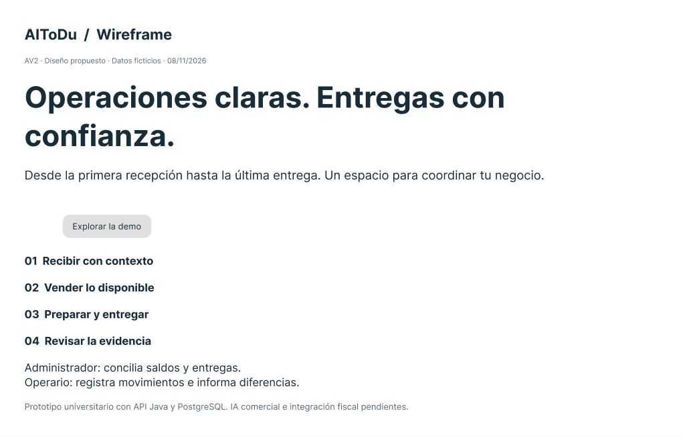

### 4.3.2. Landing Page Mock-up

El diseño publicado se encuentra en [ai-todu-platform](https://github.com/AI-ToDu/ai-todu-platform/tree/develop). El mockup de Figma siguiente conserva propósito, jerarquía y estilo como propuesta simplificada; la aplicación publicada conserva una composición más amplia. Se distingue el diseño propuesto de la captura de ejecución del capítulo V.

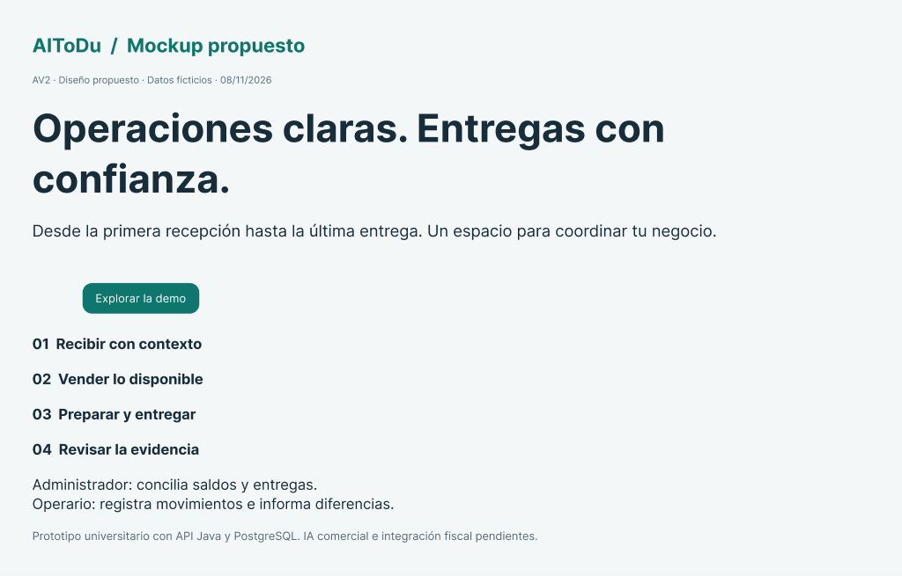

Versión móvil editable: [wireframe](https://www.figma.com/design/Kxkl1QhgvRiFthAN9O6CuW?node-id=3-2530) y [mockup](https://www.figma.com/design/Kxkl1QhgvRiFthAN9O6CuW?node-id=3-2874).

## 4.4. Web Applications UX/UI Design

### 4.4.1. Web Applications Wireframes

Acceso usa una composición de propósito y formulario. El workspace presenta navegación lateral, encabezado con rol/idioma y área central. Inventario usa tabla y diálogos; ventas usa catálogo/carrito; logística agrupa por estado. Los mensajes de carga/error/vacío conservan el contexto de la tarea.

Propuesta Figma: [inventario desktop](https://www.figma.com/design/Kxkl1QhgvRiFthAN9O6CuW?node-id=3-2459), [recepción desktop](https://www.figma.com/design/Kxkl1QhgvRiFthAN9O6CuW?node-id=3-2481), [inventario móvil](https://www.figma.com/design/Kxkl1QhgvRiFthAN9O6CuW?node-id=3-2579) y [recepción móvil](https://www.figma.com/design/Kxkl1QhgvRiFthAN9O6CuW?node-id=3-2601). El camino del operario conserva cada estado: saldo inicial, formulario y saldo actualizado; el regreso al inventario evita perder el contexto.

### 4.4.2. Web Applications Wireflow Diagrams


La secuencia corresponde a pantallas de Acceso, Inventario, Compras/recepción e Historial. Desktop conserva navegación lateral y tabla; móvil abre la navegación como panel y desplaza únicamente el contenedor de datos. Los formularios conservan sus datos al rechazarse la operación.


User goal del operario: registrar dos unidades y explicar el saldo. En el wireflow Figma: Acceso → Inventario → Registrar movimiento → Recepción → Saldo actualizado → Inventario. Hay puntos de inicio desktop/mobile; las conexiones son de diseño y no escriben en la base real.

### 4.4.3. Web Applications Mock-ups

La fuente de la vista publicada son los componentes Material y `src/styles.css`. La propuesta simplificada tiene frames de 1120 px y 390 px, con campos rotulados, acciones explícitas y textos que explican el estado. [Mockup de recepción móvil](https://www.figma.com/design/Kxkl1QhgvRiFthAN9O6CuW?node-id=3-2945). No se afirma una matriz exhaustiva de dispositivos ni equivalencia visual exacta con la implementación.

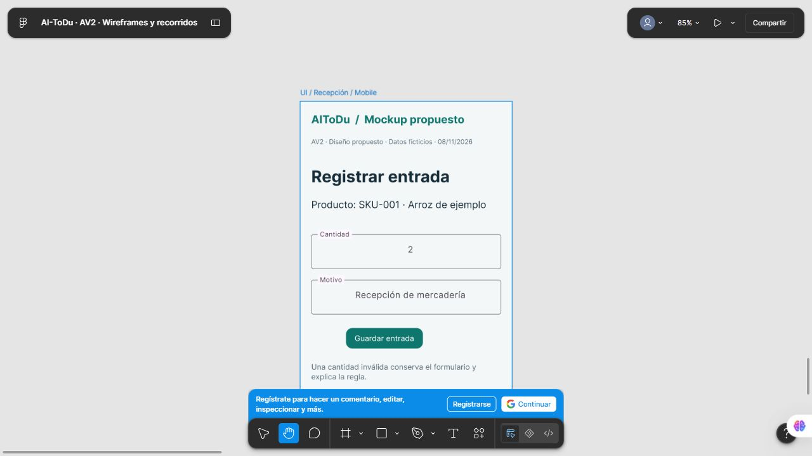

#### 4.4.3.1. Especificación por pantalla

La tabla describe la implementación y sus estados esperados; no afirma que cada estado tenga un frame individual en Figma ni que haya sido validado con usuarios. Las propuestas editables se enlazan en cada apartado y las capturas de ejecución se distinguen de los mockups.

| Pantalla | Propósito | Elementos principales | Estados y alternativas | Desktop / móvil |
| --- | --- | --- | --- | --- |
| Acceso | Entrar al espacio correcto | Correo, contraseña, idioma y enlace de registro | Cargando, credencial inválida, sesión válida | Panel/formulario en desktop; columna única y campos completos en móvil |
| Inventario | Explicar existencia y conservación | Búsqueda SKU/nombre, cantidad, mínimo, precio/costo PEN, acciones | Vacío, sin coincidencias, carga fallida, éxito | Tabla contenida; acciones accesibles sin desplazar toda la página |
| Movimiento | Registrar entrada, salida o merma | Producto, tipo, cantidad entera, motivo y saldo de referencia | Envío bloqueado, cantidad inválida, stock insuficiente | Diálogo con foco y etiquetas; ancho adaptado al viewport |
| Compras y recepción | Conciliar orden, recibido y pendiente | Proveedor, producto, unidades ordenadas, recepción parcial | Sin proveedor/artículo, exceso, recepción aceptada | Detalle legible y formulario por línea; UI inicial crea una línea por orden |
| Ventas | Confirmar solo lo disponible | Catálogo, carrito, unidades, total y comprobante académico | Carrito vacío, artículo bloqueado, falta de stock, confirmación | Catálogo/carrito lado a lado en desktop; secuencia vertical en móvil |
| Despachos | Asignar y acreditar la entrega | Ventas elegibles, conductor, vehículo, destino, estado y receptor | Recurso ocupado, transición inválida, receptor ausente, entregado | Grupos por estado; controles apilados y destino legible en móvil |
| Devoluciones | Conciliar unidades retornadas | Venta/línea, pendiente de retorno, RESTOCK/LOSS y motivo | Exceso, despacho activo, retorno aceptado | Formulario rotulado; estado y explicación junto a la acción |
| Notificaciones | Atender mensajes del negocio | Tipo, fecha, indicador de lectura y acción | Bandeja vacía, mensaje nuevo, leído | Lista con acción por elemento; sin depender solo del color |
| Dashboard | Relacionar saldo, venta y entrega | Ingresos, contribución bruta, valoración y contadores | Carga, sin operaciones, error y datos derivados | Tarjetas en columnas o apiladas; definición de contribución visible |
| Equipo | Provisionar permisos | Nombre, correo, rol y contraseña inicial | Correo repetido, rol inválido, éxito sin devolver contraseña | Formulario adaptable; acceso exclusivo de administrador |

### 4.4.4. Web Applications User Flow Diagrams



El camino principal sigue recibir → consultar saldo → vender → revisar comprobante → crear despacho → iniciar ruta → identificar receptor → confirmar entrega. Los caminos alternativos incluyen credencial inválida, stock insuficiente, artículo bloqueado, recepción excesiva y recurso ocupado. La matriz de pruebas distingue observación de navegador de pruebas del contrato.

User goal del administrador: relacionar una venta con la entrega. En los mockups conectados: Saldo actualizado → Venta → Venta confirmada → Despacho pendiente → Confirmar entrega → Entregado. La alternativa «Ver alternativa sin stock» lleva a Venta rechazada y permite corregir cantidad. Se conservan versiones desktop/mobile en el mismo archivo. Los otros rechazos se documentan en los criterios y las pruebas, sin atribuirles una conexión que no se creó en Figma.

## 4.5. Web Applications Prototyping

TB1 es un prototipo funcional con dos transportes que comparten motor: HTTP local con archivo persistente y Service Worker con IndexedDB para hosting estático. La demo no emite documentos fiscales, realiza cobros, envía invitaciones ni comparte datos entre navegadores. El prototipo permite revisar interacción y consistencia antes del servidor AV2.

AV2 añade la webapp conectada al servidor y la propuesta navegable Figma con cuatro puntos de inicio (wireflow/prototipo, desktop/mobile). Las conexiones de diseño se registraron estructuralmente y se revisaron vistas representativas; la grabación y validación completa del prototipo se mantienen pendientes. El límite de consultas del conector Figma impidió completar todas las exportaciones individuales en esta revisión.

## 4.6. Domain-Driven Software Architecture

### 4.6.1. Design-Level Event Storming

El modelo representa tres flujos de AV2 a partir del código. Los roles de almacén, ventas y logística disparan sus respectivos comandos, y el administrador también tiene acceso a esas operaciones. En una salida de inventario, `StockBelowMinimum` aparece solo cuando el saldo pasa de estar por encima del mínimo a quedar en el mínimo o por debajo. En una venta, la falta de stock en cualquier línea revierte los cambios de todas las líneas. En una entrega, el manifiesto debe estar en tránsito. El modelo sirve como evidencia de diseño basada en la implementación.


Los publishers del contexto propietario traducen `StockBelowMinimum`, `SaleConfirmed` y `DeliveryConfirmed` a mensajes de integración v1. La política de Notifications es registrar una notificación por cada uno de esos mensajes. `NotificationService.accept` ejecuta la política y usa `eventId` para identificar el registro. La bandeja se consulta por separado con `GET /api/v1/notifications`. La [secuencia del Outbox](#4611-transactional-outbox-pattern) muestra la entrega posterior al commit, el rollback ante un fallo del consumidor y el reintento. Las relaciones entre contextos se detallan en el [Context Map](design/diagrams/rendered/context-map.svg) y el [análisis arquitectónico](design/architecture.md).

#### 4.6.1.1. Transactional Outbox Pattern

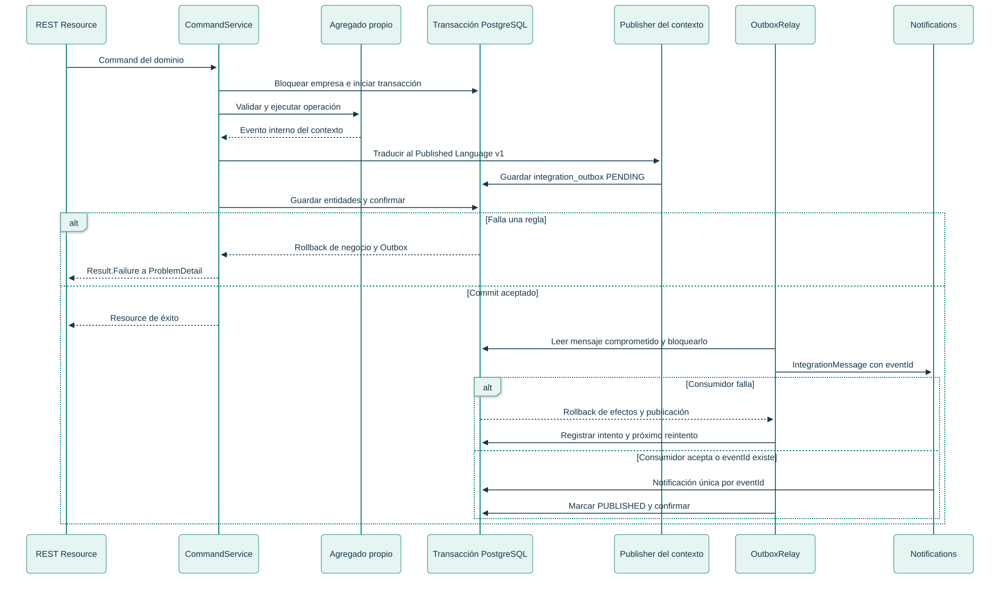

El problema de doble escritura aparece si se confirma la operación de negocio y el proceso falla antes de comunicarla. El patrón guarda el cambio y el mensaje público en la **misma transacción**. JpaIntegrationOutbox exige transacción existente (MANDATORY); una regla rechazada elimina ambos mediante rollback. El evento interno solo lo maneja su contexto: InventoryIntegrationPublisher, SaleIntegrationPublisher y DeliveryIntegrationPublisher lo traducen a IntegrationMessage/Published Language v1 antes de persistirlo.

OutboxRelay lee hasta 25 mensajes PENDING cuyo next_attempt_at ha vencido; bloquea cada fila, llama a suscriptores locales y marca PUBLISHED. Ante fallo revierte efectos y registra attempts, last_error y próximo reintento en otra transacción. La demora crece con límite de 300 segundos. Notifications usa el eventId como clave persistida; una reentrega no crea otra notificación. La entrega es eventual y admite reintentos: no se promete transporte exactly-once.

| Evidencia de código/prueba | Qué demuestra | Límite |
| --- | --- | --- |
| V2 / integration_outbox | Mensajes, estado, intentos y próxima ejecución persistidos | Esquema propio de la aplicación |
| messageRollsBackWithFailedCommand | Un comando rechazado no deja mensaje Outbox | Prueba de integración, no caída de máquina |
| retryAfterFailureAndDuplicateDeliveryAreDurable | Fallo, rollback del consumidor, reintento y efecto idempotente | Mismo proceso y relay local |
| notifications.id = eventId | Identidad estable del efecto consumidor | No constituye un inbox genérico para todos los consumidores |

El relay y Notifications comparten PostgreSQL y transacción local al consumir. No se implementó broker externo, dead-letter queue ni prueba de reinicio de proceso; esas capacidades no se atribuyen a esta evidencia. El Outbox durable conserva pendientes para una ejecución posterior.

#### 4.6.1.2. Context Map de AV2


Las flechas continuas entre contextos muestran quién consume el contrato de quién. `InventoryGateway.take` y `SalesGateway.claim` traducen datos al modelo del consumidor. Compras y Devoluciones invocan fachadas públicas, y Reporting combina consultas públicas. Los mensajes de integración siguen la ruta punteada del productor al Outbox y a Notifications. IAM aporta la identidad autenticada a la API REST, que funciona como Open Host Service. El [análisis arquitectónico](design/architecture.md#bounded-contexts-in-review-order) detalla las operaciones de cada relación.

### 4.6.2. Software Architecture Context Diagram


C1 muestra personas y propósito del sistema. No incluye pasarelas fiscales o proveedores de IA que el prototipo no integra.

### 4.6.3. Software Architecture Container Diagrams


Vista principal AV2: monolito modular Spring Boot y PostgreSQL. La SPA usa HTTPS hacia Render; la API conecta su base aislada por red privada y consulta Open-Meteo mediante un gateway. Un bounded context no equivale a un microservicio.

**Referencia histórica TB1:**


TB1 sirve archivos estáticos y ejecuta la Fake API en el navegador; el adaptador Node/archivo es una alternativa de desarrollo local.

### 4.6.4. Software Architecture Components Diagrams


Los controladores dependen de CommandService/QueryService. Los handlers coordinan puertos y agregados propios; adaptadores JPA y assemblers mantienen entidades persistentes separadas. Las consultas no ejecutan comandos. El Outbox se guarda antes del commit y el relay procesa los mensajes comprometidos.

**Referencia histórica TB1:**


## 4.7. Software Object-Oriented Design

### 4.7.1. Class Diagrams


Vista principal del incremento Java: InventoryItem, Sale, PurchaseOrder y DispatchManifest; sus colecciones internas se reconstruyen con assemblers de persistencia. Los comandos/consultas pertenecen al dominio, las interfaces CommandService/QueryService delimitan los casos de uso y las implementaciones internas coordinan transacciones. Los controladores dependen de esos contratos y los assemblers REST construyen los recursos. Las vistas TB1 siguientes se conservan como historial del prototipo.


La tabla siguiente corresponde al modelo histórico de TB1. En AV2, `Money` conserva centavos en un `long`, `Quantity` es un entero y `DispatchManifest` valida su destino como texto y contiene `DeliveryEvidence` (receptor/fecha). `Sale` y `PurchaseOrder` son agregados independientes. La separación entre clases Java de dominio y entidades JPA se comprueba en el repositorio API; `Address` y `SaleSummary` del dibujo histórico no se presentan como clases actuales del backend.

| Objeto TB1 | Semántica del prototipo | Representación en frontera TB1 |
| --- | --- | --- |
| Sku | Normalización y validación; inmutable. | Cadena JSON / columna `sku` única por empresa. |
| Quantity | Entero no negativo, positivo cuando el comando lo exige; límite explícito. | Número JSON / entero SQL con restricción. |
| Money | PEN, precisión de centavos, valor finito/no negativo; inmutable. | Número de importe en API de demo; centavos enteros en diseño SQL. |
| Address | Texto normalizado con longitud válida; inmutable. | Recurso de frontera / columna del prototipo. |
| InventoryItem | Identidad estable; entrada/salida y aptitud de venta. | Recurso de producto y adaptador de demo. |
| SaleSummary | Total validado en centavos, sin aritmética acumulada de decimales. | Total serializado; snapshot de líneas. |
| DispatchManifest | Destino y transición PENDING → IN_TRANSIT → DELIVERED. | Recurso de despacho y adaptador de demo. |

JSON y SQL requieren tipos de transporte/persistencia; eso no elimina el valor semántico del dominio. El servidor usa InventoryItem, Sale, PurchaseOrder y DispatchManifest con operaciones e invariantes; no trata cada fila persistente como agregado independiente. Los precios/costos históricos se conservan en la venta y no se recalculan desde un catálogo modificado.

## 4.8. Database Design

### 4.8.1. Database Diagrams

**Vista principal AV2: 19 tablas ejecutadas**, además del historial Flyway. [Diccionario físico por columna y restricción](design/database/dictionary-av2.md). La vista completa siguiente representa las FK del DDL; una FK entre tablas no autoriza importar el agregado de otro bounded context.


[Poster físico completo ampliable](design/diagrams/rendered/erd-av2.svg). Las vistas de detalle siguientes muestran las columnas reales por grupo; las FK entre grupos se consultan en el poster y el diccionario. No se añaden asociaciones de dominio como si fueran FK implementadas.

**IAM, coordinación e integración:**


**Inventario y ventas:**


**Abastecimiento y devoluciones:**


**Logística:**


**Modelo objetivo e histórico de referencia:**

El [DDL](design/database/schema.sql) contiene **35 tablas** con nombres físicos en minúsculas y `snake_case`, claves, unicidad, restricciones y referencias por empresa. [El diccionario](design/database/dictionary.md) enumera cada columna. Se ejecutó en SQLite como referencia; TB1 usa 35 colecciones JSON. **AV2 implementa 19 tablas de negocio/infraestructura**, además de flyway_schema_history, definidas por sus [migraciones PostgreSQL](https://github.com/AI-ToDu/ai-todu-api/tree/main/src/main/resources/db/migration). No se declara implementada automáticamente toda la referencia de 35 tablas.

| Área lógica | Tablas | Capacidad operativa actual y brecha |
| --- | --- | --- |
| Identidad y empresa | 7 | Registro, roles, sesión y provisión de empleado. Activación, recuperación e invitación pendientes; suscripciones fuera del modelo actual. |
| Inventario | 8 | Catálogo, saldo, entradas/salidas, pérdidas e historial. Categorías/unidades/ubicación de referencia; variantes, lotes y múltiples ubicaciones sin flujo completo. |
| Abastecimiento | 5 | Maestro de proveedores, orden y recepción parcial. API admite varias líneas; formulario inicial trabaja un SKU por orden. Aprobación pendiente. |
| Ventas | 5 | Venta, detalle, pago demo y comprobante histórico. Consulta de cliente de referencia; maestro de clientes sin flujo de UI completo. Sin cobros/fiscalidad real. |
| Logística | 7 | Maestros de conductor/vehículo, manifiesto, líneas, una parada, estados, receptor, intento exitoso e incidencias. Varias paradas, intentos fallidos/capacidad/rutas pendientes. |
| Devoluciones | 2 | Flujo por línea con disposición reintegrar/pérdida y límite de cantidad. Sin reembolso real, cambio ni reexpedición. |
| Notificaciones | 1 | Generación por movimiento bajo mínimo, bandeja y lectura. Sin correo/push ni alertas de vencimiento operativas. |
| **Total** | **35** | **La existencia de una tabla o colección no acredita una funcionalidad completa.** |

Los ERD se dividen para conservar legibilidad: [Inventario](design/diagrams/rendered/erd-inventory.svg), [Logística](design/diagrams/rendered/erd-logistics.svg), [Abastecimiento](design/diagrams/rendered/erd-procurement.svg), [Ventas](design/diagrams/rendered/erd-sales.svg), [Devoluciones](design/diagrams/rendered/erd-returns.svg), [Notificaciones](design/diagrams/rendered/erd-notifications.svg) e [Identidad](design/diagrams/rendered/erd-identity.svg). El DDL es la referencia completa para relaciones entre áreas.

La venta y sus salidas de stock se confirman en una sola transacción. Las pruebas cubren la reversión de todas las líneas ante falta de stock y la venta concurrente de la última unidad. Las notificaciones aparecen después del commit a través del Outbox. El [ADR de consistencia](design/architecture.md#adr-004--atomic-commands-and-workspace-locking) identifica las demás operaciones que comparten una transacción y la regla que protege cada una.

Las migraciones AV2 usan FK por UUID y FK compuestas, según la relación. Por ejemplo, `sale_lines.product_id` comprueba la existencia del producto y `customer_returns(tenant_id, sale_id)` comprueba la pertenencia de la venta a la empresa. La aplicación valida el alcance del workspace en sus consultas y fachadas. El [ADR del esquema](design/architecture.md#adr-006--implemented-schema-versus-target-model) documenta las dependencias físicas que se conservan entre contextos. AV2 usa nombres `snake_case`, centavos enteros, converters para valores simples y embeddables para valores compuestos. Los datos de demo en el navegador y los datos del servidor se almacenan por separado.

#### 4.8.1.1. Esquema ejecutado del incremento AV2

| Área | Tablas PostgreSQL implementadas |
| --- | --- |
| IAM y coordinación | workspaces, workspace_locks, users, sessions |
| Inventario | inventory_items, stock_movements |
| Ventas | sales, sale_lines |
| Logística | drivers, vehicles, dispatches, dispatch_lines, delivery_incidents |
| Compras | suppliers, purchase_orders, purchase_lines |
| Devoluciones | customer_returns |
| Integración | integration_outbox, notifications |

Flyway aplica V1–V4 y Hibernate valida el esquema sin generarlo en producción. CI ejecuta las pruebas con PostgreSQL 17. El saldo, su movimiento y la venta se confirman en una transacción. No se implementa event sourcing ni un ledger fiscal.

---

# Capítulo V: Product Implementation, Validation & Deployment

## 5.1. Software Configuration Management

### 5.1.1. Software Development Environment Configuration

| Producto / artefacto | Tecnología efectiva | Responsabilidad |
| --- | --- | --- |
| Frontend | Angular 22, TypeScript, Angular Material/CDK, CSS | Workspace responsive, UI/i18n y adaptador HttpClient. |
| Landing | HTML, CSS y JavaScript nativos | Propósito, capacidades, recorrido, CTA y contacto del proyecto. |
| Fake API | JavaScript ESM, Node 24 `node:http`; Service Worker e IndexedDB | Contrato de demo, invariantes y persistencia. |
| Pruebas | `node:test`, SQLite integrado de Node, compilador Angular | Dominio, HTTP real, concurrencia/persistencia, esquema y cobertura de traducciones. |
| Informe | Markdown, Mermaid/SVG y generadores versionados | README completo, fuentes únicas, comprobación y exportación. |
| Backend AV2 | Java 21 / Spring Boot 4.1.2 / JPA / PostgreSQL 17 / Flyway | API con dominio agnóstico, JWT, roles, transacciones y Outbox. |

El repositorio incluye lockfile cuando instala dependencias. La Fake API y landing no requieren paquetes de ejecución. Se usan datos ficticios y archivos de estado excluidos de Git. El tablero de cierre AV2 está enlazado en §5.2.3.3; se retiraron referencias a nombres de repositorios inexistentes, enlaces de ejemplo y herramientas declaradas sin evidencia de uso.

### 5.1.2. Source Code Management

| Repositorio individual | Artefacto | Rama para esta revisión |
| --- | --- | --- |
| [ai-todu-webapp](https://github.com/AI-ToDu/ai-todu-webapp) | Frontend y transporte AV2 | `fix/av2-api-integration` |
| [ai-todu-platform](https://github.com/AI-ToDu/ai-todu-platform) | Landing y acceso al servidor AV2 | `fix/av2-platform-scope` |
| [ai-todu-fake-api](https://github.com/AI-ToDu/ai-todu-fake-api) | Fuente canónica de Fake API, contrato y pruebas | `fix/tb1-readiness` |
| [ai-todu-report](https://github.com/AI-ToDu/ai-todu-report) | Informe, arquitectura y datos | `fix/av2-report-alignment` |
| [ai-todu-api](https://github.com/AI-ToDu/ai-todu-api) | Backend, contratos, migraciones y CI | `fix/av2-domain-foundation` y `fix/av2-runtime-configuration` |

**Workflow:** `main` conserva la línea estable; `develop` integra trabajo; las ramas nuevas usan `fix/<scope>`. AV2 se integra mediante PR con comprobaciones de CI antes del merge. No se reescriben commits históricos ni se atribuyen las correcciones asistidas a otros integrantes. Para el frontend se incorpora `develop` desde la base original de `main`. En landing, la rama predeterminada original ya era `develop`; se documenta esta transición antes de normalizar una futura rama estable, sin mover la publicación durante la revisión.

Los cuatro bloques de corrección son: **(1) integración funcional con Fake API; (2) interfaz, landing e idiomas; (3) DDD/C4/datos; (4) informe, trazabilidad y guía de revisión**. Cada repositorio registra un commit por bloque aplicable; no se crean commits vacíos para aumentar un contador. El paquete nuevo registra además su inicialización real. Los hashes y PR vigentes se consultan en Git, sin duplicar un historial que pueda quedar desactualizado.

El frontend conserva un manifiesto de procedencia y hashes del motor vendorizado desde la Fake API. Su prueba de integridad detecta cambios no sincronizados. Esta decisión permite servir el demo desde hosting estático y mantener un repositorio individual revisable para el contrato.

### 5.1.3. Source Code Style Guide & Conventions

TypeScript/JavaScript usan identificadores en inglés, `PascalCase` para clases y `camelCase` para funciones/DTOs. Nombres físicos SQL usan **minúsculas snake_case**. Objetos de valor y reglas de dominio se separan de UI, transporte y almacenamiento. Las vistas se agrupan por contexto; nuevas funcionalidades se exponen mediante servicio de aplicación y contrato, evitando introducir reglas de stock en el componente.

Los mensajes visibles se resuelven por clave en `en_US`/`es_419`; el API emite códigos de error estables. Un mensaje nuevo requiere ambas traducciones y revisión de accesibilidad. No se utilizan números inventados en Overview ni testimonios no autenticados en la landing.

### 5.1.4. Software Deployment Configuration

| Acceso | URL / comando | Estado y límite |
| --- | --- | --- |
| Landing pública existente | [GitHub Pages](https://ai-todu.github.io/ai-todu-platform/) | Canal estático público y CTA hacia la webapp. |
| Webapp pública existente | [GitHub Pages](https://ai-todu.github.io/ai-todu-webapp/) | GitHub Actions desde main; PR AV2 #5 integrado con CI aprobado. |
| Workspace + Fake API HTTP | `npm ci` y `npm run demo`, frontend | Sirve interfaz compilada y API en `http://127.0.0.1:8850/?api=http`. |
| Fake API independiente | `npm test`; `npm start -- --port 8853` | API local `/api/v1`, sin frontend compilado. |
| Modo estático | Build Pages y origen HTTPS o localhost | Worker/IndexedDB por origen/perfil; no servidor público REST. |

El workflow de verificación revisa ramas `fix/**` y PR. El workflow Pages de la webapp se restringe a `main` después de revisión; exige configurar GitHub Pages como **GitHub Actions** al publicar. Actions y la publicación de webapp se comprobaron; el servidor AV2 se verifica por separado. La navegación usa hash para rutas estáticas y el build fija `base-href` `/ai-todu-webapp/`. Se conserva el selector de idioma y CTA de la landing.

## 5.2. Landing Page, Services & Applications Implementation

La estructura siguiente recupera **Sprint 1 y Sprint 2**. La reconstrucción documental no acredita reuniones, horas ni transiciones históricas que no fueron registradas. La corrección técnica se ejecuta el 30/10/2026; las fechas/participantes de la planificación original y el tablero deben completarse con evidencia del equipo.

### 5.2.1. Sprint 1

#### 5.2.1.1. Sprint Planning 1

**Hito:** AV1 / primera landing y diseño. **Fuente temporal:** historial de landing y report. **Planning original:** fecha, duración, asistentes y decisiones pendientes de confirmar. **Goal propuesto para corregir el formato**, según enunciado p. 24:

> Our focus is on helping potential business owners and warehouse operators understand the traceable inventory-to-delivery proposal. We believe it delivers a clear basis for deciding whether to try the product to these two user segments. This will be confirmed when visitors can identify the product purpose, find the relevant capabilities and reach the demo entry point from the landing.

**Cobertura propuesta:** US05, US06, US08, US33, US34; suma de 12 SP de backlog. Velocity histórica y compromiso original: sin registro verificado.

La meta describe outcome, impacto, clientes y evento de confirmación. La implementación actual permite revisar el recorrido; su comprensión por usuarios reales requiere sesión de validación.

#### 5.2.1.2. Aspect Leaders and Collaborators

El historial de landing contiene aportes de los cinco integrantes. El nombramiento formal de leaders/collaborators por Development, Execution, Documentation y Deployment no quedó acreditado por una lista firmada o acta accesible. Se debe ratificar la matriz del equipo; no se reconstruye liderazgo a partir de una cantidad de commits.

#### 5.2.1.3. Sprint Backlog 1

Descomposición de referencia para recuperar el alcance, con **estimaciones propuestas**, no horas trabajadas. Story points se consultan en el backlog canónico y no se convierten a horas.

| Task | Historia | Engineering task | Est. | Evidencia / estado actual |
| --- | --- | --- | --- | --- |
| S1-T01 | US05 | Implementar estructura semántica de propósito y navegación. | 4 h | Landing actual; trazabilidad histórica por confirmar. |
| S1-T02 | US06 | Implementar capacidades y flujo del producto con alcance explícito. | 4 h | Secciones actuales y CTA. |
| S1-T03 | US08 | Conectar contacto real y revisar destinos de navegación. | 4 h | Enlace al proyecto; formulario B2B pendiente. |
| S1-T04 | US33–US34 | Incorporar idiomas, términos y privacidad accesibles. | 6 h | Implementación actual; validar con usuarios. |
| S1-T05 | US05–US06 | Revisar móvil/teclado y publicar versión revisada. | 4 h | Revisión local; merge y publicación pendientes de aprobación. |

**Seguimiento histórico To Do / In Process / To Review / Done:** pendiente de tablero exportado o enlace accesible. Esta tabla no simula transiciones históricas.

#### 5.2.1.4. Development Evidence for Sprint Review

Los commits originales de [landing](https://github.com/AI-ToDu/ai-todu-platform/commits/develop/) y capítulos AV1 enlazados en Student Outcome acreditan cambios de archivos. El rediseño de esta corrección tiene su propio commit de bloque 2. Se evita asociar capturas de otro producto con la versión actual.

#### 5.2.1.5. Execution Evidence for Sprint Review

La landing se sirve localmente y se revisan navegación, selector de idioma, CTA, términos y móvil. Se debe adjuntar video de exposición AV1 con fecha/audiencia si se usa como evidencia de ejecución histórica. Las pruebas actuales de enlaces e idiomas corresponden a la corrección.

#### 5.2.1.6. Services Documentation Evidence for Sprint Review

Sprint 1 no acredita un servidor productivo. El alcance documentado es landing/diseño. Los servicios de TB1 se describen con Fake API/OpenAPI en Sprint 2; Spring Boot/PostgreSQL queda para AV2.

#### 5.2.1.7. Software Deployment Evidence for Sprint Review

La URL pública de landing figura en configuración. El historial público y configuración de Pages son evidencia distinta del navegador local. El rediseño se integró en una revisión posterior; el [PR #4 de AV2](https://github.com/AI-ToDu/ai-todu-platform/pull/4) ajusta el alcance y el acceso al servidor, sin atribuir esta revisión a la entrega histórica de Sprint 1.

#### 5.2.1.8. Team Collaboration Insights during Sprint

Hay contribuciones históricas de los cinco integrantes en landing. Hace falta vincular cada acción con tarea y revisión. Una captura de Insights o un contador no demuestra por sí solo planificación, colaboración continua ni revisión cruzada. Se solicita el tablero real y enlaces de PR de la entrega original.

### 5.2.2. Sprint 2

#### 5.2.2.1. Sprint Planning 2

**Hito:** TB1, frontend integrado con Fake REST API. **Corrección actual:** 30/10/2026. **Planning histórico:** calendario/asistentes pendientes. **Sprint Goal de corrección:**

> Our focus is on enabling a traceable receiving-to-delivery workflow in the TB1 prototype. We believe it delivers confidence in stock and delivery records to business owners, warehouse operators and logistics operators. This will be confirmed when receiving two of four ordered units, selling two units and delivering that sale leaves a reconciled stock balance, historical demo receipt and delivery recipient that survive a page reload.

**Cobertura de corrección referenciada:** 25 historias, 99 SP de backlog. No representa velocity medida ni un compromiso histórico de capacidad. El equipo debe acordar capacidad y selección final con su calendario real.

La confirmación técnica se observa en el recorrido local. El impacto de confianza es una hipótesis que debe validarse con usuarios. **Fuera de este goal:** cobros reales, SUNAT, IA, rutas optimizadas y servidor Java de producción.

#### 5.2.2.2. Aspect Leaders and Collaborators

| Aspecto | Evidencia histórica disponible | Validación pendiente |
| --- | --- | --- |
| Development | Carlos/IAM, Fernando/inventario, Darikson/POS-reporting, Luis/logística y Kevin/base-documentación; commits en Student Outcome. | Ratificar leaders/collaborators y enlazar tareas. |
| Execution | Pruebas automatizadas y recorrido local de la corrección. | Evidencia individual de ejecución y demostración original. |
| Documentation | Contribuciones AV1 y nueva revisión asistida autorizada por Kevin. | Revisión cruzada y reflexión individual por entrega. |
| Deployment | URLs/configuración de Pages y workflows preparados. | Responsable real, aprobación y evidencia del despliegue de la versión revisada. |

#### 5.2.2.3. Sprint Backlog 2

Las tareas siguientes son la descomposición **actualizada de corrección**; las horas son estimaciones propuestas entre 4 y 8 horas, no una declaración retroactiva de esfuerzo. El ejecutor técnico de esta corrección es trabajo asistido autorizado por Kevin; no se distribuye autoría ficticia entre integrantes.

| Task | Historias | Engineering task | Est. | Evidencia de aceptación |
| --- | --- | --- | --- | --- |
| S2-T01 | US01–US03, US29 | Implementar sesión, rol y consultas por tenant en la Fake API. | 6 h | Pruebas de autenticación, autorización y aislamiento. |
| S2-T02 | US09–US14 | Persistir catálogo/movimientos y validar SKU, saldo y conservación. | 6 h | Pruebas de SKU, cantidades y producto bloqueado. |
| S2-T03 | US35 | Implementar proveedor/orden/recepción parcial atómica. | 6 h | Recepción 2/4 y rechazo de exceso/duplicación. |
| S2-T04 | US15–US18 | Integrar carrito, stock y comprobante histórico; anulación única. | 8 h | Sobreventa/concurrencia y reintegro una vez. |
| S2-T05 | US19–US22, US37 | Integrar venta, recursos, transición e identificación del receptor. | 8 h | Recorrido de entrega y conflicto de recursos. |
| S2-T06 | US23, US26, US36 | Integrar devolución, métricas derivadas y bandeja de alertas. | 6 h | Límites de devolución y consistencia del resumen. |
| S2-T07 | US33–US34 | Aplicar Material/responsive, localización y estados accesibles. | 6 h | Compilación, cobertura de traducciones y revisión móvil. |
| S2-T08 | Transversal | Revisar DDD, VO, C4, DDL/ERD y alcance real de 35 tablas. | 8 h | Diagramas renderizados y restricciones SQL ejecutadas. |
| S2-T09 | Transversal | Corregir informe, evidencias, versiones y guía de revisión. | 6 h | README reproducible, enlaces/imágenes y matriz de pendientes. |
| S2-T10 | Transversal | Ejecutar verificación y preparar PR/CI de cada producto. | 4 h | Resultados locales y PR de revisión; merge posterior. |

La tabla no reemplaza el tablero con transiciones y responsables reales. El equipo debe incorporar estos items a su herramienta y conservar la evidencia progresiva, sin backdating.

#### 5.2.2.4. Development Evidence for Sprint Review

Los seis commits iniciales de la webapp se conservan íntegros. La rama de corrección registra bloques de cambios concretos; la nueva Fake API dispone de repositorio propio. El front usa HttpClient y llamadas por contrato: los componentes no modifican directamente un arreglo en memoria como persistencia final.

Los objetos de valor son inmutables y los agregados/servicios de aplicación validan el comando antes de confirmar el draft. La copia de demo del frontend se verifica por hash frente al paquete canónico. El modelo SQL sigue siendo una base de diseño AV2; no se presenta como JPA desplegado.

#### 5.2.2.5. Execution Evidence for Sprint Review

| Verificación | Observación y límite |
| --- | --- |
| Dominio/API | Pruebas automatizadas de cantidades, SKU, conservación, sobreventa, anulación, recepción parcial, despacho, devolución, roles y tenant. |
| HTTP real | Dos solicitudes concurrentes contra stock 8, cada una por 5: una aceptada y otra rechazada; saldo 3 conserva persistencia después de reiniciar servidor. |
| Datos | DDL ejecutado en SQLite; saldo negativo y referencia cruzada entre empresas rechazados. No valida aún PostgreSQL/JPA. |
| Integración por navegador | Compra de 4 unidades de arroz, recepción de 2, venta de 2 por PEN 290 y despacho hasta entrega con receptor. Overview derivó contribución PEN 70 y stock valorizado PEN 1,510. |
| Sesión ante fallo | Fixture aislado respondió 503 en logout; la UI eliminó la sesión local y mostró acceso. La sesión del servidor no se declaró revocada cuando este falló. |
| Hosting estático | Acceso y creación de MEM-001 mediante worker/IndexedDB sin backend; al recargar el registro permanece. Worker empaquetado en un solo .js para evitar dependencia de MIME .mjs. |
| Internacionalización | Inglés predeterminado y claves cubiertas en español latinoamericano; revisión del cambio de idioma. |
| Compilación | Build de producción y build Pages, sin relajar el presupuesto original de 500 kB para el bundle inicial. |
| Despliegue | Pruebas locales de la revisión; versión pública posterior al merge/aprobación. |


Son datos ficticios de prueba, no ventas reales ni un estudio de eficiencia de negocio. El recibo es explícitamente no fiscal. La compilación y las pruebas no prueban por sí solas usabilidad ni colaboración del equipo.

#### 5.2.2.6. Services Documentation Evidence for Sprint Review

El [OpenAPI de la Fake API](https://github.com/AI-ToDu/ai-todu-fake-api/blob/fix/tb1-readiness/openapi.json) especifica rutas, cuerpos, errores y sesión demo. Contiene solo operaciones implementadas. Recuperación de contraseña, cambio de perfil/contraseña, planes y captación B2B siguen pendientes. Cambios frente a los Technical Stories se listan en el capítulo III.

El transporte HTTP local y el worker consumen el mismo motor. La URL de Pages `/api/v1` se intercepta en navegador después de instalar el worker; no es un backend remoto accesible mediante curl. El archivo JSON local y el IndexedDB no sincronizan dispositivos.

#### 5.2.2.7. Software Deployment Evidence for Sprint Review

El workflow de verificación ejecuta checks en fix/PR. El frontend incluye build con ruta base Pages y un workflow de despliegue para versión revisada. Pages cambió a GitHub Actions el 7/11; el incremento AV2 se publica desde main el 8/11. La existencia de un PR no se registra como despliegue completado.

#### 5.2.2.8. Team Collaboration Insights during Sprint

Los aportes originales se enlazan por integrante y módulo. La corrección no intenta suplir colaboración con volumen de commits: registra trabajo asistido y deja revisión cruzada pendiente. Para completar la evidencia, cada integrante debe revisar su contexto, ejecutar un caso principal/alternativo, comentar un PR y explicar una decisión en la exposición con marca de tiempo.

### 5.2.3. Sprint 3

#### 5.2.3.1. Sprint Planning 3

**Hito:** AV2, semana 12. **Registro técnico:** 7–8/11/2026. Calendario, asistentes, duración de ceremonia y compromiso de capacidad no están acreditados. La selección siguiente documenta el incremento trabajado; no reconstruye una reunión.

> Our focus is on enabling an authorized workspace to reconcile receiving, sales and delivery through the deployed API. We believe it delivers a shared and traceable operational record to business owners and warehouse operators. This will be confirmed when a sale and its delivery preserve stock, historical amounts and recipient across sessions, concurrent sales cannot oversell, and invalid or unauthorized operations leave no partial changes.

El criterio técnico se prueba con datos ficticios; la confianza del usuario se contrasta cualitativamente en cinco recorridos guiados. **Responsable actual de priorización, desarrollo y seguimiento: Kevin Junior Salazar Marquina.** No se acredita una ceremonia ni una asignación formal separada de Product Owner y Scrum Master. Los aportes históricos mantienen su atribución.

| Sprint Planning Background | Registro |
| --- | --- |
| Sprint | 3 / AV2 / semana 12 |
| Date / Time / Location | Pendiente: fecha, hora y lugar reales de la ceremonia |
| Prepared by | Kevin Junior Salazar Marquina, con preparación técnica asistida |
| Attendees | Pendiente de acta o tablero; no se presume asistencia de integrantes retirados |
| Review of previous Sprint | Evidencias TB1 y AV1 conservadas; conclusiones de la reunión pendientes |
| Retrospective of previous Sprint | Pendiente de registro real y acciones acordadas |
| Sprint Goal | Conciliar recepción, venta y entrega mediante API, conservando saldo e importes históricos |
| Sprint Goal Metric | Flujo persistente y rechazos atómicos; cobertura HTTP de las 34 operaciones; aceptación humana pendiente |
| Sprint Velocity | No medida: falta fuente de puntos completados de sprints anteriores |
| Sum of Story Points | Pendiente de estimación del equipo; horas de tareas no equivalen a story points |

#### 5.2.3.2. Aspect Leaders and Collaborators

| Aspecto | Actividad verificada | Responsable y límite |
| --- | --- | --- |
| Development | Backend Java e integración Angular en PR | Trabajo asistido autorizado por Kevin; sin atribuirlo a otros integrantes |
| Execution | Pruebas locales, CI PostgreSQL y recorrido HTTP público | Ejecución técnica asistida; demostración/reflexión individual pendientes |
| Documentation | Informe, OpenAPI y README | Revisión asistida; aprobación académica y reflexiones pendientes |
| Deployment | Pages y API gratuita con PostgreSQL aislado | Autorización de Kevin; evidencias técnicas enlazadas |

La siguiente matriz registra la **responsabilidad actual de AV2**, sin reconstruir colaboración histórica. **L:** responsable del aspecto; **—:** sin nueva participación acreditada en este incremento. La asistencia técnica no se registra como un integrante del equipo.

| Aspecto | Kevin | Carlos | Luis | Fernando | Darikson |
| --- | --- | --- | --- | --- | --- |
| Development | L | — | — | — | — |
| Execution | L | — | — | — | — |
| Documentation | L | — | — | — | — |
| Deployment | L | — | — | — | — |

La matriz no es una calificación, acta de reunión ni registro de horas. Los aportes de AV1/TB1 se conservan con sus fuentes.

#### 5.2.3.3. Sprint Backlog 3

Estimaciones de referencia, no horas registradas ni capacidad medida. La prioridad sigue core → soporte → genérico; autenticación es una dependencia técnica, no el primer objetivo del negocio.

| Story Id | Story Title | Task Id | Task Title | Task Description | Estimation (Hours) | Assigned To | Status |
| --- | --- | --- | --- | --- | --- | --- | --- |
| US09 | Registro de artículo | S3-T01 | Implementar InventoryItem, VOs, movimientos y persistencia separada | Implementar InventoryItem, VOs, movimientos y persistencia separada. Evidencia: Reglas, migraciones y rollback. Cobertura asociada: US10–US14. | 8 h | Kevin Salazar | To-Review |
| US15 | Creación de venta | S3-T02 | Confirmar/anular ventas atómicas con concurrencia e idempotencia | Confirmar/anular ventas atómicas con concurrencia e idempotencia. Evidencia: Solo una de seis ventas de la última unidad se acepta. Cobertura asociada: US16–US18, TS35. | 8 h | Kevin Salazar | To-Review |
| US19 | Manifiesto de despacho | S3-T03 | Preparar/iniciar/entregar manifiesto con recursos existentes | Preparar/iniciar/entregar manifiesto con recursos existentes. Evidencia: Receptor y saldo sin doble descuento. Cobertura asociada: US20–US22, US37. | 8 h | Kevin Salazar | To-Review |
| US35 | Abastecimiento y recepción parcial | S3-T04 | Implementar compra y recepción parcial acotada | Implementar compra y recepción parcial acotada. Evidencia: Exceso y líneas repetidas rechazados. Cobertura asociada: TS28–TS30. | 8 h | Kevin Salazar | To-Review |
| US36 | Devolución trazable | S3-T05 | Conciliar devoluciones e indicadores | Conciliar devoluciones e indicadores. Evidencia: Restock/loss y límite de devolución. Cobertura asociada: US23. | 4 h | Kevin Salazar | To-Review |
| US26 | Alerta de stock mínimo | S3-T06 | Traducir eventos internos a PL v1 con Outbox e inbox | Traducir eventos internos a PL v1 con Outbox e inbox. Evidencia: Fallo/reintento y reentrega sin duplicación. Cobertura asociada: TS34. | 8 h | Kevin Salazar | To-Review |
| TS33 | Clima regional | S3-T07 | Integrar Open-Meteo mediante gateway y caché | Integrar Open-Meteo mediante gateway y caché. Evidencia: Traducción/caché/fallo probados y llamada real. Cobertura asociada: Integración externa de Logistics. | 4 h | Kevin Salazar | To-Review |
| US01 | Registro de cuenta | S3-T08 | Implementar JWT revocables, BCrypt, roles y aislamiento | Implementar JWT revocables, BCrypt, roles y aislamiento. Evidencia: Sesión y denegaciones verificadas. Cobertura asociada: US02–US03, US28–US29. | 8 h | Kevin Salazar | To-Review |
| US33 | Idioma de aplicación | S3-T09 | Integrar Angular con API y separar sesiones demo/servidor | Integrar Angular con API y separar sesiones demo/servidor. Evidencia: 21 pruebas y build Pages aprobados. Cobertura asociada: Integración del transporte AV2. | 8 h | Kevin Salazar | To-Review |
| Enabler AV2 | Despliegue | S3-T10 | Desplegar API/DB/webapp y comprobar recorrido | Desplegar API/DB/webapp y comprobar recorrido. Evidencia: Render live, health UP y Pages. | 8 h | Kevin Salazar | To-Review |
| Enabler AV2 | Documentación | S3-T11 | Alinear informe, diagramas y servicios | Alinear informe, diagramas y servicios. Evidencia: Fuentes y exportación de esta versión. | 8 h | Kevin Salazar | To-Review |
| Enabler AV2 | Validación y comunicación | S3-T12 | Incorporar entrevistas, tablero, videos y reflexión | Incorporar entrevistas, tablero, videos y reflexión. Evidencia: Cinco fichas y ocho hallazgos; tres ediciones publicadas en YouTube y Stream; lectura concedida al docente; reflexión pendiente. | 8 h | Kevin Salazar | In-Process |

Las filas identifican una historia principal por tarea; las historias asociadas se indican en Task Description. Los enablers transversales corresponden a publicación, documentación y evaluación. El [tablero de cierre AV2 / Sprint 3](https://trello.com/b/82JkmgZH/ai-todu-av2-sprint-3) fue creado el 13/11/2026 y es público: el docente puede consultar tareas y estados sin invitación. Contiene doce tarjetas y cuatro estados para el trabajo actual; no se reconstruyen las transiciones de los sprints 1 y 2. Status utiliza To-do / In-Process / To-Review / Done. To-Review indica artefacto técnico disponible para revisión; no acredita transición histórica del tablero, aceptación del equipo ni tiempo trabajado. Assigned To identifica la responsabilidad actual de Kevin, incluyendo trabajo asistido.

| Tarjetas del cierre actual | Tareas del incremento | Criterio de seguimiento |
| --- | --- | --- |
| S3-C01, S3-C03, S3-C07–C10, S3-C12 | S3-T12 · validación y comunicación | Cinco originales publicados; fichas/hallazgos y edición disponibles; publicación institucional y reflexión se cierran con fuente real. |
| S3-C02, S3-C05, S3-C11 | S3-T11 · documentación | Fotografías recuperadas, fuentes consistentes y exportación verificada; revisión de archivos de entrega. |
| S3-C04 | S3-T09 · frontend | Acciones, vocabulario, historial, esperas y alertas; PR #7 con comprobación técnica. |
| S3-C06 | S3-T01–T08 y S3-T10 | Revisión de reglas, API, Outbox, CI y versión desplegada. |

Una tarjeta puede terminar una parte acotada: S3-C12 registra recibir/publicar cinco originales; no afirma cerrar toda la validación. Las tarjetas de revisión y sus fuentes no equivalen a aceptación académica.

#### 5.2.3.4. Development Evidence for Sprint Review

| Repository | Branch | Commit Id | Commit Message | Commit Message Body | Commited on (Date) |
| --- | --- | --- | --- | --- | --- |
| [ai-todu-api](https://github.com/AI-ToDu/ai-todu-api) | `fix/av2-api-contracts` | [067abc7bd258](https://github.com/AI-ToDu/ai-todu-api/commit/067abc7bd2583d0286dc1cc4e84c17d292c0afc2) | fix: align HTTP contracts and CQRS boundaries | Document all 34 service operations with concrete success and ProblemDetail schemas. Map expected failures directly to HTTP, validate transport resources and keep response status consistent.<br><br>Separate command/query and session contracts from implementation classes, move REST transformation into assemblers and exercise every operation with sanitized evidence. Verification: 15 local tests pass with H2; CI independently verifies PostgreSQL 17 and Java 21.<br> | 2026-11-08T13:44:13-05:00 |
| [ai-todu-webapp](https://github.com/AI-ToDu/ai-todu-webapp) | `fix/av2-readme-consistency` | [36944ba02bf2](https://github.com/AI-ToDu/ai-todu-webapp/commit/36944ba02bf23218cb1222bd8fc6852aa01993e7) | docs: align README with the published AV2 increment | Preserve the original structure and historical team attribution while linking current branches and distinguishing server contracts from the demonstration API.<br> | 2026-11-08T13:45:09-05:00 |
| [ai-todu-platform](https://github.com/AI-ToDu/ai-todu-platform) | `fix/av2-readme-consistency` | [737a4f09820c](https://github.com/AI-ToDu/ai-todu-platform/commit/737a4f09820cd463f7b551f8b35a57b7cb39b8b9) | docs: align README with the published AV2 increment | Preserve the original structure and historical team attribution while linking current branches and distinguishing server contracts from the demonstration API.<br> | 2026-11-08T13:45:10-05:00 |
| [ai-todu-fake-api](https://github.com/AI-ToDu/ai-todu-fake-api) | `fix/av2-readme-consistency` | [2b4c05a89593](https://github.com/AI-ToDu/ai-todu-fake-api/commit/2b4c05a89593bbc281eeeaf559f2296ba44d9525) | docs: align README with the published AV2 increment | Preserve the original structure and historical team attribution while linking current branches and distinguishing server contracts from the demonstration API.<br> | 2026-11-08T13:45:10-05:00 |
| [ai-todu-report](https://github.com/AI-ToDu/ai-todu-report) | `fix/av2-design-evidence` | [0ac9c2e78391](https://github.com/AI-ToDu/ai-todu-report/commit/0ac9c2e783918efc1dd0d53d085060e8ed48fdef) | docs: add measurable goals and editable AV2 design evidence | Sin cuerpo adicional | 2026-11-08T09:35:50-05:00 |
| [ai-todu-report](https://github.com/AI-ToDu/ai-todu-report) | `fix/av2-report-evidence` | [968efcafa0f4](https://github.com/AI-ToDu/ai-todu-report/commit/968efcafa0f43519b78cc1e0b0b72cad5a16739a) | docs: align AV2 service evidence and DDD views with the rubric | Document all 34 service operations with sanitized HTTP examples and Swagger captures. Make current AV2 architecture, Transactional Outbox Pattern and 19-table physical views primary while preserving the historical design.<br><br>Complete Sprint Planning, backlog and commit evidence columns, refine 37 alternative scenarios, and describe screen states and user flows. Keep unknown human evidence pending. Validation: synchronized report, local assets, endpoint catalogue and physical dictionary checks pass. | 2026-11-08T13:59:44-05:00 |

Los hashes y fechas proceden del historial Git local de los repositorios identificados. Las filas del informe identifican la evidencia de diseño previa y el commit de documentación que incorpora esta revisión. La anotación de trazabilidad posterior no modifica la autoría de esos cambios. Un commit no acredita una reunión Scrum ni participación de un integrante.

[Backend PR #1](https://github.com/AI-ToDu/ai-todu-api/pull/1) implementa contextos, agregados, recursos, migraciones y Outbox. [PR #2](https://github.com/AI-ToDu/ai-todu-api/pull/2) retira administración del runtime y prueba el gateway externo. [Frontend PR #5](https://github.com/AI-ToDu/ai-todu-webapp/pull/5) integra API, sesiones, idioma, provisión y clima.

El dominio no importa Spring/JPA. Las entidades de persistencia son separadas; converters, embeddables y assemblers pertenecen a infraestructura. Los agregados conservan sus invariantes y los errores esperados se devuelven mediante Result.

#### 5.2.3.5. Execution Evidence for Sprint Review

| Verificación | Resultado y evidencia | Límite |
| --- | --- | --- |
| Backend local | 15 pruebas aprobadas; 34 operaciones y rechazos HTTP contrastados | H2 de desarrollo; clima fixture en el recorrido de contratos; gateway probado por separado |
| Backend revisión 13/11 | 17 pruebas locales y CI PostgreSQL 17 / Java 21; referencia de producto en alertas | [PR #4](https://github.com/AI-ToDu/ai-todu-api/pull/4), [CI 43550024736](https://github.com/AI-ToDu/ai-todu-api/actions/runs/43550024736); V5 en rama de revisión, integración/despliegue pendientes |
| Frontend revisión 13/11 | 21 pruebas y build; venta por teclado, error de stock, responsable y navegación alerta → SKU; acciones dentro de 390 px | [PR #7](https://github.com/AI-ToDu/ai-todu-webapp/pull/7); navegador con HTTP demo local, no una segunda sesión con participantes |
| Backend CI | 15 pruebas aprobadas con PostgreSQL 17 / Java 21, commit 067abc7 | [Run 42511549771](https://github.com/AI-ToDu/ai-todu-api/actions/runs/42511549771); datos aislados, no mide carga empresarial |
| Webapp | 21 pruebas y bundle inicial 443.85 kB | Incluye regresión demo y selección de transporte |
| HTTP público | Entrada 5 → venta 2 / PEN 21 → entrega → saldo 3 | Datos ficticios; no equivale a aceptación de usuarios |
| Open-Meteo/CORS | Respuesta real Lima y origen GitHub Pages autorizado | Clima regional de referencia |
| Outbox | Fallo/reintento y reentrega sin duplicación | Relay e inbox en el monolito, sin broker externo |

[CI backend](https://github.com/AI-ToDu/ai-todu-api/actions) · [CI/Pages frontend](https://github.com/AI-ToDu/ai-todu-webapp/actions).


Evidencia del 8/11/2026: desde Angular se crea el producto ficticio BROWSER-20261108, se reciben dos unidades y se vende una por PEN 12,50. La recarga y el nuevo inicio de sesión conservan una unidad. El otro artículo corresponde al recorrido HTTP anterior. Los datos son sintéticos y no representan resultados comerciales.

##### Product Navigation del incremento AV2

[Recorrido completo en YouTube, 7:59](https://youtu.be/yJ4Z1_eoIPs) · [Microsoft Stream](https://upcedupe-my.sharepoint.com/personal/u202417747_upc_edu_pe/_layouts/15/stream.aspx?id=%2Fpersonal%2Fu202417747_upc_edu_pe%2FDocuments%2FAI-ToDu+AV2+Sprint+3+-+Evidencias%2FAI-ToDu-Product-Navigation-AV2-revision.mp4). El montaje incluye **3:02 de landing** y **4:51 de aplicación**, más cinco segundos de cierre. El archivo dura aproximadamente 7:58; YouTube lo muestra como 7:59. Se identifican las sesiones guiadas y los datos ficticios. El último tramo incluye la confirmación de entrega, sin afirmar transferencia entre sedes ni entregas parciales.

| Inicio | Recorrido | Fuente original |
| --- | --- | --- |
| 00:00 | Landing: presentación, contenido y acceso | Kimberlin 00:59–02:43; Shirley 01:00–02:13; portada inicial de 5 s |
| 03:02 | Aplicación: inventario e historial | Shirley 03:20–04:53; portada de 5 s |
| 04:40 | Recepción de mercadería | Shirley 05:02–05:45 |
| 05:23 | Venta y comprobante demo | Shirley 06:16–06:48 |
| 05:55 | Despacho y confirmación de entrega | Shirley 07:28–09:26 |
| 07:53 | Cierre académico | Portada final de 5 s |

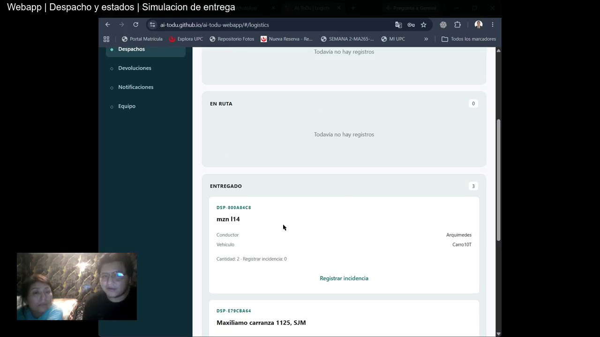

#### 5.2.3.6. Services Documentation Evidence for Sprint Review

**Versión documentada:** [067abc7](https://github.com/AI-ToDu/ai-todu-api/commit/067abc7bd2583d0286dc1cc4e84c17d292c0afc2), rama fix/av2-api-contracts, [PR #3](https://github.com/AI-ToDu/ai-todu-api/pull/3). CI Java 21/PostgreSQL 17 aprobado en [run 42511549771](https://github.com/AI-ToDu/ai-todu-api/actions/runs/42511549771). El Swagger público conserva la versión desplegada anterior hasta integrar y desplegar esta revisión.

[Swagger UI](https://ai-todu-api-av2.onrender.com/swagger-ui.html) · [OpenAPI](https://ai-todu-api-av2.onrender.com/v3/api-docs) · [Repositorio Web Services](https://github.com/AI-ToDu/ai-todu-api) · [Published Language v1](https://github.com/AI-ToDu/ai-todu-api/blob/main/contracts/integration-messages.v1.schema.json).

La API `/api/v1` es el **Open Host Service**. Recursos JSON y OpenAPI definen el contrato HTTP; los esquemas versionados definen el Published Language de integración. Los eventos internos se traducen dentro de su bounded context antes de cruzarlo. Tenant y rol provienen de la identidad autenticada; no se reciben desde el cuerpo. Las colecciones usan `{"items":[]}`.

**Bases:** desarrollo `http://localhost:8080/api/v1`; despliegue `https://ai-todu-api-av2.onrender.com/api/v1`. Se anexa el path de cada ficha a la base correspondiente. No hay parámetros query de paginación ni filtros de servidor implementados. Todo `{id}` es UUID de un recurso del espacio autenticado.

**Headers:** `Content-Type: application/json` cuando hay cuerpo; `Authorization: Bearer <token>` en operaciones protegidas; `Accept-Language: en-US` o `es-419` para mensajes localizados. `POST /sales` admite además `Idempotency-Key` opcional. Los ejemplos usan identidades ficticias y ocultan contraseña/token. Los UUID de respuesta deben sustituir las referencias ilustrativas de la siguiente petición.

**Origen y límites:** las solicitudes y respuestas siguientes provienen de ServicesContractIntegrationTest, ejecutado localmente con H2 en modo PostgreSQL y datos sintéticos. El ejemplo de clima usa un fixture determinista; WeatherGatewayTest verifica traducción/caché/fallo y la integración pública previa documenta Open-Meteo real. Esta ejecución local no acredita despliegue ni validación con personas. La verificación CI PostgreSQL se identifica separadamente por commit y run.

| Código | Significado y contrato |
| --- | --- |
| 200 | Consulta o transición aceptada; devuelve el recurso descrito |
| 201 | Creación aceptada; devuelve el recurso; replay idempotente de venta conserva 201 |
| 204 | Sesión revocada; respuesta sin cuerpo |
| 400 | JSON ilegible, parámetro inválido o validación de entrada incompleta |
| 401 / 403 | Sesión ausente/inválida/revocada o rol sin permiso |
| 404 | Identificador/referencia no encontrado en el espacio autenticado |
| 409 | Duplicado o conflicto de negocio, como stock insuficiente |
| 422 | Regla del dominio rechaza valores válidos a nivel de transporte |
| 503 | Proveedor climático no disponible |
| 500 | Fallo inesperado; no expone detalles internos |

Los errores usan `application/problem+json` con `type`, `title`, `status`, `detail` y `code`. HTTP y `status` del cuerpo coinciden. Cada ficha lista únicamente los códigos declarados para esa operación; una declaración no implica haber provocado todos sus fallos.

[OpenAPI de esta versión](assets/services-openapi-av2.json) · [Solicitudes y respuestas sanitizadas](assets/service-http-examples-av2.json).

##### Interacción real con Swagger UI

Capturas locales del 8/11/2026, con datos ficticios y base H2 en memoria. Las imágenes documentan respuestas observadas y se distinguen del despliegue público.

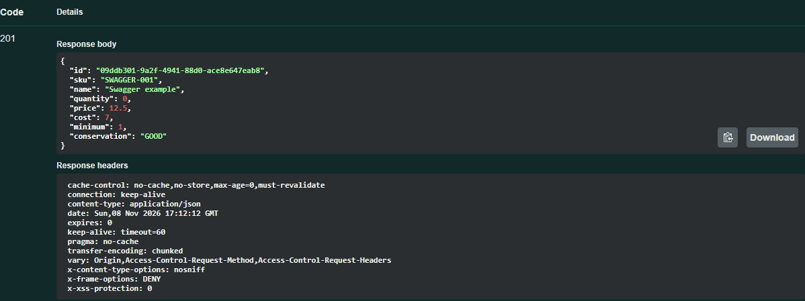

POST /products crea un artículo con saldo cero. El identificador retornado permite registrar la recepción posterior.

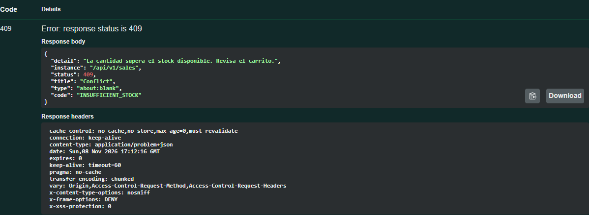

Sin saldo, POST /sales devuelve 409. La prueba de integración comprueba que no quedan venta, salidas ni Outbox parciales.

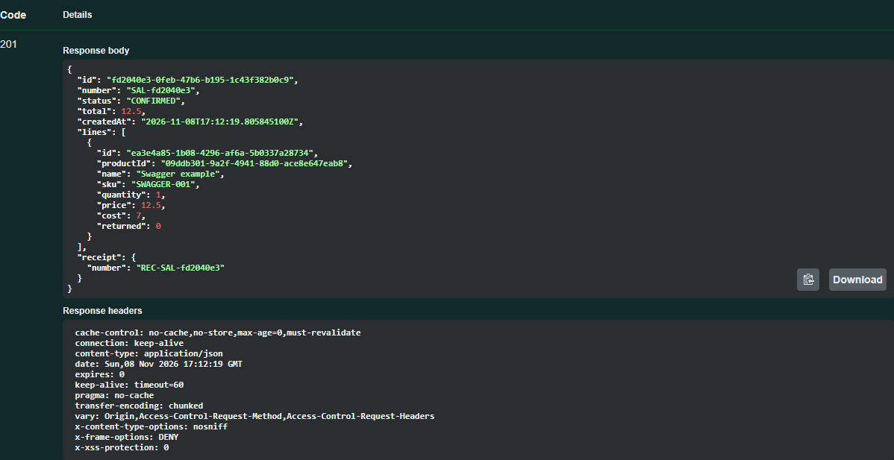

Después de recibir dos unidades, vender una devuelve 201 con líneas históricas, total PEN 12,50 y referencia de recibo académico.

##### Catálogo de las 34 operaciones

| Verbo | Ruta | Acción / contexto | Éxito | Roles |
| --- | --- | --- | --- | --- |
| POST | `/api/v1/auth/register` | Register a workspace / IAM | 201 | Public |
| POST | `/api/v1/auth/login` | Create a session / IAM | 200 | Public |
| GET | `/api/v1/auth/me` | Read the current identity / IAM | 200 | Any active role |
| POST | `/api/v1/auth/logout` | Revoke the current session / IAM | 204 | Any active role |
| GET | `/api/v1/employees` | List employees / IAM | 200 | ADMIN |
| POST | `/api/v1/employees` | Create an employee / IAM | 201 | ADMIN |
| GET | `/api/v1/products` | List products / Inventory | 200 | Any active role |
| POST | `/api/v1/products` | Register a product / Inventory | 201 | ADMIN, WAREHOUSE |
| PATCH | `/api/v1/products/{id}` | Change conservation status / Inventory | 200 | ADMIN, WAREHOUSE |
| GET | `/api/v1/movements` | List stock movements / Inventory | 200 | ADMIN, WAREHOUSE |
| POST | `/api/v1/movements` | Record a stock movement / Inventory | 201 | ADMIN, WAREHOUSE |
| GET | `/api/v1/suppliers` | List suppliers / Procurement | 200 | ADMIN, WAREHOUSE |
| POST | `/api/v1/suppliers` | Register a supplier / Procurement | 201 | ADMIN, WAREHOUSE |
| GET | `/api/v1/purchases` | List purchase orders / Procurement | 200 | ADMIN, WAREHOUSE |
| POST | `/api/v1/purchases` | Place a purchase order / Procurement | 201 | ADMIN, WAREHOUSE |
| POST | `/api/v1/purchases/{id}/receipts` | Receive a purchase partially or fully / Procurement | 201 | ADMIN, WAREHOUSE |
| GET | `/api/v1/sales` | List sales / Sales | 200 | ADMIN, SALES |
| POST | `/api/v1/sales` | Confirm a sale / Sales | 201 | ADMIN, SALES |
| POST | `/api/v1/sales/{id}/cancel` | Cancel a sale / Sales | 200 | ADMIN, SALES |
| GET | `/api/v1/returns` | List customer returns / Returns | 200 | ADMIN, SALES |
| POST | `/api/v1/returns` | Record a customer return / Returns | 201 | ADMIN, SALES |
| GET | `/api/v1/dispatches` | List dispatch manifests / Logistics | 200 | ADMIN, LOGISTICS |
| POST | `/api/v1/dispatches` | Prepare a dispatch / Logistics | 201 | ADMIN, LOGISTICS |
| PATCH | `/api/v1/dispatches/{id}` | Transition a dispatch / Logistics | 200 | ADMIN, LOGISTICS |
| POST | `/api/v1/dispatches/{id}/incidents` | Record a delivery incident / Logistics | 201 | ADMIN, LOGISTICS |
| GET | `/api/v1/dispatch-candidates` | List eligible sales / Logistics | 200 | ADMIN, LOGISTICS |
| GET | `/api/v1/drivers` | List drivers / Logistics | 200 | ADMIN, LOGISTICS |
| POST | `/api/v1/drivers` | Register a driver / Logistics | 201 | ADMIN, LOGISTICS |
| GET | `/api/v1/vehicles` | List vehicles / Logistics | 200 | ADMIN, LOGISTICS |
| POST | `/api/v1/vehicles` | Register a vehicle / Logistics | 201 | ADMIN, LOGISTICS |
| GET | `/api/v1/logistics/weather` | Read regional Lima weather / Logistics | 200 | ADMIN, LOGISTICS |
| GET | `/api/v1/notifications` | List notifications / Notifications | 200 | Any active role |
| PATCH | `/api/v1/notifications/{id}` | Mark a notification as read / Notifications | 200 | Any active role |
| GET | `/api/v1/metrics` | Read operational metrics / Reporting | 200 | ADMIN |

##### Servicio 01. Register a workspace

**POST `/api/v1/auth/register`** · Contexto IAM · Permisos: Public.

Create a company and its first administrator; email must be unique.

**Recurso de solicitud:** `RegistrationResource`.

| Campo | Tipo | Validación / semántica |
| --- | --- | --- |
| `name` | `string` | Obligatorio |
| `company` | `string` | Obligatorio |
| `email` | `string` | Obligatorio; email |
| `password` | `string` | Obligatorio; registro: mínimo 8 caracteres y máximo 72 bytes UTF-8 |

Solicitud de ejemplo:

```json
{"name":"Contract review","company":"Synthetic company","email":"contracts-5efd17ae-8420-4d3f-8ac4-b796fe5dbad3@example.test","password":"[REDACTED]"}
```

**Respuesta:** 201 con `UserResource`.

Ejemplo observado:

```json
{"id":"97ff2372-db30-4ee4-a376-382cadc6f234","tenantId":"d60e39fe-f1d0-4d1e-8a40-b8540ed537c6","name":"Contract review","email":"contracts-5efd17ae-8420-4d3f-8ac4-b796fe5dbad3@example.test","role":"ADMIN"}
```

**Interpretación:** El objeto conserva los identificadores y valores aceptados. Los importes monetarios están expresados en PEN y las cantidades en unidades enteras.

**Errores aplicables:** 400 Malformed request, missing required input or invalid parameter; 422 A domain invariant rejects the supplied values; 409 Duplicate identity or conflicting business state; 500 Unexpected server failure; internal details are not disclosed.

##### Servicio 02. Create a session

**POST `/api/v1/auth/login`** · Contexto IAM · Permisos: Public.

Authenticate an active account and return a revocable JWT.

**Recurso de solicitud:** `LoginResource`.

| Campo | Tipo | Validación / semántica |
| --- | --- | --- |
| `email` | `string` | Obligatorio; email |
| `password` | `string` | Obligatorio; registro: mínimo 8 caracteres y máximo 72 bytes UTF-8 |

Solicitud de ejemplo:

```json
{"email":"contracts-5efd17ae-8420-4d3f-8ac4-b796fe5dbad3@example.test","password":"[REDACTED]"}
```

**Respuesta:** 200 con `SessionResource`.

Ejemplo observado:

```json
{"token":"[REDACTED]","user":{"id":"97ff2372-db30-4ee4-a376-382cadc6f234","tenantId":"d60e39fe-f1d0-4d1e-8a40-b8540ed537c6","name":"Contract review","email":"contracts-5efd17ae-8420-4d3f-8ac4-b796fe5dbad3@example.test","role":"ADMIN"}}
```

**Interpretación:** El objeto conserva los identificadores y valores aceptados. Los importes monetarios están expresados en PEN y las cantidades en unidades enteras.

**Errores aplicables:** 401 Invalid credentials or inactive account; 400 Malformed request, missing required input or invalid parameter; 422 A domain invariant rejects the supplied values; 409 Duplicate identity or conflicting business state; 500 Unexpected server failure; internal details are not disclosed.

##### Servicio 03. Read the current identity

**GET `/api/v1/auth/me`** · Contexto IAM · Permisos: Any active role.

Read the authenticated identity; tenant is derived from the token.

**Solicitud:** sin cuerpo. No admite filtros query de servidor.

**Respuesta:** 200 con `UserResource`.

Ejemplo observado:

```json
{"id":"97ff2372-db30-4ee4-a376-382cadc6f234","tenantId":"d60e39fe-f1d0-4d1e-8a40-b8540ed537c6","name":"Contract review","email":"contracts-5efd17ae-8420-4d3f-8ac4-b796fe5dbad3@example.test","role":"ADMIN"}
```

**Interpretación:** El objeto conserva los identificadores y valores aceptados. Los importes monetarios están expresados en PEN y las cantidades en unidades enteras.

**Errores aplicables:** 401 Missing, invalid, expired or revoked session; 500 Unexpected server failure; internal details are not disclosed.

##### Servicio 04. Revoke the current session

**POST `/api/v1/auth/logout`** · Contexto IAM · Permisos: Any active role.

Revoke the presented token; later access with it returns 401.

**Solicitud:** sin cuerpo. El token que se revoca es el presentado en Authorization.

**Respuesta:** 204 sin cuerpo.

**Interpretación:** La sesión deja de autorizar solicitudes; el cuerpo vacío es intencional.

**Errores aplicables:** 401 Missing, invalid, expired or revoked session; 500 Unexpected server failure; internal details are not disclosed.

##### Servicio 05. List employees

**GET `/api/v1/employees`** · Contexto IAM · Permisos: ADMIN.

List employees in the authenticated workspace.

**Solicitud:** sin cuerpo. No admite filtros query de servidor.

**Respuesta:** 200 con `CollectionResourceEmployeeResource`.

Ejemplo observado:

```json
{"items":[{"id":"97ff2372-db30-4ee4-a376-382cadc6f234","name":"Contract review","email":"contracts-5efd17ae-8420-4d3f-8ac4-b796fe5dbad3@example.test","role":"ADMIN","active":true},{"id":"689715f7-8d90-40ca-800d-4c26784e1186","name":"Operator","email":"employee-c2a127d9-0c5e-43e2-938d-eb5cbfdf9f4f@example.test","role":"WAREHOUSE","active":true}]}
```

**Interpretación:** El objeto conserva los identificadores y valores aceptados. `items` contiene los recursos del espacio autenticado; una lista vacía es un resultado válido.

**Errores aplicables:** 401 Missing, invalid, expired or revoked session; 403 Role does not permit this operation; 500 Unexpected server failure; internal details are not disclosed.

##### Servicio 06. Create an employee

**POST `/api/v1/employees`** · Contexto IAM · Permisos: ADMIN.

Provision a role and initial password; no password or hash is returned.

**Recurso de solicitud:** `CreateEmployeeResource`.

| Campo | Tipo | Validación / semántica |
| --- | --- | --- |
| `name` | `string` | Obligatorio |
| `email` | `string` | Obligatorio; email |
| `role` | `string` | Obligatorio; Valores: ADMIN, WAREHOUSE, SALES, LOGISTICS |
| `password` | `string` | Obligatorio; registro: mínimo 8 caracteres y máximo 72 bytes UTF-8 |

Solicitud de ejemplo:

```json
{"name":"Operator","email":"employee-c2a127d9-0c5e-43e2-938d-eb5cbfdf9f4f@example.test","role":"WAREHOUSE","password":"[REDACTED]"}
```

**Respuesta:** 201 con `EmployeeResource`.

Ejemplo observado:

```json
{"id":"689715f7-8d90-40ca-800d-4c26784e1186","name":"Operator","email":"employee-c2a127d9-0c5e-43e2-938d-eb5cbfdf9f4f@example.test","role":"WAREHOUSE","active":true}
```

**Interpretación:** El objeto conserva los identificadores y valores aceptados. Los importes monetarios están expresados en PEN y las cantidades en unidades enteras.

**Errores aplicables:** 401 Missing, invalid, expired or revoked session; 403 Role does not permit this operation; 400 Malformed request, missing required input or invalid parameter; 422 A domain invariant rejects the supplied values; 409 Duplicate identity or conflicting business state; 500 Unexpected server failure; internal details are not disclosed.

##### Servicio 07. List products

**GET `/api/v1/products`** · Contexto Inventory · Permisos: Any active role.

List products in the authenticated workspace; no server-side pagination or filters.

**Solicitud:** sin cuerpo. No admite filtros query de servidor.

**Respuesta:** 200 con `CollectionResourceProductResource`.

Ejemplo observado:

```json
{"items":[{"id":"71633291-7316-43de-a084-7473e47bc466","sku":"CONTRACT-001","name":"Example item","quantity":0,"price":12.5,"cost":7.0,"minimum":1,"conservation":"GOOD"}]}
```

**Interpretación:** El objeto conserva los identificadores y valores aceptados. `items` contiene los recursos del espacio autenticado; una lista vacía es un resultado válido.

**Errores aplicables:** 401 Missing, invalid, expired or revoked session; 500 Unexpected server failure; internal details are not disclosed.

##### Servicio 08. Register a product

**POST `/api/v1/products`** · Contexto Inventory · Permisos: ADMIN, WAREHOUSE.

Register a unique workspace SKU with zero initial stock. Amounts are PEN.

**Recurso de solicitud:** `CreateProductResource`.

| Campo | Tipo | Validación / semántica |
| --- | --- | --- |
| `sku` | `string` | Obligatorio |
| `name` | `string` | Obligatorio |
| `price` | `number` | Obligatorio; PEN ≥ 0; precisión de centavos |
| `cost` | `number` | Obligatorio; PEN ≥ 0; precisión de centavos |
| `minimum` | `integer` | Obligatorio; int32 |

Solicitud de ejemplo:

```json
{"sku":"CONTRACT-001","name":"Example item","price":12.5,"cost":7,"minimum":1}
```

**Respuesta:** 201 con `ProductResource`.

Ejemplo observado:

```json
{"id":"71633291-7316-43de-a084-7473e47bc466","sku":"CONTRACT-001","name":"Example item","quantity":0,"price":12.5,"cost":7.0,"minimum":1,"conservation":"GOOD"}
```

**Interpretación:** El objeto conserva los identificadores y valores aceptados. Los importes monetarios están expresados en PEN y las cantidades en unidades enteras.

**Errores aplicables:** 401 Missing, invalid, expired or revoked session; 403 Role does not permit this operation; 400 Malformed request, missing required input or invalid parameter; 422 A domain invariant rejects the supplied values; 409 Duplicate identity or conflicting business state; 500 Unexpected server failure; internal details are not disclosed.

##### Servicio 09. Change conservation status

**PATCH `/api/v1/products/{id}`** · Contexto Inventory · Permisos: ADMIN, WAREHOUSE.

Change conservation; this action does not edit price or stock.

**Path:** `id` UUID obligatorio; identificador de artículo.

**Recurso de solicitud:** `ConservationResource`.

| Campo | Tipo | Validación / semántica |
| --- | --- | --- |
| `conservation` | `string` | Obligatorio; Valores: GOOD, DAMAGED, QUARANTINED |

Solicitud de ejemplo:

```json
{"conservation":"GOOD"}
```

**Respuesta:** 200 con `ProductResource`.

Ejemplo observado:

```json
{"id":"71633291-7316-43de-a084-7473e47bc466","sku":"CONTRACT-001","name":"Example item","quantity":0,"price":12.5,"cost":7.0,"minimum":1,"conservation":"GOOD"}
```

**Interpretación:** El objeto conserva los identificadores y valores aceptados. Los importes monetarios están expresados en PEN y las cantidades en unidades enteras.

**Errores aplicables:** 401 Missing, invalid, expired or revoked session; 403 Role does not permit this operation; 400 Malformed request, missing required input or invalid parameter; 422 A domain invariant rejects the supplied values; 404 Reference not found in the authenticated workspace; 500 Unexpected server failure; internal details are not disclosed.

##### Servicio 10. List stock movements

**GET `/api/v1/movements`** · Contexto Inventory · Permisos: ADMIN, WAREHOUSE.

Read the audit history of signed stock movements.

**Solicitud:** sin cuerpo. No admite filtros query de servidor.

**Respuesta:** 200 con `CollectionResourceMovementResponseResource`.

Ejemplo observado:

```json
{"items":[{"id":"55e61117-905e-4f6f-bab4-453d55b55f62","productId":"71633291-7316-43de-a084-7473e47bc466","delta":5,"type":"RECEIPT","reason":"Initial receipt","actorId":"97ff2372-db30-4ee4-a376-382cadc6f234","createdAt":"2026-11-08T18:43:19.085409Z"}]}
```

**Interpretación:** El objeto conserva los identificadores y valores aceptados. `items` contiene los recursos del espacio autenticado; una lista vacía es un resultado válido.

**Errores aplicables:** 401 Missing, invalid, expired or revoked session; 403 Role does not permit this operation; 500 Unexpected server failure; internal details are not disclosed.

##### Servicio 11. Record a stock movement

**POST `/api/v1/movements`** · Contexto Inventory · Permisos: ADMIN, WAREHOUSE.

Apply RECEIPT or ISSUE in whole positive units; an issue cannot exceed available stock.

**Recurso de solicitud:** `MovementResource`.

| Campo | Tipo | Validación / semántica |
| --- | --- | --- |
| `productId` | `string` | Obligatorio; uuid |
| `quantity` | `number` | Obligatorio; entero positivo |
| `type` | `string` | Obligatorio; Valores: RECEIPT, ISSUE, LOSS |
| `reason` | `string` | Obligatorio |

Solicitud de ejemplo:

```json
{"productId":"71633291-7316-43de-a084-7473e47bc466","quantity":5,"type":"RECEIPT","reason":"Initial receipt"}
```

**Respuesta:** 201 con `ProductResource`.

Ejemplo observado:

```json
{"id":"71633291-7316-43de-a084-7473e47bc466","sku":"CONTRACT-001","name":"Example item","quantity":5,"price":12.5,"cost":7.0,"minimum":1,"conservation":"GOOD"}
```

**Interpretación:** El objeto conserva los identificadores y valores aceptados. Los importes monetarios están expresados en PEN y las cantidades en unidades enteras.

**Errores aplicables:** 401 Missing, invalid, expired or revoked session; 403 Role does not permit this operation; 400 Malformed request, missing required input or invalid parameter; 422 A domain invariant rejects the supplied values; 409 Duplicate identity or conflicting business state; 404 Reference not found in the authenticated workspace; 500 Unexpected server failure; internal details are not disclosed.

##### Servicio 12. List suppliers

**GET `/api/v1/suppliers`** · Contexto Procurement · Permisos: ADMIN, WAREHOUSE.

Read suppliers belonging to this workspace.

**Solicitud:** sin cuerpo. No admite filtros query de servidor.

**Respuesta:** 200 con `CollectionResourceSupplierResource`.

Ejemplo observado:

```json
{"items":[{"id":"ea689c0b-798f-4295-a250-bc5b3cea91aa","name":"Example supplier","contact":"supplier@example.test"}]}
```

**Interpretación:** El objeto conserva los identificadores y valores aceptados. `items` contiene los recursos del espacio autenticado; una lista vacía es un resultado válido.

**Errores aplicables:** 401 Missing, invalid, expired or revoked session; 403 Role does not permit this operation; 500 Unexpected server failure; internal details are not disclosed.

##### Servicio 13. Register a supplier

**POST `/api/v1/suppliers`** · Contexto Procurement · Permisos: ADMIN, WAREHOUSE.

Register supplier name and contact information.

**Recurso de solicitud:** `CreateSupplierResource`.

| Campo | Tipo | Validación / semántica |
| --- | --- | --- |
| `name` | `string` | Obligatorio |
| `contact` | `string` | Obligatorio |

Solicitud de ejemplo:

```json
{"name":"Example supplier","contact":"supplier@example.test"}
```

**Respuesta:** 201 con `SupplierResource`.

Ejemplo observado:

```json
{"id":"ea689c0b-798f-4295-a250-bc5b3cea91aa","name":"Example supplier","contact":"supplier@example.test"}
```

**Interpretación:** El objeto conserva los identificadores y valores aceptados. Los importes monetarios están expresados en PEN y las cantidades en unidades enteras.

**Errores aplicables:** 401 Missing, invalid, expired or revoked session; 403 Role does not permit this operation; 400 Malformed request, missing required input or invalid parameter; 422 A domain invariant rejects the supplied values; 409 Duplicate identity or conflicting business state; 500 Unexpected server failure; internal details are not disclosed.

##### Servicio 14. List purchase orders

**GET `/api/v1/purchases`** · Contexto Procurement · Permisos: ADMIN, WAREHOUSE.

Read orders and ordered/received quantities.

**Solicitud:** sin cuerpo. No admite filtros query de servidor.

**Respuesta:** 200 con `CollectionResourcePurchaseResource`.

Ejemplo observado:

```json
{"items":[{"id":"2bcf4876-2b0e-4421-9000-6963f4a965bd","number":"PO-2bcf4876","supplierId":"ea689c0b-798f-4295-a250-bc5b3cea91aa","status":"OPEN","createdAt":"2026-11-08T18:43:19.161628Z","lines":[{"id":"1e7d4586-e255-408f-a763-e102fa4c57b0","productId":"71633291-7316-43de-a084-7473e47bc466","quantity":3,"received":0}]}]}
```

**Interpretación:** El objeto conserva los identificadores y valores aceptados. `items` contiene los recursos del espacio autenticado; una lista vacía es un resultado válido.

**Errores aplicables:** 401 Missing, invalid, expired or revoked session; 403 Role does not permit this operation; 500 Unexpected server failure; internal details are not disclosed.

##### Servicio 15. Place a purchase order

**POST `/api/v1/purchases`** · Contexto Procurement · Permisos: ADMIN, WAREHOUSE.

Create an order for an existing supplier and distinct workspace products.

**Recurso de solicitud:** `PlacePurchaseResource`.

| Campo | Tipo | Validación / semántica |
| --- | --- | --- |
| `supplierId` | `string` | Obligatorio; uuid |
| `lines` | `List<RequestedPurchaseLineResource>` | Obligatorio |

Solicitud de ejemplo:

```json
{"supplierId":"ea689c0b-798f-4295-a250-bc5b3cea91aa","lines":[{"productId":"71633291-7316-43de-a084-7473e47bc466","quantity":3}]}
```

Elementos `RequestedPurchaseLineResource`:

| Campo | Tipo | Validación / semántica |
| --- | --- | --- |
| `productId` | `string` | Obligatorio; uuid |
| `quantity` | `number` | Obligatorio; entero positivo |

**Respuesta:** 201 con `PurchaseResource`.

Ejemplo observado:

```json
{"id":"2bcf4876-2b0e-4421-9000-6963f4a965bd","number":"PO-2bcf4876","supplierId":"ea689c0b-798f-4295-a250-bc5b3cea91aa","status":"OPEN","createdAt":"2026-11-08T18:43:19.161628400Z","lines":[{"id":"1e7d4586-e255-408f-a763-e102fa4c57b0","productId":"71633291-7316-43de-a084-7473e47bc466","quantity":3,"received":0}]}
```

**Interpretación:** El objeto conserva los identificadores y valores aceptados. Los importes monetarios están expresados en PEN y las cantidades en unidades enteras.

**Errores aplicables:** 401 Missing, invalid, expired or revoked session; 403 Role does not permit this operation; 400 Malformed request, missing required input or invalid parameter; 422 A domain invariant rejects the supplied values; 409 Duplicate identity or conflicting business state; 404 Reference not found in the authenticated workspace; 500 Unexpected server failure; internal details are not disclosed.

##### Servicio 16. Receive a purchase partially or fully

**POST `/api/v1/purchases/{id}/receipts`** · Contexto Procurement · Permisos: ADMIN, WAREHOUSE.

Receive positive quantities by order line; exceeding outstanding units rolls back the entire receipt.

**Path:** `id` UUID obligatorio; identificador de compra.

**Recurso de solicitud:** `ReceivePurchaseResource`.

| Campo | Tipo | Validación / semántica |
| --- | --- | --- |
| `lines` | `List<ReceivedPurchaseLineResource>` | Obligatorio |

Solicitud de ejemplo:

```json
{"lines":[{"lineId":"1e7d4586-e255-408f-a763-e102fa4c57b0","quantity":2}]}
```

Elementos `ReceivedPurchaseLineResource`:

| Campo | Tipo | Validación / semántica |
| --- | --- | --- |
| `lineId` | `string` | Obligatorio; uuid |
| `quantity` | `number` | Obligatorio; entero positivo |

**Respuesta:** 201 con `PurchaseResource`.

Ejemplo observado:

```json
{"id":"2bcf4876-2b0e-4421-9000-6963f4a965bd","number":"PO-2bcf4876","supplierId":"ea689c0b-798f-4295-a250-bc5b3cea91aa","status":"PARTIAL","createdAt":"2026-11-08T18:43:19.161628Z","lines":[{"id":"1e7d4586-e255-408f-a763-e102fa4c57b0","productId":"71633291-7316-43de-a084-7473e47bc466","quantity":3,"received":2}]}
```

**Interpretación:** El objeto conserva los identificadores y valores aceptados. Los importes monetarios están expresados en PEN y las cantidades en unidades enteras.

**Errores aplicables:** 401 Missing, invalid, expired or revoked session; 403 Role does not permit this operation; 400 Malformed request, missing required input or invalid parameter; 422 A domain invariant rejects the supplied values; 409 Duplicate identity or conflicting business state; 404 Reference not found in the authenticated workspace; 500 Unexpected server failure; internal details are not disclosed.

##### Servicio 17. List sales

**GET `/api/v1/sales`** · Contexto Sales · Permisos: ADMIN, SALES.

Read sales, immutable commercial line snapshots and academic receipt references.

**Solicitud:** sin cuerpo. No admite filtros query de servidor.

**Respuesta:** 200 con `CollectionResourceSaleResource`.

Ejemplo observado:

```json
{"items":[{"id":"b55c8a8c-73d7-4210-8555-f8481861c01a","number":"SAL-b55c8a8c","status":"CONFIRMED","total":25.0,"createdAt":"2026-11-08T18:43:19.238105Z","lines":[{"id":"d92e2b7f-4acb-4b83-bca2-4c5ef287e8c8","productId":"71633291-7316-43de-a084-7473e47bc466","name":"Example item","sku":"CONTRACT-001","quantity":2,"price":12.5,"cost":7.0,"returned":0}],"receipt":{"number":"REC-SAL-b55c8a8c"}}]}
```

**Interpretación:** El objeto conserva los identificadores y valores aceptados. `items` contiene los recursos del espacio autenticado; una lista vacía es un resultado válido.

**Errores aplicables:** 401 Missing, invalid, expired or revoked session; 403 Role does not permit this operation; 500 Unexpected server failure; internal details are not disclosed.

##### Servicio 18. Confirm a sale

**POST `/api/v1/sales`** · Contexto Sales · Permisos: ADMIN, SALES.

Atomically record sale, stock issues and integration messages. An identical Idempotency-Key replay returns the existing sale with 201; a conflicting payload returns 409.

**Recurso de solicitud:** `ConfirmSaleResource`.

| Campo | Tipo | Validación / semántica |
| --- | --- | --- |
| `lines` | `List<LineRequest>` | Obligatorio |

Solicitud de ejemplo:

```json
{"lines":[{"productId":"71633291-7316-43de-a084-7473e47bc466","quantity":2}]}
```

Elementos `LineRequest`:

| Campo | Tipo | Validación / semántica |
| --- | --- | --- |
| `productId` | `string` | Obligatorio; uuid |
| `quantity` | `number` | Obligatorio; entero positivo |

**Header opcional:** `Idempotency-Key`; repetirlo con iguales productos/cantidades conserva la venta y devuelve 201; con otro contenido devuelve 409.

**Respuesta:** 201 con `SaleResource`.

Ejemplo observado:

```json
{"id":"b55c8a8c-73d7-4210-8555-f8481861c01a","number":"SAL-b55c8a8c","status":"CONFIRMED","total":25.0,"createdAt":"2026-11-08T18:43:19.238105100Z","lines":[{"id":"d92e2b7f-4acb-4b83-bca2-4c5ef287e8c8","productId":"71633291-7316-43de-a084-7473e47bc466","name":"Example item","sku":"CONTRACT-001","quantity":2,"price":12.5,"cost":7.0,"returned":0}],"receipt":{"number":"REC-SAL-b55c8a8c"}}
```

**Interpretación:** El objeto conserva los identificadores y valores aceptados. Los importes monetarios están expresados en PEN y las cantidades en unidades enteras.

**Errores aplicables:** 401 Missing, invalid, expired or revoked session; 403 Role does not permit this operation; 400 Malformed request, missing required input or invalid parameter; 422 A domain invariant rejects the supplied values; 409 Duplicate identity or conflicting business state; 404 Reference not found in the authenticated workspace; 500 Unexpected server failure; internal details are not disclosed.

##### Servicio 19. Cancel a sale

**POST `/api/v1/sales/{id}/cancel`** · Contexto Sales · Permisos: ADMIN, SALES.

Cancel a sale that has not been dispatched and restore its stock once.

**Path:** `id` UUID obligatorio; identificador de venta.

**Recurso de solicitud:** `CancelResource`.

| Campo | Tipo | Validación / semántica |
| --- | --- | --- |
| `reason` | `string` | Obligatorio |

Solicitud de ejemplo:

```json
{"reason":"Example cancellation"}
```

**Respuesta:** 200 con `SaleResource`.

Ejemplo observado:

```json
{"id":"2cfe9035-b68f-4ad4-8612-032cb36272bf","number":"SAL-2cfe9035","status":"CANCELLED","total":12.5,"createdAt":"2026-11-08T18:43:19.516651Z","lines":[{"id":"4ce64e5e-a745-44f4-b655-64d36fc9c645","productId":"71633291-7316-43de-a084-7473e47bc466","name":"Example item","sku":"CONTRACT-001","quantity":1,"price":12.5,"cost":7.0,"returned":0}],"receipt":{"number":"REC-SAL-2cfe9035"}}
```

**Interpretación:** El objeto conserva los identificadores y valores aceptados. Los importes monetarios están expresados en PEN y las cantidades en unidades enteras.

**Errores aplicables:** 401 Missing, invalid, expired or revoked session; 403 Role does not permit this operation; 400 Malformed request, missing required input or invalid parameter; 422 A domain invariant rejects the supplied values; 409 Duplicate identity or conflicting business state; 404 Reference not found in the authenticated workspace; 500 Unexpected server failure; internal details are not disclosed.

##### Servicio 20. List customer returns

**GET `/api/v1/returns`** · Contexto Returns · Permisos: ADMIN, SALES.

Read previously recorded returns and disposition.

**Solicitud:** sin cuerpo. No admite filtros query de servidor.

**Respuesta:** 200 con `CollectionResourceReturnResource`.

Ejemplo observado:

```json
{"items":[{"id":"ec84466b-9ff4-432f-b042-986b6d0b4bb3","saleId":"b55c8a8c-73d7-4210-8555-f8481861c01a","saleLineId":"d92e2b7f-4acb-4b83-bca2-4c5ef287e8c8","quantity":1,"disposition":"RESTOCK","reason":"Example return","createdAt":"2026-11-08T18:43:19.480300Z"}]}
```

**Interpretación:** El objeto conserva los identificadores y valores aceptados. `items` contiene los recursos del espacio autenticado; una lista vacía es un resultado válido.

**Errores aplicables:** 401 Missing, invalid, expired or revoked session; 403 Role does not permit this operation; 500 Unexpected server failure; internal details are not disclosed.

##### Servicio 21. Record a customer return

**POST `/api/v1/returns`** · Contexto Returns · Permisos: ADMIN, SALES.

Return units against one sale line. RESTOCK restores stock; LOSS records loss. Previously returned quantities limit the remaining return.

**Recurso de solicitud:** `RecordReturnResource`.

| Campo | Tipo | Validación / semántica |
| --- | --- | --- |
| `saleId` | `string` | Obligatorio; uuid |
| `saleLineId` | `string` | Obligatorio; uuid |
| `quantity` | `number` | Obligatorio; entero positivo |
| `disposition` | `string` | Obligatorio; Valores: RESTOCK, LOSS |
| `reason` | `string` | Obligatorio |

Solicitud de ejemplo:

```json
{"saleId":"b55c8a8c-73d7-4210-8555-f8481861c01a","saleLineId":"d92e2b7f-4acb-4b83-bca2-4c5ef287e8c8","quantity":1,"disposition":"RESTOCK","reason":"Example return"}
```

**Respuesta:** 201 con `ReturnResource`.

Ejemplo observado:

```json
{"id":"ec84466b-9ff4-432f-b042-986b6d0b4bb3","saleId":"b55c8a8c-73d7-4210-8555-f8481861c01a","saleLineId":"d92e2b7f-4acb-4b83-bca2-4c5ef287e8c8","quantity":1,"disposition":"RESTOCK","reason":"Example return","createdAt":"2026-11-08T18:43:19.480300200Z"}
```

**Interpretación:** El objeto conserva los identificadores y valores aceptados. Los importes monetarios están expresados en PEN y las cantidades en unidades enteras.

**Errores aplicables:** 401 Missing, invalid, expired or revoked session; 403 Role does not permit this operation; 400 Malformed request, missing required input or invalid parameter; 422 A domain invariant rejects the supplied values; 409 Duplicate identity or conflicting business state; 404 Reference not found in the authenticated workspace; 500 Unexpected server failure; internal details are not disclosed.

##### Servicio 22. List dispatch manifests

**GET `/api/v1/dispatches`** · Contexto Logistics · Permisos: ADMIN, LOGISTICS.

Read manifests, lines, incidents and recipient evidence.

**Solicitud:** sin cuerpo. No admite filtros query de servidor.

**Respuesta:** 200 con `CollectionResourceDispatchResource`.

Ejemplo observado:

```json
{"items":[{"id":"86410196-6937-4ccc-b971-efcf11d06ce4","number":"DSP-86410196","driverId":"06449429-0047-481d-9f1c-b1d1e37cc7a1","vehicleId":"569f1cb0-cb5b-4482-98ae-d941d425508c","destination":"Example Lima warehouse","status":"PENDING","createdAt":"2026-11-08T18:43:19.364757Z","lines":[{"id":"bf8817fa-a350-4432-aa8c-67e23446b700","saleId":"b55c8a8c-73d7-4210-8555-f8481861c01a","saleLineId":"d92e2b7f-4acb-4b83-bca2-4c5ef287e8c8","productId":"71633291-7316-43de-a084-7473e47bc466","name":"Example item","quantity":2}],"incidents":[],"recipient":null}]}
```

**Interpretación:** El objeto conserva los identificadores y valores aceptados. `items` contiene los recursos del espacio autenticado; una lista vacía es un resultado válido.

**Errores aplicables:** 401 Missing, invalid, expired or revoked session; 403 Role does not permit this operation; 500 Unexpected server failure; internal details are not disclosed.

##### Servicio 23. Prepare a dispatch

**POST `/api/v1/dispatches`** · Contexto Logistics · Permisos: ADMIN, LOGISTICS.

Assign confirmed undispatched sales, a driver, a vehicle and destination. Stock is not deducted again.

**Recurso de solicitud:** `PrepareDispatchResource`.

| Campo | Tipo | Validación / semántica |
| --- | --- | --- |
| `saleIds` | `List<string>` | Obligatorio |
| `driverId` | `string` | Obligatorio; uuid |
| `vehicleId` | `string` | Obligatorio; uuid |
| `destination` | `string` | Obligatorio |

Solicitud de ejemplo:

```json
{"saleIds":["b55c8a8c-73d7-4210-8555-f8481861c01a"],"driverId":"06449429-0047-481d-9f1c-b1d1e37cc7a1","vehicleId":"569f1cb0-cb5b-4482-98ae-d941d425508c","destination":"Example Lima warehouse"}
```

**Respuesta:** 201 con `DispatchResource`.

Ejemplo observado:

```json
{"id":"86410196-6937-4ccc-b971-efcf11d06ce4","number":"DSP-86410196","driverId":"06449429-0047-481d-9f1c-b1d1e37cc7a1","vehicleId":"569f1cb0-cb5b-4482-98ae-d941d425508c","destination":"Example Lima warehouse","status":"PENDING","createdAt":"2026-11-08T18:43:19.364757100Z","lines":[{"id":"bf8817fa-a350-4432-aa8c-67e23446b700","saleId":"b55c8a8c-73d7-4210-8555-f8481861c01a","saleLineId":"d92e2b7f-4acb-4b83-bca2-4c5ef287e8c8","productId":"71633291-7316-43de-a084-7473e47bc466","name":"Example item","quantity":2}],"incidents":[],"recipient":null}
```

**Interpretación:** El objeto conserva los identificadores y valores aceptados. Los importes monetarios están expresados en PEN y las cantidades en unidades enteras.

**Errores aplicables:** 401 Missing, invalid, expired or revoked session; 403 Role does not permit this operation; 400 Malformed request, missing required input or invalid parameter; 422 A domain invariant rejects the supplied values; 409 Duplicate identity or conflicting business state; 404 Reference not found in the authenticated workspace; 500 Unexpected server failure; internal details are not disclosed.

##### Servicio 24. Transition a dispatch

**PATCH `/api/v1/dispatches/{id}`** · Contexto Logistics · Permisos: ADMIN, LOGISTICS.

Transition PENDING to IN_TRANSIT, then DELIVERED with recipient evidence; invalid transitions preserve the previous state.

**Path:** `id` UUID obligatorio; identificador de manifiesto.

**Recurso de solicitud:** `TransitionResource`.

| Campo | Tipo | Validación / semántica |
| --- | --- | --- |
| `status` | `string` | Obligatorio; Valores: IN_TRANSIT, DELIVERED |
| `recipient` | `string` | obligatorio al entregar |

Solicitud de ejemplo:

```json
{"status":"IN_TRANSIT"}
```

**Respuesta:** 200 con `DispatchResource`.

Ejemplo observado:

```json
{"id":"86410196-6937-4ccc-b971-efcf11d06ce4","number":"DSP-86410196","driverId":"06449429-0047-481d-9f1c-b1d1e37cc7a1","vehicleId":"569f1cb0-cb5b-4482-98ae-d941d425508c","destination":"Example Lima warehouse","status":"IN_TRANSIT","createdAt":"2026-11-08T18:43:19.364757Z","lines":[{"id":"bf8817fa-a350-4432-aa8c-67e23446b700","saleId":"b55c8a8c-73d7-4210-8555-f8481861c01a","saleLineId":"d92e2b7f-4acb-4b83-bca2-4c5ef287e8c8","productId":"71633291-7316-43de-a084-7473e47bc466","name":"Example item","quantity":2}],"incidents":[{"id":"3feefe20-adad-4a6c-92ca-499d18f8dabc","description":"Recipient contacted before delivery","createdAt":"2026-11-08T18:43:19.411362Z"}],"recipient":null}
```

**Interpretación:** El objeto conserva los identificadores y valores aceptados. Los importes monetarios están expresados en PEN y las cantidades en unidades enteras.

**Errores aplicables:** 401 Missing, invalid, expired or revoked session; 403 Role does not permit this operation; 400 Malformed request, missing required input or invalid parameter; 422 A domain invariant rejects the supplied values; 404 Reference not found in the authenticated workspace; 500 Unexpected server failure; internal details are not disclosed.

##### Servicio 25. Record a delivery incident

**POST `/api/v1/dispatches/{id}/incidents`** · Contexto Logistics · Permisos: ADMIN, LOGISTICS.

Append an incident description to the selected manifest.

**Path:** `id` UUID obligatorio; identificador de manifiesto.

**Recurso de solicitud:** `IncidentResource`.

| Campo | Tipo | Validación / semántica |
| --- | --- | --- |
| `description` | `string` | Obligatorio |

Solicitud de ejemplo:

```json
{"description":"Recipient contacted before delivery"}
```

**Respuesta:** 201 con `DispatchResource`.

Ejemplo observado:

```json
{"id":"86410196-6937-4ccc-b971-efcf11d06ce4","number":"DSP-86410196","driverId":"06449429-0047-481d-9f1c-b1d1e37cc7a1","vehicleId":"569f1cb0-cb5b-4482-98ae-d941d425508c","destination":"Example Lima warehouse","status":"PENDING","createdAt":"2026-11-08T18:43:19.364757Z","lines":[{"id":"bf8817fa-a350-4432-aa8c-67e23446b700","saleId":"b55c8a8c-73d7-4210-8555-f8481861c01a","saleLineId":"d92e2b7f-4acb-4b83-bca2-4c5ef287e8c8","productId":"71633291-7316-43de-a084-7473e47bc466","name":"Example item","quantity":2}],"incidents":[{"id":"3feefe20-adad-4a6c-92ca-499d18f8dabc","description":"Recipient contacted before delivery","createdAt":"2026-11-08T18:43:19.411361500Z"}],"recipient":null}
```

**Interpretación:** El objeto conserva los identificadores y valores aceptados. Los importes monetarios están expresados en PEN y las cantidades en unidades enteras.

**Errores aplicables:** 401 Missing, invalid, expired or revoked session; 403 Role does not permit this operation; 400 Malformed request, missing required input or invalid parameter; 422 A domain invariant rejects the supplied values; 409 Duplicate identity or conflicting business state; 404 Reference not found in the authenticated workspace; 500 Unexpected server failure; internal details are not disclosed.

##### Servicio 26. List eligible sales

**GET `/api/v1/dispatch-candidates`** · Contexto Logistics · Permisos: ADMIN, LOGISTICS.

Read confirmed sales that can be assigned to a dispatch.

**Solicitud:** sin cuerpo. No admite filtros query de servidor.

**Respuesta:** 200 con `CollectionResourceCandidateResource`.

Ejemplo observado:

```json
{"items":[{"id":"b55c8a8c-73d7-4210-8555-f8481861c01a","number":"SAL-b55c8a8c"}]}
```

**Interpretación:** El objeto conserva los identificadores y valores aceptados. `items` contiene los recursos del espacio autenticado; una lista vacía es un resultado válido.

**Errores aplicables:** 401 Missing, invalid, expired or revoked session; 403 Role does not permit this operation; 500 Unexpected server failure; internal details are not disclosed.

##### Servicio 27. List drivers

**GET `/api/v1/drivers`** · Contexto Logistics · Permisos: ADMIN, LOGISTICS.

Read drivers registered in this workspace.

**Solicitud:** sin cuerpo. No admite filtros query de servidor.

**Respuesta:** 200 con `CollectionResourceDriverResponseResource`.

Ejemplo observado:

```json
{"items":[{"id":"06449429-0047-481d-9f1c-b1d1e37cc7a1","name":"Example driver","license":"LIC-CONTRACT"}]}
```

**Interpretación:** El objeto conserva los identificadores y valores aceptados. `items` contiene los recursos del espacio autenticado; una lista vacía es un resultado válido.

**Errores aplicables:** 401 Missing, invalid, expired or revoked session; 403 Role does not permit this operation; 500 Unexpected server failure; internal details are not disclosed.

##### Servicio 28. Register a driver

**POST `/api/v1/drivers`** · Contexto Logistics · Permisos: ADMIN, LOGISTICS.

Register a driver and unique license.

**Recurso de solicitud:** `DriverResource`.

| Campo | Tipo | Validación / semántica |
| --- | --- | --- |
| `name` | `string` | Obligatorio |
| `license` | `string` | Obligatorio |

Solicitud de ejemplo:

```json
{"name":"Example driver","license":"LIC-CONTRACT"}
```

**Respuesta:** 201 con `DriverResponseResource`.

Ejemplo observado:

```json
{"id":"06449429-0047-481d-9f1c-b1d1e37cc7a1","name":"Example driver","license":"LIC-CONTRACT"}
```

**Interpretación:** El objeto conserva los identificadores y valores aceptados. Los importes monetarios están expresados en PEN y las cantidades en unidades enteras.

**Errores aplicables:** 401 Missing, invalid, expired or revoked session; 403 Role does not permit this operation; 400 Malformed request, missing required input or invalid parameter; 422 A domain invariant rejects the supplied values; 409 Duplicate identity or conflicting business state; 500 Unexpected server failure; internal details are not disclosed.

##### Servicio 29. List vehicles

**GET `/api/v1/vehicles`** · Contexto Logistics · Permisos: ADMIN, LOGISTICS.

Read vehicles registered in this workspace.

**Solicitud:** sin cuerpo. No admite filtros query de servidor.

**Respuesta:** 200 con `CollectionResourceVehicleResponseResource`.

Ejemplo observado:

```json
{"items":[{"id":"569f1cb0-cb5b-4482-98ae-d941d425508c","name":"Example van","plate":"CON-001"}]}
```

**Interpretación:** El objeto conserva los identificadores y valores aceptados. `items` contiene los recursos del espacio autenticado; una lista vacía es un resultado válido.

**Errores aplicables:** 401 Missing, invalid, expired or revoked session; 403 Role does not permit this operation; 500 Unexpected server failure; internal details are not disclosed.

##### Servicio 30. Register a vehicle

**POST `/api/v1/vehicles`** · Contexto Logistics · Permisos: ADMIN, LOGISTICS.

Register a vehicle and unique plate.

**Recurso de solicitud:** `VehicleResource`.

| Campo | Tipo | Validación / semántica |
| --- | --- | --- |
| `name` | `string` | Obligatorio |
| `plate` | `string` | Obligatorio |

Solicitud de ejemplo:

```json
{"name":"Example van","plate":"CON-001"}
```

**Respuesta:** 201 con `VehicleResponseResource`.

Ejemplo observado:

```json
{"id":"569f1cb0-cb5b-4482-98ae-d941d425508c","name":"Example van","plate":"CON-001"}
```

**Interpretación:** El objeto conserva los identificadores y valores aceptados. Los importes monetarios están expresados en PEN y las cantidades en unidades enteras.

**Errores aplicables:** 401 Missing, invalid, expired or revoked session; 403 Role does not permit this operation; 400 Malformed request, missing required input or invalid parameter; 422 A domain invariant rejects the supplied values; 409 Duplicate identity or conflicting business state; 500 Unexpected server failure; internal details are not disclosed.

##### Servicio 31. Read regional Lima weather

**GET `/api/v1/logistics/weather`** · Contexto Logistics · Permisos: ADMIN, LOGISTICS.

Read fixed central-Lima conditions from Open-Meteo, cached for ten minutes. Provider failure returns 503; dispatch commands remain usable.

**Solicitud:** sin cuerpo. No admite filtros query de servidor.

**Respuesta:** 200 con `WeatherResource`.

Ejemplo observado:

```json
{"location":"Lima fixture","temperatureC":21.0,"precipitationMm":0.0,"windKmh":8.0,"observedAt":"2026-11-08T12:00:00Z","fetchedAt":"2026-11-08T12:00:00Z","source":"Open-Meteo","attributionUrl":"https://open-meteo.com/"}
```

**Interpretación:** El objeto conserva los identificadores y valores aceptados. Los importes monetarios están expresados en PEN y las cantidades en unidades enteras.

**Errores aplicables:** 401 Missing, invalid, expired or revoked session; 403 Role does not permit this operation; 503 Weather provider unavailable; 500 Unexpected server failure; internal details are not disclosed.

##### Servicio 32. List notifications

**GET `/api/v1/notifications`** · Contexto Notifications · Permisos: Any active role.

Read workspace notifications produced by committed integration messages.

**Solicitud:** sin cuerpo. No admite filtros query de servidor.

**Respuesta:** 200 con `CollectionResourceNotificationResource`.

Ejemplo observado:

```json
{"items":[{"id":"5c21a07f-de0d-4091-b492-ce1dacd8126c","type":"SALE_CONFIRMED","createdAt":"2026-11-08T18:43:19.516651Z","read":false},{"id":"ba5a8ad2-adc8-4f9c-ad76-40b6d9f749e5","type":"DELIVERY_CONFIRMED","createdAt":"2026-11-08T18:43:19.452569Z","read":false},{"id":"6ed61054-e5e0-429a-b064-2ce2fd2058f0","type":"SALE_CONFIRMED","createdAt":"2026-11-08T18:43:19.238105Z","read":false}]}
```

**Interpretación:** El objeto conserva los identificadores y valores aceptados. `items` contiene los recursos del espacio autenticado; una lista vacía es un resultado válido.

**Errores aplicables:** 401 Missing, invalid, expired or revoked session; 500 Unexpected server failure; internal details are not disclosed.

##### Servicio 33. Mark a notification as read

**PATCH `/api/v1/notifications/{id}`** · Contexto Notifications · Permisos: Any active role.

Mark a workspace notification as read; repeating it preserves the read state.

**Path:** `id` UUID obligatorio; identificador de notificación.

**Solicitud:** sin cuerpo. No admite filtros query de servidor.

**Respuesta:** 200 con `NotificationResource`.

Ejemplo observado:

```json
{"id":"5c21a07f-de0d-4091-b492-ce1dacd8126c","type":"SALE_CONFIRMED","createdAt":"2026-11-08T18:43:19.516651Z","read":true}
```

**Interpretación:** El objeto conserva los identificadores y valores aceptados. Los importes monetarios están expresados en PEN y las cantidades en unidades enteras.

**Errores aplicables:** 401 Missing, invalid, expired or revoked session; 400 Malformed request, missing required input or invalid parameter; 422 A domain invariant rejects the supplied values; 404 Reference not found in the authenticated workspace; 500 Unexpected server failure; internal details are not disclosed.

##### Servicio 34. Read operational metrics

**GET `/api/v1/metrics`** · Contexto Reporting · Permisos: ADMIN.

Read revenue, gross contribution, inventory valuation, low-stock count and dispatch/sale counts. Gross contribution is not net profit.

**Solicitud:** sin cuerpo. No admite filtros query de servidor.

**Respuesta:** 200 con `Metrics`.

Ejemplo observado:

```json
{"revenue":12.5,"grossMargin":5.5,"inventoryValue":42.0,"lowStock":0,"dispatches":0,"sales":1}
```

**Interpretación:** El objeto conserva los identificadores y valores aceptados. Los importes monetarios están expresados en PEN y las cantidades en unidades enteras.

**Errores aplicables:** 401 Missing, invalid, expired or revoked session; 403 Role does not permit this operation; 500 Unexpected server failure; internal details are not disclosed.

##### Ejemplos de rechazo observados

**POST /api/v1/products → 400**

```json
{"detail":"Revisa la longitud del texto y los campos obligatorios.","instance":"/api/v1/products","status":400,"title":"Bad Request","type":"about:blank","code":"INVALID_TEXT"}
```

**POST /api/v1/products → 400**

```json
{"detail":"Revisa la longitud del texto y los campos obligatorios.","instance":"/api/v1/products","status":400,"title":"Bad Request","type":"about:blank","code":"INVALID_TEXT"}
```

**POST /api/v1/sales → 400**

```json
{"detail":"Revisa la longitud del texto y los campos obligatorios.","instance":"/api/v1/sales","status":400,"title":"Bad Request","type":"about:blank","code":"INVALID_TEXT"}
```

**PATCH /api/v1/products/not-a-uuid → 400**

```json
{"detail":"Revisa la longitud del texto y los campos obligatorios.","instance":"/api/v1/products/not-a-uuid","status":400,"title":"Bad Request","type":"about:blank","code":"INVALID_TEXT"}
```

**POST /api/v1/sales → 409**

```json
{"detail":"La cantidad supera el stock disponible. Revisa el carrito.","instance":"/api/v1/sales","status":409,"title":"Conflict","type":"about:blank","code":"INSUFFICIENT_STOCK"}
```

**POST /api/v1/movements → 422**

```json
{"detail":"Ingresa una cantidad entera positiva.","instance":"/api/v1/movements","status":422,"title":"Unprocessable Content","type":"about:blank","code":"INVALID_QUANTITY"}
```

**GET /api/v1/metrics → 403**

```json
{"detail":"Tu rol no tiene acceso a esta operación.","instance":"/api/v1/metrics","status":403,"title":"Forbidden","type":"about:blank","code":"FORBIDDEN"}
```

**GET /api/v1/products → 401**

```json
{"detail":"Vuelve a iniciar sesión para continuar.","code":"UNAUTHENTICATED","title":"Unauthorized","type":"about:blank","status":401}
```

#### 5.2.3.7. Software Deployment Evidence for Sprint Review

| Artefacto | Publicación | Estado |
| --- | --- | --- |
| Landing | [Pages](https://ai-todu.github.io/ai-todu-platform/) | Canal estático y CTA |
| Frontend | [Pages](https://ai-todu.github.io/ai-todu-webapp/) | Workflow main aprobado |
| API | [Render / health](https://ai-todu-api-av2.onrender.com/actuator/health) | Servicio gratuito live y UP |
| PostgreSQL | Base aislada aitodu_av2 / usuario aitodu_app | Red privada y sin lectura sobre tablas de otros proyectos |

El runtime recibe solo credenciales propias. La provisión administrativa se ejecutó desde el equipo local con una regla /32 temporal, ya retirada. La instancia gratuita comparte capacidad y caducidad: Dashboard indica 28/11/2026 y la API de Render devuelve su expiración UTC equivalente al 29/11. Se requiere continuidad/exportación antes del vencimiento. El servicio gratuito puede tardar en reactivarse tras inactividad.

#### 5.2.3.8. Team Collaboration Insights during Sprint

PR y CI muestran el incremento técnico asistido autorizado por Kevin. No prueban reuniones, revisión cruzada o participación reciente de todos. Se conservan aportes AV1/TB1 y se enlaza el tablero público actual y se conservan las cinco validaciones recibidas. La entrega distingue autoría histórica, trabajo actual, reflexión individual y comunicación.

## 5.3. Validation Interviews

### 5.3.1. Diseño de entrevistas

El plan de validación del Sprint 3 contempla **cinco entrevistas en total**, con participantes de los dos segmentos objetivo, consentimiento y grabación autorizada. Esta fase se registra por separado de la elicitación inicial. Ambos perfiles revisan la landing; las tareas de la aplicación se adaptan a su función: recepción parcial y explicación del saldo para almacén, y venta y seguimiento de entrega para administración. Registrar éxito, errores, tiempo, ayuda y feedback contrario. No afirmar ahorro porcentual sin una referencia medida.

### 5.3.2. Registro de entrevistas

Se recibieron cinco grabaciones originales y se publicaron como **no listadas** en el canal de Kevin Salazar Marquina el **13/11/2026**. Los perfiles de la tabla corresponden a la identificación proporcionada por Kevin. La revisión documental combina las grabaciones, sus capturas y transcripciones automáticas en español. Se usan paráfrasis con marcas de tiempo; los errores del reconocimiento automático no se convierten en datos personales verificados.

| ID | Participante | Perfil indicado | Inicio del archivo | Duración del reproductor | Fuente |
| --- | --- | --- | --- | --- | --- |
| VAL-S3-01 | Junior | Administrador; supervisor de Entel | 00:00 | 14:00 | [Entrevista de Junior](https://youtu.be/4JEE-XqUjrM) |
| VAL-S3-02 | Fabiana | Operaria; asesora de Entel | 00:00 | 09:31 | [Entrevista de Fabiana](https://youtu.be/5jAaAcLhDPM) |
| VAL-S3-03 | Diego | Operario; almacenero de Makro | 00:00 | 08:18 | [Entrevista de Diego](https://youtu.be/o0oloMIIYdc) |
| VAL-S3-04 | Kimberlin | Administradora; colegio y productos de belleza | 00:00 | 10:49 | [Entrevista de Kimberlin](https://youtu.be/SnLXXd2ZRlI) |
| VAL-S3-05 | Shirley | Administradora y operaria; peluquería y productos de belleza | 00:00 | 12:48 | [Entrevista de Shirley](https://youtu.be/-ITG0JFogfw) |

**Estado de incorporación: 5 de 5 grabaciones recibidas y publicadas.** Dos participantes fueron identificados con el perfil administrador, dos con el perfil operario y Shirley con funciones de administración y operación. Shirley cuenta como una participante. La recepción del material está completa; las fichas y la evaluación de las sesiones se registran por separado.

#### Protocolo y límites de observación

**Responsable de las sesiones:** Kevin Junior Salazar Marquina. **Fecha de incorporación y revisión:** 13/11/2026. Las pantallas de las operaciones muestran el 13 de noviembre; no se infieren horarios de inicio de las sesiones a partir de las horas de los movimientos. Se registran los perfiles proporcionados por Kevin. Edad, apellidos, dirección y otros datos no necesarios no se completan por inferencia. El nombre mostrado por una cuenta de videollamada o una cuenta de prueba puede diferir del participante.

**Instrumento aplicado:** presentación y consentimiento; contexto laboral; lectura de la landing; acceso a una cuenta preparada; recorrido de inventario, recepción y, según rol, venta/despacho; preguntas de comprensión y mejora. El moderador indica menús, productos y acciones. Por ello los intervalos siguientes describen actividades asistidas, no tiempos de tarea autónoma. No se aplicó una medición comparable del proceso previo, SUS ni un cálculo de aceptación porcentual.

**Consentimiento:** cada fuente conserva la autorización al inicio. Junior (00:16–00:23), Diego (00:20–00:33) y Shirley (00:25–00:32) aceptan la grabación para la sesión académica; Fabiana (00:22–00:35) y Kimberlin (00:17–00:34) hacen referencia al curso y al docente. Esta evidencia no se interpreta como autorización general de uso publicitario. Una URL no listada se puede compartir; no equivale a acceso privado autenticado.

#### VAL-S3-01 · Junior · Administración

**Contexto:** supervisión de tienda de Entel, según identificación proporcionada por Kevin. Describe control de ingresos, ventas y caja; la transcripción del contexto tiene fragmentos poco claros, por lo que no se atribuyen citas literales ni cifras. **Fuente:** [grabación completa, 14:00](https://youtu.be/4JEE-XqUjrM). **Inicio efectivo:** 00:00; consentimiento desde 00:16.

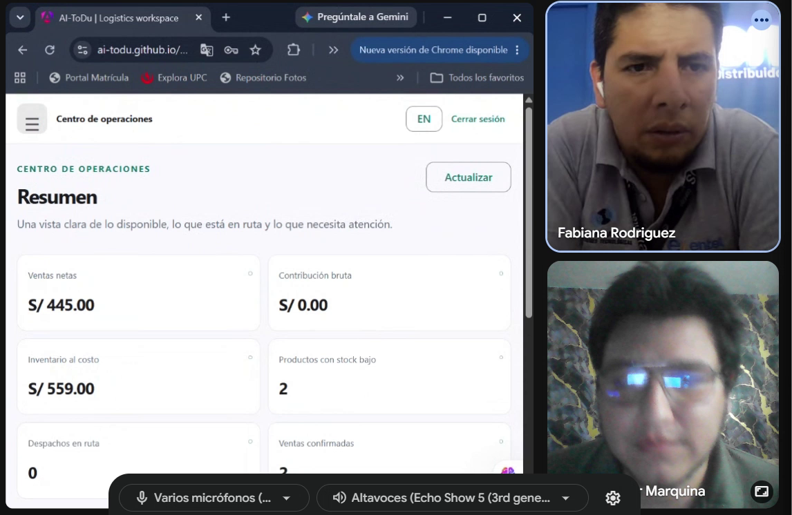

| Actividad y tiempo en la fuente | Observación y asistencia | Interpretación / decisión |
| --- | --- | --- |
| Landing y acceso · 01:33–02:32 | Revisa la página y accede con una cuenta preparada, con indicaciones del moderador. | Se observa acceso asistido; no se mide descubrimiento autónomo. |
| Inventario e historial · 03:54–06:29 | El moderador explica movimientos, producto nuevo e historial; se cancelan formularios de exploración. | Evidencia de comprensión guiada del recorrido, no de completar altas sin ayuda. |
| Venta · 07:08–08:08 | Se agregan dos unidades y se confirma la venta con indicaciones; se muestra el comprobante. | Conservar la referencia venta–comprobante; no presentarlo como comprobante tributario. |
| Opinión y mejora · 12:01–13:40 | Valora reunir funciones que utiliza en varios sistemas; solicita separar tiendas/sedes (13:19–13:40). | H-06: evaluar múltiples ubicaciones como evolución del dominio. |

**Resumen:** la integración del flujo resulta pertinente para su función de supervisión. La necesidad de separar tiendas no está cubierta por el incremento AV2. En 08:19–09:13 el moderador describe un traspaso automático entre tiendas; esa explicación excede la implementación: el despacho enlaza una venta y no mueve saldo entre almacenes. La conclusión y el alcance del producto mantienen esa distinción. No hay segunda sesión de comprobación.

#### VAL-S3-02 · Fabiana · Operación

**Contexto:** asesora de Entel con tareas de recepción e inventario. Describe anotar desde el teléfono en una hoja compartida y trasladar la información a otro sistema (00:35–00:47). **Fuente:** [grabación completa, 09:31](https://youtu.be/5jAaAcLhDPM). **Inicio efectivo:** 00:00; consentimiento desde 00:22.

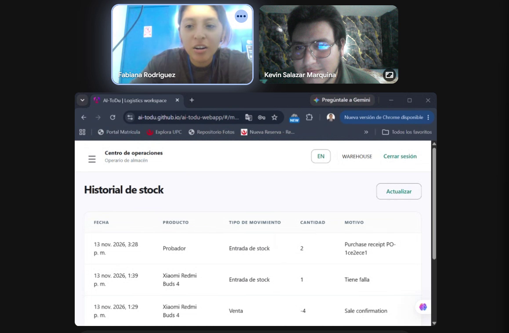

| Actividad y tiempo en la fuente | Observación y asistencia | Interpretación / decisión |
| --- | --- | --- |
| Landing e idioma · 01:10–02:54 | Necesita indicación para pasar de inglés a español; identifica el recorrido general. | H-02: hacer comprensibles los términos y conservar el idioma elegido. |
| Acceso e inventario · 03:09–05:20 | Cuenta preparada; ayuda para abrir menú y localizar el producto. Inicialmente menciona tres unidades y el moderador distingue la fila de prueba con saldo cero. | H-07: diferenciar cantidad de productos y unidades disponibles. No registrar la tarea como éxito sin asistencia. |
| Recepción parcial · 05:47–06:58 | Registra dos de cuatro unidades y consulta el historial con indicaciones. | H1 tiene evidencia cualitativa de uso asistido; el umbral de 80% no se evaluó. |
| Mejora · 08:59–09:11 | Solicita acciones visibles sin desplazamiento lateral y mensajes con el stock disponible. | H-01 y H-05: priorizar acceso a acciones y recuperación de errores. |

**Resumen:** percibe mayor control que en una hoja compartida (08:08–08:16), pero esto es una valoración de la participante, no una medición de seguridad o productividad. La sesión identifica barreras concretas de navegación y mensajes; la corrección debe comprobarse técnicamente y después con usuarios.

#### VAL-S3-03 · Diego · Operación

**Contexto:** almacenero de Makro, según identificación proporcionada por Kevin. Describe recepción de proveedores, registro en portapapeles y traslado a una computadora (00:36–00:48). Se conserva el nombre indicado por Kevin: el texto automático del inicio y el alias de videollamada no verifican por sí solos la identidad. **Fuente:** [grabación completa, 08:18](https://youtu.be/o0oloMIIYdc). **Inicio efectivo:** 00:00; consentimiento desde 00:20.

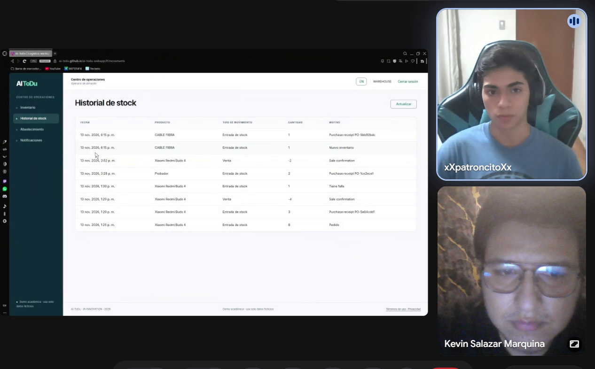

| Actividad y tiempo en la fuente | Observación y asistencia | Interpretación / decisión |
| --- | --- | --- |
| Movimiento de inventario · 05:03–05:20 | Registra una entrada con ayuda del moderador. | Observar registro asistido, sin extrapolar al proceso real de Makro. |
| Recepción e historial · 05:28–06:18 | Revisa compra, recepción e historial con indicaciones. | Se distingue la recepción de compra del movimiento manual. |
| Responsable del registro · 06:45–07:07 | Señala que ve la fecha, pero no quién recibió. | H-03: mostrar el responsable que la API ya conserva y una fecha precisa. |
| Conectividad y acciones · 07:24–07:54 | Reporta conectividad débil en almacén y pide una espera clara para evitar repetir clics; también solicita acciones visibles. | H-04: revisar carga/envío; H-01: acceso a acciones. Conectividad descrita, no medida. |

**Resumen:** para operar y conciliar por turnos necesita identificar quién ejecutó la acción y cuándo. El problema observado corresponde a la presentación del historial; la API de movimientos incluye `actorId`. No se requiere inventar un nuevo dato del dominio para corregir la vista. No hay una prueba posterior en su almacén.

#### VAL-S3-04 · Kimberlin · Administración

**Contexto:** administración y recepción de materiales en un colegio, además de compras, ventas y stock de un emprendimiento de belleza (00:37–00:57). **Fuente:** [grabación completa, 10:49](https://youtu.be/SnLXXd2ZRlI). **Inicio efectivo:** 00:00; consentimiento desde 00:17.

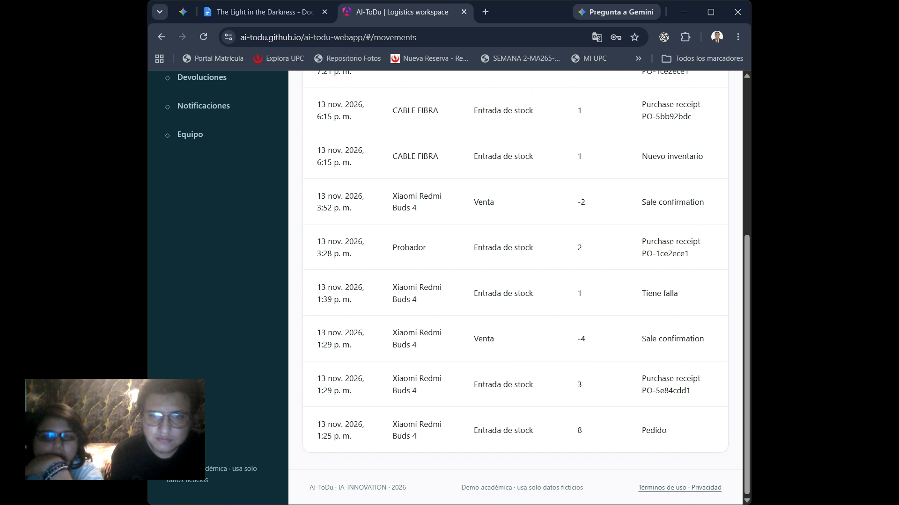

| Actividad y tiempo en la fuente | Observación y asistencia | Interpretación / decisión |
| --- | --- | --- |
| Landing · 01:07–02:43 | Explica que se reúnen compra, almacén, venta y despacho; localiza la demo tras la consigna. | Evidencia de comprensión de la propuesta, con una participante. |
| Inventario · 03:10–04:08 | Busca el producto indicado y responde que hay dos unidades y condición buena, con guía del moderador. | H1 tiene un ejemplo cualitativo; no se mide su umbral. |
| Recepción, venta y despacho · 04:15–08:16 | Recibe unidades, confirma venta y ejecuta el despacho con indicaciones. La cuenta de demostración es de administrador. | H2: recorrido asistido; no prueba un reparto físico, entrega parcial ni autonomía. |
| Historial y vocabulario · 09:38–10:16 | Confunde inicialmente el historial con recibos; pide cambiar términos en inglés. | H-02: traducir etiquetas y motivos generados; explicar la función del historial. |

**Resumen:** reconoce el propósito del producto y lo percibe práctico. La mezcla de idiomas dificulta la comprensión. En 07:48–07:59 el moderador menciona una entrega parcial; AV2 confirma la entrega completa del manifiesto, por lo que no se atribuye esa capacidad al sistema. El feedback favorable no se convierte en una tasa de aceptación.

#### VAL-S3-05 · Shirley · Administración y operación

**Contexto:** administra su peluquería y realiza compras, entradas, salidas y ventas de productos de belleza; utiliza cuadernos, comprobantes y WhatsApp (00:35–00:54). Cuenta como una participante con dos funciones. **Fuente:** [grabación completa, 12:48](https://youtu.be/-ITG0JFogfw). **Inicio efectivo:** 00:00; consentimiento desde 00:25.


| Actividad y tiempo en la fuente | Observación y asistencia | Interpretación / decisión |
| --- | --- | --- |
| Landing y acceso · 01:00–03:17 | Recorre la landing y entra con cuenta preparada; el moderador explica el resumen. | Comprensión posterior a explicación, sin medición autónoma. |
| Inventario y recepción · 03:20–06:10 | Explora formulario de producto, historial y recepción de una unidad, con guía. | Evidencia cualitativa del flujo de entrada con datos ficticios. |
| Venta y despacho · 06:16–09:26 | Agrega productos, confirma venta y completa las transiciones del despacho con indicaciones. | Recorrido asistido; no demuestra entrega física ni ahorro de tiempo. |
| Descubrimiento de venta · 11:22–11:52 | No reconoce claramente la tarjeta como acción para agregar producto; menciona contraste tenue. | H-08: incluir una acción explícita y perceptible para agregar al carrito. |
| Organización y alertas · 12:02–12:23 | Solicita clasificar por marca/sede e identificar el producto en alertas de stock. | H-09: resolver producto en la notificación; H-06: evaluar clasificación y sedes como evolución. |

**Resumen:** la sesión aporta necesidades de una persona que combina compra, venta y administración. Las marcas/sedes son una necesidad propuesta, no una función validada de AV2. El producto debe ayudar a descubrir acciones sin explicación del moderador y relacionar las alertas con artículos concretos.

#### Síntesis de hallazgos y contraste de hipótesis

| Hipótesis | Evidencia disponible | Resultado del contraste |
| --- | --- | --- |
| H1 · Comprender saldo e historial | Fabiana 05:47–06:58; Diego 05:28–07:07; Kimberlin 03:10–04:08 | Apoyo cualitativo parcial en un recorrido guiado. Persisten confusión de cantidades y ausencia visible del responsable. No se midió 80% sin ayuda. |
| H2 · Relacionar venta y despacho | Junior 07:08–09:13; Kimberlin 05:29–08:16; Shirley 06:16–09:26 | Se explora el flujo con asistencia. La ausencia de doble descuento se verifica en pruebas técnicas; no equivale a éxito autónomo de participantes. Sedes/entregas parciales no están implementadas. |
| H3 · Comprensión bilingüe | Fabiana 01:10–01:27; Kimberlin 09:59–10:16 | Hay evidencia contraria al criterio de mensajes clave totalmente traducidos: roles y motivos siguen en inglés. Requiere corrección y nueva comprobación. |

**Decisión:** priorizar acciones visibles, términos comprensibles, identificación del responsable, estados de espera y detalle del producto en alertas. Se conserva la solicitud de múltiples sedes y clasificación como trabajo futuro con reglas por definir. No se presenta una nueva prueba con usuarios que todavía no se ha realizado.

Las cinco fichas tienen fuente, captura, actividades, asistencia y observaciones. Las correcciones de código se detallan en el seguimiento del Anexo D y se encuentran en [backend PR #4](https://github.com/AI-ToDu/ai-todu-api/pull/4) y [frontend PR #7](https://github.com/AI-ToDu/ai-todu-webapp/pull/7); su publicación en ramas no acredita que ya estén integradas y desplegadas. La edición consolidada de 3–5 minutos por participante está publicada en YouTube y Stream y se detalla en el Anexo C; se concedió lectura al docente en Microsoft 365, sin notificación. Los registros heredados no se cuentan como nuevas validaciones.

### 5.3.3. Evaluación heurística

La evaluación documental sigue la estructura del **Anexo D** del enunciado: alcance, escala, tabla resumen, problema, evidencia y recomendación. Los hallazgos proceden de las cinco sesiones; la clasificación y las recomendaciones se preparan con revisión técnica asistida. No se declara una auditoría independiente ni una segunda evaluación con participantes.

| ID | Problema identificado | Severidad propuesta | Principio | Fuente |
| --- | --- | --- | --- | --- |
| H-01 | Acciones de fila dependientes del desplazamiento horizontal | 3 | Usability · flexibilidad y eficiencia | Fabiana 08:59–09:11; Diego 07:44–07:54 |
| H-02 | Motivos generados en inglés en una vista en español | 2 | Usability · consistencia; Inclusive Design · comprensión | Kimberlin 09:59–10:16; captura del historial |
| H-03 | Historial sin responsable visible ni segundos/zona horaria | 3 | Information Architecture · información comprensible y útil | Diego 06:45–07:07 y 07:44–07:54 |
| H-04 | Riesgo de repetir acciones durante una espera poco clara | 3 | Usability · visibilidad del estado y prevención de errores | Diego 07:24–07:35; conectividad reportada |
| H-05 | Rechazo de stock sin cantidad disponible para corregirlo | 2 | Usability · reconocer y recuperarse de errores | Fabiana 08:59–09:11 |
| H-07 | Contador de productos que puede confundirse con unidades | 2 | Information Architecture · etiquetas claras | Fabiana 04:56–05:20 |
| H-08 | Tarjeta de producto sin acción explícita para agregar a venta | 3 | Usability · reconocimiento; Inclusive Design · percepción | Shirley 11:22–11:52 |
| H-09 | Alerta de stock sin identificar el artículo | 2 | Information Architecture · contexto y referencia | Shirley 12:02–12:23 |

La necesidad H-06 de marcas/sedes es una solicitud de capacidad adicional, no un error heurístico de una función prometida. Se mantiene como trabajo futuro. El [Anexo D](#anexo-d-evaluación-de-user-experience-según-heurísticas) desarrolla los ocho problemas y sus criterios de comprobación.

## 5.4. Video About-the-Product

La versión AV2 **AI-ToDu | AV2 Sprint 3 | About-the-Product** reúne escenas reales de recepción, venta y despacho y opiniones de administración (Kimberlin) y operación (Fabiana). Usa extractos de las sesiones guiadas del 13/11/2026, datos ficticios y las autorizaciones de publicación correspondientes. No presenta las opiniones como resultados empresariales ni como pruebas autónomas.

[Ver en YouTube, 2:21](https://youtu.be/nvsYXk91k4c) · [Reproducir en Microsoft Stream](https://upcedupe-my.sharepoint.com/personal/u202417747_upc_edu_pe/_layouts/15/stream.aspx?id=%2Fpersonal%2Fu202417747_upc_edu_pe%2FDocuments%2FAI-ToDu+AV2+Sprint+3+-+Evidencias%2FAI-ToDu-About-the-Product-AV2-revision.mp4) · [Video embebido en la landing pública](https://ai-todu.github.io/ai-todu-platform/#product-video). El archivo tiene aproximadamente 2:20; YouTube redondea a 2:21. La reproducción institucional se verificó desde la cuenta propietaria; se concedió acceso de lectura al docente, sin notificación. No se comprobó su inicio de sesión.

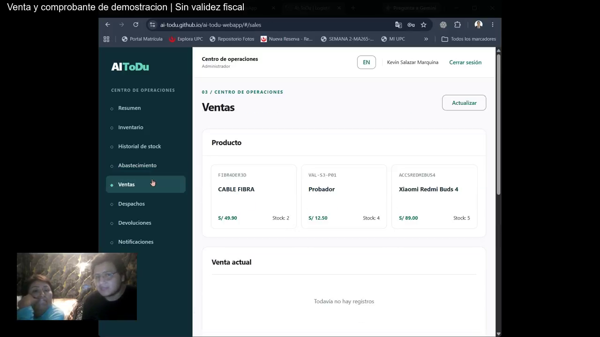

| Inicio | Sección | Fuente |
| --- | --- | --- |
| 00:00 | Propuesta de valor y contexto académico | Portada de edición |
| 00:05 | Recepción de mercadería | Shirley, 05:02–05:33 |
| 00:36 | Venta y comprobante demo | Shirley, 06:16–06:48 |
| 01:08 | Despacho | Kimberlin, 07:11–07:39 |
| 01:36 | Opinión de administración | Kimberlin, 09:59–10:16 |
| 01:53 | Opinión de operación | Fabiana, 08:08–08:18 |
| 02:03 | Mejora sugerida por operación | Fabiana, 08:59–09:11 |
| 02:15 | Cierre | Portada final |

Se conserva como antecedente el [clip promocional PROMO: Ai ToDu](https://youtu.be/NXNWTw8_6GY), de aproximadamente 10 segundos. La edición AV2 amplía esa evidencia sin sustituir su procedencia histórica.

## 5.5. Video About-the-Team

**Pendiente de evidencia real.** Mostrar trabajo, aportes y reflexión de cada participante que corresponda. Las grabaciones históricas se atribuyen con contexto verificable. No se simulan reuniones, integrantes activos ni contribuciones recientes. Enlace, duración, participantes y minutos se completarán al recibir videos.

---

# Conclusiones

1. El prototipo conecta recepción, saldo, venta y entrega mediante registros persistidos. La prueba técnica demuestra coherencia del recorrido ficticio; no mide reducción de pérdidas o productividad empresarial.
2. La corrección separa dominio de transporte, incorpora value objects y contrasta arquitectura TB1 con diseño AV2. El monolito modular está implementado en Java y desplegado; no se declaran microservicios inexistentes.
3. El modelo objetivo de 35 tablas organiza capacidades; las migraciones AV2 implementan 19 tablas más historial Flyway. La cobertura operativa sigue siendo parcial en lotes, ubicaciones, clientes, varios intentos/paradas, suscripciones y seguridad productiva. El conteo no sustituye un caso de uso terminado.
4. Cinco sesiones guiadas aportan observaciones de administración y operación: se requieren acciones visibles, lenguaje consistente, responsable del movimiento y contexto del artículo en las alertas. Se documentan ocho problemas heurísticos y correcciones técnicas en ramas de revisión. La eficacia sin ayuda, el impacto empresarial y la reflexión individual todavía no están demostrados.

## Mejora continua y autocrítica

| Observación del docente | Corrección aplicada | Evidencia / condición pendiente |
| --- | --- | --- |
| Student Outcome sin acciones por persona/entrega | Matriz AV1/TB1 con commits reales y acción escrita específica. | Evidencia oral y reflexión individual pendientes. |
| Repositorios faltantes | Repositorios reales enlazados; Fake API independiente y copia trazable. | Backend Java publicado y CI PostgreSQL aprobado. |
| Versiones incorrectas | Registro apoyado en fechas/commits; corrección fechada 30/10/2026. | Ratificar fecha formal de las ceremonias. |
| Imágenes rotas | Referencias ausentes sustituidas por estado explícito; fuentes históricas conservadas. | Adjuntar material real; no intercambiar identidades. |
| Seis commits y sin develop | Historial preservado, develop incorporada y bloques de corrección revisables. | Colaboración progresiva, revisión y tablero reales del equipo. |
| Landing sin enlace | URL pública y CTA real en configuración y producto. | Comprobar el CTA y la versión pública en cada entrega. |
| Falta de Mock API | Motor persistente, HTTP local, worker estático, OpenAPI y pruebas. | No equivale a servidor productivo multiusuario. |
| Orden del dominio | Épicas, historias y diagramas core → soporte → genérico; canal público al final. | Revalidar clasificación si cambia el negocio. |
| C4 débil | C1, C2 actual/futuro y C3 con responsabilidades, límites y tecnología. | C2/C3 AV2 y Design-Level Event Storming contrastados con el servidor. |
| Tipos primitivos en dominio | Sku, Quantity, Money y Address; límites de agregados. | Dominio Java agnóstico y repositorios implementados; ampliar VOs según cambien reglas. |
| Tablas con nomenclatura incorrecta | 35 tablas lowercase snake_case, claves/restricciones/diccionario/ERD. | Migraciones PostgreSQL V1–V4 y pruebas reales en CI; modelo objetivo aún parcial. |
| Sprint 1 incompleto / salto a 3 | Sprint 1 y 2 con las ocho secciones, límites históricos explícitos. | Actas, tablero y evidencias históricas pendientes. |
| Goal sin formato | Outcome/impact/customer/confirmation con estructura del enunciado. | Acuerdo del equipo y validación del impacto con usuarios. |
| BD poco funcional | Recepción parcial, recursos reales de demo, devoluciones y bandeja operativa. | Profundidad en lotes/ubicaciones/rutas y clientes. |

## Pendientes de evidencia y próxima entrega

**Estado del cierre actual:** cinco originales publicados, fichas con capturas/tiempos y ocho problemas heurísticos documentados; cuatro retratos originales y seis imágenes de investigación recuperados. El tablero de seguimiento es público. El consolidado de validaciones (19:18 en YouTube), Product Navigation (7:59) y About-the-Product (2:21) están publicados en YouTube y en la carpeta institucional propia de UPC. About-the-Product también está embebido en la landing pública.

**Pendiente de evidencia real o acción externa:** grabar About-the-Team y la reflexión personal de Kevin; revisar e integrar las ramas técnicas, desplegar y volver a comprobar con participantes. El Performance Report conserva la escala sin asignar una calificación, justificación personal ni firma automática. Las ceremonias históricas y los videos iniciales sin URL auténtica no se reconstruyen.

**Trabajo posterior, en orden del dominio:**

1. Inventory: almacenes, ubicaciones, lotes, variantes y vencimiento, con reglas y casos completos.
2. Logistics: múltiples paradas, intentos fallidos, reprogramación, capacidad y rutas.
3. Procurement/Sales/Returns: clientes, aprobaciones, política de valorización, cambios y reexpedición. Pagos/SUNAT requieren alcance y proveedor.
4. IAM: invitaciones, recuperación/cambio de contraseña y auditoría ampliada.
5. Operación: continuidad/exportación de PostgreSQL antes de su caducidad, observabilidad y pruebas de carga acordes al uso real.

El seguimiento actual identifica a Kevin como responsable y usa las fechas reales de creación/avance. Las estimaciones de referencia no se presentan como horas medidas ni compromisos históricos.

# Bibliografía y fuentes

- Universidad Peruana de Ciencias Aplicadas. (2026). *1ASI0729 Final Project Statement, ABET*. Documento del curso proporcionado por el equipo; formato de Sprint Goal, p. 24; entregables y evidencias según secciones correspondientes.
- Universidad Peruana de Ciencias Aplicadas. (2026). *Rúbrica ABET 3* y *Rúbrica de logro 1ASI0729*. Documentos proporcionados por el equipo. Las capturas de la evaluación TB1 son feedback, no una calificación recalculada por esta revisión.
- Angular Team. (s. f.). *Angular Material: Getting started*. https://material.angular.dev/guide/getting-started
- Mozilla. (s. f.). *Using Service Workers*. https://developer.mozilla.org/en-US/docs/Web/API/Service_Worker_API/Using_Service_Workers
- Node.js Contributors. (s. f.). *SQLite*. https://nodejs.org/api/sqlite.html
- GitHub. (s. f.). *Using custom workflows with GitHub Pages*. https://docs.github.com/en/pages/getting-started-with-github-pages/using-custom-workflows-with-github-pages
- Mermaid Contributors. (s. f.). *Mermaid CLI*. https://github.com/mermaid-js/mermaid-cli
- Brown, S. (s. f.). *The C4 model for visualising software architecture*. https://c4model.com/
- Spring Team. *Spring Boot reference*. https://docs.spring.io/spring-boot/
- JJWT. *Signed JWT creation and parsing*. https://github.com/jwtk/jjwt
- Render. *Free instances and limits*. https://render.com/docs/free
- Open-Meteo. *Weather Forecast API*. https://open-meteo.com/en/docs
- AI-ToDu. (2026). *Repositorios de producto e informe*. https://github.com/AI-ToDu

Las fuentes de mercado heredadas sin trazabilidad entre afirmación y documento no se utilizan para sostener porcentajes o resultados. El análisis competitivo vincula páginas oficiales y requiere prueba de edición/fecha antes de afirmar equivalencias de funciones o precio.

# Anexos

- [Arquitectura, decisiones y brechas](design/architecture.md).
- [Diccionario de las 35 tablas](design/database/dictionary.md) y [DDL](design/database/schema.sql).
- [Registro de investigación y fuentes heredadas](research/README.md).
- Las notas de revisión y avances se conservan localmente, fuera del repositorio.
- Diagramas: fuentes Mermaid junto a los SVG en `design/diagrams`.

El README completo se genera desde las fuentes indicadas en la introducción. `npm run check` valida sincronía, assets locales y límites de estimaciones; la exportación PDF mantiene el mismo texto. Ningún generador completa evidencias humanas pendientes automáticamente.

## Modelo físico · diagramas de detalle

Los diagramas siguientes incluyen claves y columnas. Las FK entre áreas se consultan en el DDL y diccionario; los SVG editables permiten ampliar el detalle sin pérdida de definición. El modelo de 35 tablas es una referencia de alcance futuro. El esquema AV2 desplegado se enumera en 4.8.1.1 y en las migraciones del backend.

<div class="diagram-appendix">

### Inventario · core


[Fuente SVG ampliable](design/diagrams/rendered/erd-inventory.svg) · [DDL completo](design/database/schema.sql).

</div>

<div class="diagram-appendix">

### Logística · core


[Fuente SVG ampliable](design/diagrams/rendered/erd-logistics.svg) · [DDL completo](design/database/schema.sql).

</div>

<div class="diagram-appendix">

### Abastecimiento · soporte


[Fuente SVG ampliable](design/diagrams/rendered/erd-procurement.svg) · [DDL completo](design/database/schema.sql).

</div>

<div class="diagram-appendix">

### Ventas · soporte


[Fuente SVG ampliable](design/diagrams/rendered/erd-sales.svg) · [DDL completo](design/database/schema.sql).

</div>

<div class="diagram-appendix">

### Devoluciones · soporte


[Fuente SVG ampliable](design/diagrams/rendered/erd-returns.svg) · [DDL completo](design/database/schema.sql).

</div>

<div class="diagram-appendix">

### Notificaciones · soporte


[Fuente SVG ampliable](design/diagrams/rendered/erd-notifications.svg) · [DDL completo](design/database/schema.sql).

</div>

<div class="diagram-appendix">

### Identidad · genérico


[Fuente SVG ampliable](design/diagrams/rendered/erd-identity.svg) · [DDL completo](design/database/schema.sql).

</div>

## Anexo A. Student Outcome

La introducción, criterios, acciones por entrega, fuentes y conclusiones se encuentran en la sección inicial Student Outcome. La evidencia oral y reflexión individual pendiente se incorporará con audiencia, enlace y minuto verificables.

## Anexo B. Participación individual

El Performance Report editable del paquete de entrega mantiene la escala del enunciado (20, 16, 13, 07 o 00), sin asignar una nota automática. El coordinador debe verificar autoría, contribuciones, justificación y firma antes de emitirlo. Los commits históricos no prueban por sí solos tiempo dedicado ni aprendizaje individual.

## Anexo C. Testimonios y videos

| Evidencia | Segmento / participante | Fuente, consentimiento y minuto | Estado |
| --- | --- | --- | --- |
| Entrevista de validación VAL-S3-01 | Junior; perfil administrador indicado por Kevin | [YouTube no listado](https://youtu.be/4JEE-XqUjrM), archivo 00:00–14:00 | Fuente, captura y ficha en §5.3.2; extracto incluido en consolidado |
| Entrevista de validación VAL-S3-02 | Fabiana; perfil operaria indicado por Kevin | [YouTube no listado](https://youtu.be/5jAaAcLhDPM), archivo 00:00–09:31 | Fuente, captura y ficha en §5.3.2; extracto incluido en consolidado |
| Entrevista de validación VAL-S3-03 | Diego; perfil operario indicado por Kevin | [YouTube no listado](https://youtu.be/o0oloMIIYdc), archivo 00:00–08:18 | Fuente, captura y ficha en §5.3.2; extracto incluido en consolidado |
| Entrevista de validación VAL-S3-04 | Kimberlin; perfil administradora indicado por Kevin | [YouTube no listado](https://youtu.be/SnLXXd2ZRlI), archivo 00:00–10:49 | Fuente, captura y ficha en §5.3.2; extracto incluido en consolidado |
| Entrevista de validación VAL-S3-05 | Shirley; administración y operación de peluquería, según Kevin | [YouTube no listado](https://youtu.be/-ITG0JFogfw), archivo 00:00–12:48 | Fuente, captura y ficha en §5.3.2; extracto incluido en consolidado |
| Validaciones consolidadas | Junior, Fabiana, Diego, Kimberlin y Shirley | [YouTube, 19:18](https://youtu.be/jyTipnKiQVY) · [Stream](https://upcedupe-my.sharepoint.com/personal/u202417747_upc_edu_pe/_layouts/15/stream.aspx?id=%2Fpersonal%2Fu202417747_upc_edu_pe%2FDocuments%2FAI-ToDu+AV2+Sprint+3+-+Evidencias%2FAI-ToDu-validacion-Sprint3-consolidado.mp4) | Cinco extractos de 3–5 min; lectura concedida al docente |
| Product Navigation | Landing y aplicación, con Kimberlin y Shirley | [YouTube, 7:59](https://youtu.be/yJ4Z1_eoIPs) · [Stream](https://upcedupe-my.sharepoint.com/personal/u202417747_upc_edu_pe/_layouts/15/stream.aspx?id=%2Fpersonal%2Fu202417747_upc_edu_pe%2FDocuments%2FAI-ToDu+AV2+Sprint+3+-+Evidencias%2FAI-ToDu-Product-Navigation-AV2-revision.mp4) | Landing 3:02; aplicación 4:51; cierre 0:05; captura y tiempos en §5.2.3.5 |
| About-the-Product | Producto y ambos segmentos | [YouTube, 2:21](https://youtu.be/nvsYXk91k4c) · [Stream](https://upcedupe-my.sharepoint.com/personal/u202417747_upc_edu_pe/_layouts/15/stream.aspx?id=%2Fpersonal%2Fu202417747_upc_edu_pe%2FDocuments%2FAI-ToDu+AV2+Sprint+3+-+Evidencias%2FAI-ToDu-About-the-Product-AV2-revision.mp4) | Publicado y embebido en landing; captura y tiempos en §5.4 |
| About-the-Team | Participantes de la entrega | Enlaces y reflexiones individuales pendientes | Sin evidencia completa |
| Tablero Scrum | Cierre actual a cargo de Kevin | [Trello público](https://trello.com/b/82JkmgZH/ai-todu-av2-sprint-3), creado 13/11/2026; acceso de lectura sin invitación | Doce tarjetas, cuatro estados; no reconstruye sprints anteriores |

### Distribución del consolidado de validación

| Participante | Inicio en el consolidado | Duración del extracto |
| --- | --- | --- |
| Junior | 00:00 | 3:58 |
| Fabiana | 03:58 | 3:15 |
| Diego | 07:13 | 3:25 |
| Kimberlin | 10:38 | 4:21 |
| Shirley | 14:59 | 4:18 |

La edición dura aproximadamente 19:17; YouTube redondea a 19:18. Los rótulos conservan participante, segmento, fecha, corte y minuto de la fuente. Los fragmentos mantienen la guía del moderador y las limitaciones de la demostración. No se convierten en cinco pruebas independientes sin asistencia.

**Repositorio institucional de evidencias:** [AI-ToDu AV2 Sprint 3 - Evidencias](https://upcedupe-my.sharepoint.com/:f:/r/personal/u202417747_upc_edu_pe/Documents/AI-ToDu%20AV2%20Sprint%203%20-%20Evidencias?d=w21e563693fa24002b7ab2dfd547653d3&csf=1&web=1&e=glswqF), en el OneDrive UPC de Kevin. Se verificaron los tres archivos y su reproducción en Stream desde la cuenta propietaria el 13/11/2026. Se concedió acceso de lectura al docente indicado por Kevin, sin enviar notificación; la carpeta conserva acceso restringido. La configuración se verificó desde la cuenta propietaria y no acredita que el docente ya la haya abierto. No se afirma que sea un canal proporcionado por el docente.

Los datos identificables y consentimientos no se publican automáticamente en Git. Solo se adjunta material autorizado para la evaluación.


## Anexo D. Evaluación de User Experience según heurísticas

**Carrera:** Ingeniería de Software. **Curso:** Desarrollo de Aplicaciones Open Source, 1ASI0729. **Sección:** NRC 7750. **Docente:** Efraín Ricardo Bautista Ubillús. **Producto:** AI-ToDu, landing y aplicación web AV2. **Preparación:** Kevin Junior Salazar Marquina, con revisión documental/técnica asistida. **Fuentes:** sesiones VAL-S3-01 a VAL-S3-05; nombres de referencia en §5.3.2. **Fecha de revisión:** 13/11/2026. **Revisión final del responsable y auditoría independiente:** no acreditadas por este documento.

### Alcance e instrumento

Se revisan comprensión de la landing, navegación, consulta de existencias, recepción, historial, venta, despacho y notificaciones. Se contrastan Usability, Inclusive Design e Information Architecture. Se excluyen facturación tributaria, pagos, transferencias entre sedes, entregas parciales, trabajo sin conexión y una auditoría integral de accesibilidad. Las tareas fueron guiadas, con cuentas preparadas y datos ficticios. La opinión favorable no elimina una dificultad observada.

La severidad usa la escala del curso: **1**, superficial; **2**, menor; **3**, mayor y de prioridad alta; **4**, impide continuar y exige corrección previa al lanzamiento. Los valores son una priorización propuesta a partir de las sesiones; no se calcula frecuencia poblacional a partir de cinco participantes. La tabla resumen se encuentra en §5.3.3.

### H-01 · Acciones de fila fuera de la vista inicial

**Severidad:** 3. **Principio:** Usability, flexibilidad y eficiencia. **Problema:** una tabla ancha exige desplazarse lateralmente para descubrir o alcanzar la acción de recepción. Fabiana lo señala en 08:59–09:11 y Diego en 07:44–07:54. La captura ilustra el desplazamiento de la tabla; no prueba que la acción falte en todos los tamaños.

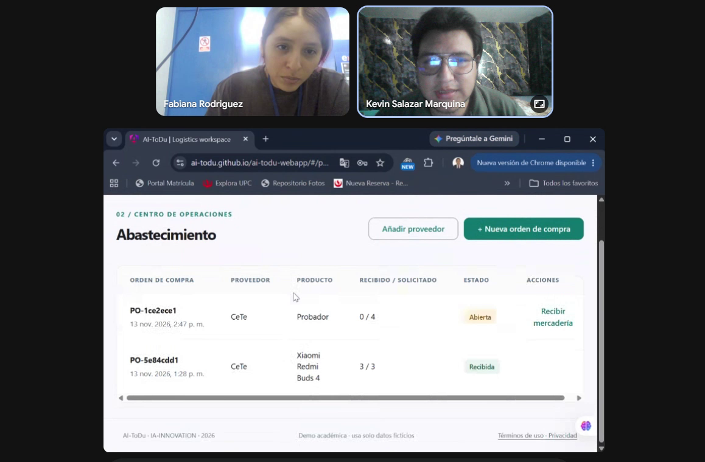

**Recomendación:** mantener la columna de acciones visible durante el desplazamiento y conservar nombre/producto y cantidades accesibles. **Comprobación requerida:** a 390 px y en escritorio, alcanzar «Recibir mercadería» sin desplazar primero hasta el borde derecho; abrir/cancelar el diálogo con teclado; evitar que la columna tape todas las columnas informativas. Una prueba técnica no sustituye la comprobación con participantes.

### H-02 · Mezcla de idiomas en motivos del historial

**Severidad:** 2. **Principio:** Usability, consistencia y estándares; Inclusive Design, comprensión. **Problema:** la pantalla está en español, pero se ven motivos automáticos como confirmación de venta y recepción en inglés. Kimberlin pide traducirlos en 09:59–10:16. [Captura de la sesión](assets/validation/kimberlin-session.png).

**Recomendación:** traducir los motivos generados por el sistema y conservar intacto el texto libre escrito por la persona. No sustituir códigos ni datos persistidos para resolver una etiqueta de interfaz. **Comprobación requerida:** cambiar idioma, mostrar motivo traducido y referencia de compra; un motivo libre debe permanecer idéntico.

### H-03 · Falta de responsable visible en el historial

**Severidad:** 3. **Principio:** Information Architecture, información comprensible y útil. **Problema:** Diego busca quién recibió y en qué momento del turno (06:45–07:07; 07:44–07:54); la vista solo presenta fecha, producto, tipo, cantidad y motivo. [Captura del historial, 06:48](assets/validation/diego-session.png).

**Recomendación:** mostrar el responsable que ya viene en `actorId`, con nombre cuando exista una fuente autorizada y referencia cuando no; incluir segundos y zona horaria al revisar movimientos. No adjudicar automáticamente registros históricos a Kevin ni consultar una lista de empleados sin permiso del rol. **Comprobación requerida:** administrador y operario, registros propios/ajenos y registros antiguos sin responsable; distinguir una referencia de usuario de un nombre verificado.

### H-04 · Espera y repetición de acciones

**Severidad:** 3. **Principio:** Usability, visibilidad y prevención de errores. **Problema reportado:** Diego describe mala conectividad y solicita saber si la acción sigue procesándose para no repetirla (07:24–07:35). La sesión no aporta una medición controlada de latencia ni demuestra duplicación causada por el servidor. [Contexto de la sesión](assets/validation/diego-session.png).

**Recomendación:** indicar carga y envío, deshabilitar temporalmente el control que ejecuta la operación y conservar feedback de error. Mantener las invariantes y garantías transaccionales del backend. **Comprobación requerida:** red con espera, dos clics consecutivos y error: una solicitud mientras esté en curso; controles recuperables al terminar. Esto no declara operación sin conexión.

### H-05 · Error de stock sin contexto cuantitativo

**Severidad:** 2. **Principio:** Usability, recuperación de errores. **Problema reportado:** Fabiana solicita que el mensaje indique cuántas unidades quedan (08:59–09:11). [Captura representativa de la sesión](assets/validation/fabiana-session.png); ilustra el contexto, no una reproducción del error.

**Recomendación:** mostrar el saldo consultado del artículo al registrar una salida y actualizarlo tras un rechazo por stock. El servidor debe seguir validando concurrencia. **Comprobación requerida:** intentar retirar más unidades que las disponibles, mantener el formulario y el mensaje, volver a consultar el saldo y corregir la cantidad; ninguna unidad debe descontarse en el intento rechazado.

### H-07 · Productos frente a unidades disponibles

**Severidad:** 2. **Principio:** Information Architecture, etiquetas comprensibles. **Problema:** Fabiana inicialmente da una cantidad que el moderador corrige al precisar el producto (04:56–05:20). No se atribuye causalidad definitiva al contador, pero su etiqueta sin unidad aumenta la ambigüedad. [Contexto de la sesión](assets/validation/fabiana-session.png).

**Recomendación:** rotular el contador como cantidad de productos y la columna como unidades disponibles. **Comprobación requerida:** al filtrar, el contador cuenta artículos y la columna mantiene el saldo del artículo; no sumar ambos conceptos ni convertirlos en una única métrica.

### H-08 · Descubrimiento de agregar un producto a la venta

**Severidad:** 3. **Principio:** Usability, reconocimiento; Inclusive Design, percepción. **Problema:** Shirley duda cómo vender porque la tarjeta no presenta una acción explícita y su contraste le resulta tenue (11:22–11:52). No se afirma un incumplimiento WCAG medido solo por esta opinión.

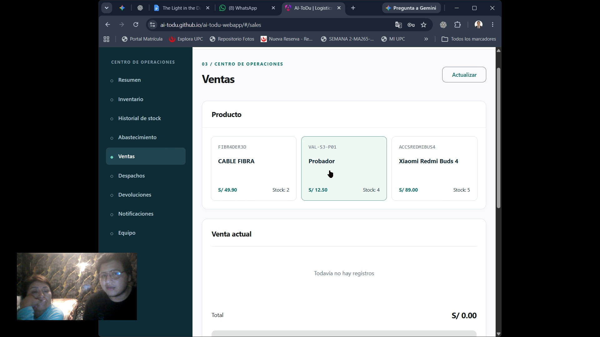

**Recomendación:** incluir «Agregar a la venta», foco visible, contraste perceptible y explicación para producto sin stock o bloqueado por conservación. Conservar una sola acción semántica por tarjeta. **Comprobación requerida:** agregar con ratón y teclado, incrementar una unidad, no permitir exceder saldo ni agregar un artículo no vendible, y conservar cantidades durante el envío.

### H-09 · Alerta sin producto identificado

**Severidad:** 2. **Principio:** Information Architecture, contexto y referencia. **Problema reportado:** Shirley necesita identificar a qué producto corresponde la alerta de stock (12:02–12:23). [Captura representativa de la sesión](assets/validation/shirley-session.png). La interfaz y el recurso de notificación original solo muestran tipo, fecha y lectura; la captura no presenta el instante de la alerta.

**Recomendación:** transportar una referencia de producto desde el evento de integración, persistirla en la notificación y resolver nombre/SKU dentro de la empresa autorizada. Conservar compatibilidad con notificaciones antiguas sin referencia. **Comprobación requerida:** generar una alerta real por umbral, identificar el artículo correcto, aislar empresas y permitir leer registros históricos; no inferir el producto a partir de la fecha.

### Seguimiento de correcciones

Cada corrección debe vincular commit, comprobación técnica, resultado y condición pendiente. El cierre con participantes solo puede registrarse tras otra sesión real; no se deduce de una compilación o un cambio de código. Las necesidades de marcas/sedes (H-06) requieren un nuevo alcance de dominio y permanecen en el backlog de evolución.


### Comprobación técnica de las correcciones del 13/11/2026

| Hallazgo | Cambio y fuente | Comprobación realizada | Límite |
| --- | --- | --- | --- |
| H-01, H-07, H-08 | Frontend `9f0b2cc`: columna fija de acciones, unidades explícitas y «Agregar a la venta» | Navegador HTTP demo: venta desde teclado, stock 15 → 14; a 390 px acción dentro de la vista y sin desbordamiento de página | Rama de revisión; falta comprobar con participantes |
| H-02, H-03, H-04, H-05 | Frontend `486127b` y `d36fd08`: responsable, segundos/zona, traducción de motivos, saldo consultado y espera | Se muestra Alex Morgan en datos ficticios; se conserva el formulario tras rechazo con saldo cero; 21 pruebas y compilación aprobadas | No se mide tolerancia a una red empresarial ni éxito autónomo |
| H-09 | Backend `6014719`: ProductReference y converter; V5 nullable. Frontend `d36fd08`: nombre/SKU y enlace filtrado | 17 pruebas H2 y CI PostgreSQL 17/Java 21; contrato HTTP identifica el producto; una alerta demo abre el SKU correcto | Alertas anteriores sin referencia muestran estado explícito. No se infiere el artículo |

Fuentes revisables: [backend PR #4](https://github.com/AI-ToDu/ai-todu-api/pull/4), [frontend PR #7](https://github.com/AI-ToDu/ai-todu-webapp/pull/7) y [verificación PostgreSQL](https://github.com/AI-ToDu/ai-todu-api/actions/runs/43550024736). Las comprobaciones se hicieron con datos ficticios. Integración, despliegue de estas ramas y nueva sesión con usuarios no se dan por concluidos.
