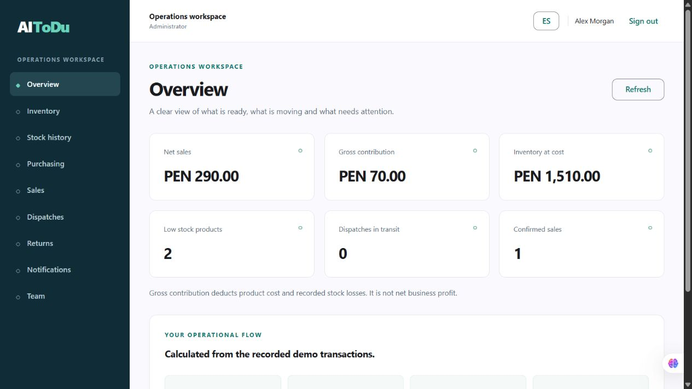

<!-- GENERATED: edit report-front.md, chapters and report-closing.md; npm run report -->

# UNIVERSIDAD PERUANA DE CIENCIAS APLICADAS

### Facultad de Ingeniería
### Carrera de Ingeniería de Software

 

### **7750**
### **Desarrollo de Aplicaciones Open Source · 1ASI0729**

 

# **Informe del Trabajo Final**

Docente
### **Bautista Ubillús, Efraín Ricardo**

 

Startup
### **IA-INNOVATION**

Producto
### **AI-ToDu**

 

## **INTEGRANTES**

| Código | Apellidos y Nombres |
| :---: | :--- |
| U202420071 | Bernal Torres, Carlos Alberto |
| U20241i327 | Chui Kcomt, Luis Carlos |
| U202411324 | Condezo Pacheco, Fernando André |
| U202417747 | Salazar Marquina, Kevin Junior |
| U202422620 | Salazar Quiche, Darikson Bill |

 

### **Período 2026-2**
### **Octubre 2026**

**TB1 — Corrección y preparación de AV2 · v0.2.0**

[Producto](#capítulo-i-introducción) · [Investigación](#capítulo-ii-requirements-elicitation--analysis) · [Requisitos](#capítulo-iii-requirements-specification) · [Diseño](#capítulo-iv-product-design) · [Implementación](#capítulo-v-product-implementation-validation--deployment) · [Pendientes](#pendientes-de-evidencia-y-próxima-entrega)

---

> **Alcance de esta revisión.** TB1 integra el frontend con una Fake REST API persistente. El servidor Java/Spring Boot, la persistencia PostgreSQL y la autenticación de producción corresponden a AV2. La revisión técnica no sustituye entrevistas, sustentaciones ni registros históricos del equipo.

## Cómo leer y mantener este informe

Este README es el informe completo **generado** desde `report-front.md`, los cinco capítulos y `report-closing.md`. Se edita cada fuente una sola vez y se ejecuta `npm run report`; `npm run check` detecta divergencias e imágenes locales rotas. Los diagramas se entregan en SVG y Mermaid editable. La exportación HTML/PDF comparte el mismo contenido.

| Estado documental | Significado |
| --- | --- |
| Implementado y verificado | Comportamiento observado en prueba automatizada o recorrido local, con alcance indicado. |
| Diseñado | Modelo, contrato o decisión revisada cuya implementación productiva aún falta. |
| Evidencia pendiente | Dato que el equipo debe sustentar con una fuente real. |

## Registro de versiones

Las fechas se apoyan en commits existentes; no se reconstruyen reuniones ni aprobaciones sin registro.

| Hito / revisión | Fecha verificable | Cambio y referencia |
| --- | --- | --- |
| AV1 · línea histórica | 19/09/2026 | Capítulos aportados por los cinco integrantes; véase Student Outcome. No se afirma que esta fecha represente la ceremonia de entrega. |
| TB1 · frontend inicial | 08/10/2026 | Seis commits originales de la webapp; módulos y README en [historial](https://github.com/AI-ToDu/ai-todu-webapp/commits/main/). |
| TB1 · informe base | 09/10/2026 | Baseline `fd8d611` del report; fuente anterior conservada en Git. |
| Corrección TB1 · v0.2.0 | 30/10/2026 | Fake API, UI/i18n, arquitectura/datos e informe en bloques de commits de `fix/tb1-readiness`. Revisión asistida ejecutada con autorización de Kevin; no atribuida a otros integrantes. |

## Student Outcome · ABET 3

**Comunicar eficazmente con diferentes audiencias, de forma oral y escrita.** Cada fila distingue una acción respaldada por Git de la evidencia oral aún pendiente. El commit acredita una contribución al archivo; no prueba por sí solo el aprendizaje individual ni una sustentación.

| Integrante | Entrega | Acción escrita realizada y fuente | Acción oral / evidencia requerida |
| --- | --- | --- | --- |
| Carlos | AV1 | Aportó el capítulo de elicitación: [e69f9e4](https://github.com/AI-ToDu/ai-todu-report/commit/e69f9e478750c3a3b981292e13bf13293c63cf93). | Adjuntar intervención, audiencia, enlace y minuto; sin registro verificado. |
| Luis | AV1 | Aportó el capítulo de implementación: [9940325](https://github.com/AI-ToDu/ai-todu-report/commit/9940325d09eef173c137a82a76201dcc5c64f345). | Adjuntar intervención y cómo explicó decisiones; sin registro verificado. |
| Fernando | AV1 | Aportó requisitos: [cf0f8c4](https://github.com/AI-ToDu/ai-todu-report/commit/cf0f8c4c93e7e789dad29682be9b851b8c618379). | Adjuntar intervención sobre requisitos y audiencia. |
| Kevin | AV1 | Aportó introducción: [93b6d8e](https://github.com/AI-ToDu/ai-todu-report/commit/93b6d8ed07031e62fa73336328b4a256cd6511d1). | Adjuntar intervención sobre problema/propuesta y minuto. |
| Darikson | AV1 | Aportó diseño: [eb5d628](https://github.com/AI-ToDu/ai-todu-report/commit/eb5d62850b1a987af937b42844c4d93be72f8020). | Adjuntar intervención sobre diseño y decisión comunicada. |
| Carlos | TB1 | Implementó IAM en frontend: [9aa7dae](https://github.com/AI-ToDu/ai-todu-webapp/commit/9aa7dae4236da015632ec7e8990e162cc4ed6654). | Adjuntar explicación de acceso/roles en sustentación TB1. |
| Luis | TB1 | Implementó logística en frontend: [b6bb6a3](https://github.com/AI-ToDu/ai-todu-webapp/commit/b6bb6a35bc04643ed1f24adcdc77ac580887c787). | Adjuntar demostración y minuto de despacho. |
| Fernando | TB1 | Implementó inventario: [9d10d5a](https://github.com/AI-ToDu/ai-todu-webapp/commit/9d10d5ac4f26c1982f0c668d9e22efd81fc65fa5). | Adjuntar demostración y explicación de reglas de stock. |
| Kevin | TB1 | Creó base de aplicación [e090d1f](https://github.com/AI-ToDu/ai-todu-webapp/commit/e090d1fda11606dc53aec8096c5feb5118a91f4d) y documentación [b05f4d7](https://github.com/AI-ToDu/ai-todu-webapp/commit/b05f4d7864c9fb07d1d80357c4649bf185622a3b). | Adjuntar explicación de integración y límites de la entrega. |
| Darikson | TB1 | Implementó POS/reporting: [427375e](https://github.com/AI-ToDu/ai-todu-webapp/commit/427375e4f19cd5a7ba481523642e01bcc194acfa). | Adjuntar demostración de venta/métricas y minuto. |

**AV2:** al realizar la entrega, añadir una fila por integrante con su acción efectivamente realizada, audiencia, decisión explicada, artefacto y evidencia oral/escrita. No registrar actividad futura como logro. La comunicación debe acompañarse de una reflexión individual sobre claridad, feedback recibido y mejora aplicada.

---

---

# Capítulo I: Introducción

## 1.1. Startup Profile

### 1.1.1. Descripción de la startup

IA-INNOVATION desarrolla **AI-ToDu**, una propuesta de software para pequeños negocios que necesitan conectar el inventario de almacén con compras, ventas y despachos. La unidad de valor es una operación trazable: conocer qué artículo entró, por qué cambió su saldo, qué venta comprometió unidades y qué entrega utilizó esa venta.

TB1 demuestra esta cadena con datos ficticios y una Fake REST API. El nombre del producto no acredita modelos de inteligencia artificial implementados. Predicción de demanda, optimización automática de rutas y decisiones basadas en IA permanecen fuera de la versión actual.

### 1.1.2. Perfiles de integrantes del equipo

Perfiles académicos declarados en el informe base, conservados como presentación del equipo. Las acciones verificadas por entrega se registran por separado en Student Outcome.

| Integrante | Perfil académico declarado |
| --- | --- |
| Bernal Torres, Carlos Alberto | Estudiante con sólidos conocimientos en el desarrollo frontend y backend. Aporta al equipo habilidades en la implementación de arquitecturas orientadas a dominio (DDD). |
| Chui Kcomt, Luis Carlos | Estudiante responsable con conocimientos en Python, C++, HTML. Aporta calidad y buen rendimiento en trabajos en equipo así como buen ambiente y compromiso. |
| Condezo Pacheco, Fernando André | Estudiante con conocimientos en C++ y Python. Aporta colaboración con el equipo y buen ambiente. |
| Salazar Marquina, Kevin Junior | Estudiante con sólidos conocimientos en el desarrollo frontend y backend. Aporta al equipo habilidades en el uso de frameworks como Angular y Spring Boot, enfocado en asegurar la escalabilidad del sistema B2B. |
| Salazar Quiche, Darikson Bill | [Pendiente de redacción] |

## 1.2. Solution Profile

### 1.2.1. Antecedentes y problemática

La hipótesis de problema es que el registro fragmentado entre cuadernos, hojas de cálculo y mensajes dificulta conciliar existencias y entregas. Se propone un flujo compartido entre quien administra y quien opera el almacén. La frecuencia, costo y severidad del problema deberán contrastarse con entrevistas verificables; no se presentan porcentajes de pérdida como datos medidos.

| Situación por validar | Consecuencia esperada | Respuesta de diseño |
| --- | --- | --- |
| Entradas y salidas sin motivo ni responsable | Conciliación difícil | Historial persistente y movimientos tipificados. |
| Venta sin comprobación del saldo/conservación | Sobreventa o artículo bloqueado | Validación completa y descuento atómico. |
| Despacho separado de la venta | Doble registro y pérdida de referencia | Manifiesto enlazado con líneas de venta reales. |
| Uso de números manuales como indicadores | Decisiones con información desactualizada | Métricas derivadas del registro, con límites contables explícitos. |

### 1.2.2. Lean UX Process

#### 1.2.2.1. Lean UX Problem Statements

Un pequeño negocio necesita coordinar recepción, venta y reparto con una vista común de las existencias. Suponemos que la fragmentación actual exige conciliaciones manuales y retrabajo. Sabremos que el problema fue atendido cuando usuarios de ambos segmentos completen un recorrido con saldo y entrega conciliados, con menos errores que en su proceso de referencia.

#### 1.2.2.2. Lean UX Assumptions

- El dueño considera útil un sistema que explica el origen del saldo y de sus métricas.
- El operario dispone de un dispositivo y conexión compatibles con la aplicación web.
- El negocio acepta un catálogo por SKU y cantidades enteras en la primera versión.
- Roles y lenguaje claro reducen errores sin exigir capacitación extensa.

Estas son suposiciones. La demo no prueba disposición de pago, tamaño de mercado, retención ni ahorro de tiempo en una empresa real.

#### 1.2.2.3. Lean UX Hypothesis Statements

| Hipótesis | Experimento propuesto | Criterio objetivo, aún no medido |
| --- | --- | --- |
| H1 · Un saldo acompañado por historial genera comprensión. | Pedir a 3–5 operarios que expliquen un cambio de saldo después de una recepción y una venta. | Al menos 80% identifica cantidad y motivo sin ayuda. |
| H2 · El manifiesto enlazado evita pérdida de referencia. | Dueños y operarios preparan el mismo despacho desde una venta. | 80% completa el flujo sin duplicar venta ni descontar stock nuevamente. |
| H3 · La interfaz bilingüe conserva comprensión del flujo. | Repetir una tarea en el idioma preferido, observar etiquetas y errores. | Sin mensajes clave sin traducir; 80% comprende el rechazo de sobreventa. |

Los porcentajes son umbrales de decisión del experimento, no resultados del producto. Registrar tamaño muestral, tiempo, errores y ayuda del moderador antes de compararlos.

#### 1.2.2.4. Lean UX Canvas

El canvas representa hipótesis actuales. Reemplaza la imagen heredada de otro producto y se actualiza con hallazgos trazables, no con conclusiones anticipadas.

## 1.3. Segmentos objetivo

### 1.3.1. Dueños y administradores de pequeños negocios

Deciden la adopción y necesitan comprender existencias, ventas registradas y despachos pendientes. La entrevista debe contrastar frecuencia de conciliación, consecuencias de errores y quién autoriza ajustes o devoluciones. La versión actual ofrece un resumen operativo; contribución bruta no equivale a utilidad neta.

### 1.3.2. Jefes de logística y personal de almacén

Ejecutan recepción, movimientos, preparación y entrega. Se priorizan lectura clara, acciones por rol y acceso móvil. Las restricciones del primer corte son cantidades enteras, una ubicación operativa de referencia y un destino por despacho. Operaciones por lote, múltiples almacenes y rutas con varias paradas requieren evolución y validación.

---

# Capítulo II: Requirements Elicitation & Analysis

## 2.1. Competidores

### 2.1.1. Análisis competitivo

El análisis se concentra en el enfoque de producto. No se atribuyen precios, ausencia de funciones o limitaciones vigentes sin probar una edición específica y registrar fecha/fuente.

| Referente | Fuente primaria | Enfoque a contrastar con el segmento |
| --- | --- | --- |
| Odoo Inventory | [Documentación oficial](https://www.odoo.com/documentation/19.0/applications/inventory_and_mrp/inventory.html) | Gestión de inventario como parte de una suite empresarial. |
| Alegra | [Sitio oficial](https://www.alegra.com/) | Operación administrativa/comercial para negocios. |
| Wally | [Sitio oficial](https://wallypos.com/) | Operación de punto de venta. |
| AI-ToDu | Repositorios y pruebas de esta entrega | Recorrido académico compacto entre saldo, venta y entrega; sin equivalencia funcional con una suite comercial. |

### 2.1.2. Estrategias y tácticas frente a competidores

La diferenciación propuesta es la comprensión del recorrido de una operación, no la cantidad de pantallas. Se probarán tres tácticas: historial visible para explicar el saldo, despacho a partir de una venta ya registrada e indicadores con definición comprensible. La preferencia y disposición de adopción requieren investigación; no se afirman como ventaja validada.

## 2.2. Entrevistas

### 2.2.1. Diseño de entrevistas

La investigación requiere **3–5 participantes por segmento y fase**, conforme al enunciado. Preparar consentimiento, guion, ficha de contexto y registro accesible. Evitar preguntas que sugieran una respuesta favorable al producto.

| Etapa | Preguntas y actividad | Registro requerido |
| --- | --- | --- |
| Contexto | ¿Qué rol cumple? ¿Cómo fue su última recepción, venta o entrega? | Rol/segmento, fecha, consentimiento y entorno. |
| Proceso actual | Muestre cómo registra un cambio de stock. ¿Cómo descubre una diferencia? | Secuencia y ejemplo concreto, sin datos privados innecesarios. |
| Dificultad | ¿Cuándo ocurrió por última vez? ¿Cómo la resolvió y qué costo tuvo? | Cita con minuto; separar estimación del participante de medición. |
| Prioridad | ¿Qué necesita resolver primero y por qué? | Clasificación de problemas, incluyendo desacuerdos. |
| Cierre | ¿Qué condición le impediría usar una solución? | Riesgos y permiso para una sesión de validación posterior. |

### 2.2.2. Registro de entrevistas

**Estado:** existen diferencias entre las fichas del capítulo separado y el README remoto más reciente. El primero conserva cuatro rutas inexistentes; el segundo referencia seis archivos fotográficos existentes y cambia dos nombres, manteniendo textos alternativos anteriores. Se conservan ambas fuentes para revisión, sin reasignar fotografías ni descartar respuestas del equipo. La correspondencia entre identidad, imagen, consentimiento y grabación requiere confirmación.

| Registro del README remoto | Diferencia con el capítulo separado | Archivo localizado; correspondencia por confirmar |
| --- | --- | --- |
| Carlos Mendoza | Mismo nombre; segmento de decisión | `Images/Carlos_Mendoza.jpeg` |
| Lucía Valdivia | Mismo nombre; segmento de decisión | `Images/Lucia_Valdivia1.jpeg` |
| Roberto Sánchez | El capítulo apunta a un archivo ausente | `Images/Entrevista_ Sebastian.jpg`; nombre de archivo distinto de la ficha |
| Miguel Rojas | El capítulo apunta a un archivo ausente | `Images/Raul_Delgado.jpeg`; nombre de archivo distinto de la ficha |
| Maria Morales | El capítulo registra Andrea Gómez; el README conserva ese alt | `Images/Entrevista_Maria_Morales.jpg` |
| Diego Ramirez | El capítulo registra Jorge Quispe; el README conserva ese alt | `Images/Entrevista_Diego_Ramirez.jpg` |

Las fichas y respuestas de **ambas versiones** están en el [archivo de investigación](research/README.md). La presencia de archivos no resuelve estas diferencias ni acredita por sí sola las entrevistas. Confirmar cada registro con el equipo y completar responsable real, fecha, enlace autorizado, duración, transcripción y marcas de tiempo antes de contabilizarlo como evidencia.

### 2.2.3. Análisis de entrevistas

Se conserva un **mapa provisional de temas**, pendiente de codificar con citas auténticas: conciliación de saldos, visibilidad de pendientes, control de pérdidas y coordinación del despacho. Para cada hallazgo, registrar participante anonimizado, cita/minuto, interpretación, requisito relacionado y evidencia contradictoria. No se calculan porcentajes de aceptación con estas fichas sin verificar.

## 2.3. Needfinding

### 2.3.1. User Personas

| Persona provisional | Objetivo | Necesidad y decisión de diseño | Validación pendiente |
| --- | --- | --- | --- |
| Administrador de negocio | Saber qué puede vender y qué falta entregar | Resumen de transacciones, stock y despachos; definiciones de métricas visibles. | Confirmar prioridades y frecuencia de consulta. |
| Operario de almacén | Registrar y preparar sin duplicar el trabajo | Recepción parcial, movimientos con motivo, navegación móvil y acciones por rol. | Observar el proceso real, conectividad y unidades que utiliza. |

Son arquetipos de diseño, no personas reales adicionales ni síntesis empírica concluida.

### 2.3.2. User Task Matrix

| Tarea | Administrador | Almacén | Ventas | Logística |
| --- | --- | --- | --- | --- |
| Consultar saldo | Sí | Sí | Sí | Lectura según permisos actuales |
| Recibir / ajustar inventario | Sí | Sí | No | No |
| Vender / devolver | Sí | No | Sí | No |
| Preparar y confirmar despacho | Sí | No | No | Sí |
| Ver resumen comercial | Sí | No | No | No |
| Provisionar empleado | Sí | No | No | No |

Esta matriz describe permisos del prototipo. Las reglas se validan también en API, no solo ocultando botones. El entorno de demo no sustituye una frontera de seguridad de servidor.

### 2.3.3. User Journey Mapping

| Momento | Tarea | Fricción hipotética | Respuesta y criterio observable |
| --- | --- | --- | --- |
| Recepción | Contrastar pedido y mercadería | Entrega incompleta | Recibir 2/4 mantiene pedido parcial y suma solo dos al saldo. |
| Venta | Seleccionar cantidad disponible | Sobreventa o producto dañado | Rechazo completo sin venta ni movimiento parcial. |
| Preparación | Asignar venta, conductor y vehículo | Recursos duplicados | Una venta no se asigna dos veces; conflicto de recursos al salir. |
| Entrega | Confirmar recepción | Estado sin evidencia mínima | Secuencia válida y receptor registrado. |
| Conciliación | Explicar el resultado | Métricas manuales | Saldo e importes derivados de operaciones persistidas. |

### 2.3.4. Empathy Mapping

El mapa de empatía es provisional: el administrador podría pensar «necesito saber de dónde sale este número» y el operario «necesito registrar una sola vez». Estas frases son hipótesis de diseño, no citas de entrevistados. Las capas piensa/siente/dice/hace se completarán con observación autorizada y citas, incluyendo frustraciones y prácticas que el equipo aún no conoce.

## 2.4. Big Picture Event Storming

El recorrido del dominio se ordena por el core: **mercadería recibida → saldo actualizado → venta confirmada → manifiesto creado → ruta iniciada → entrega confirmada**. Compras y ventas soportan el flujo; IAM limita quién puede ejecutar cada comando. Se distinguen comandos (registrar recepción), hechos (recepción registrada), política (crear alerta de stock mínimo), lectura (saldo) e interrogante (¿cómo tratar una entrega fallida?).

Cada fila muestra la secuencia local de un contexto; se presentan primero los contextos core y después el soporte comercial. La venta confirmada es una precondición del despacho. Este modelo de análisis requiere revisión del equipo; no acredita un taller colaborativo ya realizado. Los hechos nombran conceptos del dominio, no mensajes publicados por un bus. La implementación TB1 ejecuta políticas de forma síncrona y conserva registros transaccionales; no implementa broker ni event sourcing.

## 2.5. Ubiquitous Language

| Término | Definición y regla compartida |
| --- | --- |
| SKU | Identificador normalizado del artículo, único en una empresa. No representa saldo ni ubicación. |
| Stock / saldo | Cantidad entera disponible en TB1. Nunca negativa. |
| Conservación | Condición del artículo independiente de su cantidad; puede bloquear una venta. |
| Movimiento | Cambio de saldo con tipo, cantidad, motivo y responsable. |
| Orden de compra / recepción | Compromiso con proveedor y hecho de recibir; una recepción puede ser parcial. |
| Venta | Transacción confirmada que descuenta stock una vez. |
| Manifiesto de despacho | Asignación de venta, recursos y destino; no vuelve a descontar inventario. |
| Intento de entrega | Registro del resultado; TB1 registra únicamente confirmación exitosa con receptor. |
| Devolución | Retorno limitado por la línea vendida; reincorpora stock o registra pérdida según disposición. |
| Contribución bruta | Venta neta de devoluciones menos costo registrado y pérdidas; excluye otros gastos e impuestos. |
| Empresa / tenant | Frontera de pertenencia de los registros operativos. |

---

# Capítulo III: Requirements Specification

## 3.1. User Stories

Los identificadores históricos se conservan. La presentación sigue **core → soporte → genéricos → canal público**. El orden de lectura del dominio no implica poder ejecutar una operación protegida sin autenticación. Las estimaciones son una base de planificación, no horas reales ni velocidad medida.

### Épicas

| ID | Categoría | Contexto / capacidad |
| --- | --- | --- |
| EPIC-02 | Core | Inventario |
| EPIC-04 | Core | Logística |
| EPIC-10 | Soporte | Abastecimiento |
| EPIC-03 | Soporte | Comercial y devoluciones |
| EPIC-05 | Soporte | Reporting |
| EPIC-06 | Soporte | Notificaciones |
| EPIC-01 | Genérico | Identidad |
| EPIC-07 | Genérico | Acceso y roles |
| EPIC-08 | Genérico | Preferencias |
| EPIC-09 | Canal público | Landing page |

### EPIC-02 · Inventario

| ID y título | User story | Criterio de aceptación verificable | Estado TB1 |
| --- | --- | --- | --- |
| **US09 · Registro de artículo** | Como Almacenero, deseo registrar un SKU para identificar mercadería. | Al guardar un SKU único normalizado, se crea con saldo cero. Un SKU duplicado, precio inválido o mínimo negativo se rechaza. | Demo implementada |
| **US10 · Ingreso de mercadería** | Como Almacenero, deseo registrar una entrada para conciliar el stock. | Dada cantidad entera positiva y motivo, al recibir se suma el saldo y se conserva movimiento/responsable. Cero o fracción se rechaza. | Demo implementada |
| **US11 · Salida manual** | Como Almacenero, deseo registrar una salida para explicar el saldo. | Con stock suficiente, una salida conserva su motivo y reduce exactamente la cantidad solicitada. Sobrepasar saldo revierte la operación. | Demo implementada |
| **US12 · Registro de mermas** | Como Almacenero, deseo registrar una merma para distinguir pérdida de venta. | Al registrar pérdida positiva se reduce stock y se guarda tipo LOSS. Conservación y cantidad no se confunden. | Demo implementada |
| **US13 · Buscador de inventario** | Como Operador, deseo buscar por nombre o SKU para encontrar un artículo. | Dado catálogo cargado, la búsqueda filtra sin modificar datos. Sin coincidencias aparece un estado vacío. | Demo implementada |
| **US14 · Historial de movimientos** | Como Administrador, deseo consultar movimientos para explicar un cambio de saldo. | Al abrir el historial aparecen producto, tipo, cantidad, motivo y fecha persistidos. Otro tenant no accede a esos registros. | Demo implementada |

### EPIC-04 · Logística

| ID y título | User story | Criterio de aceptación verificable | Estado TB1 |
| --- | --- | --- | --- |
| **US19 · Manifiesto de despacho** | Como Logístico, deseo crear un manifiesto desde ventas para preparar una entrega trazable. | La venta debe estar confirmada, sin despacho previo ni devolución. Sus líneas se enlazan al manifiesto sin descontar stock nuevamente. | Demo: una venta en UI; varias mediante API |
| **US20 · Asignación de recursos** | Como Logístico, deseo asignar conductor y vehículo para responsabilizar recursos. | Se seleccionan recursos existentes. Al iniciar ruta, un conductor o vehículo en otra ruta activa produce conflicto. | Demo implementada |
| **US21 · Estado y confirmación de entrega** | Como Logístico, deseo confirmar el progreso de entrega para saber qué falta atender. | Solo PENDING → IN_TRANSIT → DELIVERED; entrega requiere receptor. Estado terminal y saltos se rechazan. | Demo: un destino e intento exitoso |
| **US22 · Incidencia en ruta** | Como Logístico, deseo registrar una incidencia para conservar el problema observado. | Una descripción válida queda ligada al despacho y fecha. La vista muestra su registro persistido. | Demo implementada; resolución pendiente |
| **US37 · Maestros de recursos logísticos** | Como Logístico, deseo mantener recursos de reparto para asignar entidades existentes. | Conductor exige nombre/licencia y vehículo nombre/placa; referencias son del mismo tenant. | Nueva historia: demo implementada |

### EPIC-10 · Abastecimiento

| ID y título | User story | Criterio de aceptación verificable | Estado TB1 |
| --- | --- | --- | --- |
| **US35 · Abastecimiento y recepción parcial** | Como Almacenero, deseo recibir parcialmente una compra para conciliar pedido y entrada. | Proveedor y producto existentes; recibir 2/4 suma dos, conserva recepción y deja PARTIAL; exceso/duplicación revierte la solicitud. | Nueva historia: demo implementada |

### EPIC-03 · Comercial y devoluciones

| ID y título | User story | Criterio de aceptación verificable | Estado TB1 |
| --- | --- | --- | --- |
| **US15 · Creación de venta** | Como Vendedor, deseo confirmar una venta para registrar salida e importe una vez. | Con líneas válidas se guardan venta, detalles, movimiento, pago demo y comprobante histórico. Una línea inválida revierte todo. | Demo implementada |
| **US16 · Validación de stock** | Como Vendedor, deseo validar saldo y conservación para evitar sobreventa. | Si falta stock o el artículo no está en buen estado, se rechaza toda la venta. Dos solicitudes concurrentes no venden las mismas unidades en el adaptador HTTP. | Demo implementada |
| **US17 · Historial de ventas** | Como Vendedor, deseo consultar ventas históricas para revisar una operación. | El historial muestra fecha, estado, importe y comprobante con precios/costos del momento. Recargar conserva datos en el adaptador usado. | Demo implementada |
| **US18 · Anulación de venta** | Como Vendedor, deseo anular una venta para corregir una operación permitida. | Una venta confirmada sin despacho/devolución repone stock una sola vez. Segundo intento o venta ya despachada se rechaza. | Demo implementada |
| **US36 · Devolución trazable** | Como Vendedor, deseo registrar una devolución para conciliar stock y venta neta. | No excede lo vendido; RESTOCK reincorpora y LOSS no; se bloquea durante despacho sin finalizar. | Nueva historia: demo implementada; reembolso real pendiente |

### EPIC-05 · Reporting

| ID y título | User story | Criterio de aceptación verificable | Estado TB1 |
| --- | --- | --- | --- |
| **US23 · Dashboard operativo** | Como Administrador, deseo ver métricas derivadas para conciliar la operación. | Después de una venta/devolución cambian ingresos, contribución y saldo. Reporting directo de otro rol devuelve 403. | Demo implementada; no utilidad neta |
| **US24 · Reporte de productos más vendidos** | Como Administrador, deseo ver productos más vendidos para priorizar decisiones. | El ranking debe derivarse de líneas confirmadas, excluyendo anulaciones y considerando devoluciones. | Pendiente |
| **US25 · Exportación de datos** | Como Administrador, deseo exportar datos autorizados para analizar fuera del sistema. | La exportación debe respetar empresa, filtros y formato; no incluir secretos ni registros ajenos. | Pendiente; imprimir comprobante no cumple esta historia |

### EPIC-06 · Notificaciones

| ID y título | User story | Criterio de aceptación verificable | Estado TB1 |
| --- | --- | --- | --- |
| **US26 · Alerta de stock mínimo** | Como Operador, deseo recibir alerta de mínimo para atender reposición. | Un movimiento que deja stock bajo mínimo genera notificación persistente; la bandeja permite marcarla leída. | Demo implementada; no correo/push |
| **US27 · Alerta de vencimiento** | Como Almacenero, deseo detectar vencimientos por lote para evitar salida vencida. | Dado un lote vencido, se genera alerta y se restringe despacho según política validada. | Pendiente: lotes sin flujo operativo completo |

### EPIC-01 · Identidad

| ID y título | User story | Criterio de aceptación verificable | Estado TB1 |
| --- | --- | --- | --- |
| **US01 · Registro de cuenta** | Como Administrador, deseo registrar mi empresa para acceder a un espacio separado. | Dado un correo nuevo y contraseña válida, cuando registro el espacio, entonces se crea empresa/administrador/sesión. Correo existente se rechaza. | Demo implementada |
| **US02 · Inicio de sesión** | Como Usuario, deseo iniciar sesión para operar según mi rol. | Dadas credenciales válidas, al iniciar sesión recibo sesión y ruta autorizada. Contraseña incorrecta devuelve 401. | Demo implementada |
| **US03 · Cierre de sesión** | Como Usuario, deseo cerrar sesión para terminar el acceso. | Dada una sesión, al salir se invalida y se eliminan credenciales locales. Un acceso posterior sin sesión devuelve 401. | Demo implementada |
| **US04 · Recuperación de contraseña** | Como Usuario, deseo recuperar el acceso para volver a operar. | Dado un correo, la respuesta no debe revelar si existe; el enlace real debe expirar y permitir recuperación segura. | Pendiente AV2 |

### EPIC-07 · Acceso y roles

| ID y título | User story | Criterio de aceptación verificable | Estado TB1 |
| --- | --- | --- | --- |
| **US28 · Creación de usuarios** | Como Administrador, deseo incorporar empleados para distribuir operación. | La provisión registra nombre, correo y rol sin divulgar contraseña. Activación y credencial real requieren flujo posterior. | Parcial: provisión, sin activación/invitación |
| **US29 · Restricción por roles** | Como Administrador, deseo restringir acciones por rol para delimitar responsabilidades. | Navegación y API aplican permisos. Acceso directo no autorizado devuelve 403; referencias ajenas no modifican datos. | Demo implementada; seguridad productiva pendiente |

### EPIC-08 · Preferencias

| ID y título | User story | Criterio de aceptación verificable | Estado TB1 |
| --- | --- | --- | --- |
| **US30 · Edición de perfil empresa** | Como Administrador, deseo editar perfil de empresa para mantener datos vigentes. | Una edición validada debe persistir únicamente en el tenant autorizado. | Pendiente |
| **US31 · Cambio de contraseña** | Como Usuario, deseo cambiar contraseña para mantener el acceso. | Verificar credencial actual, política de hash segura en servidor e invalidación de sesiones según política. | Pendiente AV2 |
| **US33 · Idioma de aplicación** | Como Usuario, deseo cambiar idioma para comprender la operación. | Inglés predeterminado y español latinoamericano; selector actualiza navegación, formularios, estados y errores y conserva preferencia. | Implementada: en_US / es_419 |

### EPIC-09 · Landing page

| ID y título | User story | Criterio de aceptación verificable | Estado TB1 |
| --- | --- | --- | --- |
| **US05 · Propuesta de valor** | Como Visitante, deseo comprender la propuesta para identificar el problema atendido. | Dada la landing, al leer el hero comprendo inventario/venta/despacho y el carácter académico. | Implementada |
| **US06 · Capacidades de landing** | Como Visitante, deseo conocer las capacidades para decidir si probar. | Dada la landing, al recorrer capacidades encuentro flujo, roles y acceso a la demo. La ilustración está identificada como muestra. | Implementada |
| **US07 · Modelo comercial y planes** | Como Comprador, deseo consultar planes para evaluar la adopción. | Dado un modelo comercial validado, se describen condiciones y límites sin simular cobros o suscripciones activas. | Pendiente; sin planes comerciales activos |
| **US08 · Contacto B2B** | Como Visitante, deseo contactar al equipo para resolver dudas. | El canal debe conducir a un destino real. Un formulario B2B requerirá persistencia, validación y seguimiento. | Parcial: enlace real al proyecto; captación B2B pendiente |
| **US32 · Testimonios** | Como Visitante, deseo leer testimonios auténticos para evaluar experiencias. | Solo publicar testimonios autorizados con fuente real. Sin fuente se mantiene fuera de la landing. | Pendiente evidencia; no se publican testimonios ficticios |
| **US34 · Términos y privacidad** | Como Visitante, deseo consultar términos y privacidad para comprender el tratamiento del demo. | Se informa alcance académico, persistencia local y ausencia de pagos/facturación real; diálogo accesible y cierre por teclado. | Implementada |

### Technical stories y cambio de contrato

Prefijo común: `/api/v1`. Esta tabla conserva la intención de los TS originales y hace visibles los cambios de contrato. Lo pendiente no se declara en OpenAPI como implementado. El [contrato ejecutable](https://github.com/AI-ToDu/ai-todu-fake-api/blob/fix/tb1-readiness/openapi.json) describe la versión de demo.

| ID | Contrato o capacidad | Validación / diferencia frente a versión anterior |
| --- | --- | --- |
| TS05 | `GET /products` | Reemplaza GET /inventory; consulta de catálogo |
| TS06 | `POST /products` | Reemplaza POST /inventory; SKU único |
| TS07 | `POST /movements · type RECEIPT` | Reemplaza /inventory/{sku}/entries |
| TS08 | `POST /movements · type ISSUE o LOSS` | Reemplaza /inventory/{sku}/exits |
| TS09 | `GET /movements` | Reemplaza /inventory/{sku}/history; producto referenciado |
| TS14 | `GET /dispatches` | Manifiestos con líneas/paradas/incidencias |
| TS15 | `POST /dispatches` | Ventas y recursos del mismo tenant |
| TS16 | `PATCH /dispatches/{id}` | Reemplaza subruta /status; transición y receptor |
| TS17 | `POST /dispatches/{id}/incidents` | Incidencia persistida |
| TS32 | `GET/POST /drivers · GET/POST /vehicles` | Nueva: maestros de recursos |
| TS28 | `POST /purchases` | Nueva: orden y líneas |
| TS29 | `POST /purchases/{id}/receipts` | Nueva: recepción parcial acotada |
| TS30 | `GET /suppliers · POST /suppliers` | Nueva: maestro de proveedor |
| TS10 | `GET /sales` | Historial con detalles y comprobante |
| TS11 | `POST /sales` | Transacción completa / 201 / conflicto 409 |
| TS12 | `Detalle incluido en GET /sales` | GET /sales/{id} no está implementado; proyección de consulta documentada |
| TS13 | `POST /sales/{id}/cancel` | Ajusta método anterior PATCH; reintegro una sola vez |
| TS31 | `POST /returns` | Nueva: retorno acotado y disposición |
| TS18 | `GET /metrics` | Reemplaza /analytics/dashboard; administrador |
| TS19 | `GET /notifications` | Bandeja de alertas persistidas |
| TS20 | `PATCH /notifications/{id}` | Reemplaza subruta /read |
| TS01 | `POST /auth/register` | Alta de empresa/administrador en demo |
| TS02 | `POST /auth/login` | Credencial válida / 401 |
| TS03 | `POST /auth/logout` | Invalida sesión / 204 |
| TS04 | `Recuperación de contraseña` | Pendiente; no endpoint implementado |
| TS21 | `GET /employees` | Proyección de empleados, no listado general de credenciales |
| TS22 | `POST /employees` | Reemplaza /users/invite solo para provisión; invitación/activación pendiente |
| TS23 | `GET /auth/me` | Perfil de sesión; sin hash ni contraseña |
| TS24 | `Edición de perfil` | Pendiente; no endpoint operativo |
| TS25 | `Cambio de contraseña` | Pendiente AV2 |
| TS26 | `Captación B2B` | Pendiente; no POST /contact-messages |
| TS27 | `Planes comerciales` | Pendiente; no GET /landing/plans |

## 3.2. Impact Mapping

| Objetivo e impacto esperado | Actor | Cambio observable | Entregables / historias |
| --- | --- | --- | --- |
| Explicar el saldo y evitar sobreventa | Almacén / ventas | Recepción y venta dejan historial conciliado | US09–US18, US35. |
| Coordinar una entrega trazable | Logística | Despacho referencia venta y finaliza con receptor | US19–US22, US37. |
| Comprender la operación | Administrador | Distingue venta neta, costo y contribución | US23, US26, US36. |
| Poder probar sin ambigüedad | Visitante / usuario | Accede a demo y comprende su alcance e idioma | US01–US06, US29, US33–US34. |

Los objetivos comerciales heredados (clientes, retención y ahorro porcentual) se tratan como hipótesis, no como resultados. La primera validación mide comprensión y ejecución; la segunda podrá contrastar tiempo frente al proceso real.

## 3.3. Product Backlog

| Orden de revisión | Story ID | Épica | Título | Story points propuestos |
| --- | --- | --- | --- | --- |
| 1 | US09 | EPIC-02 | Registro de artículo | 3 |
| 2 | US10 | EPIC-02 | Ingreso de mercadería | 5 |
| 3 | US11 | EPIC-02 | Salida manual | 3 |
| 4 | US12 | EPIC-02 | Registro de mermas | 2 |
| 5 | US13 | EPIC-02 | Buscador de inventario | 3 |
| 6 | US14 | EPIC-02 | Historial de movimientos | 3 |
| 7 | US19 | EPIC-04 | Manifiesto de despacho | 5 |
| 8 | US20 | EPIC-04 | Asignación de recursos | 3 |
| 9 | US21 | EPIC-04 | Estado y confirmación de entrega | 3 |
| 10 | US22 | EPIC-04 | Incidencia en ruta | 3 |
| 11 | US37 | EPIC-04 | Maestros de recursos logísticos | 5 |
| 12 | US35 | EPIC-10 | Abastecimiento y recepción parcial | 8 |
| 13 | US15 | EPIC-03 | Creación de venta | 8 |
| 14 | US16 | EPIC-03 | Validación de stock | 5 |
| 15 | US17 | EPIC-03 | Historial de ventas | 3 |
| 16 | US18 | EPIC-03 | Anulación de venta | 5 |
| 17 | US36 | EPIC-03 | Devolución trazable | 5 |
| 18 | US23 | EPIC-05 | Dashboard operativo | 5 |
| 19 | US24 | EPIC-05 | Reporte de productos más vendidos | 3 |
| 20 | US25 | EPIC-05 | Exportación de datos | 5 |
| 21 | US26 | EPIC-06 | Alerta de stock mínimo | 5 |
| 22 | US27 | EPIC-06 | Alerta de vencimiento | 3 |
| 23 | US01 | EPIC-01 | Registro de cuenta | 3 |
| 24 | US02 | EPIC-01 | Inicio de sesión | 3 |
| 25 | US03 | EPIC-01 | Cierre de sesión | 2 |
| 26 | US04 | EPIC-01 | Recuperación de contraseña | 5 |
| 27 | US28 | EPIC-07 | Creación de usuarios | 5 |
| 28 | US29 | EPIC-07 | Restricción por roles | 5 |
| 29 | US30 | EPIC-08 | Edición de perfil empresa | 2 |
| 30 | US31 | EPIC-08 | Cambio de contraseña | 3 |
| 31 | US33 | EPIC-08 | Idioma de aplicación | 2 |
| 32 | US05 | EPIC-09 | Propuesta de valor | 3 |
| 33 | US06 | EPIC-09 | Capacidades de landing | 2 |
| 34 | US07 | EPIC-09 | Modelo comercial y planes | 2 |
| 35 | US08 | EPIC-09 | Contacto B2B | 3 |
| 36 | US32 | EPIC-09 | Testimonios | 2 |
| 37 | US34 | EPIC-09 | Términos y privacidad | 2 |

**Total:** 137 story points: 119 de las 34 historias originales y 18 propuestos para US35–US37. Se corrige la suma heredada de 121; el valor original recalculado es 119. Las tres historias nuevas reflejan funcionalidad incorporada, no un incremento de velocidad histórica.

**Tablero colaborativo:** no se localizó un enlace público verificable que demuestre transiciones históricas To Do / In Process / To Review / Done. El backlog versionado sirve como fuente textual; el equipo debe adjuntar tablero, responsables reales y trazabilidad de cambios. No se utiliza una captura aislada como prueba de seguimiento continuo.

---

# Capítulo IV: Product Design

## 4.1. Style Guidelines

### 4.1.1. General Style Guidelines

La identidad utiliza azul profundo para estructura, verde azulado para acción y superficies claras para lectura de datos. Se priorizan contraste, jerarquía tipográfica y consistencia entre landing y workspace. La aplicación usa **Angular Material y Material Design**; la landing emplea HTML/CSS/JavaScript semánticos. La revisión utiliza la skill `ui-ux-pro-max` como apoyo de evaluación, sin reemplazar pruebas con usuarios.

| Token | Valor / uso |
| --- | --- |
| Estructura | Azul profundo `#112f43` y tonos próximos definidos en CSS. |
| Acción | Verde azulado; botón primario contrastado y estado de foco visible. |
| Tipografía | Familia de sistema sans serif; sin dependencia de fuentes remotas. |
| Superficies | Fondo claro, bordes suaves y espacios consistentes. |
| Estados | Texto explícito además de color: pendiente, tránsito, entregado, error y vacío. |

### 4.1.2. Web Style Guidelines

Inglés predeterminado (`en_US`) y español latinoamericano (`es_419`). Se traducen mensajes, formularios, estados, navegación y errores del dominio. Los nombres de artículos/proveedores son datos del usuario y no se alteran automáticamente. Importes en PEN y fechas se formatean por idioma.

La navegación móvil usa panel superpuesto; tablas amplias desplazan dentro de su contenedor. Formularios muestran validación, deshabilitan doble envío y conservan el error de API. Material administra foco del diálogo, cierre y selectores; existen etiquetas accesibles, enlace para saltar al contenido y preferencia de movimiento reducido. La accesibilidad se ha revisado por implementación y recorrido, pendiente de evaluación con usuarios y auditoría automatizada dedicada.

## 4.2. Information Architecture

### 4.2.1. Organization Systems

El workspace sigue el flujo operativo: inventario/historial, abastecimiento, ventas, despacho, devolución y notificaciones. Overview deriva el estado, Team provisiona registros e IAM controla sesión. Las rutas se cargan por dominio. La landing presenta propósito, capacidades, recorrido, segmentos, equipo y CTA a la demo.

### 4.2.2. Labeling Systems

Las etiquetas distinguen venta de despacho y stock de conservación. `Demo receipt · not a fiscal document` informa el alcance del comprobante. `Gross contribution` se acompaña de definición y exclusiones; no se traduce como utilidad neta. Los códigos de error de API se convierten a mensajes localizados.

### 4.2.3. SEO Tags and Meta Tags

Landing declara título, descripción, idioma, viewport y marca. El selector actualiza título, descripción e idioma del documento. La aplicación autenticada es un espacio de trabajo, no una estrategia de posicionamiento de páginas privadas. No se agregan testimonios, métricas comerciales o etiquetas estructuradas de reseñas sin fuente.

### 4.2.4. Searching Systems

La búsqueda implementada filtra catálogo por nombre/SKU en el cliente sobre datos obtenidos por API. Paginación, filtros avanzados de servidor y búsqueda entre almacenes/lotes permanecen pendientes. Un estado vacío distingue ausencia de coincidencias de un error de carga.

### 4.2.5. Navigation Systems

Las rutas protegidas verifican sesión y permisos. Un usuario autenticado que abre login es enviado a su primera ruta autorizada. Las llamadas a API aplican el mismo rol/tenant, con el límite explícito de seguridad propio de una Fake API. La landing pasa preferencia de idioma y perfil demo al acceso del workspace.

## 4.3. Landing Page UI Design

### 4.3.1. Landing Page Wireframe

La estructura de lectura es: encabezado con navegación/idioma → propuesta principal y muestra identificada → capacidades → recorrido de cuatro pasos → segmentos → equipo/alcance → CTA y contacto del proyecto → términos y privacidad. En móvil se apilan columnas y el menú se controla por botón con `aria-expanded`.

### 4.3.2. Landing Page Mock-up

El diseño vigente es la implementación de [ai-todu-platform](https://github.com/AI-ToDu/ai-todu-platform/tree/fix/tb1-readiness). Las capturas antiguas del repositorio son material histórico y no acreditan esta revisión. El mock visual de la landing se identifica como ilustrativo; los resultados del recorrido real constan en la verificación de implementación.

## 4.4. Web Applications UX/UI Design

### 4.4.1. Web Applications Wireframes

Acceso usa una composición de propósito y formulario. El workspace presenta navegación lateral, encabezado con rol/idioma y área central. Inventario usa tabla y diálogos; ventas usa catálogo/carrito; logística agrupa por estado. Los mensajes de carga/error/vacío conservan el contexto de la tarea.

### 4.4.2. Web Applications Wireflow Diagrams

### 4.4.3. Web Applications Mock-ups

La fuente de la vista vigente son los componentes Material y `src/styles.css`. Las [instrucciones de demostración](https://github.com/AI-ToDu/ai-todu-webapp/tree/fix/tb1-readiness) permiten reproducir el diseño con datos ficticios. El formato 375 px se revisa para navegación, formularios y tablas; no se afirma una matriz exhaustiva de todos los dispositivos.

### 4.4.4. Web Applications User Flow Diagrams

El camino principal sigue recibir → consultar saldo → vender → revisar comprobante → crear despacho → iniciar ruta → identificar receptor → confirmar entrega. Los caminos alternativos incluyen credencial inválida, stock insuficiente, artículo bloqueado, recepción excesiva y recurso ocupado. La matriz de pruebas distingue observación de navegador de pruebas del contrato.

## 4.5. Web Applications Prototyping

TB1 es un prototipo funcional con dos transportes que comparten motor: HTTP local con archivo persistente y Service Worker con IndexedDB para hosting estático. La demo no emite documentos fiscales, realiza cobros, envía invitaciones ni comparte datos entre navegadores. El prototipo permite revisar interacción y consistencia antes del servidor AV2.

## 4.6. Domain-Driven Software Architecture

### 4.6.1. Design-Level Event Storming

Primero se presentan **Inventory y Logistics (core)**; después Procurement, Commercial/Returns, Reporting y Notifications (soporte); finalmente Identity and Access (genérico). El [análisis arquitectónico](design/architecture.md) define relaciones y tecnología. La [revisión DDD de todo el alcance](design/ddd-review.md) evalúa límites de agregados, objetos de valor, reglas y deuda de cada contexto; diferencia lo implementado del modelo AV2. Eventos como `StockReceived` o `DeliveryConfirmed` son vocabulario de diseño, no mensajes publicados por un broker en esta versión.

### 4.6.2. Software Architecture Context Diagram

C1 muestra personas y propósito del sistema. No incluye pasarelas fiscales o proveedores de IA que el prototipo no integra.

### 4.6.3. Software Architecture Container Diagrams

TB1 sirve archivos estáticos y ejecuta la Fake API en el navegador; el adaptador Node/archivo es una alternativa de desarrollo local. Se separa de la **propuesta AV2** siguiente:

Para AV2 se propone un monolito modular Spring Boot y PostgreSQL. Un bounded context no se convierte automáticamente en microservicio. La elección preserva transacciones y permite separar responsabilidades antes de sumar despliegues.

### 4.6.4. Software Architecture Components Diagrams

El dispatcher es un servicio de aplicación compartido. Los tres objetos de dominio están en módulos independientes de Angular, HTTP y almacenamiento. Los adaptadores deciden cómo confirmar la transacción. La separación posterior en servicios de aplicación por contexto y repositorios JPA es trabajo explícito de AV2.

## 4.7. Software Object-Oriented Design

### 4.7.1. Class Diagrams

| Objeto | Semántica implementada | Representación en frontera |
| --- | --- | --- |
| Sku | Normalización y validación; inmutable. | Cadena JSON / columna `sku` única por empresa. |
| Quantity | Entero no negativo, positivo cuando el comando lo exige; límite explícito. | Número JSON / entero SQL con restricción. |
| Money | PEN, precisión de centavos, valor finito/no negativo; inmutable. | Número de importe en API de demo; centavos enteros en diseño SQL. |
| Address | Texto normalizado con longitud válida; inmutable. | DTO / columna de dirección. |
| InventoryItem | Identidad estable; entrada/salida y aptitud de venta. | DTO de producto y repositorio futuro. |
| SaleSummary | Total validado en centavos, sin aritmética acumulada de decimales. | Total serializado; snapshot de líneas. |
| DispatchManifest | Destino y transición PENDING → IN_TRANSIT → DELIVERED. | Estado serializado y entidad futura. |

JSON y SQL requieren tipos de transporte/persistencia; eso no elimina el valor semántico del dominio. No se afirma que todas las filas JSON sean agregados DDD completos. Los precios/costos históricos se conservan en la venta y no se recalculan desde un catálogo modificado.

## 4.8. Database Design

### 4.8.1. Database Diagrams

El [DDL](design/database/schema.sql) contiene **35 tablas** con nombres físicos en minúsculas y `snake_case`, claves, unicidad, restricciones y referencias por empresa. [El diccionario](design/database/dictionary.md) enumera cada columna. Se ejecutó en SQLite para validar estructura y restricciones; su migración PostgreSQL/JPA aún no se implementa. La demo usa 35 **colecciones JSON**, no una base relacional operativa.

| Área lógica | Tablas | Capacidad operativa actual y brecha |
| --- | --- | --- |
| Identidad y empresa | 7 | Registro, roles, sesión y provisión de empleado. Activación, recuperación e invitación pendientes; suscripciones fuera del modelo actual. |
| Inventario | 8 | Catálogo, saldo, entradas/salidas, pérdidas e historial. Categorías/unidades/ubicación de referencia; variantes, lotes y múltiples ubicaciones sin flujo completo. |
| Abastecimiento | 5 | Maestro de proveedores, orden y recepción parcial. API admite varias líneas; formulario inicial trabaja un SKU por orden. Aprobación pendiente. |
| Ventas | 5 | Venta, detalle, pago demo y comprobante histórico. Consulta de cliente de referencia; maestro de clientes sin flujo de UI completo. Sin cobros/fiscalidad real. |
| Logística | 7 | Maestros de conductor/vehículo, manifiesto, líneas, una parada, estados, receptor, intento exitoso e incidencias. Varias paradas, intentos fallidos/capacidad/rutas pendientes. |
| Devoluciones | 2 | Flujo por línea con disposición reintegrar/pérdida y límite de cantidad. Sin reembolso real, cambio ni reexpedición. |
| Notificaciones | 1 | Generación por movimiento bajo mínimo, bandeja y lectura. Sin correo/push ni alertas de vencimiento operativas. |
| **Total** | **35** | **La existencia de una tabla o colección no acredita una funcionalidad completa.** |

Los ERD se dividen para conservar legibilidad: [Inventario](design/diagrams/rendered/erd-inventory.svg), [Logística](design/diagrams/rendered/erd-logistics.svg), [Abastecimiento](design/diagrams/rendered/erd-procurement.svg), [Ventas](design/diagrams/rendered/erd-sales.svg), [Devoluciones](design/diagrams/rendered/erd-returns.svg), [Notificaciones](design/diagrams/rendered/erd-notifications.svg) e [Identidad](design/diagrams/rendered/erd-identity.svg). El DDL es la referencia completa para relaciones entre áreas.

**Reglas de consistencia:** saldo no negativo; recepción acumulada no supera orden; venta confirma todo o nada; anulación restituye una vez; despacho conserva referencia sin doble salida; devolución no excede línea; referencias del tenant se validan en aplicación y se modelan con FK compuestas en SQL. La serialización camelCase del demo se mapeará explícitamente a columnas snake_case en AV2; no se promete una migración automática ni se expone el esquema físico como contrato HTTP.

---

# Capítulo V: Product Implementation, Validation & Deployment

## 5.1. Software Configuration Management

### 5.1.1. Software Development Environment Configuration

| Producto / artefacto | Tecnología efectiva | Responsabilidad |
| --- | --- | --- |
| Frontend | Angular 22, TypeScript, Angular Material/CDK, CSS | Workspace responsive, UI/i18n y adaptador HttpClient. |
| Landing | HTML, CSS y JavaScript nativos | Propósito, capacidades, recorrido, CTA y contacto del proyecto. |
| Fake API | JavaScript ESM, Node 24 `node:http`; Service Worker e IndexedDB | Contrato de demo, invariantes y persistencia. |
| Pruebas | `node:test`, SQLite integrado de Node, compilador Angular | Dominio, HTTP real, concurrencia/persistencia, esquema y cobertura de traducciones. |
| Informe | Markdown, Mermaid/SVG y generadores versionados | README completo, fuentes únicas, comprobación y exportación. |
| AV2, diseño | Java / Spring Boot / JPA / PostgreSQL | Implementación productiva pendiente. |

El repositorio incluye lockfile cuando instala dependencias. La Fake API y landing no requieren paquetes de ejecución. Se usan datos ficticios y archivos de estado excluidos de Git. El equipo debe confirmar su tablero de gestión; se retiraron referencias a nombres de repositorios inexistentes, enlaces de ejemplo y herramientas declaradas sin evidencia de uso.

### 5.1.2. Source Code Management

| Repositorio individual | Artefacto | Rama para esta revisión |
| --- | --- | --- |
| [ai-todu-webapp](https://github.com/AI-ToDu/ai-todu-webapp) | Frontend y copia verificable del motor de demo | `fix/tb1-readiness` |
| [ai-todu-platform](https://github.com/AI-ToDu/ai-todu-platform) | Landing | `fix/tb1-readiness` |
| [ai-todu-fake-api](https://github.com/AI-ToDu/ai-todu-fake-api) | Fuente canónica de Fake API, contrato y pruebas | `fix/tb1-readiness` |
| [ai-todu-report](https://github.com/AI-ToDu/ai-todu-report) | Informe, arquitectura y datos | `fix/tb1-readiness` |

**Workflow:** `main` conserva la línea estable; `develop` integra trabajo; `feature/<scope>` desarrolla cambios y `fix/<scope>` prepara correcciones. Esta revisión se propone mediante PR en draft y se revisa antes de merge. No se reescriben commits históricos ni se atribuyen las correcciones asistidas a otros integrantes. Para el frontend se incorpora `develop` desde la base original de `main`. En landing, la rama predeterminada original ya era `develop`; se documenta esta transición antes de normalizar una futura rama estable, sin mover la publicación durante la revisión.

Los cuatro bloques de corrección son: **(1) integración funcional con Fake API; (2) interfaz, landing e idiomas; (3) DDD/C4/datos; (4) informe, trazabilidad y guía de revisión**. Cada repositorio registra un commit por bloque aplicable; no se crean commits vacíos para aumentar un contador. El paquete nuevo registra además su inicialización real. Los hashes y PR vigentes se consultan en Git, sin duplicar un historial que pueda quedar desactualizado.

El frontend conserva un manifiesto de procedencia y hashes del motor vendorizado desde la Fake API. Su prueba de integridad detecta cambios no sincronizados. Esta decisión permite servir el demo desde hosting estático y mantener un repositorio individual revisable para el contrato.

### 5.1.3. Source Code Style Guide & Conventions

TypeScript/JavaScript usan identificadores en inglés, `PascalCase` para clases y `camelCase` para funciones/DTOs. Nombres físicos SQL usan **minúsculas snake_case**. Objetos de valor y reglas de dominio se separan de UI, transporte y almacenamiento. Las vistas se agrupan por contexto; nuevas funcionalidades se exponen mediante servicio de aplicación y contrato, evitando introducir reglas de stock en el componente.

Los mensajes visibles se resuelven por clave en `en_US`/`es_419`; el API emite códigos de error estables. Un mensaje nuevo requiere ambas traducciones y revisión de accesibilidad. No se utilizan números inventados en Overview ni testimonios no autenticados en la landing.

### 5.1.4. Software Deployment Configuration

| Acceso | URL / comando | Estado y límite |
| --- | --- | --- |
| Landing pública existente | [GitHub Pages](https://ai-todu.github.io/ai-todu-platform/) | La publicación actual conserva la versión anterior hasta aprobar el merge/despliegue. |
| Webapp pública existente | [GitHub Pages](https://ai-todu.github.io/ai-todu-webapp/) | Fuente actual verificada: rama `gh-pages`. La revisión se prueba localmente y se entrega por PR. |
| Workspace + Fake API HTTP | `npm ci` y `npm run demo`, frontend | Sirve interfaz compilada y API en `http://127.0.0.1:8850/?api=http`. |
| Fake API independiente | `npm test`; `npm start -- --port 8853` | API local `/api/v1`, sin frontend compilado. |
| Modo estático | Build Pages y origen HTTPS o localhost | Worker/IndexedDB por origen/perfil; no servidor público REST. |

El workflow de verificación revisa ramas `fix/**` y PR. El workflow Pages de la webapp se restringe a `main` después de revisión; exige configurar GitHub Pages como **GitHub Actions** al publicar. Esa configuración y el despliegue de producción quedan fuera de la revisión actual hasta aprobar los cambios. La navegación usa hash para rutas estáticas y el build fija `base-href` `/ai-todu-webapp/`. Se conserva el selector de idioma y CTA de la landing.

## 5.2. Landing Page, Services & Applications Implementation

La estructura siguiente recupera **Sprint 1 y Sprint 2**. La reconstrucción documental no acredita reuniones, horas ni transiciones históricas que no fueron registradas. La corrección técnica se ejecuta el 30/10/2026; las fechas/participantes de la planificación original y el tablero deben completarse con evidencia del equipo.

### 5.2.1. Sprint 1

#### 5.2.1.1. Sprint Planning 1

**Hito:** AV1 / primera landing y diseño. **Fuente temporal:** historial de landing y report. **Planning original:** fecha, duración, asistentes y decisiones pendientes de confirmar. **Goal propuesto para corregir el formato**, según enunciado p. 24:

> Our focus is on helping potential business owners and warehouse operators understand the traceable inventory-to-delivery proposal. We believe it delivers a clear basis for deciding whether to try the product to these two user segments. This will be confirmed when visitors can identify the product purpose, find the relevant capabilities and reach the demo entry point from the landing.

**Cobertura propuesta:** US05, US06, US08, US33, US34; suma de 12 SP de backlog. Velocity histórica y compromiso original: sin registro verificado.

La meta describe outcome, impacto, clientes y evento de confirmación. La implementación actual permite revisar el recorrido; su comprensión por usuarios reales requiere sesión de validación.

#### 5.2.1.2. Aspect Leaders and Collaborators

El historial de landing contiene aportes de los cinco integrantes. El nombramiento formal de leaders/collaborators por Development, Execution, Documentation y Deployment no quedó acreditado por una lista firmada o acta accesible. Se debe ratificar la matriz del equipo; no se reconstruye liderazgo a partir de una cantidad de commits.

#### 5.2.1.3. Sprint Backlog 1

Descomposición de referencia para recuperar el alcance, con **estimaciones propuestas**, no horas trabajadas. Story points se consultan en el backlog canónico y no se convierten a horas.

| Task | Historia | Engineering task | Est. | Evidencia / estado actual |
| --- | --- | --- | --- | --- |
| S1-T01 | US05 | Implementar estructura semántica de propósito y navegación. | 4 h | Landing actual; trazabilidad histórica por confirmar. |
| S1-T02 | US06 | Implementar capacidades y flujo del producto con alcance explícito. | 4 h | Secciones actuales y CTA. |
| S1-T03 | US08 | Conectar contacto real y revisar destinos de navegación. | 4 h | Enlace al proyecto; formulario B2B pendiente. |
| S1-T04 | US33–US34 | Incorporar idiomas, términos y privacidad accesibles. | 6 h | Implementación actual; validar con usuarios. |
| S1-T05 | US05–US06 | Revisar móvil/teclado y publicar versión revisada. | 4 h | Revisión local; merge y publicación pendientes de aprobación. |

**Seguimiento histórico To Do / In Process / To Review / Done:** pendiente de tablero exportado o enlace accesible. Esta tabla no simula transiciones históricas.

#### 5.2.1.4. Development Evidence for Sprint Review

Los commits originales de [landing](https://github.com/AI-ToDu/ai-todu-platform/commits/develop/) y capítulos AV1 enlazados en Student Outcome acreditan cambios de archivos. El rediseño de esta corrección tiene su propio commit de bloque 2. Se evita asociar capturas de otro producto con la versión actual.

#### 5.2.1.5. Execution Evidence for Sprint Review

La landing se sirve localmente y se revisan navegación, selector de idioma, CTA, términos y móvil. Se debe adjuntar video de exposición AV1 con fecha/audiencia si se usa como evidencia de ejecución histórica. Las pruebas actuales de enlaces e idiomas corresponden a la corrección.

#### 5.2.1.6. Services Documentation Evidence for Sprint Review

Sprint 1 no acredita un servidor productivo. El alcance documentado es landing/diseño. Los servicios de TB1 se describen con Fake API/OpenAPI en Sprint 2; Spring Boot/PostgreSQL queda para AV2.

#### 5.2.1.7. Software Deployment Evidence for Sprint Review

La URL pública de landing figura en configuración. El historial público y configuración de Pages son evidencia distinta del navegador local; el rediseño se entrega en rama de revisión y aún requiere merge/publicación aprobados.

#### 5.2.1.8. Team Collaboration Insights during Sprint

Hay contribuciones históricas de los cinco integrantes en landing. Hace falta vincular cada acción con tarea y revisión. Una captura de Insights o un contador no demuestra por sí solo planificación, colaboración continua ni revisión cruzada. Se solicita el tablero real y enlaces de PR de la entrega original.

### 5.2.2. Sprint 2

#### 5.2.2.1. Sprint Planning 2

**Hito:** TB1, frontend integrado con Fake REST API. **Corrección actual:** 30/10/2026. **Planning histórico:** calendario/asistentes pendientes. **Sprint Goal de corrección:**

> Our focus is on enabling a traceable receiving-to-delivery workflow in the TB1 prototype. We believe it delivers confidence in stock and delivery records to business owners, warehouse operators and logistics operators. This will be confirmed when receiving two of four ordered units, selling two units and delivering that sale leaves a reconciled stock balance, historical demo receipt and delivery recipient that survive a page reload.

**Cobertura de corrección referenciada:** 25 historias, 99 SP de backlog. No representa velocity medida ni un compromiso histórico de capacidad. El equipo debe acordar capacidad y selección final con su calendario real.

La confirmación técnica se observa en el recorrido local. El impacto de confianza es una hipótesis que debe validarse con usuarios. **Fuera de este goal:** cobros reales, SUNAT, IA, rutas optimizadas y servidor Java de producción.

#### 5.2.2.2. Aspect Leaders and Collaborators

| Aspecto | Evidencia histórica disponible | Validación pendiente |
| --- | --- | --- |
| Development | Carlos/IAM, Fernando/inventario, Darikson/POS-reporting, Luis/logística y Kevin/base-documentación; commits en Student Outcome. | Ratificar leaders/collaborators y enlazar tareas. |
| Execution | Pruebas automatizadas y recorrido local de la corrección. | Evidencia individual de ejecución y demostración original. |
| Documentation | Contribuciones AV1 y nueva revisión asistida autorizada por Kevin. | Revisión cruzada y reflexión individual por entrega. |
| Deployment | URLs/configuración de Pages y workflows preparados. | Responsable real, aprobación y evidencia del despliegue de la versión revisada. |

#### 5.2.2.3. Sprint Backlog 2

Las tareas siguientes son la descomposición **actualizada de corrección**; las horas son estimaciones propuestas entre 4 y 8 horas, no una declaración retroactiva de esfuerzo. El ejecutor técnico de esta corrección es trabajo asistido autorizado por Kevin; no se distribuye autoría ficticia entre integrantes.

| Task | Historias | Engineering task | Est. | Evidencia de aceptación |
| --- | --- | --- | --- | --- |
| S2-T01 | US01–US03, US29 | Implementar sesión, rol y consultas por tenant en la Fake API. | 6 h | Pruebas de autenticación, autorización y aislamiento. |
| S2-T02 | US09–US14 | Persistir catálogo/movimientos y validar SKU, saldo y conservación. | 6 h | Pruebas de SKU, cantidades y producto bloqueado. |
| S2-T03 | US35 | Implementar proveedor/orden/recepción parcial atómica. | 6 h | Recepción 2/4 y rechazo de exceso/duplicación. |
| S2-T04 | US15–US18 | Integrar carrito, stock y comprobante histórico; anulación única. | 8 h | Sobreventa/concurrencia y reintegro una vez. |
| S2-T05 | US19–US22, US37 | Integrar venta, recursos, transición e identificación del receptor. | 8 h | Recorrido de entrega y conflicto de recursos. |
| S2-T06 | US23, US26, US36 | Integrar devolución, métricas derivadas y bandeja de alertas. | 6 h | Límites de devolución y consistencia del resumen. |
| S2-T07 | US33–US34 | Aplicar Material/responsive, localización y estados accesibles. | 6 h | Compilación, cobertura de traducciones y revisión móvil. |
| S2-T08 | Transversal | Revisar DDD, VO, C4, DDL/ERD y alcance real de 35 tablas. | 8 h | Diagramas renderizados y restricciones SQL ejecutadas. |
| S2-T09 | Transversal | Corregir informe, evidencias, versiones y guía de revisión. | 6 h | README reproducible, enlaces/imágenes y matriz de pendientes. |
| S2-T10 | Transversal | Ejecutar verificación y preparar PR/CI de cada producto. | 4 h | Resultados locales y PR de revisión; merge posterior. |

La tabla no reemplaza el tablero con transiciones y responsables reales. El equipo debe incorporar estos items a su herramienta y conservar la evidencia progresiva, sin backdating.

#### 5.2.2.4. Development Evidence for Sprint Review

Los seis commits iniciales de la webapp se conservan íntegros. La rama de corrección registra bloques de cambios concretos; la nueva Fake API dispone de repositorio propio. El front usa HttpClient y llamadas por contrato: los componentes no modifican directamente un arreglo en memoria como persistencia final.

Los objetos de valor son inmutables y los agregados/servicios de aplicación validan el comando antes de confirmar el draft. La copia de demo del frontend se verifica por hash frente al paquete canónico. El modelo SQL sigue siendo una base de diseño AV2; no se presenta como JPA desplegado.

#### 5.2.2.5. Execution Evidence for Sprint Review

| Verificación | Observación y límite |
| --- | --- |
| Dominio/API | Pruebas automatizadas de cantidades, SKU, conservación, sobreventa, anulación, recepción parcial, despacho, devolución, roles y tenant. |
| HTTP real | Dos solicitudes concurrentes contra stock 8, cada una por 5: una aceptada y otra rechazada; saldo 3 conserva persistencia después de reiniciar servidor. |
| Datos | DDL ejecutado en SQLite; saldo negativo y referencia cruzada entre empresas rechazados. No valida aún PostgreSQL/JPA. |
| Integración por navegador | Compra de 4 unidades de arroz, recepción de 2, venta de 2 por PEN 290 y despacho hasta entrega con receptor. Overview derivó contribución PEN 70 y stock valorizado PEN 1,510. |
| Sesión ante fallo | Fixture aislado respondió 503 en logout; la UI eliminó la sesión local y mostró acceso. La sesión del servidor no se declaró revocada cuando este falló. |
| Hosting estático | Acceso y creación de MEM-001 mediante worker/IndexedDB sin backend; al recargar el registro permanece. Worker empaquetado en un solo .js para evitar dependencia de MIME .mjs. |
| Internacionalización | Inglés predeterminado y claves cubiertas en español latinoamericano; revisión del cambio de idioma. |
| Compilación | Build de producción y build Pages, sin relajar el presupuesto original de 500 kB para el bundle inicial. |
| Despliegue | Pruebas locales de la revisión; versión pública posterior al merge/aprobación. |

Son datos ficticios de prueba, no ventas reales ni un estudio de eficiencia de negocio. El recibo es explícitamente no fiscal. La compilación y las pruebas no prueban por sí solas usabilidad ni colaboración del equipo.

#### 5.2.2.6. Services Documentation Evidence for Sprint Review

El [OpenAPI de la Fake API](https://github.com/AI-ToDu/ai-todu-fake-api/blob/fix/tb1-readiness/openapi.json) especifica rutas, cuerpos, errores y sesión demo. Contiene solo operaciones implementadas. Recuperación de contraseña, cambio de perfil/contraseña, planes y captación B2B siguen pendientes. Cambios frente a los Technical Stories se listan en el capítulo III.

El transporte HTTP local y el worker consumen el mismo motor. La URL de Pages `/api/v1` se intercepta en navegador después de instalar el worker; no es un backend remoto accesible mediante curl. El archivo JSON local y el IndexedDB no sincronizan dispositivos.

#### 5.2.2.7. Software Deployment Evidence for Sprint Review

El workflow de verificación ejecuta checks en fix/PR. El frontend incluye build con ruta base Pages y un workflow de despliegue para versión revisada. La configuración pública actual continúa usando `gh-pages`; tras aprobación se configura Actions y se publica deliberadamente. La existencia de un PR no se registra como despliegue completado.

#### 5.2.2.8. Team Collaboration Insights during Sprint

Los aportes originales se enlazan por integrante y módulo. La corrección no intenta suplir colaboración con volumen de commits: registra trabajo asistido y deja revisión cruzada pendiente. Para completar la evidencia, cada integrante debe revisar su contexto, ejecutar un caso principal/alternativo, comentar un PR y explicar una decisión en la exposición con marca de tiempo.

## 5.3. Validation Interviews

### 5.3.1. Diseño de entrevistas

Realizar una fase de validación distinta de la elicitación: **3–5 personas por segmento**, consentimiento y grabación autorizada. Pedir a administrador y operario que completen recepción parcial, venta y seguimiento de entrega sin instrucciones que indiquen el siguiente clic. Medir éxito, errores, tiempo, solicitudes de ayuda y comprensión del mensaje de rechazo. Comparar con la referencia real antes de afirmar ahorro porcentual.

### 5.3.2. Registro de entrevistas

Los registros heredados sobre Carlos Mendoza y Miguel Rojas carecen de una grabación autenticada en esta revisión. No se contabilizan como validación completada. Completar por sesión: identificador anonimizado, segmento, fecha, moderador/observador, enlace accesible, tarea, resultado, citas/minutos y decisión de mejora. Incorporar también tareas fallidas y feedback contrario a la propuesta.

## 5.4. Video About-the-Product

**Pendiente de evidencia real.** El enlace heredado no se usa como prueba de un video propio sin confirmar contenido y autoría. Guion propuesto: problema/segmentos → alcance académico → recepción 2/4 → venta con rechazo de sobreventa → comprobante demo → despacho/receptor → resultado calculado → idioma/móvil → límites y siguiente hito. Debe acompañarse de nombres/roles reales, enlace, duración y participación individual con marcas de tiempo.

---

# Conclusiones

1. El prototipo conecta recepción, saldo, venta y entrega mediante registros persistidos. La prueba técnica demuestra coherencia del recorrido ficticio; no mide reducción de pérdidas o productividad empresarial.
2. La corrección separa dominio de transporte, incorpora value objects y contrasta arquitectura TB1 con diseño AV2. Un monolito modular es una propuesta proporcionada al alcance actual; no se declaran microservicios inexistentes.
3. El modelo de 35 tablas organiza capacidades y restricciones. La cobertura operativa sigue siendo parcial en lotes, ubicaciones, clientes, varios intentos/paradas, suscripciones y seguridad productiva. El conteo no sustituye un caso de uso terminado.
4. La interfaz bilingüe Material y la landing explican alcance y resultados del demo. La aceptación con usuarios, la capacidad de comunicación individual y el proceso colaborativo requieren evidencia humana auténtica.

## Mejora continua y autocrítica

| Observación del docente | Corrección aplicada | Evidencia / condición pendiente |
| --- | --- | --- |
| Student Outcome sin acciones por persona/entrega | Matriz AV1/TB1 con commits reales y acción escrita específica. | Evidencia oral y reflexión individual pendientes. |
| Repositorios faltantes | Repositorios reales enlazados; Fake API independiente y copia trazable. | Backend Java se implementará en AV2. |
| Versiones incorrectas | Registro apoyado en fechas/commits; corrección fechada 30/10/2026. | Ratificar fecha formal de las ceremonias. |
| Imágenes rotas | Referencias ausentes sustituidas por estado explícito; fuentes históricas conservadas. | Adjuntar material real; no intercambiar identidades. |
| Seis commits y sin develop | Historial preservado, develop incorporada y bloques de corrección revisables. | Colaboración progresiva, revisión y tablero reales del equipo. |
| Landing sin enlace | URL pública y CTA real en configuración y producto. | Publicar la revisión después de aprobación. |
| Falta de Mock API | Motor persistente, HTTP local, worker estático, OpenAPI y pruebas. | No equivale a servidor productivo multiusuario. |
| Orden del dominio | Épicas, historias y diagramas core → soporte → genérico; canal público al final. | Revalidar clasificación si cambia el negocio. |
| C4 débil | C1, C2 actual/futuro y C3 con responsabilidades, límites y tecnología. | Revisar contra servidor AV2 cuando exista. |
| Tipos primitivos en dominio | Sku, Quantity, Money y Address; límites de agregados. | Migración semántica a Java y repositorios futuros. |
| Tablas con nomenclatura incorrecta | 35 tablas lowercase snake_case, claves/restricciones/diccionario/ERD. | PostgreSQL/JPA y pruebas de migración. |
| Sprint 1 incompleto / salto a 3 | Sprint 1 y 2 con las ocho secciones, límites históricos explícitos. | Actas, tablero y evidencias históricas pendientes. |
| Goal sin formato | Outcome/impact/customer/confirmation con estructura del enunciado. | Acuerdo del equipo y validación del impacto con usuarios. |
| BD poco funcional | Recepción parcial, recursos reales de demo, devoluciones y bandeja operativa. | Profundidad en lotes/ubicaciones/rutas y clientes. |

## Pendientes de evidencia y próxima entrega

**Antes de presentar TB1 corregido:** revisar y aprobar los PR; publicar landing/webapp revisadas y comprobar URLs; completar entrevistas auténticas por segmento/fase; adjuntar tablero con transiciones y responsables; incorporar videos de sustentación/About-the-Product y comunicación individual; confirmar la matriz LACX y reflexiones de mejora. Preparar presentación, reporte de participación y demás formatos exigidos por el enunciado. La revisión de código no acredita estos documentos como realizados.

**Preparación AV2, en orden de dominio:**

1. Inventory: repositorios JPA, transacciones de stock, almacenes/ubicaciones/lotes y vencimiento; pruebas de no sobreventa y aislamiento en PostgreSQL.
2. Logistics: manifiestos con múltiples paradas, intentos fallidos y reprogramación; capacidad/ocupación de recursos; evidencia de entrega con política de datos.
3. Procurement/Commercial/Returns: maestros de clientes, aprobaciones/valorización, devoluciones/cambios y política contable. Pagos/SUNAT solo con alcance y proveedor confirmados.
4. Identity: hash de contraseñas adecuado en servidor, sesiones/token, autorización, activación/recuperación y auditoría; retirando cualquier supuesto de seguridad del mock.
5. Operación: migraciones, contrato real, despliegue, observabilidad, gestión de errores e integración del frontend mediante puerto HTTP. Validación con usuarios y evidencia individual/collaborativa por hito.

No se asignan fechas, responsables ni estimaciones de AV2 como compromisos del equipo sin su acuerdo.

# Bibliografía y fuentes

- Universidad Peruana de Ciencias Aplicadas. (2026). *1ASI0729 Final Project Statement, ABET*. Documento del curso proporcionado por el equipo; formato de Sprint Goal, p. 24; entregables y evidencias según secciones correspondientes.
- Universidad Peruana de Ciencias Aplicadas. (2026). *Rúbrica ABET 3* y *Rúbrica de logro 1ASI0729*. Documentos proporcionados por el equipo. Las capturas de la evaluación TB1 son feedback, no una calificación recalculada por esta revisión.
- Angular Team. (s. f.). *Angular Material: Getting started*. https://material.angular.dev/guide/getting-started
- Mozilla. (s. f.). *Using Service Workers*. https://developer.mozilla.org/en-US/docs/Web/API/Service_Worker_API/Using_Service_Workers
- Node.js Contributors. (s. f.). *SQLite*. https://nodejs.org/api/sqlite.html
- GitHub. (s. f.). *Using custom workflows with GitHub Pages*. https://docs.github.com/en/pages/getting-started-with-github-pages/using-custom-workflows-with-github-pages
- Mermaid Contributors. (s. f.). *Mermaid CLI*. https://github.com/mermaid-js/mermaid-cli
- Brown, S. (s. f.). *The C4 model for visualising software architecture*. https://c4model.com/
- AI-ToDu. (2026). *Repositorios de producto e informe*. https://github.com/AI-ToDu

Las fuentes de mercado heredadas sin trazabilidad entre afirmación y documento no se utilizan para sostener porcentajes o resultados. El análisis competitivo vincula páginas oficiales y requiere prueba de edición/fecha antes de afirmar equivalencias de funciones o precio.

# Anexos

- [Arquitectura, decisiones y brechas](design/architecture.md).
- [Diccionario de las 35 tablas](design/database/dictionary.md) y [DDL](design/database/schema.sql).
- [Registro de investigación y fuentes heredadas](research/README.md).
- [Checklist de revisión y demostración](REVIEW.md).
- Diagramas: fuentes Mermaid junto a los SVG en `design/diagrams`.

El README completo se genera desde las fuentes indicadas en la introducción. `npm run check` valida sincronía, assets locales y límites de estimaciones; la exportación PDF mantiene el mismo texto. Ningún generador completa evidencias humanas pendientes automáticamente.

## Modelo físico · diagramas de detalle

Los diagramas siguientes incluyen claves y columnas. Las FK entre áreas se consultan en el DDL y diccionario; los SVG editables permiten ampliar el detalle sin pérdida de definición. El modelo es diseño AV2, no persistencia relacional ya desplegada.

### Inventario · core

[Fuente SVG ampliable](design/diagrams/rendered/erd-inventory.svg) · [DDL completo](design/database/schema.sql).

### Logística · core

[Fuente SVG ampliable](design/diagrams/rendered/erd-logistics.svg) · [DDL completo](design/database/schema.sql).

### Abastecimiento · soporte

[Fuente SVG ampliable](design/diagrams/rendered/erd-procurement.svg) · [DDL completo](design/database/schema.sql).

### Ventas · soporte

[Fuente SVG ampliable](design/diagrams/rendered/erd-sales.svg) · [DDL completo](design/database/schema.sql).

### Devoluciones · soporte

[Fuente SVG ampliable](design/diagrams/rendered/erd-returns.svg) · [DDL completo](design/database/schema.sql).

### Notificaciones · soporte

[Fuente SVG ampliable](design/diagrams/rendered/erd-notifications.svg) · [DDL completo](design/database/schema.sql).

### Identidad · genérico

[Fuente SVG ampliable](design/diagrams/rendered/erd-identity.svg) · [DDL completo](design/database/schema.sql).

