<!-- GENERATED: edit report-front.md, chapters and report-closing.md; npm run report -->

**Universidad Peruana de Ciencias Aplicadas · Ingeniería de Software** 
Desarrollo de Aplicaciones Open Source · **1ASI0729 · NRC 7750** 
Docente: **Efraín Ricardo Bautista Ubillús** 
Startup **IA-INNOVATION** · Período **2026-2**

# Informe del Trabajo Final · AI-ToDu

**AV2 · Sprint 3 · Semana 12** 
Versión **0.3.0 · 8 de noviembre de 2026** 
Lima, Perú · Noviembre de 2026

| Integrante | Código |
| --- | --- |
| Carlos Alberto Bernal Torres | U202420071 |
| Luis Carlos Chui Kcomt | U20241i327 |
| Fernando André Condezo Pacheco | U202411324 |
| Kevin Junior Salazar Marquina | U202417747 |
| Darikson Bill Salazar Quiche | U202422620 |

[Producto](#capítulo-i-introducción) · [Investigación](#capítulo-ii-requirements-elicitation--analysis) · [Requisitos](#capítulo-iii-requirements-specification) · [Diseño](#capítulo-iv-product-design) · [Implementación](#capítulo-v-product-implementation-validation--deployment) · [Pendientes](#pendientes-de-evidencia-y-próxima-entrega)

> **Alcance AV2.** Presentamos el incremento técnico del Sprint 3: backend Java/Spring Boot con PostgreSQL, dominio independiente de frameworks, recursos REST, roles, transacciones, Outbox e integración Open-Meteo. La Fake API conserva el alcance histórico de TB1. Las entrevistas, los videos, las reflexiones y las evidencias Scrum aún requieren fuentes reales.

## Cómo leer y mantener este informe

Este README es el informe completo **generado** desde `report-front.md`, los cinco capítulos y `report-closing.md`. Se edita cada fuente una sola vez y se ejecuta `npm run report`; `npm run check` detecta divergencias e imágenes locales rotas. Los diagramas se entregan en SVG y Mermaid editable. La exportación HTML/PDF comparte el mismo contenido.

| Estado documental | Significado |
| --- | --- |
| Implementado y verificado | Comportamiento observado en prueba automatizada o recorrido local, con alcance indicado. |
| Diseñado | Modelo, contrato o decisión revisada cuya implementación productiva aún falta. |
| Evidencia pendiente | Dato que el equipo debe sustentar con una fuente real. |

## Registro de versiones

Las fechas se apoyan en commits existentes; no se reconstruyen reuniones ni aprobaciones sin registro.

| Versión / hito | Fecha verificable | Autor | Descripción de modificación |
| --- | --- | --- | --- |
| AV1 · línea histórica | 19/09/2026 | Equipo, según historial | Capítulos aportados por los cinco integrantes; véase Student Outcome. No se afirma que esta fecha represente la ceremonia de entrega. |
| TB1 · frontend inicial | 08/10/2026 | Equipo, según historial | Seis commits originales de la webapp; módulos y README en [historial](https://github.com/AI-ToDu/ai-todu-webapp/commits/main/). |
| TB1 · informe base | 09/10/2026 | Equipo, según historial | Baseline `fd8d611` del report; fuente anterior conservada en Git. |
| Corrección TB1 · v0.2.0 | 30/10/2026 | Kevin Salazar, revisión asistida | Fake API, UI/i18n, arquitectura/datos e informe en bloques de commits de `fix/tb1-readiness`. Revisión asistida ejecutada con autorización de Kevin; no atribuida a otros integrantes. |
| AV2 · v0.3.0 | 08/11/2026 | Kevin Salazar, con implementación asistida autorizada | API Java, pruebas PostgreSQL, integración, despliegue e informe. [Revisiones del backend](https://github.com/AI-ToDu/ai-todu-api/pulls?q=is%3Apr+is%3Aclosed). |

## Student Outcome · ABET 3

El curso contribuye al cumplimiento del Student Outcome ABET: **ABET – EAC - Student Outcome 3**.

**Criterio: Capacidad de comunicarse efectivamente con un rango de audiencias.**

En el siguiente cuadro se describe las acciones realizadas y enunciados de conclusiones por parte del grupo, que permiten sustentar el haber alcanzado el logro del ABET – EAC - Student Outcome 3.

| Criterio específico | Acciones realizadas | Conclusiones |
| --- | --- | --- |
| Comunica oralmente con efectividad a diferentes rangos de audiencia. | AV1/TB1: intervenciones y minutos individuales pendientes de verificar. AV2: casos y guion técnico preparados; exposición, audiencia, feedback y reflexión individual pendientes. | Aún no se acredita el criterio oral. Los videos deben mostrar comunicación real para la audiencia correspondiente. |
| Comunica por escrito con efectividad a diferentes rangos de audiencia. | AV1: aportes de los cinco integrantes a los capítulos enlazados abajo. TB1: frontend por contexto y documentación. AV2: Kevin coordina la revisión asistida de API, contratos, límites y ejecución para docentes/desarrolladores. Nuevos aportes de otros integrantes requieren evidencia. | Los artefactos permiten examinar decisiones y límites. La comprensión individual y la claridad requieren feedback y reflexión; no se declara alcanzado todo el resultado. |

### Registro de acciones y fuentes

Cada fila distingue una contribución respaldada por Git de la evidencia oral pendiente. Un commit acredita un cambio de archivo; no prueba por sí solo aprendizaje individual ni sustentación.

| Integrante | Entrega | Acción escrita realizada y fuente | Acción oral / evidencia requerida |
| --- | --- | --- | --- |
| Carlos | AV1 | Aportó el capítulo de elicitación: [e69f9e4](https://github.com/AI-ToDu/ai-todu-report/commit/e69f9e478750c3a3b981292e13bf13293c63cf93). | Adjuntar intervención, audiencia, enlace y minuto; sin registro verificado. |
| Luis | AV1 | Aportó el capítulo de implementación: [9940325](https://github.com/AI-ToDu/ai-todu-report/commit/9940325d09eef173c137a82a76201dcc5c64f345). | Adjuntar intervención y cómo explicó decisiones; sin registro verificado. |
| Fernando | AV1 | Aportó requisitos: [cf0f8c4](https://github.com/AI-ToDu/ai-todu-report/commit/cf0f8c4c93e7e789dad29682be9b851b8c618379). | Adjuntar intervención sobre requisitos y audiencia. |
| Kevin | AV1 | Aportó introducción: [93b6d8e](https://github.com/AI-ToDu/ai-todu-report/commit/93b6d8ed07031e62fa73336328b4a256cd6511d1). | Adjuntar intervención sobre problema/propuesta y minuto. |
| Darikson | AV1 | Aportó diseño: [eb5d628](https://github.com/AI-ToDu/ai-todu-report/commit/eb5d62850b1a987af937b42844c4d93be72f8020). | Adjuntar intervención sobre diseño y decisión comunicada. |
| Carlos | TB1 | Implementó IAM en frontend: [9aa7dae](https://github.com/AI-ToDu/ai-todu-webapp/commit/9aa7dae4236da015632ec7e8990e162cc4ed6654). | Adjuntar explicación de acceso/roles en sustentación TB1. |
| Luis | TB1 | Implementó logística en frontend: [b6bb6a3](https://github.com/AI-ToDu/ai-todu-webapp/commit/b6bb6a35bc04643ed1f24adcdc77ac580887c787). | Adjuntar demostración y minuto de despacho. |
| Fernando | TB1 | Implementó inventario: [9d10d5a](https://github.com/AI-ToDu/ai-todu-webapp/commit/9d10d5ac4f26c1982f0c668d9e22efd81fc65fa5). | Adjuntar demostración y explicación de reglas de stock. |
| Kevin | TB1 | Creó base de aplicación [e090d1f](https://github.com/AI-ToDu/ai-todu-webapp/commit/e090d1fda11606dc53aec8096c5feb5118a91f4d) y documentación [b05f4d7](https://github.com/AI-ToDu/ai-todu-webapp/commit/b05f4d7864c9fb07d1d80357c4649bf185622a3b). | Adjuntar explicación de integración y límites de la entrega. |
| Darikson | TB1 | Implementó POS/reporting: [427375e](https://github.com/AI-ToDu/ai-todu-webapp/commit/427375e4f19cd5a7ba481523642e01bcc194acfa). | Adjuntar demostración de venta/métricas y minuto. |

**AV2:** conservamos los aportes históricos. Kevin continúa con el incremento actual y enviará el tablero y los videos existentes; su autenticidad y atribución siguen pendientes. Product Owner, Scrum Master, reflexiones individuales y matriz LACX formal: pendientes de confirmar. No se reconstruyen reuniones ni aportes sin registro.

## Collaboration Insights

[Backend](https://github.com/AI-ToDu/ai-todu-api/commits/main/) · [Frontend](https://github.com/AI-ToDu/ai-todu-webapp/commits/main/) · [Landing](https://github.com/AI-ToDu/ai-todu-platform/commits/develop/) · [Informe](https://github.com/AI-ToDu/ai-todu-report/commits/main/). Los PR muestran cambios y comprobaciones; no equivalen a colaboración de todo el equipo. El tablero y las fuentes audiovisuales se incorporarán al recibirlos.

## Tabla de contenidos

- [Informe del Trabajo Final · AI-ToDu](#informe-del-trabajo-final--ai-todu)
  - [Cómo leer y mantener este informe](#cómo-leer-y-mantener-este-informe)
  - [Registro de versiones](#registro-de-versiones)
  - [Student Outcome · ABET 3](#student-outcome--abet-3)
    - [Registro de acciones y fuentes](#registro-de-acciones-y-fuentes)
  - [Collaboration Insights](#collaboration-insights)
- [Capítulo I: Introducción](#capítulo-i-introducción)
  - [1.1. Startup Profile](#11-startup-profile)
    - [1.1.1. Descripción de la startup](#111-descripción-de-la-startup)
    - [1.1.2. Perfiles de integrantes del equipo](#112-perfiles-de-integrantes-del-equipo)
  - [1.2. Solution Profile](#12-solution-profile)
    - [1.2.1. Antecedentes y problemática](#121-antecedentes-y-problemática)
    - [1.2.2. Lean UX Process](#122-lean-ux-process)
      - [1.2.2.1. Lean UX Problem Statements](#1221-lean-ux-problem-statements)
      - [1.2.2.2. Lean UX Assumptions](#1222-lean-ux-assumptions)
      - [1.2.2.3. Lean UX Hypothesis Statements](#1223-lean-ux-hypothesis-statements)
      - [1.2.2.4. Lean UX Canvas](#1224-lean-ux-canvas)
  - [1.3. Segmentos objetivo](#13-segmentos-objetivo)
    - [1.3.1. Dueños y administradores de pequeños negocios](#131-dueños-y-administradores-de-pequeños-negocios)
    - [1.3.2. Jefes de logística y personal de almacén](#132-jefes-de-logística-y-personal-de-almacén)
- [Capítulo II: Requirements Elicitation & Analysis](#capítulo-ii-requirements-elicitation--analysis)
  - [2.1. Competidores](#21-competidores)
    - [2.1.1. Análisis competitivo](#211-análisis-competitivo)
    - [2.1.2. Estrategias y tácticas frente a competidores](#212-estrategias-y-tácticas-frente-a-competidores)
  - [2.2. Entrevistas](#22-entrevistas)
    - [2.2.1. Diseño de entrevistas](#221-diseño-de-entrevistas)
    - [2.2.2. Registro de entrevistas](#222-registro-de-entrevistas)
    - [2.2.3. Análisis de entrevistas](#223-análisis-de-entrevistas)
  - [2.3. Needfinding](#23-needfinding)
    - [2.3.1. User Personas](#231-user-personas)
    - [2.3.2. User Task Matrix](#232-user-task-matrix)
    - [2.3.3. User Journey Mapping](#233-user-journey-mapping)
    - [2.3.4. Empathy Mapping](#234-empathy-mapping)
  - [2.4. Big Picture Event Storming](#24-big-picture-event-storming)
  - [2.5. Ubiquitous Language](#25-ubiquitous-language)
- [Capítulo III: Requirements Specification](#capítulo-iii-requirements-specification)
  - [3.1. User Stories](#31-user-stories)
  - [3.2. Impact Mapping](#32-impact-mapping)
  - [3.3. Product Backlog](#33-product-backlog)
- [Capítulo IV: Product Design](#capítulo-iv-product-design)
  - [4.1. Style Guidelines](#41-style-guidelines)
    - [4.1.1. General Style Guidelines](#411-general-style-guidelines)
    - [4.1.2. Web Style Guidelines](#412-web-style-guidelines)
  - [4.2. Information Architecture](#42-information-architecture)
    - [4.2.1. Organization Systems](#421-organization-systems)
    - [4.2.2. Labeling Systems](#422-labeling-systems)
    - [4.2.3. SEO Tags and Meta Tags](#423-seo-tags-and-meta-tags)
    - [4.2.4. Searching Systems](#424-searching-systems)
    - [4.2.5. Navigation Systems](#425-navigation-systems)
  - [4.3. Landing Page UI Design](#43-landing-page-ui-design)
    - [4.3.1. Landing Page Wireframe](#431-landing-page-wireframe)
    - [4.3.2. Landing Page Mock-up](#432-landing-page-mock-up)
  - [4.4. Web Applications UX/UI Design](#44-web-applications-uxui-design)
    - [4.4.1. Web Applications Wireframes](#441-web-applications-wireframes)
    - [4.4.2. Web Applications Wireflow Diagrams](#442-web-applications-wireflow-diagrams)
    - [4.4.3. Web Applications Mock-ups](#443-web-applications-mock-ups)
    - [4.4.4. Web Applications User Flow Diagrams](#444-web-applications-user-flow-diagrams)
  - [4.5. Web Applications Prototyping](#45-web-applications-prototyping)
  - [4.6. Domain-Driven Software Architecture](#46-domain-driven-software-architecture)
    - [4.6.1. Design-Level Event Storming](#461-design-level-event-storming)
    - [4.6.2. Software Architecture Context Diagram](#462-software-architecture-context-diagram)
    - [4.6.3. Software Architecture Container Diagrams](#463-software-architecture-container-diagrams)
    - [4.6.4. Software Architecture Components Diagrams](#464-software-architecture-components-diagrams)
  - [4.7. Software Object-Oriented Design](#47-software-object-oriented-design)
    - [4.7.1. Class Diagrams](#471-class-diagrams)
  - [4.8. Database Design](#48-database-design)
    - [4.8.1. Database Diagrams](#481-database-diagrams)
      - [4.8.1.1. Esquema ejecutado del incremento AV2](#4811-esquema-ejecutado-del-incremento-av2)
- [Capítulo V: Product Implementation, Validation & Deployment](#capítulo-v-product-implementation-validation--deployment)
  - [5.1. Software Configuration Management](#51-software-configuration-management)
    - [5.1.1. Software Development Environment Configuration](#511-software-development-environment-configuration)
    - [5.1.2. Source Code Management](#512-source-code-management)
    - [5.1.3. Source Code Style Guide & Conventions](#513-source-code-style-guide--conventions)
    - [5.1.4. Software Deployment Configuration](#514-software-deployment-configuration)
  - [5.2. Landing Page, Services & Applications Implementation](#52-landing-page-services--applications-implementation)
    - [5.2.1. Sprint 1](#521-sprint-1)
      - [5.2.1.1. Sprint Planning 1](#5211-sprint-planning-1)
      - [5.2.1.2. Aspect Leaders and Collaborators](#5212-aspect-leaders-and-collaborators)
      - [5.2.1.3. Sprint Backlog 1](#5213-sprint-backlog-1)
      - [5.2.1.4. Development Evidence for Sprint Review](#5214-development-evidence-for-sprint-review)
      - [5.2.1.5. Execution Evidence for Sprint Review](#5215-execution-evidence-for-sprint-review)
      - [5.2.1.6. Services Documentation Evidence for Sprint Review](#5216-services-documentation-evidence-for-sprint-review)
      - [5.2.1.7. Software Deployment Evidence for Sprint Review](#5217-software-deployment-evidence-for-sprint-review)
      - [5.2.1.8. Team Collaboration Insights during Sprint](#5218-team-collaboration-insights-during-sprint)
    - [5.2.2. Sprint 2](#522-sprint-2)
      - [5.2.2.1. Sprint Planning 2](#5221-sprint-planning-2)
      - [5.2.2.2. Aspect Leaders and Collaborators](#5222-aspect-leaders-and-collaborators)
      - [5.2.2.3. Sprint Backlog 2](#5223-sprint-backlog-2)
      - [5.2.2.4. Development Evidence for Sprint Review](#5224-development-evidence-for-sprint-review)
      - [5.2.2.5. Execution Evidence for Sprint Review](#5225-execution-evidence-for-sprint-review)
      - [5.2.2.6. Services Documentation Evidence for Sprint Review](#5226-services-documentation-evidence-for-sprint-review)
      - [5.2.2.7. Software Deployment Evidence for Sprint Review](#5227-software-deployment-evidence-for-sprint-review)
      - [5.2.2.8. Team Collaboration Insights during Sprint](#5228-team-collaboration-insights-during-sprint)
    - [5.2.3. Sprint 3](#523-sprint-3)
      - [5.2.3.1. Sprint Planning 3](#5231-sprint-planning-3)
      - [5.2.3.2. Aspect Leaders and Collaborators](#5232-aspect-leaders-and-collaborators)
      - [5.2.3.3. Sprint Backlog 3](#5233-sprint-backlog-3)
      - [5.2.3.4. Development Evidence for Sprint Review](#5234-development-evidence-for-sprint-review)
      - [5.2.3.5. Execution Evidence for Sprint Review](#5235-execution-evidence-for-sprint-review)
      - [5.2.3.6. Services Documentation Evidence for Sprint Review](#5236-services-documentation-evidence-for-sprint-review)
      - [5.2.3.7. Software Deployment Evidence for Sprint Review](#5237-software-deployment-evidence-for-sprint-review)
      - [5.2.3.8. Team Collaboration Insights during Sprint](#5238-team-collaboration-insights-during-sprint)
  - [5.3. Validation Interviews](#53-validation-interviews)
    - [5.3.1. Diseño de entrevistas](#531-diseño-de-entrevistas)
    - [5.3.2. Registro de entrevistas](#532-registro-de-entrevistas)
    - [5.3.3. Evaluación heurística](#533-evaluación-heurística)
  - [5.4. Video About-the-Product](#54-video-about-the-product)
  - [5.5. Video About-the-Team](#55-video-about-the-team)
- [Conclusiones](#conclusiones)
  - [Mejora continua y autocrítica](#mejora-continua-y-autocrítica)
  - [Pendientes de evidencia y próxima entrega](#pendientes-de-evidencia-y-próxima-entrega)
- [Bibliografía y fuentes](#bibliografía-y-fuentes)
- [Anexos](#anexos)
  - [Modelo físico · diagramas de detalle](#modelo-físico--diagramas-de-detalle)
    - [Inventario · core](#inventario--core)
    - [Logística · core](#logística--core)
    - [Abastecimiento · soporte](#abastecimiento--soporte)
    - [Ventas · soporte](#ventas--soporte)
    - [Devoluciones · soporte](#devoluciones--soporte)
    - [Notificaciones · soporte](#notificaciones--soporte)
    - [Identidad · genérico](#identidad--genérico)
  - [Anexo A. Student Outcome](#anexo-a-student-outcome)
  - [Anexo B. Participación individual](#anexo-b-participación-individual)
  - [Anexo C. Testimonios y videos](#anexo-c-testimonios-y-videos)

---

---

# Capítulo I: Introducción

## 1.1. Startup Profile

### 1.1.1. Descripción de la startup

IA-INNOVATION desarrolla **AI-ToDu**, una propuesta de software para pequeños negocios que necesitan conectar el inventario de almacén con compras, ventas y despachos. La unidad de valor es una operación trazable: conocer qué artículo entró, por qué cambió su saldo, qué venta comprometió unidades y qué entrega utilizó esa venta.

TB1 demuestra esta cadena con datos ficticios y una Fake REST API. El nombre del producto no acredita modelos de inteligencia artificial implementados. Predicción de demanda, optimización automática de rutas y decisiones basadas en IA permanecen fuera de la versión actual.

### 1.1.2. Perfiles de integrantes del equipo

Perfiles académicos declarados en el informe base, conservados como presentación del equipo. Las acciones verificadas por entrega se registran por separado en Student Outcome.

| Integrante | Perfil académico declarado |
| --- | --- |
| Bernal Torres, Carlos Alberto | Estudiante con sólidos conocimientos en el desarrollo frontend y backend. Aporta al equipo habilidades en la implementación de arquitecturas orientadas a dominio (DDD). |
| Chui Kcomt, Luis Carlos | Estudiante responsable con conocimientos en Python, C++, HTML. Aporta calidad y buen rendimiento en trabajos en equipo así como buen ambiente y compromiso. |
| Condezo Pacheco, Fernando André | Estudiante con conocimientos en C++ y Python. Aporta colaboración con el equipo y buen ambiente. |
| Salazar Marquina, Kevin Junior | Estudiante con sólidos conocimientos en el desarrollo frontend y backend. Aporta al equipo habilidades en el uso de frameworks como Angular y Spring Boot, enfocado en asegurar la escalabilidad del sistema B2B. |
| Salazar Quiche, Darikson Bill | [Pendiente de redacción] |

## 1.2. Solution Profile

### 1.2.1. Antecedentes y problemática

La hipótesis de problema es que el registro fragmentado entre cuadernos, hojas de cálculo y mensajes dificulta conciliar existencias y entregas. Se propone un flujo compartido entre quien administra y quien opera el almacén. La frecuencia, costo y severidad del problema deberán contrastarse con entrevistas verificables; no se presentan porcentajes de pérdida como datos medidos.

| Situación por validar | Consecuencia esperada | Respuesta de diseño |
| --- | --- | --- |
| Entradas y salidas sin motivo ni responsable | Conciliación difícil | Historial persistente y movimientos tipificados. |
| Venta sin comprobación del saldo/conservación | Sobreventa o artículo bloqueado | Validación completa y descuento atómico. |
| Despacho separado de la venta | Doble registro y pérdida de referencia | Manifiesto enlazado con líneas de venta reales. |
| Uso de números manuales como indicadores | Decisiones con información desactualizada | Métricas derivadas del registro, con límites contables explícitos. |

### 1.2.2. Lean UX Process

#### 1.2.2.1. Lean UX Problem Statements

Un pequeño negocio necesita coordinar recepción, venta y reparto con una vista común de las existencias. Suponemos que la fragmentación actual exige conciliaciones manuales y retrabajo. Sabremos que el problema fue atendido cuando usuarios de ambos segmentos completen un recorrido con saldo y entrega conciliados, con menos errores que en su proceso de referencia.

#### 1.2.2.2. Lean UX Assumptions

- El dueño considera útil un sistema que explica el origen del saldo y de sus métricas.
- El operario dispone de un dispositivo y conexión compatibles con la aplicación web.
- El negocio acepta un catálogo por SKU y cantidades enteras en la primera versión.
- Roles y lenguaje claro reducen errores sin exigir capacitación extensa.

Estas son suposiciones. La demo no prueba disposición de pago, tamaño de mercado, retención ni ahorro de tiempo en una empresa real.

#### 1.2.2.3. Lean UX Hypothesis Statements

| Hipótesis | Experimento propuesto | Criterio objetivo, aún no medido |
| --- | --- | --- |
| H1 · Un saldo acompañado por historial genera comprensión. | Pedir a 3–5 operarios que expliquen un cambio de saldo después de una recepción y una venta. | Al menos 80% identifica cantidad y motivo sin ayuda. |
| H2 · El manifiesto enlazado evita pérdida de referencia. | Dueños y operarios preparan el mismo despacho desde una venta. | 80% completa el flujo sin duplicar venta ni descontar stock nuevamente. |
| H3 · La interfaz bilingüe conserva comprensión del flujo. | Repetir una tarea en el idioma preferido, observar etiquetas y errores. | Sin mensajes clave sin traducir; 80% comprende el rechazo de sobreventa. |

Los porcentajes son umbrales de decisión del experimento, no resultados del producto. Registrar tamaño muestral, tiempo, errores y ayuda del moderador antes de compararlos.

#### 1.2.2.4. Lean UX Canvas

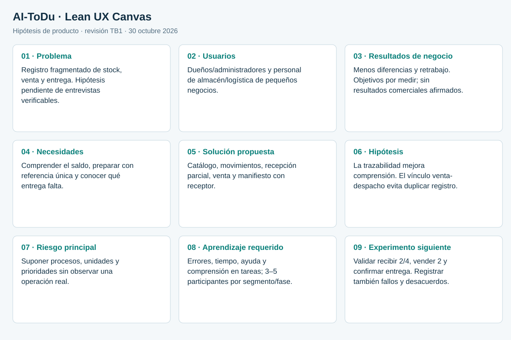

El canvas representa hipótesis actuales. Reemplaza la imagen heredada de otro producto y se actualiza con hallazgos trazables, no con conclusiones anticipadas.

## 1.3. Segmentos objetivo

### 1.3.1. Dueños y administradores de pequeños negocios

Deciden la adopción y necesitan comprender existencias, ventas registradas y despachos pendientes. La entrevista debe contrastar frecuencia de conciliación, consecuencias de errores y quién autoriza ajustes o devoluciones. La versión actual ofrece un resumen operativo; contribución bruta no equivale a utilidad neta.

### 1.3.2. Jefes de logística y personal de almacén

Ejecutan recepción, movimientos, preparación y entrega. Se priorizan lectura clara, acciones por rol y acceso móvil. Las restricciones del primer corte son cantidades enteras, una ubicación operativa de referencia y un destino por despacho. Operaciones por lote, múltiples almacenes y rutas con varias paradas requieren evolución y validación.

---

# Capítulo II: Requirements Elicitation & Analysis

## 2.1. Competidores

### 2.1.1. Análisis competitivo

El análisis se concentra en el enfoque de producto. No se atribuyen precios, ausencia de funciones o limitaciones vigentes sin probar una edición específica y registrar fecha/fuente.

| Referente | Fuente primaria | Enfoque a contrastar con el segmento |
| --- | --- | --- |
| Odoo Inventory | [Documentación oficial](https://www.odoo.com/documentation/19.0/applications/inventory_and_mrp/inventory.html) | Gestión de inventario como parte de una suite empresarial. |
| Alegra | [Sitio oficial](https://www.alegra.com/) | Operación administrativa/comercial para negocios. |
| Wally | [Sitio oficial](https://wallypos.com/) | Operación de punto de venta. |
| AI-ToDu | Repositorios y pruebas de esta entrega | Recorrido académico compacto entre saldo, venta y entrega; sin equivalencia funcional con una suite comercial. |

### 2.1.2. Estrategias y tácticas frente a competidores

La diferenciación propuesta es la comprensión del recorrido de una operación, no la cantidad de pantallas. Se probarán tres tácticas: historial visible para explicar el saldo, despacho a partir de una venta ya registrada e indicadores con definición comprensible. La preferencia y disposición de adopción requieren investigación; no se afirman como ventaja validada.

## 2.2. Entrevistas

### 2.2.1. Diseño de entrevistas

La investigación requiere **3–5 participantes por segmento y fase**, conforme al enunciado. Preparar consentimiento, guion, ficha de contexto y registro accesible. Evitar preguntas que sugieran una respuesta favorable al producto.

| Etapa | Preguntas y actividad | Registro requerido |
| --- | --- | --- |
| Contexto | ¿Qué rol cumple? ¿Cómo fue su última recepción, venta o entrega? | Rol/segmento, fecha, consentimiento y entorno. |
| Proceso actual | Muestre cómo registra un cambio de stock. ¿Cómo descubre una diferencia? | Secuencia y ejemplo concreto, sin datos privados innecesarios. |
| Dificultad | ¿Cuándo ocurrió por última vez? ¿Cómo la resolvió y qué costo tuvo? | Cita con minuto; separar estimación del participante de medición. |
| Prioridad | ¿Qué necesita resolver primero y por qué? | Clasificación de problemas, incluyendo desacuerdos. |
| Cierre | ¿Qué condición le impediría usar una solución? | Riesgos y permiso para una sesión de validación posterior. |

### 2.2.2. Registro de entrevistas

**Estado:** existen diferencias entre las fichas del capítulo separado y el README remoto más reciente. El primero conserva cuatro rutas inexistentes; el segundo referencia seis archivos fotográficos existentes y cambia dos nombres, manteniendo textos alternativos anteriores. Se conservan ambas fuentes para revisión, sin reasignar fotografías ni descartar respuestas del equipo. La correspondencia entre identidad, imagen, consentimiento y grabación requiere confirmación.

| Registro del README remoto | Diferencia con el capítulo separado | Archivo localizado; correspondencia por confirmar |
| --- | --- | --- |
| Carlos Mendoza | Mismo nombre; segmento de decisión | `Images/Carlos_Mendoza.jpeg` |
| Lucía Valdivia | Mismo nombre; segmento de decisión | `Images/Lucia_Valdivia1.jpeg` |
| Roberto Sánchez | El capítulo apunta a un archivo ausente | `Images/Entrevista_ Sebastian.jpg`; nombre de archivo distinto de la ficha |
| Miguel Rojas | El capítulo apunta a un archivo ausente | `Images/Raul_Delgado.jpeg`; nombre de archivo distinto de la ficha |
| Maria Morales | El capítulo registra Andrea Gómez; el README conserva ese alt | `Images/Entrevista_Maria_Morales.jpg` |
| Diego Ramirez | El capítulo registra Jorge Quispe; el README conserva ese alt | `Images/Entrevista_Diego_Ramirez.jpg` |

Las fichas y respuestas de **ambas versiones** están en el [archivo de investigación](research/README.md). La presencia de archivos no resuelve estas diferencias ni acredita por sí sola las entrevistas. Confirmar cada registro con el equipo y completar responsable real, fecha, enlace autorizado, duración, transcripción y marcas de tiempo antes de contabilizarlo como evidencia.

### 2.2.3. Análisis de entrevistas

Se conserva un **mapa provisional de temas**, pendiente de codificar con citas auténticas: conciliación de saldos, visibilidad de pendientes, control de pérdidas y coordinación del despacho. Para cada hallazgo, registrar participante anonimizado, cita/minuto, interpretación, requisito relacionado y evidencia contradictoria. No se calculan porcentajes de aceptación con estas fichas sin verificar.

## 2.3. Needfinding

### 2.3.1. User Personas

| Persona provisional | Objetivo | Necesidad y decisión de diseño | Validación pendiente |
| --- | --- | --- | --- |
| Administrador de negocio | Saber qué puede vender y qué falta entregar | Resumen de transacciones, stock y despachos; definiciones de métricas visibles. | Confirmar prioridades y frecuencia de consulta. |
| Operario de almacén | Registrar y preparar sin duplicar el trabajo | Recepción parcial, movimientos con motivo, navegación móvil y acciones por rol. | Observar el proceso real, conectividad y unidades que utiliza. |

Son arquetipos de diseño, no personas reales adicionales ni síntesis empírica concluida.

### 2.3.2. User Task Matrix

Consideramos dos segmentos: administrador del negocio y operario de almacén. Las tareas existen independientemente de AI-ToDu. **Frecuencias e importancias son hipótesis**, todavía no mediciones de entrevistas verificadas; se sustituirán por los resultados reales.

| Tarea del negocio | Administrador · frecuencia | Administrador · importancia | Operario · frecuencia | Operario · importancia |
| --- | --- | --- | --- | --- |
| Conciliar mercadería disponible | Diaria, por validar | Alta, por validar | Diaria, por validar | Alta, por validar |
| Contrastar pedido y entrega del proveedor | Por recepción, por validar | Alta, por validar | Por recepción, por validar | Alta, por validar |
| Registrar entradas, salidas y pérdidas | Diaria, por validar | Alta, por validar | Por movimiento, por validar | Alta, por validar |
| Comprobar que se puede atender una venta | Por venta, por validar | Alta, por validar | Por preparación, por validar | Alta, por validar |
| Coordinar recursos y confirmar entrega | Por reparto, por validar | Alta, por validar | Por pedido, por validar | Media/alta, por validar |
| Explicar diferencias de saldo e importes | Periódica, por validar | Alta, por validar | Al detectar diferencia, por validar | Alta, por validar |

La coincidencia propuesta es conciliar saldo y registrar movimientos. La diferencia por validar está en la supervisión global frente a la comprobación física. Esta matriz no representa permisos de software. Fichas, capturas y matriz en UXPressia, con las fuentes que sustenten sus valores: pendientes.

### 2.3.3. User Journey Mapping

El recorrido **As-Is**, anterior a nuestra solución, abarca recepción, preparación de entrega y conciliación. Los escenarios son hipótesis; no observaciones verificadas. Los mapas por persona y capturas en UXPressia quedan pendientes.

| Persona | Etapa actual sin AI-ToDu | Acción del negocio por validar | Fricción hipotética | Fuente |
| --- | --- | --- | --- | --- |
| Administrador | Comprueba disponibilidad | Contrasta pedido, registro y confirmación del almacén | Información distribuida entre registros y mensajes | Entrevista pendiente |
| Administrador | Coordina reparto | Asigna responsable y pide confirmación | Venta y entrega difíciles de relacionar | Entrevista pendiente |
| Administrador | Concilia jornada | Compara ventas, mercadería y entregas | Diferencias sin referencia compartida | Entrevista pendiente |
| Operario | Recibe mercadería | Cuenta unidades y compara con pedido | Entrega parcial o dato incompleto | Entrevista pendiente |
| Operario | Prepara salida | Ubica, separa y vuelve a contar unidades | Saldo desactualizado o doble anotación | Entrevista pendiente |
| Operario | Informa diferencias | Comunica pérdida o faltante y busca la causa | Motivo y responsable sin vincular | Entrevista pendiente |

El recorrido recepción → venta → despacho del prototipo corresponde a la solución **To-Be**; se documenta en diseño e implementación y no sustituye el Journey As-Is.

### 2.3.4. Empathy Mapping

El mapa de empatía es provisional: el administrador podría pensar «necesito saber de dónde sale este número» y el operario «necesito registrar una sola vez». Estas frases son hipótesis de diseño, no citas de entrevistados. Las capas piensa/siente/dice/hace se completarán con observación autorizada y citas, incluyendo frustraciones y prácticas que el equipo aún no conoce.

## 2.4. Big Picture Event Storming

El recorrido del dominio se ordena por el core: **mercadería recibida → saldo actualizado → venta confirmada → manifiesto creado → ruta iniciada → entrega confirmada**. Compras y ventas soportan el flujo; IAM limita quién puede ejecutar cada comando. Se distinguen comandos (registrar recepción), hechos (recepción registrada), política (crear alerta de stock mínimo), lectura (saldo) e interrogante (¿cómo tratar una entrega fallida?).


Cada fila muestra la secuencia local de un contexto; se presentan primero los contextos core y después el soporte comercial. La venta confirmada es una precondición del despacho. Este modelo de análisis requiere revisión del equipo; no acredita un taller colaborativo ya realizado. Los hechos nombran conceptos del dominio, no mensajes publicados por un bus. La implementación TB1 ejecuta políticas de forma síncrona y conserva registros transaccionales; no implementa broker ni event sourcing.

## 2.5. Ubiquitous Language

| Término | Definición y regla compartida |
| --- | --- |
| SKU | Identificador normalizado del artículo, único en una empresa. No representa saldo ni ubicación. |
| Stock / saldo | Cantidad entera disponible en TB1. Nunca negativa. |
| Conservación | Condición del artículo independiente de su cantidad; puede bloquear una venta. |
| Movimiento | Cambio de saldo con tipo, cantidad, motivo y responsable. |
| Orden de compra / recepción | Compromiso con proveedor y hecho de recibir; una recepción puede ser parcial. |
| Venta | Transacción confirmada que descuenta stock una vez. |
| Manifiesto de despacho | Asignación de venta, recursos y destino; no vuelve a descontar inventario. |
| Intento de entrega | Registro del resultado; TB1 registra únicamente confirmación exitosa con receptor. |
| Devolución | Retorno limitado por la línea vendida; reincorpora stock o registra pérdida según disposición. |
| Contribución bruta | Venta neta de devoluciones menos costo registrado y pérdidas; excluye otros gastos e impuestos. |
| Empresa / tenant | Frontera de pertenencia de los registros operativos. |

---

# Capítulo III: Requirements Specification

## 3.1. User Stories

Un único cuadro reúne épicas, historias funcionales y técnicas, en orden core → soporte → genéricos → canal público. Conservamos identificadores y distinguimos implementación de evidencia humana. Los criterios usan Gherkin; los comportamientos pendientes no se presentan como pruebas aprobadas.

| Epic / Story ID | Título | Descripción | Criterios de aceptación | Relacionado con (Epic ID) | Estado |
| --- | --- | --- | --- | --- | --- |
| EPIC-02 | Inventario | Capacidad core para el flujo trazable del negocio. | Given sus historias relacionadas, When se evalúa la capacidad, Then se comprueban criterios y límites; un módulo existente no acredita terminar la épica. | — | Cobertura parcial |
| US09 | Registro de artículo | Como Almacenero, deseo registrar un SKU para identificar mercadería. | Given un SKU único y valores válidos, When se registra el artículo, Then se conserva normalizado con saldo cero. Escenario alternativo: Given SKU duplicado o dinero inválido, When se evalúa el caso, Then se aplica su restricción sin cambios ajenos o parciales. | EPIC-02 | AV2 implementada; validación humana pendiente |
| US10 | Ingreso de mercadería | Como Almacenero, deseo registrar una entrada para conciliar el stock. | Given un artículo y cantidad entera positiva, When se recibe mercadería, Then aumenta el saldo y registra motivo/responsable. Escenario alternativo: Given cantidad cero o fraccionaria, When se evalúa el caso, Then se aplica su restricción sin cambios ajenos o parciales. | EPIC-02 | AV2 implementada; validación humana pendiente |
| US11 | Salida manual | Como Almacenero, deseo registrar una salida para explicar el saldo. | Given tres unidades disponibles, When se registra salida de dos, Then queda una unidad con movimiento. Escenario alternativo: Given salida mayor al saldo, When se evalúa el caso, Then se aplica su restricción sin cambios ajenos o parciales. | EPIC-02 | AV2 implementada; validación humana pendiente |
| US12 | Registro de mermas | Como Almacenero, deseo registrar una merma para distinguir pérdida de venta. | Given stock suficiente, When se registra una merma, Then disminuye saldo con tipo LOSS sin cambiar conservación. Escenario alternativo: Given cantidad no positiva, When se evalúa el caso, Then se aplica su restricción sin cambios ajenos o parciales. | EPIC-02 | AV2 implementada; validación humana pendiente |
| US13 | Buscador de inventario | Como Operador, deseo buscar por nombre o SKU para encontrar un artículo. | Given un catálogo, When se busca nombre o SKU, Then obtiene coincidencias sin modificar registros. Escenario alternativo: Given búsqueda sin coincidencias devuelve resultado vacío, When se evalúa el caso, Then se aplica su restricción sin cambios ajenos o parciales. | EPIC-02 | Demo implementada |
| US14 | Historial de movimientos | Como Administrador, deseo consultar movimientos para explicar un cambio de saldo. | Given movimientos del espacio autorizado, When se consulta su historial, Then obtiene producto, tipo, cantidad, motivo, responsable y fecha. Escenario alternativo: Given identificador de empresa ajena no modifica registros, When se evalúa el caso, Then se aplica su restricción sin cambios ajenos o parciales. | EPIC-02 | AV2 implementada; validación humana pendiente |
| EPIC-04 | Logística | Capacidad core para el flujo trazable del negocio. | Given sus historias relacionadas, When se evalúa la capacidad, Then se comprueban criterios y límites; un módulo existente no acredita terminar la épica. | — | Cobertura parcial |
| US19 | Manifiesto de despacho | Como Logístico, deseo crear un manifiesto desde ventas para preparar una entrega trazable. | Given una venta confirmada sin despacho ni devolución, When se prepara un manifiesto, Then vincula las líneas sin descontar stock nuevamente. Escenario alternativo: Given venta ya asignada, When se evalúa el caso, Then se aplica su restricción sin cambios ajenos o parciales. | EPIC-04 | AV2 implementada; validación humana pendiente |
| US20 | Asignación de recursos | Como Logístico, deseo asignar conductor y vehículo para responsabilizar recursos. | Given recursos de la empresa, When se asigna conductor y vehículo, Then conserva referencias existentes. Escenario alternativo: Given recurso ya en tránsito al iniciar otra ruta, When se evalúa el caso, Then se aplica su restricción sin cambios ajenos o parciales. | EPIC-04 | AV2 implementada; validación humana pendiente |
| US21 | Estado y confirmación de entrega | Como Logístico, deseo confirmar el progreso de entrega para saber qué falta atender. | Given despacho PENDING, When se inicia y luego confirma con receptor, Then transita por IN_TRANSIT y finaliza DELIVERED con fecha. Escenario alternativo: Given salto de estado o falta de receptor, When se evalúa el caso, Then se aplica su restricción sin cambios ajenos o parciales. | EPIC-04 | AV2 implementada; validación humana pendiente |
| US22 | Incidencia en ruta | Como Logístico, deseo registrar una incidencia para conservar el problema observado. | Given un despacho no finalizado, When se registra una incidencia válida, Then conserva descripción y fecha. Escenario alternativo: Given incidencia posterior a entrega, When se evalúa el caso, Then se aplica su restricción sin cambios ajenos o parciales. | EPIC-04 | AV2 implementada; validación humana pendiente |
| US37 | Maestros de recursos logísticos | Como Logístico, deseo mantener recursos de reparto para asignar entidades existentes. | Given nombre y licencia o placa válidos, When se registra un recurso, Then pertenece a la empresa autenticada. Escenario alternativo: Given licencia o placa duplicada en esa empresa, When se evalúa el caso, Then se aplica su restricción sin cambios ajenos o parciales. | EPIC-04 | AV2 implementada; validación humana pendiente |
| EPIC-10 | Abastecimiento | Capacidad soporte para el flujo trazable del negocio. | Given sus historias relacionadas, When se evalúa la capacidad, Then se comprueban criterios y límites; un módulo existente no acredita terminar la épica. | — | Cobertura parcial |
| US35 | Abastecimiento y recepción parcial | Como Almacenero, deseo recibir parcialmente una compra para conciliar pedido y entrada. | Given una orden de cuatro unidades, When se recibe dos, Then aumenta el stock dos y queda PARTIAL. Escenario alternativo: Given exceso de recepción o línea duplicada, When se evalúa el caso, Then se aplica su restricción sin cambios ajenos o parciales. | EPIC-10 | AV2 implementada; validación humana pendiente |
| EPIC-03 | Comercial y devoluciones | Capacidad soporte para el flujo trazable del negocio. | Given sus historias relacionadas, When se evalúa la capacidad, Then se comprueban criterios y límites; un módulo existente no acredita terminar la épica. | — | Cobertura parcial |
| US15 | Creación de venta | Como Vendedor, deseo confirmar una venta para registrar salida e importe una vez. | Given líneas válidas y stock suficiente, When se confirma la venta, Then guarda snapshots, movimientos y Outbox en una transacción. Escenario alternativo: Given línea inválida revierte toda la venta, When se evalúa el caso, Then se aplica su restricción sin cambios ajenos o parciales. | EPIC-03 | AV2 implementada; validación humana pendiente |
| US16 | Validación de stock | Como Vendedor, deseo validar saldo y conservación para evitar sobreventa. | Given una unidad y seis solicitudes concurrentes, When se confirma ventas de una unidad, Then solo una se acepta y cinco reciben conflicto. Escenario alternativo: Given artículo con conservación bloqueada, When se evalúa el caso, Then se aplica su restricción sin cambios ajenos o parciales. | EPIC-03 | AV2 implementada; validación humana pendiente |
| US17 | Historial de ventas | Como Vendedor, deseo consultar ventas históricas para revisar una operación. | Given ventas registradas, When se consulta el historial, Then conserva fecha, estado, líneas e importe histórico. Escenario alternativo: Given cambio posterior del catálogo no recalcula el snapshot, When se evalúa el caso, Then se aplica su restricción sin cambios ajenos o parciales. | EPIC-03 | AV2 implementada; validación humana pendiente |
| US18 | Anulación de venta | Como Vendedor, deseo anular una venta para corregir una operación permitida. | Given venta sin despacho ni devolución, When se anula con motivo, Then repone stock una sola vez. Escenario alternativo: Given anulación repetida o venta despachada, When se evalúa el caso, Then se aplica su restricción sin cambios ajenos o parciales. | EPIC-03 | AV2 implementada; validación humana pendiente |
| US36 | Devolución trazable | Como Vendedor, deseo registrar una devolución para conciliar stock y venta neta. | Given unidades vendidas no devueltas, When se registra RESTOCK o LOSS, Then resta venta neta y reintegra solo RESTOCK. Escenario alternativo: Given exceso o despacho sin finalizar, When se evalúa el caso, Then se aplica su restricción sin cambios ajenos o parciales. | EPIC-03 | AV2 implementada; validación humana pendiente |
| EPIC-05 | Reporting | Capacidad soporte para el flujo trazable del negocio. | Given sus historias relacionadas, When se evalúa la capacidad, Then se comprueban criterios y límites; un módulo existente no acredita terminar la épica. | — | Cobertura parcial |
| US23 | Dashboard operativo | Como Administrador, deseo ver métricas derivadas para conciliar la operación. | Given operaciones aceptadas, When se consulta indicadores como administrador, Then obtiene importes y saldos derivados. Escenario alternativo: Given otro rol recibe 403, When se evalúa el caso, Then se aplica su restricción sin cambios ajenos o parciales. | EPIC-05 | AV2 implementada; validación humana pendiente |
| US24 | Reporte de productos más vendidos | Como Administrador, deseo ver productos más vendidos para priorizar decisiones. | Given ventas registradas, When se consulta el ranking de productos, Then obtiene orden por unidades o importe indicado. Escenario alternativo: Given venta anulada no cuenta como efectiva, When se evalúa el caso, Then se aplica su restricción sin cambios ajenos o parciales. | EPIC-05 | Pendiente |
| US25 | Exportación de datos | Como Administrador, deseo exportar datos autorizados para analizar fuera del sistema. | Given registros autorizados, When se exporta datos, Then obtiene archivo interpretable con alcance y fecha. Escenario alternativo: Given registros ajenos no aparecen, When se evalúa el caso, Then se aplica su restricción sin cambios ajenos o parciales. | EPIC-05 | Pendiente; imprimir comprobante no cumple esta historia |
| EPIC-06 | Notificaciones | Capacidad soporte para el flujo trazable del negocio. | Given sus historias relacionadas, When se evalúa la capacidad, Then se comprueban criterios y límites; un módulo existente no acredita terminar la épica. | — | Cobertura parcial |
| US26 | Alerta de stock mínimo | Como Operador, deseo recibir alerta de mínimo para atender reposición. | Given stock que cruza el mínimo, When se confirma la salida, Then persiste mensaje y notificación eventual. Escenario alternativo: Given reentrega del evento no duplica notificación, When se evalúa el caso, Then se aplica su restricción sin cambios ajenos o parciales. | EPIC-06 | AV2 implementada; validación humana pendiente |
| US27 | Alerta de vencimiento | Como Almacenero, deseo detectar vencimientos por lote para evitar salida vencida. | Given lotes con vencimiento, When se alcanza el umbral acordado, Then genera alerta vinculada al lote. Escenario alternativo: Given alerta ya procesada no se duplica sin cambio relevante, When se evalúa el caso, Then se aplica su restricción sin cambios ajenos o parciales. | EPIC-06 | Pendiente: lotes sin flujo operativo completo |
| EPIC-01 | Identidad | Capacidad genérico para el flujo trazable del negocio. | Given sus historias relacionadas, When se evalúa la capacidad, Then se comprueban criterios y límites; un módulo existente no acredita terminar la épica. | — | Cobertura parcial |
| US01 | Registro de cuenta | Como Administrador, deseo registrar mi empresa para acceder a un espacio separado. | Given datos válidos y correo disponible, When se registra empresa, Then crea administrador sin exponer hash. Escenario alternativo: Given correo existente o contraseña fuera de política, When se evalúa el caso, Then se aplica su restricción sin cambios ajenos o parciales. | EPIC-01 | AV2 implementada; validación humana pendiente |
| US02 | Inicio de sesión | Como Usuario, deseo iniciar sesión para operar según mi rol. | Given cuenta activa y contraseña válida, When se inicia sesión, Then recibe JWT temporal y perfil. Escenario alternativo: Given credenciales inválidas producen 401 sin token, When se evalúa el caso, Then se aplica su restricción sin cambios ajenos o parciales. | EPIC-01 | AV2 implementada; validación humana pendiente |
| US03 | Cierre de sesión | Como Usuario, deseo cerrar sesión para terminar el acceso. | Given sesión válida, When se cierra sesión, Then el token queda revocado. Escenario alternativo: Given acceso posterior con token revocado produce 401, When se evalúa el caso, Then se aplica su restricción sin cambios ajenos o parciales. | EPIC-01 | AV2 implementada; validación humana pendiente |
| US04 | Recuperación de contraseña | Como Usuario, deseo recuperar el acceso para volver a operar. | Given solicitud de recuperación, When se procesa el correo, Then no revela si la cuenta existe. Escenario alternativo: Given enlace vencido o usado no permite cambiar acceso, When se evalúa el caso, Then se aplica su restricción sin cambios ajenos o parciales. | EPIC-01 | Pendiente AV2 |
| EPIC-07 | Acceso y roles | Capacidad genérico para el flujo trazable del negocio. | Given sus historias relacionadas, When se evalúa la capacidad, Then se comprueban criterios y límites; un módulo existente no acredita terminar la épica. | — | Cobertura parcial |
| US28 | Creación de usuarios | Como Administrador, deseo incorporar empleados para distribuir operación. | Given administrador y datos válidos, When se provisiona empleado con contraseña inicial, Then obtiene perfil sin hash ni contraseña. Escenario alternativo: Given otro rol recibe 403, When se evalúa el caso, Then se aplica su restricción sin cambios ajenos o parciales. | EPIC-07 | AV2: contraseña inicial; invitación/recuperación pendientes |
| US29 | Restricción por roles | Como Administrador, deseo restringir acciones por rol para delimitar responsabilidades. | Given cuenta activa, When se ejecuta una operación, Then el servidor usa su rol y empresa autenticados. Escenario alternativo: Given rol sin permiso o referencia ajena no modifica datos, When se evalúa el caso, Then se aplica su restricción sin cambios ajenos o parciales. | EPIC-07 | AV2 implementada; validación humana pendiente |
| EPIC-08 | Preferencias | Capacidad genérico para el flujo trazable del negocio. | Given sus historias relacionadas, When se evalúa la capacidad, Then se comprueban criterios y límites; un módulo existente no acredita terminar la épica. | — | Cobertura parcial |
| US30 | Edición de perfil empresa | Como Administrador, deseo editar perfil de empresa para mantener datos vigentes. | Given administrador autenticado, When se edita el perfil de empresa, Then persiste únicamente datos de su empresa. Escenario alternativo: Given empresa ajena no se puede editar, When se evalúa el caso, Then se aplica su restricción sin cambios ajenos o parciales. | EPIC-08 | Pendiente |
| US31 | Cambio de contraseña | Como Usuario, deseo cambiar contraseña para mantener el acceso. | Given contraseña actual válida, When se cambia contraseña, Then conserva hash seguro e invalida sesiones según política. Escenario alternativo: Given contraseña actual inválida, When se evalúa el caso, Then se aplica su restricción sin cambios ajenos o parciales. | EPIC-08 | Pendiente AV2 |
| US33 | Idioma de aplicación | Como Usuario, deseo cambiar idioma para comprender la operación. | Given primera visita sin preferencia, When se inicia aplicación, Then usa en_US. Escenario alternativo: Given selección es_419 persiste al navegar y recargar, When se evalúa el caso, Then se aplica su restricción sin cambios ajenos o parciales. | EPIC-08 | Implementada: en_US / es_419 |
| EPIC-09 | Landing page | Capacidad canal público para el flujo trazable del negocio. | Given sus historias relacionadas, When se evalúa la capacidad, Then se comprueban criterios y límites; un módulo existente no acredita terminar la épica. | — | Cobertura parcial |
| US05 | Propuesta de valor | Como Visitante, deseo comprender la propuesta para identificar el problema atendido. | Given visitante del segmento, When se consulta la propuesta, Then identifica inventario, venta, despacho y alcance académico. Escenario alternativo: Given no se afirman resultados medidos sin evidencia, When se evalúa el caso, Then se aplica su restricción sin cambios ajenos o parciales. | EPIC-09 | Implementada |
| US06 | Capacidades de landing | Como Visitante, deseo conocer las capacidades para decidir si probar. | Given landing disponible, When se consulta capacidades, Then conoce el flujo y accede a la aplicación. Escenario alternativo: Given ilustración sintética se identifica como muestra, When se evalúa el caso, Then se aplica su restricción sin cambios ajenos o parciales. | EPIC-09 | Implementada |
| US07 | Modelo comercial y planes | Como Comprador, deseo consultar planes para evaluar la adopción. | Given modelo comercial validado, When se consulta planes, Then conoce condiciones y límites reales. Escenario alternativo: Given sin cobros no se simula suscripción activa, When se evalúa el caso, Then se aplica su restricción sin cambios ajenos o parciales. | EPIC-09 | Pendiente; sin planes comerciales activos |
| US08 | Contacto B2B | Como Visitante, deseo contactar al equipo para resolver dudas. | Given visitante, When se solicita contacto, Then llega a un destino real. Escenario alternativo: Given un futuro formulario requiere validación y seguimiento, When se evalúa el caso, Then se aplica su restricción sin cambios ajenos o parciales. | EPIC-09 | Parcial: enlace real al proyecto; captación B2B pendiente |
| US32 | Testimonios | Como Visitante, deseo leer testimonios auténticos para evaluar experiencias. | Given testimonio autorizado y fuente real, When se publica testimonio, Then conserva atribución y contexto. Escenario alternativo: Given sin fuente o consentimiento no se publica, When se evalúa el caso, Then se aplica su restricción sin cambios ajenos o parciales. | EPIC-09 | Pendiente evidencia; no se publican testimonios ficticios |
| US34 | Términos y privacidad | Como Visitante, deseo consultar términos y privacidad para comprender el tratamiento del demo. | Given visitante, When se consulta privacidad, Then conoce persistencia y ausencia de pagos/SUNAT. Escenario alternativo: Given servidor y demo distinguen sus formas de almacenamiento, When se evalúa el caso, Then se aplica su restricción sin cambios ajenos o parciales. | EPIC-09 | Implementada |
| TS05 | GET /products | Como Developer, deseo consumir GET /products para integrar la capacidad. Reemplaza GET /inventory; consulta de catálogo. | Given un usuario autorizado, When ejecuta `GET /products`, Then cumple request/response: GET autenticado → 200 con recurso o {items:[]}; sin sesión → 401; rol sin permiso → 403 cuando corresponde. Given una referencia ajena, When solicita modificarla, Then no cambia datos de otra empresa. | EPIC-02 | AV2; detalle en OpenAPI |
| TS06 | POST /products | Como Developer, deseo consumir POST /products para integrar la capacidad. Reemplaza POST /inventory; SKU único. | Given un usuario autorizado, When ejecuta `POST /products`, Then cumple request/response: {sku,name,price,cost,minimum} → 201 ProductResource; duplicado → 409. Given una referencia ajena, When solicita modificarla, Then no cambia datos de otra empresa. | EPIC-02 | AV2; detalle en OpenAPI |
| TS07 | POST /movements · type RECEIPT | Como Developer, deseo consumir POST /movements · type RECEIPT para integrar la capacidad. Reemplaza /inventory/{sku}/entries. | Given un usuario autorizado, When ejecuta `POST /movements · type RECEIPT`, Then cumple request/response: {productId,quantity,type:RECEIPT,reason} → 201; fracción → 422. Given una referencia ajena, When solicita modificarla, Then no cambia datos de otra empresa. | EPIC-02 | AV2; detalle en OpenAPI |
| TS08 | POST /movements · type ISSUE o LOSS | Como Developer, deseo consumir POST /movements · type ISSUE o LOSS para integrar la capacidad. Reemplaza /inventory/{sku}/exits. | Given un usuario autorizado, When ejecuta `POST /movements · type ISSUE o LOSS`, Then cumple request/response: {productId,quantity,type:ISSUE o LOSS,reason} → 201; saldo insuficiente → 409. Given una referencia ajena, When solicita modificarla, Then no cambia datos de otra empresa. | EPIC-02 | AV2; detalle en OpenAPI |
| TS09 | GET /movements | Como Developer, deseo consumir GET /movements para integrar la capacidad. Reemplaza /inventory/{sku}/history; producto referenciado. | Given un usuario autorizado, When ejecuta `GET /movements`, Then cumple request/response: GET autenticado → 200 con recurso o {items:[]}; sin sesión → 401; rol sin permiso → 403 cuando corresponde. Given una referencia ajena, When solicita modificarla, Then no cambia datos de otra empresa. | EPIC-02 | AV2; detalle en OpenAPI |
| TS14 | GET /dispatches | Como Developer, deseo consumir GET /dispatches para integrar la capacidad. Manifiestos con líneas/paradas/incidencias. | Given un usuario autorizado, When ejecuta `GET /dispatches`, Then cumple request/response: GET autenticado → 200 con recurso o {items:[]}; sin sesión → 401; rol sin permiso → 403 cuando corresponde. Given una referencia ajena, When solicita modificarla, Then no cambia datos de otra empresa. | EPIC-04 | AV2; detalle en OpenAPI |
| TS15 | POST /dispatches | Como Developer, deseo consumir POST /dispatches para integrar la capacidad. Ventas y recursos del mismo tenant. | Given un usuario autorizado, When ejecuta `POST /dispatches`, Then cumple request/response: {saleIds,driverId,vehicleId,destination} → 201 DispatchResource; referencia ajena → 404. Given una referencia ajena, When solicita modificarla, Then no cambia datos de otra empresa. | EPIC-04 | AV2; detalle en OpenAPI |
| TS16 | PATCH /dispatches/{id} | Como Developer, deseo consumir PATCH /dispatches/{id} para integrar la capacidad. Reemplaza subruta /status; transición y receptor. | Given un usuario autorizado, When ejecuta `PATCH /dispatches/{id}`, Then cumple request/response: {status,recipient?} → 200 DispatchResource; salto → 422; recurso ocupado → 409. Given una referencia ajena, When solicita modificarla, Then no cambia datos de otra empresa. | EPIC-04 | AV2; detalle en OpenAPI |
| TS17 | POST /dispatches/{id}/incidents | Como Developer, deseo consumir POST /dispatches/{id}/incidents para integrar la capacidad. Incidencia persistida. | Given un usuario autorizado, When ejecuta `POST /dispatches/{id}/incidents`, Then cumple request/response: {description} → 201 DispatchResource; despacho entregado → 422. Given una referencia ajena, When solicita modificarla, Then no cambia datos de otra empresa. | EPIC-04 | AV2; detalle en OpenAPI |
| TS32 | GET/POST /drivers · GET/POST /vehicles | Como Developer, deseo consumir GET/POST /drivers · GET/POST /vehicles para integrar la capacidad. Nueva: maestros de recursos. | Given un usuario autorizado, When ejecuta `GET/POST /drivers · GET/POST /vehicles`, Then cumple request/response: GET autenticado → 200 con recurso o {items:[]}; sin sesión → 401; rol sin permiso → 403 cuando corresponde. Given una referencia ajena, When solicita modificarla, Then no cambia datos de otra empresa. | EPIC-04 | AV2; detalle en OpenAPI |
| TS28 | POST /purchases | Como Developer, deseo consumir POST /purchases para integrar la capacidad. Nueva: orden y líneas. | Given un usuario autorizado, When ejecuta `POST /purchases`, Then cumple request/response: {supplierId,lines:[{productId,quantity}]} → 201 PurchaseResource. Given una referencia ajena, When solicita modificarla, Then no cambia datos de otra empresa. | EPIC-10 | AV2; detalle en OpenAPI |
| TS29 | POST /purchases/{id}/receipts | Como Developer, deseo consumir POST /purchases/{id}/receipts para integrar la capacidad. Nueva: recepción parcial acotada. | Given un usuario autorizado, When ejecuta `POST /purchases/{id}/receipts`, Then cumple request/response: {lines:[{lineId,quantity}]} → 201 PurchaseResource; exceso → 409. Given una referencia ajena, When solicita modificarla, Then no cambia datos de otra empresa. | EPIC-10 | AV2; detalle en OpenAPI |
| TS30 | GET /suppliers · POST /suppliers | Como Developer, deseo consumir GET /suppliers · POST /suppliers para integrar la capacidad. Nueva: maestro de proveedor. | Given un usuario autorizado, When ejecuta `GET /suppliers · POST /suppliers`, Then cumple request/response: GET autenticado → 200 con recurso o {items:[]}; sin sesión → 401; rol sin permiso → 403 cuando corresponde. Given una referencia ajena, When solicita modificarla, Then no cambia datos de otra empresa. | EPIC-10 | AV2; detalle en OpenAPI |
| TS10 | GET /sales | Como Developer, deseo consumir GET /sales para integrar la capacidad. Historial con detalles y comprobante. | Given un usuario autorizado, When ejecuta `GET /sales`, Then cumple request/response: GET autenticado → 200 con recurso o {items:[]}; sin sesión → 401; rol sin permiso → 403 cuando corresponde. Given una referencia ajena, When solicita modificarla, Then no cambia datos de otra empresa. | EPIC-03 | AV2; detalle en OpenAPI |
| TS11 | POST /sales | Como Developer, deseo consumir POST /sales para integrar la capacidad. Transacción completa / 201 / conflicto 409. | Given un usuario autorizado, When ejecuta `POST /sales`, Then cumple request/response: {lines:[{productId,quantity}]} y Idempotency-Key opcional → 201 SaleResource; stock insuficiente o clave con otro payload → 409. Given una referencia ajena, When solicita modificarla, Then no cambia datos de otra empresa. | EPIC-03 | AV2; detalle en OpenAPI |
| TS12 | Detalle incluido en GET /sales | Como Developer, deseo consumir Detalle incluido en GET /sales para integrar la capacidad. GET /sales/{id} no está implementado; proyección de consulta documentada. | Given un usuario autorizado, When ejecuta `Detalle incluido en GET /sales`, Then cumple request/response: GET autenticado → 200 con recurso o {items:[]}; sin sesión → 401; rol sin permiso → 403 cuando corresponde. Given una referencia ajena, When solicita modificarla, Then no cambia datos de otra empresa. | EPIC-03 | AV2; detalle en OpenAPI |
| TS13 | POST /sales/{id}/cancel | Como Developer, deseo consumir POST /sales/{id}/cancel para integrar la capacidad. Ajusta método anterior PATCH; reintegro una sola vez. | Given un usuario autorizado, When ejecuta `POST /sales/{id}/cancel`, Then cumple request/response: {reason} → 200 SaleResource; venta despachada o anulación repetida → 409. Given una referencia ajena, When solicita modificarla, Then no cambia datos de otra empresa. | EPIC-03 | AV2; detalle en OpenAPI |
| TS31 | POST /returns | Como Developer, deseo consumir POST /returns para integrar la capacidad. Nueva: retorno acotado y disposición. | Given un usuario autorizado, When ejecuta `POST /returns`, Then cumple request/response: {saleId,saleLineId,quantity,disposition,reason} → 201 ReturnResource; exceso → 409. Given una referencia ajena, When solicita modificarla, Then no cambia datos de otra empresa. | EPIC-03 | AV2; detalle en OpenAPI |
| TS18 | GET /metrics | Como Developer, deseo consumir GET /metrics para integrar la capacidad. Reemplaza /analytics/dashboard; administrador. | Given un usuario autorizado, When ejecuta `GET /metrics`, Then cumple request/response: GET autenticado → 200 con recurso o {items:[]}; sin sesión → 401; rol sin permiso → 403 cuando corresponde. Given una referencia ajena, When solicita modificarla, Then no cambia datos de otra empresa. | EPIC-05 | AV2; detalle en OpenAPI |
| TS19 | GET /notifications | Como Developer, deseo consumir GET /notifications para integrar la capacidad. Bandeja de alertas persistidas. | Given un usuario autorizado, When ejecuta `GET /notifications`, Then cumple request/response: GET autenticado → 200 con recurso o {items:[]}; sin sesión → 401; rol sin permiso → 403 cuando corresponde. Given una referencia ajena, When solicita modificarla, Then no cambia datos de otra empresa. | EPIC-06 | AV2; detalle en OpenAPI |
| TS20 | PATCH /notifications/{id} | Como Developer, deseo consumir PATCH /notifications/{id} para integrar la capacidad. Reemplaza subruta /read. | Given un usuario autorizado, When ejecuta `PATCH /notifications/{id}`, Then cumple request/response: GET autenticado → 200 con recurso o {items:[]}; sin sesión → 401; rol sin permiso → 403 cuando corresponde. Given una referencia ajena, When solicita modificarla, Then no cambia datos de otra empresa. | EPIC-06 | AV2; detalle en OpenAPI |
| TS01 | POST /auth/register | Como Developer, deseo consumir POST /auth/register para integrar la capacidad. Alta de empresa/administrador en demo. | Given un usuario autorizado, When ejecuta `POST /auth/register`, Then cumple request/response: {name,company,email,password} → 201 UserResource; correo repetido → 409. Given una referencia ajena, When solicita modificarla, Then no cambia datos de otra empresa. | EPIC-01 | AV2; detalle en OpenAPI |
| TS02 | POST /auth/login | Como Developer, deseo consumir POST /auth/login para integrar la capacidad. Credencial válida / 401. | Given un usuario autorizado, When ejecuta `POST /auth/login`, Then cumple request/response: {email,password} → 200 {token,user}; credencial inválida → 401. Given una referencia ajena, When solicita modificarla, Then no cambia datos de otra empresa. | EPIC-01 | AV2; detalle en OpenAPI |
| TS03 | POST /auth/logout | Como Developer, deseo consumir POST /auth/logout para integrar la capacidad. Invalida sesión / 204. | Given un usuario autorizado, When ejecuta `POST /auth/logout`, Then cumple request/response: Bearer válido y {} → 204; ese token usado después → 401. Given una referencia ajena, When solicita modificarla, Then no cambia datos de otra empresa. | EPIC-01 | AV2; detalle en OpenAPI |
| TS04 | Recuperación de contraseña | Como Developer, deseo consumir Recuperación de contraseña para integrar la capacidad. Pendiente; no endpoint implementado. | Given capacidad pendiente, When se prioriza su implementación, Then se define y verifica request/response; no se declara un endpoint operativo actualmente. | EPIC-01 | Pendiente |
| TS21 | GET /employees | Como Developer, deseo consumir GET /employees para integrar la capacidad. Proyección de empleados, no listado general de credenciales. | Given un usuario autorizado, When ejecuta `GET /employees`, Then cumple request/response: GET autenticado → 200 con recurso o {items:[]}; sin sesión → 401; rol sin permiso → 403 cuando corresponde. Given una referencia ajena, When solicita modificarla, Then no cambia datos de otra empresa. | EPIC-07 | AV2; detalle en OpenAPI |
| TS22 | POST /employees | Como Developer, deseo consumir POST /employees para integrar la capacidad. Reemplaza /users/invite solo para provisión; invitación/activación pendiente. | Given un usuario autorizado, When ejecuta `POST /employees`, Then cumple request/response: {name,email,role,password} → 201 EmployeeResource; otro rol → 403. Given una referencia ajena, When solicita modificarla, Then no cambia datos de otra empresa. | EPIC-07 | AV2; detalle en OpenAPI |
| TS23 | GET /auth/me | Como Developer, deseo consumir GET /auth/me para integrar la capacidad. Perfil de sesión; sin hash ni contraseña. | Given un usuario autorizado, When ejecuta `GET /auth/me`, Then cumple request/response: GET autenticado → 200 con recurso o {items:[]}; sin sesión → 401; rol sin permiso → 403 cuando corresponde. Given una referencia ajena, When solicita modificarla, Then no cambia datos de otra empresa. | EPIC-01 | AV2; detalle en OpenAPI |
| TS24 | Edición de perfil | Como Developer, deseo consumir Edición de perfil para integrar la capacidad. Pendiente; no endpoint operativo. | Given capacidad pendiente, When se prioriza su implementación, Then se define y verifica request/response; no se declara un endpoint operativo actualmente. | EPIC-08 | Pendiente |
| TS25 | Cambio de contraseña | Como Developer, deseo consumir Cambio de contraseña para integrar la capacidad. Pendiente AV2. | Given capacidad pendiente, When se prioriza su implementación, Then se define y verifica request/response; no se declara un endpoint operativo actualmente. | EPIC-08 | Pendiente |
| TS26 | Captación B2B | Como Developer, deseo consumir Captación B2B para integrar la capacidad. Pendiente; no POST /contact-messages. | Given capacidad pendiente, When se prioriza su implementación, Then se define y verifica request/response; no se declara un endpoint operativo actualmente. | EPIC-09 | Pendiente |
| TS27 | Planes comerciales | Como Developer, deseo consumir Planes comerciales para integrar la capacidad. Pendiente; no GET /landing/plans. | Given capacidad pendiente, When se prioriza su implementación, Then se define y verifica request/response; no se declara un endpoint operativo actualmente. | EPIC-09 | Pendiente |
| TS33 | Clima regional | Como Developer, deseo consultar GET /logistics/weather para mostrar condiciones de Lima sin enviar destinos de clientes. | Given rol ADMIN o LOGISTICS, When solicita, Then recibe 200 {location,temperatureC,precipitationMm,windKmh,observedAt,fetchedAt,source,attributionUrl}. Given fallo del proveedor, When solicita, Then recibe 503 UPSTREAM_UNAVAILABLE y puede seguir operando despachos. | EPIC-04 | Implementada |
| TS34 | Outbox e inbox | Como Developer, deseo mensajes públicos versionados para integrar notificaciones con reintentos. | Given un comando aceptado, When confirma transacción, Then persiste mensaje Outbox. Given fallo del consumidor, When se reintenta, Then conserva intento y evita duplicar notificación. | EPIC-06 | Implementada |
| TS35 | Consistencia e idempotencia | Como Developer, deseo ventas atómicas para evitar sobreventa y reenvíos duplicados. | Given una unidad y seis requests concurrentes, When confirman, Then una recibe 201 y cinco 409. Given igual Idempotency-Key y líneas, When se repite, Then devuelve la misma venta sin otra salida. | EPIC-03 | Implementada |

Prefijo REST: /api/v1. [OpenAPI del servidor](https://ai-todu-api-av2.onrender.com/v3/api-docs) y [schemas públicos](https://github.com/AI-ToDu/ai-todu-api/blob/main/contracts/integration-messages.v1.schema.json). La Fake API conserva el contrato histórico TB1.

## 3.2. Impact Mapping

| Objetivo e impacto esperado | Actor | Cambio observable | Entregables / historias |
| --- | --- | --- | --- |
| Explicar el saldo y evitar sobreventa | Almacén / ventas | Recepción y venta dejan historial conciliado | US09–US18, US35. |
| Coordinar una entrega trazable | Logística | Despacho referencia venta y finaliza con receptor | US19–US22, US37. |
| Comprender la operación | Administrador | Distingue venta neta, costo y contribución | US23, US26, US36. |
| Poder probar sin ambigüedad | Visitante / usuario | Accede a demo y comprende su alcance e idioma | US01–US06, US29, US33–US34. |

Los objetivos comerciales heredados (clientes, retención y ahorro porcentual) se tratan como hipótesis, no como resultados. La primera validación mide comprensión y ejecución; la segunda podrá contrastar tiempo frente al proceso real.

## 3.3. Product Backlog

| Orden de revisión | Story ID | Épica | Título | Descripción | Story points propuestos |
| --- | --- | --- | --- | --- | --- |
| 1 | US09 | EPIC-02 | Registro de artículo | Como Almacenero, deseo registrar un SKU para identificar mercadería. | 3 |
| 2 | US10 | EPIC-02 | Ingreso de mercadería | Como Almacenero, deseo registrar una entrada para conciliar el stock. | 5 |
| 3 | US11 | EPIC-02 | Salida manual | Como Almacenero, deseo registrar una salida para explicar el saldo. | 3 |
| 4 | US12 | EPIC-02 | Registro de mermas | Como Almacenero, deseo registrar una merma para distinguir pérdida de venta. | 2 |
| 5 | US13 | EPIC-02 | Buscador de inventario | Como Operador, deseo buscar por nombre o SKU para encontrar un artículo. | 3 |
| 6 | US14 | EPIC-02 | Historial de movimientos | Como Administrador, deseo consultar movimientos para explicar un cambio de saldo. | 3 |
| 7 | US19 | EPIC-04 | Manifiesto de despacho | Como Logístico, deseo crear un manifiesto desde ventas para preparar una entrega trazable. | 5 |
| 8 | US20 | EPIC-04 | Asignación de recursos | Como Logístico, deseo asignar conductor y vehículo para responsabilizar recursos. | 3 |
| 9 | US21 | EPIC-04 | Estado y confirmación de entrega | Como Logístico, deseo confirmar el progreso de entrega para saber qué falta atender. | 3 |
| 10 | US22 | EPIC-04 | Incidencia en ruta | Como Logístico, deseo registrar una incidencia para conservar el problema observado. | 3 |
| 11 | US37 | EPIC-04 | Maestros de recursos logísticos | Como Logístico, deseo mantener recursos de reparto para asignar entidades existentes. | 5 |
| 12 | US35 | EPIC-10 | Abastecimiento y recepción parcial | Como Almacenero, deseo recibir parcialmente una compra para conciliar pedido y entrada. | 8 |
| 13 | US15 | EPIC-03 | Creación de venta | Como Vendedor, deseo confirmar una venta para registrar salida e importe una vez. | 8 |
| 14 | US16 | EPIC-03 | Validación de stock | Como Vendedor, deseo validar saldo y conservación para evitar sobreventa. | 5 |
| 15 | US17 | EPIC-03 | Historial de ventas | Como Vendedor, deseo consultar ventas históricas para revisar una operación. | 3 |
| 16 | US18 | EPIC-03 | Anulación de venta | Como Vendedor, deseo anular una venta para corregir una operación permitida. | 5 |
| 17 | US36 | EPIC-03 | Devolución trazable | Como Vendedor, deseo registrar una devolución para conciliar stock y venta neta. | 5 |
| 18 | US23 | EPIC-05 | Dashboard operativo | Como Administrador, deseo ver métricas derivadas para conciliar la operación. | 5 |
| 19 | US24 | EPIC-05 | Reporte de productos más vendidos | Como Administrador, deseo ver productos más vendidos para priorizar decisiones. | 3 |
| 20 | US25 | EPIC-05 | Exportación de datos | Como Administrador, deseo exportar datos autorizados para analizar fuera del sistema. | 5 |
| 21 | US26 | EPIC-06 | Alerta de stock mínimo | Como Operador, deseo recibir alerta de mínimo para atender reposición. | 5 |
| 22 | US27 | EPIC-06 | Alerta de vencimiento | Como Almacenero, deseo detectar vencimientos por lote para evitar salida vencida. | 3 |
| 23 | US01 | EPIC-01 | Registro de cuenta | Como Administrador, deseo registrar mi empresa para acceder a un espacio separado. | 3 |
| 24 | US02 | EPIC-01 | Inicio de sesión | Como Usuario, deseo iniciar sesión para operar según mi rol. | 3 |
| 25 | US03 | EPIC-01 | Cierre de sesión | Como Usuario, deseo cerrar sesión para terminar el acceso. | 2 |
| 26 | US04 | EPIC-01 | Recuperación de contraseña | Como Usuario, deseo recuperar el acceso para volver a operar. | 5 |
| 27 | US28 | EPIC-07 | Creación de usuarios | Como Administrador, deseo incorporar empleados para distribuir operación. | 5 |
| 28 | US29 | EPIC-07 | Restricción por roles | Como Administrador, deseo restringir acciones por rol para delimitar responsabilidades. | 5 |
| 29 | US30 | EPIC-08 | Edición de perfil empresa | Como Administrador, deseo editar perfil de empresa para mantener datos vigentes. | 2 |
| 30 | US31 | EPIC-08 | Cambio de contraseña | Como Usuario, deseo cambiar contraseña para mantener el acceso. | 3 |
| 31 | US33 | EPIC-08 | Idioma de aplicación | Como Usuario, deseo cambiar idioma para comprender la operación. | 2 |
| 32 | US05 | EPIC-09 | Propuesta de valor | Como Visitante, deseo comprender la propuesta para identificar el problema atendido. | 3 |
| 33 | US06 | EPIC-09 | Capacidades de landing | Como Visitante, deseo conocer las capacidades para decidir si probar. | 2 |
| 34 | US07 | EPIC-09 | Modelo comercial y planes | Como Comprador, deseo consultar planes para evaluar la adopción. | 2 |
| 35 | US08 | EPIC-09 | Contacto B2B | Como Visitante, deseo contactar al equipo para resolver dudas. | 3 |
| 36 | US32 | EPIC-09 | Testimonios | Como Visitante, deseo leer testimonios auténticos para evaluar experiencias. | 2 |
| 37 | US34 | EPIC-09 | Términos y privacidad | Como Visitante, deseo consultar términos y privacidad para comprender el tratamiento del demo. | 2 |

**Total:** 137 story points: 119 de las 34 historias originales y 18 propuestos para US35–US37. Se corrige la suma heredada de 121; el valor original recalculado es 119. Las tres historias nuevas reflejan funcionalidad incorporada, no un incremento de velocidad histórica.

**Tablero colaborativo:** no se localizó un enlace público verificable que demuestre transiciones históricas To Do / In Process / To Review / Done. El backlog versionado sirve como fuente textual; el equipo debe adjuntar tablero, responsables reales y trazabilidad de cambios. No se utiliza una captura aislada como prueba de seguimiento continuo.

---

# Capítulo IV: Product Design

## 4.1. Style Guidelines

### 4.1.1. General Style Guidelines

La identidad utiliza azul profundo para estructura, verde azulado para acción y superficies claras para lectura de datos. Se priorizan contraste, jerarquía tipográfica y consistencia entre landing y workspace. La aplicación usa **Angular Material y Material Design**; la landing emplea HTML/CSS/JavaScript semánticos. La revisión utiliza la skill `ui-ux-pro-max` como apoyo de evaluación, sin reemplazar pruebas con usuarios.

| Token | Valor / uso |
| --- | --- |
| Estructura | Azul profundo `#112f43` y tonos próximos definidos en CSS. |
| Acción | Verde azulado; botón primario contrastado y estado de foco visible. |
| Tipografía | Familia de sistema sans serif; sin dependencia de fuentes remotas. |
| Superficies | Fondo claro, bordes suaves y espacios consistentes. |
| Estados | Texto explícito además de color: pendiente, tránsito, entregado, error y vacío. |

### 4.1.2. Web Style Guidelines

Inglés predeterminado (`en_US`) y español latinoamericano (`es_419`). Se traducen mensajes, formularios, estados, navegación y errores del dominio. Los nombres de artículos/proveedores son datos del usuario y no se alteran automáticamente. Importes en PEN y fechas se formatean por idioma.

La navegación móvil usa panel superpuesto; tablas amplias desplazan dentro de su contenedor. Formularios muestran validación, deshabilitan doble envío y conservan el error de API. Material administra foco del diálogo, cierre y selectores; existen etiquetas accesibles, enlace para saltar al contenido y preferencia de movimiento reducido. La accesibilidad se ha revisado por implementación y recorrido, pendiente de evaluación con usuarios y auditoría automatizada dedicada.

## 4.2. Information Architecture

### 4.2.1. Organization Systems

El workspace sigue el flujo operativo: inventario/historial, abastecimiento, ventas, despacho, devolución y notificaciones. Overview deriva el estado, Team provisiona registros e IAM controla sesión. Las rutas se cargan por dominio. La landing presenta propósito, capacidades, recorrido, segmentos, equipo y CTA a la demo.

### 4.2.2. Labeling Systems

Las etiquetas distinguen venta de despacho y stock de conservación. `Demo receipt · not a fiscal document` informa el alcance del comprobante. `Gross contribution` se acompaña de definición y exclusiones; no se traduce como utilidad neta. Los códigos de error de API se convierten a mensajes localizados.

### 4.2.3. SEO Tags and Meta Tags

Landing declara título, descripción, idioma, viewport y marca. El selector actualiza título, descripción e idioma del documento. La aplicación autenticada es un espacio de trabajo, no una estrategia de posicionamiento de páginas privadas. No se agregan testimonios, métricas comerciales o etiquetas estructuradas de reseñas sin fuente.

### 4.2.4. Searching Systems

La búsqueda implementada filtra catálogo por nombre/SKU en el cliente sobre datos obtenidos por API. Paginación, filtros avanzados de servidor y búsqueda entre almacenes/lotes permanecen pendientes. Un estado vacío distingue ausencia de coincidencias de un error de carga.

### 4.2.5. Navigation Systems

Las rutas protegidas verifican sesión y permisos. Un usuario autenticado que abre login es enviado a su primera ruta autorizada. Las llamadas a API aplican el mismo rol/tenant, con el límite explícito de seguridad propio de una Fake API. La landing pasa preferencia de idioma y perfil demo al acceso del workspace.

## 4.3. Landing Page UI Design

### 4.3.1. Landing Page Wireframe

La estructura de lectura es: encabezado con navegación/idioma → propuesta principal y muestra identificada → capacidades → recorrido de cuatro pasos → segmentos → equipo/alcance → CTA y contacto del proyecto → términos y privacidad. En móvil se apilan columnas y el menú se controla por botón con `aria-expanded`.

### 4.3.2. Landing Page Mock-up

El diseño vigente es la implementación de [ai-todu-platform](https://github.com/AI-ToDu/ai-todu-platform/tree/fix/tb1-readiness). Las capturas antiguas del repositorio son material histórico y no acreditan esta revisión. El mock visual de la landing se identifica como ilustrativo; los resultados del recorrido real constan en la verificación de implementación.

## 4.4. Web Applications UX/UI Design

### 4.4.1. Web Applications Wireframes

Acceso usa una composición de propósito y formulario. El workspace presenta navegación lateral, encabezado con rol/idioma y área central. Inventario usa tabla y diálogos; ventas usa catálogo/carrito; logística agrupa por estado. Los mensajes de carga/error/vacío conservan el contexto de la tarea.

### 4.4.2. Web Applications Wireflow Diagrams

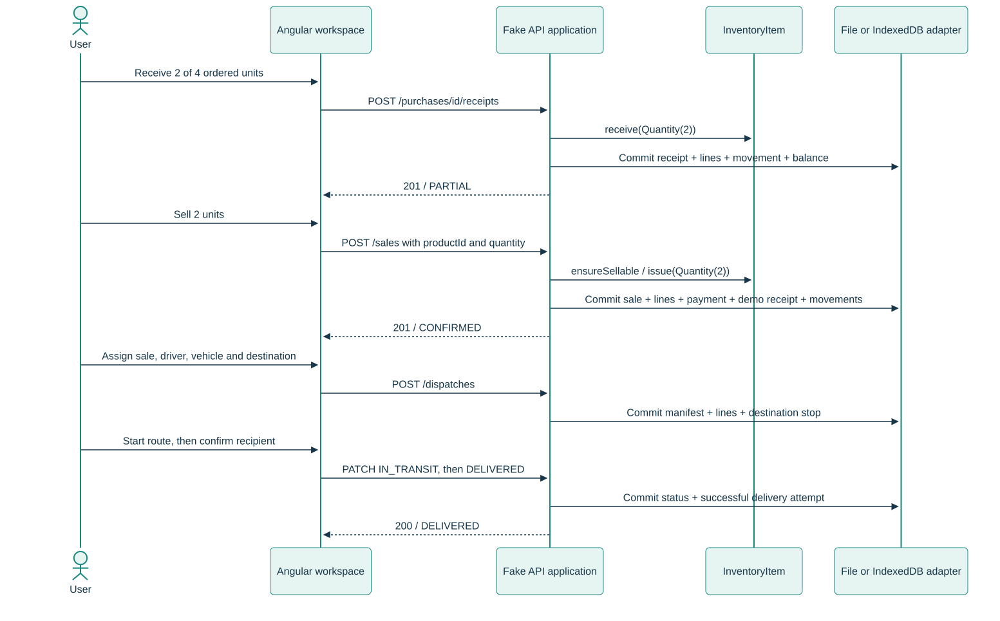

### 4.4.3. Web Applications Mock-ups

La fuente de la vista vigente son los componentes Material y `src/styles.css`. Las [instrucciones de demostración](https://github.com/AI-ToDu/ai-todu-webapp/tree/fix/tb1-readiness) permiten reproducir el diseño con datos ficticios. El formato 375 px se revisa para navegación, formularios y tablas; no se afirma una matriz exhaustiva de todos los dispositivos.

### 4.4.4. Web Applications User Flow Diagrams

El camino principal sigue recibir → consultar saldo → vender → revisar comprobante → crear despacho → iniciar ruta → identificar receptor → confirmar entrega. Los caminos alternativos incluyen credencial inválida, stock insuficiente, artículo bloqueado, recepción excesiva y recurso ocupado. La matriz de pruebas distingue observación de navegador de pruebas del contrato.

## 4.5. Web Applications Prototyping

TB1 es un prototipo funcional con dos transportes que comparten motor: HTTP local con archivo persistente y Service Worker con IndexedDB para hosting estático. La demo no emite documentos fiscales, realiza cobros, envía invitaciones ni comparte datos entre navegadores. El prototipo permite revisar interacción y consistencia antes del servidor AV2.

## 4.6. Domain-Driven Software Architecture

### 4.6.1. Design-Level Event Storming

Primero revisamos **Inventory y Logistics (core)**; luego Procurement, Sales/Returns, Reporting y Notifications (soporte); finalmente IAM (genérico). El [análisis arquitectónico](design/architecture.md) registra decisiones. El modelo distingue comandos, agregados, eventos internos, traducción pública, Outbox e inbox. Es un diseño contrastado con código; no acredita un taller colaborativo realizado.


Los mensajes públicos se añaden al Outbox en la transacción del comando. El relay reintenta entregas y Notifications evita duplicados por ID del evento.

StockBelowMinimum, SaleConfirmed y DeliveryConfirmed son eventos internos del contexto propietario. Su application publisher los traduce al Published Language v1. Notifications consume únicamente mensajes públicos. La coordinación Inventory–Sales–Logistics usa fachadas/gateways dentro de la transacción del monolito; no un broker distribuido. [Context map](design/diagrams/rendered/context-map.svg).

### 4.6.2. Software Architecture Context Diagram

C1 muestra personas y propósito del sistema. No incluye pasarelas fiscales o proveedores de IA que el prototipo no integra.

### 4.6.3. Software Architecture Container Diagrams


TB1 sirve archivos estáticos y ejecuta la Fake API en el navegador; el adaptador Node/archivo es una alternativa de desarrollo local. Se separa de la **implementación AV2** siguiente:


AV2 implementa un monolito modular Spring Boot y PostgreSQL. La SPA usa HTTPS hacia Render; la API conecta su base aislada por red privada y consulta Open-Meteo mediante un gateway. Un bounded context no equivale a un microservicio.

### 4.6.4. Software Architecture Components Diagrams


El diagrama anterior describe TB1. En AV2, los handlers coordinan puertos y agregados propios; adaptadores JPA y assemblers mantienen entidades persistentes separadas. Las consultas no ejecutan comandos.


## 4.7. Software Object-Oriented Design

### 4.7.1. Class Diagrams


La tabla siguiente corresponde al modelo histórico de TB1. En AV2, `Money` conserva centavos en un `long`, `Quantity` es un entero y `DispatchManifest` valida su destino como texto y contiene `DeliveryEvidence` (receptor/fecha). `Sale` y `PurchaseOrder` son agregados independientes. La separación entre clases Java de dominio y entidades JPA se comprueba en el repositorio API; `Address` y `SaleSummary` del dibujo histórico no se presentan como clases actuales del backend.

| Objeto TB1 | Semántica del prototipo | Representación en frontera TB1 |
| --- | --- | --- |
| Sku | Normalización y validación; inmutable. | Cadena JSON / columna `sku` única por empresa. |
| Quantity | Entero no negativo, positivo cuando el comando lo exige; límite explícito. | Número JSON / entero SQL con restricción. |
| Money | PEN, precisión de centavos, valor finito/no negativo; inmutable. | Número de importe en API de demo; centavos enteros en diseño SQL. |
| Address | Texto normalizado con longitud válida; inmutable. | Recurso de frontera / columna del prototipo. |
| InventoryItem | Identidad estable; entrada/salida y aptitud de venta. | Recurso de producto y adaptador de demo. |
| SaleSummary | Total validado en centavos, sin aritmética acumulada de decimales. | Total serializado; snapshot de líneas. |
| DispatchManifest | Destino y transición PENDING → IN_TRANSIT → DELIVERED. | Recurso de despacho y adaptador de demo. |

JSON y SQL requieren tipos de transporte/persistencia; eso no elimina el valor semántico del dominio. El servidor usa InventoryItem, Sale, PurchaseOrder y DispatchManifest con operaciones e invariantes; no trata cada fila persistente como agregado independiente. Los precios/costos históricos se conservan en la venta y no se recalculan desde un catálogo modificado.

## 4.8. Database Design

### 4.8.1. Database Diagrams

El [DDL](design/database/schema.sql) contiene **35 tablas** con nombres físicos en minúsculas y `snake_case`, claves, unicidad, restricciones y referencias por empresa. [El diccionario](design/database/dictionary.md) enumera cada columna. Se ejecutó en SQLite como referencia; TB1 usa 35 colecciones JSON. **AV2 implementa 19 tablas de negocio/infraestructura**, además de flyway_schema_history, definidas por sus [migraciones PostgreSQL](https://github.com/AI-ToDu/ai-todu-api/tree/main/src/main/resources/db/migration). No se declara implementada automáticamente toda la referencia de 35 tablas.

| Área lógica | Tablas | Capacidad operativa actual y brecha |
| --- | --- | --- |
| Identidad y empresa | 7 | Registro, roles, sesión y provisión de empleado. Activación, recuperación e invitación pendientes; suscripciones fuera del modelo actual. |
| Inventario | 8 | Catálogo, saldo, entradas/salidas, pérdidas e historial. Categorías/unidades/ubicación de referencia; variantes, lotes y múltiples ubicaciones sin flujo completo. |
| Abastecimiento | 5 | Maestro de proveedores, orden y recepción parcial. API admite varias líneas; formulario inicial trabaja un SKU por orden. Aprobación pendiente. |
| Ventas | 5 | Venta, detalle, pago demo y comprobante histórico. Consulta de cliente de referencia; maestro de clientes sin flujo de UI completo. Sin cobros/fiscalidad real. |
| Logística | 7 | Maestros de conductor/vehículo, manifiesto, líneas, una parada, estados, receptor, intento exitoso e incidencias. Varias paradas, intentos fallidos/capacidad/rutas pendientes. |
| Devoluciones | 2 | Flujo por línea con disposición reintegrar/pérdida y límite de cantidad. Sin reembolso real, cambio ni reexpedición. |
| Notificaciones | 1 | Generación por movimiento bajo mínimo, bandeja y lectura. Sin correo/push ni alertas de vencimiento operativas. |
| **Total** | **35** | **La existencia de una tabla o colección no acredita una funcionalidad completa.** |

Los ERD se dividen para conservar legibilidad: [Inventario](design/diagrams/rendered/erd-inventory.svg), [Logística](design/diagrams/rendered/erd-logistics.svg), [Abastecimiento](design/diagrams/rendered/erd-procurement.svg), [Ventas](design/diagrams/rendered/erd-sales.svg), [Devoluciones](design/diagrams/rendered/erd-returns.svg), [Notificaciones](design/diagrams/rendered/erd-notifications.svg) e [Identidad](design/diagrams/rendered/erd-identity.svg). El DDL es la referencia completa para relaciones entre áreas.

**Reglas de consistencia:** saldo no negativo; recepción acumulada no supera orden; venta confirma todo o nada; anulación restituye una vez; despacho conserva referencia sin doble salida; devolución no excede línea; referencias del tenant se validan en aplicación y se modelan con FK compuestas en SQL. AV2 usa nombres snake_case, centavos enteros, converters para valores simples y embeddables para valores compuestos. No hay migración automática de datos ficticios del navegador al servidor; cada modo mantiene su almacenamiento. El esquema físico no es el contrato HTTP.

#### 4.8.1.1. Esquema ejecutado del incremento AV2

| Área | Tablas PostgreSQL implementadas |
| --- | --- |
| IAM y coordinación | workspaces, workspace_locks, users, sessions |
| Inventario | inventory_items, stock_movements |
| Ventas | sales, sale_lines |
| Logística | drivers, vehicles, dispatches, dispatch_lines, delivery_incidents |
| Compras | suppliers, purchase_orders, purchase_lines |
| Devoluciones | customer_returns |
| Integración | integration_outbox, notifications |

Flyway aplica V1–V4 y Hibernate valida el esquema sin generarlo en producción. CI ejecuta las pruebas con PostgreSQL 17. El saldo, su movimiento y la venta se confirman en una transacción. No se implementa event sourcing ni un ledger fiscal.

---

# Capítulo V: Product Implementation, Validation & Deployment

## 5.1. Software Configuration Management

### 5.1.1. Software Development Environment Configuration

| Producto / artefacto | Tecnología efectiva | Responsabilidad |
| --- | --- | --- |
| Frontend | Angular 22, TypeScript, Angular Material/CDK, CSS | Workspace responsive, UI/i18n y adaptador HttpClient. |
| Landing | HTML, CSS y JavaScript nativos | Propósito, capacidades, recorrido, CTA y contacto del proyecto. |
| Fake API | JavaScript ESM, Node 24 `node:http`; Service Worker e IndexedDB | Contrato de demo, invariantes y persistencia. |
| Pruebas | `node:test`, SQLite integrado de Node, compilador Angular | Dominio, HTTP real, concurrencia/persistencia, esquema y cobertura de traducciones. |
| Informe | Markdown, Mermaid/SVG y generadores versionados | README completo, fuentes únicas, comprobación y exportación. |
| Backend AV2 | Java 21 / Spring Boot 4.1.2 / JPA / PostgreSQL 17 / Flyway | API con dominio agnóstico, JWT, roles, transacciones y Outbox. |

El repositorio incluye lockfile cuando instala dependencias. La Fake API y landing no requieren paquetes de ejecución. Se usan datos ficticios y archivos de estado excluidos de Git. El equipo debe confirmar su tablero de gestión; se retiraron referencias a nombres de repositorios inexistentes, enlaces de ejemplo y herramientas declaradas sin evidencia de uso.

### 5.1.2. Source Code Management

| Repositorio individual | Artefacto | Rama para esta revisión |
| --- | --- | --- |
| [ai-todu-webapp](https://github.com/AI-ToDu/ai-todu-webapp) | Frontend y transporte AV2 | `fix/av2-api-integration` |
| [ai-todu-platform](https://github.com/AI-ToDu/ai-todu-platform) | Landing y acceso al servidor AV2 | `fix/av2-platform-scope` |
| [ai-todu-fake-api](https://github.com/AI-ToDu/ai-todu-fake-api) | Fuente canónica de Fake API, contrato y pruebas | `fix/tb1-readiness` |
| [ai-todu-report](https://github.com/AI-ToDu/ai-todu-report) | Informe, arquitectura y datos | `fix/av2-report-alignment` |
| [ai-todu-api](https://github.com/AI-ToDu/ai-todu-api) | Backend, contratos, migraciones y CI | `fix/av2-domain-foundation` y `fix/av2-runtime-configuration` |

**Workflow:** `main` conserva la línea estable; `develop` integra trabajo; las ramas nuevas usan `fix/<scope>`. AV2 se integra mediante PR con comprobaciones de CI antes del merge. No se reescriben commits históricos ni se atribuyen las correcciones asistidas a otros integrantes. Para el frontend se incorpora `develop` desde la base original de `main`. En landing, la rama predeterminada original ya era `develop`; se documenta esta transición antes de normalizar una futura rama estable, sin mover la publicación durante la revisión.

Los cuatro bloques de corrección son: **(1) integración funcional con Fake API; (2) interfaz, landing e idiomas; (3) DDD/C4/datos; (4) informe, trazabilidad y guía de revisión**. Cada repositorio registra un commit por bloque aplicable; no se crean commits vacíos para aumentar un contador. El paquete nuevo registra además su inicialización real. Los hashes y PR vigentes se consultan en Git, sin duplicar un historial que pueda quedar desactualizado.

El frontend conserva un manifiesto de procedencia y hashes del motor vendorizado desde la Fake API. Su prueba de integridad detecta cambios no sincronizados. Esta decisión permite servir el demo desde hosting estático y mantener un repositorio individual revisable para el contrato.

### 5.1.3. Source Code Style Guide & Conventions

TypeScript/JavaScript usan identificadores en inglés, `PascalCase` para clases y `camelCase` para funciones/DTOs. Nombres físicos SQL usan **minúsculas snake_case**. Objetos de valor y reglas de dominio se separan de UI, transporte y almacenamiento. Las vistas se agrupan por contexto; nuevas funcionalidades se exponen mediante servicio de aplicación y contrato, evitando introducir reglas de stock en el componente.

Los mensajes visibles se resuelven por clave en `en_US`/`es_419`; el API emite códigos de error estables. Un mensaje nuevo requiere ambas traducciones y revisión de accesibilidad. No se utilizan números inventados en Overview ni testimonios no autenticados en la landing.

### 5.1.4. Software Deployment Configuration

| Acceso | URL / comando | Estado y límite |
| --- | --- | --- |
| Landing pública existente | [GitHub Pages](https://ai-todu.github.io/ai-todu-platform/) | Canal estático público y CTA hacia la webapp. |
| Webapp pública existente | [GitHub Pages](https://ai-todu.github.io/ai-todu-webapp/) | GitHub Actions desde main; PR AV2 #5 integrado con CI aprobado. |
| Workspace + Fake API HTTP | `npm ci` y `npm run demo`, frontend | Sirve interfaz compilada y API en `http://127.0.0.1:8850/?api=http`. |
| Fake API independiente | `npm test`; `npm start -- --port 8853` | API local `/api/v1`, sin frontend compilado. |
| Modo estático | Build Pages y origen HTTPS o localhost | Worker/IndexedDB por origen/perfil; no servidor público REST. |

El workflow de verificación revisa ramas `fix/**` y PR. El workflow Pages de la webapp se restringe a `main` después de revisión; exige configurar GitHub Pages como **GitHub Actions** al publicar. Actions y la publicación de webapp se comprobaron; el servidor AV2 se verifica por separado. La navegación usa hash para rutas estáticas y el build fija `base-href` `/ai-todu-webapp/`. Se conserva el selector de idioma y CTA de la landing.

## 5.2. Landing Page, Services & Applications Implementation

La estructura siguiente recupera **Sprint 1 y Sprint 2**. La reconstrucción documental no acredita reuniones, horas ni transiciones históricas que no fueron registradas. La corrección técnica se ejecuta el 30/10/2026; las fechas/participantes de la planificación original y el tablero deben completarse con evidencia del equipo.

### 5.2.1. Sprint 1

#### 5.2.1.1. Sprint Planning 1

**Hito:** AV1 / primera landing y diseño. **Fuente temporal:** historial de landing y report. **Planning original:** fecha, duración, asistentes y decisiones pendientes de confirmar. **Goal propuesto para corregir el formato**, según enunciado p. 24:

> Our focus is on helping potential business owners and warehouse operators understand the traceable inventory-to-delivery proposal. We believe it delivers a clear basis for deciding whether to try the product to these two user segments. This will be confirmed when visitors can identify the product purpose, find the relevant capabilities and reach the demo entry point from the landing.

**Cobertura propuesta:** US05, US06, US08, US33, US34; suma de 12 SP de backlog. Velocity histórica y compromiso original: sin registro verificado.

La meta describe outcome, impacto, clientes y evento de confirmación. La implementación actual permite revisar el recorrido; su comprensión por usuarios reales requiere sesión de validación.

#### 5.2.1.2. Aspect Leaders and Collaborators

El historial de landing contiene aportes de los cinco integrantes. El nombramiento formal de leaders/collaborators por Development, Execution, Documentation y Deployment no quedó acreditado por una lista firmada o acta accesible. Se debe ratificar la matriz del equipo; no se reconstruye liderazgo a partir de una cantidad de commits.

#### 5.2.1.3. Sprint Backlog 1

Descomposición de referencia para recuperar el alcance, con **estimaciones propuestas**, no horas trabajadas. Story points se consultan en el backlog canónico y no se convierten a horas.

| Task | Historia | Engineering task | Est. | Evidencia / estado actual |
| --- | --- | --- | --- | --- |
| S1-T01 | US05 | Implementar estructura semántica de propósito y navegación. | 4 h | Landing actual; trazabilidad histórica por confirmar. |
| S1-T02 | US06 | Implementar capacidades y flujo del producto con alcance explícito. | 4 h | Secciones actuales y CTA. |
| S1-T03 | US08 | Conectar contacto real y revisar destinos de navegación. | 4 h | Enlace al proyecto; formulario B2B pendiente. |
| S1-T04 | US33–US34 | Incorporar idiomas, términos y privacidad accesibles. | 6 h | Implementación actual; validar con usuarios. |
| S1-T05 | US05–US06 | Revisar móvil/teclado y publicar versión revisada. | 4 h | Revisión local; merge y publicación pendientes de aprobación. |

**Seguimiento histórico To Do / In Process / To Review / Done:** pendiente de tablero exportado o enlace accesible. Esta tabla no simula transiciones históricas.

#### 5.2.1.4. Development Evidence for Sprint Review

Los commits originales de [landing](https://github.com/AI-ToDu/ai-todu-platform/commits/develop/) y capítulos AV1 enlazados en Student Outcome acreditan cambios de archivos. El rediseño de esta corrección tiene su propio commit de bloque 2. Se evita asociar capturas de otro producto con la versión actual.

#### 5.2.1.5. Execution Evidence for Sprint Review

La landing se sirve localmente y se revisan navegación, selector de idioma, CTA, términos y móvil. Se debe adjuntar video de exposición AV1 con fecha/audiencia si se usa como evidencia de ejecución histórica. Las pruebas actuales de enlaces e idiomas corresponden a la corrección.

#### 5.2.1.6. Services Documentation Evidence for Sprint Review

Sprint 1 no acredita un servidor productivo. El alcance documentado es landing/diseño. Los servicios de TB1 se describen con Fake API/OpenAPI en Sprint 2; Spring Boot/PostgreSQL queda para AV2.

#### 5.2.1.7. Software Deployment Evidence for Sprint Review

La URL pública de landing figura en configuración. El historial público y configuración de Pages son evidencia distinta del navegador local. El rediseño se integró en una revisión posterior; el [PR #4 de AV2](https://github.com/AI-ToDu/ai-todu-platform/pull/4) ajusta el alcance y el acceso al servidor, sin atribuir esta revisión a la entrega histórica de Sprint 1.

#### 5.2.1.8. Team Collaboration Insights during Sprint

Hay contribuciones históricas de los cinco integrantes en landing. Hace falta vincular cada acción con tarea y revisión. Una captura de Insights o un contador no demuestra por sí solo planificación, colaboración continua ni revisión cruzada. Se solicita el tablero real y enlaces de PR de la entrega original.

### 5.2.2. Sprint 2

#### 5.2.2.1. Sprint Planning 2

**Hito:** TB1, frontend integrado con Fake REST API. **Corrección actual:** 30/10/2026. **Planning histórico:** calendario/asistentes pendientes. **Sprint Goal de corrección:**

> Our focus is on enabling a traceable receiving-to-delivery workflow in the TB1 prototype. We believe it delivers confidence in stock and delivery records to business owners, warehouse operators and logistics operators. This will be confirmed when receiving two of four ordered units, selling two units and delivering that sale leaves a reconciled stock balance, historical demo receipt and delivery recipient that survive a page reload.

**Cobertura de corrección referenciada:** 25 historias, 99 SP de backlog. No representa velocity medida ni un compromiso histórico de capacidad. El equipo debe acordar capacidad y selección final con su calendario real.

La confirmación técnica se observa en el recorrido local. El impacto de confianza es una hipótesis que debe validarse con usuarios. **Fuera de este goal:** cobros reales, SUNAT, IA, rutas optimizadas y servidor Java de producción.

#### 5.2.2.2. Aspect Leaders and Collaborators

| Aspecto | Evidencia histórica disponible | Validación pendiente |
| --- | --- | --- |
| Development | Carlos/IAM, Fernando/inventario, Darikson/POS-reporting, Luis/logística y Kevin/base-documentación; commits en Student Outcome. | Ratificar leaders/collaborators y enlazar tareas. |
| Execution | Pruebas automatizadas y recorrido local de la corrección. | Evidencia individual de ejecución y demostración original. |
| Documentation | Contribuciones AV1 y nueva revisión asistida autorizada por Kevin. | Revisión cruzada y reflexión individual por entrega. |
| Deployment | URLs/configuración de Pages y workflows preparados. | Responsable real, aprobación y evidencia del despliegue de la versión revisada. |

#### 5.2.2.3. Sprint Backlog 2

Las tareas siguientes son la descomposición **actualizada de corrección**; las horas son estimaciones propuestas entre 4 y 8 horas, no una declaración retroactiva de esfuerzo. El ejecutor técnico de esta corrección es trabajo asistido autorizado por Kevin; no se distribuye autoría ficticia entre integrantes.

| Task | Historias | Engineering task | Est. | Evidencia de aceptación |
| --- | --- | --- | --- | --- |
| S2-T01 | US01–US03, US29 | Implementar sesión, rol y consultas por tenant en la Fake API. | 6 h | Pruebas de autenticación, autorización y aislamiento. |
| S2-T02 | US09–US14 | Persistir catálogo/movimientos y validar SKU, saldo y conservación. | 6 h | Pruebas de SKU, cantidades y producto bloqueado. |
| S2-T03 | US35 | Implementar proveedor/orden/recepción parcial atómica. | 6 h | Recepción 2/4 y rechazo de exceso/duplicación. |
| S2-T04 | US15–US18 | Integrar carrito, stock y comprobante histórico; anulación única. | 8 h | Sobreventa/concurrencia y reintegro una vez. |
| S2-T05 | US19–US22, US37 | Integrar venta, recursos, transición e identificación del receptor. | 8 h | Recorrido de entrega y conflicto de recursos. |
| S2-T06 | US23, US26, US36 | Integrar devolución, métricas derivadas y bandeja de alertas. | 6 h | Límites de devolución y consistencia del resumen. |
| S2-T07 | US33–US34 | Aplicar Material/responsive, localización y estados accesibles. | 6 h | Compilación, cobertura de traducciones y revisión móvil. |
| S2-T08 | Transversal | Revisar DDD, VO, C4, DDL/ERD y alcance real de 35 tablas. | 8 h | Diagramas renderizados y restricciones SQL ejecutadas. |
| S2-T09 | Transversal | Corregir informe, evidencias, versiones y guía de revisión. | 6 h | README reproducible, enlaces/imágenes y matriz de pendientes. |
| S2-T10 | Transversal | Ejecutar verificación y preparar PR/CI de cada producto. | 4 h | Resultados locales y PR de revisión; merge posterior. |

La tabla no reemplaza el tablero con transiciones y responsables reales. El equipo debe incorporar estos items a su herramienta y conservar la evidencia progresiva, sin backdating.

#### 5.2.2.4. Development Evidence for Sprint Review

Los seis commits iniciales de la webapp se conservan íntegros. La rama de corrección registra bloques de cambios concretos; la nueva Fake API dispone de repositorio propio. El front usa HttpClient y llamadas por contrato: los componentes no modifican directamente un arreglo en memoria como persistencia final.

Los objetos de valor son inmutables y los agregados/servicios de aplicación validan el comando antes de confirmar el draft. La copia de demo del frontend se verifica por hash frente al paquete canónico. El modelo SQL sigue siendo una base de diseño AV2; no se presenta como JPA desplegado.

#### 5.2.2.5. Execution Evidence for Sprint Review

| Verificación | Observación y límite |
| --- | --- |
| Dominio/API | Pruebas automatizadas de cantidades, SKU, conservación, sobreventa, anulación, recepción parcial, despacho, devolución, roles y tenant. |
| HTTP real | Dos solicitudes concurrentes contra stock 8, cada una por 5: una aceptada y otra rechazada; saldo 3 conserva persistencia después de reiniciar servidor. |
| Datos | DDL ejecutado en SQLite; saldo negativo y referencia cruzada entre empresas rechazados. No valida aún PostgreSQL/JPA. |
| Integración por navegador | Compra de 4 unidades de arroz, recepción de 2, venta de 2 por PEN 290 y despacho hasta entrega con receptor. Overview derivó contribución PEN 70 y stock valorizado PEN 1,510. |
| Sesión ante fallo | Fixture aislado respondió 503 en logout; la UI eliminó la sesión local y mostró acceso. La sesión del servidor no se declaró revocada cuando este falló. |
| Hosting estático | Acceso y creación de MEM-001 mediante worker/IndexedDB sin backend; al recargar el registro permanece. Worker empaquetado en un solo .js para evitar dependencia de MIME .mjs. |
| Internacionalización | Inglés predeterminado y claves cubiertas en español latinoamericano; revisión del cambio de idioma. |
| Compilación | Build de producción y build Pages, sin relajar el presupuesto original de 500 kB para el bundle inicial. |
| Despliegue | Pruebas locales de la revisión; versión pública posterior al merge/aprobación. |

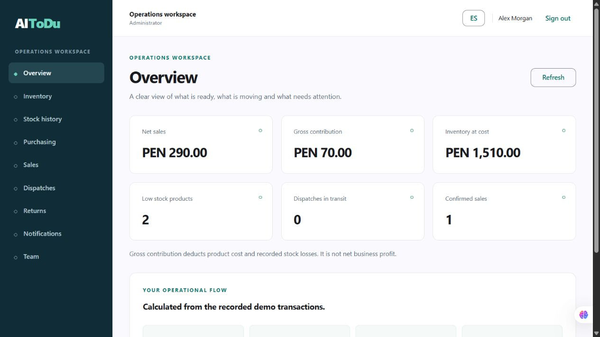

Son datos ficticios de prueba, no ventas reales ni un estudio de eficiencia de negocio. El recibo es explícitamente no fiscal. La compilación y las pruebas no prueban por sí solas usabilidad ni colaboración del equipo.

#### 5.2.2.6. Services Documentation Evidence for Sprint Review

El [OpenAPI de la Fake API](https://github.com/AI-ToDu/ai-todu-fake-api/blob/fix/tb1-readiness/openapi.json) especifica rutas, cuerpos, errores y sesión demo. Contiene solo operaciones implementadas. Recuperación de contraseña, cambio de perfil/contraseña, planes y captación B2B siguen pendientes. Cambios frente a los Technical Stories se listan en el capítulo III.

El transporte HTTP local y el worker consumen el mismo motor. La URL de Pages `/api/v1` se intercepta en navegador después de instalar el worker; no es un backend remoto accesible mediante curl. El archivo JSON local y el IndexedDB no sincronizan dispositivos.

#### 5.2.2.7. Software Deployment Evidence for Sprint Review

El workflow de verificación ejecuta checks en fix/PR. El frontend incluye build con ruta base Pages y un workflow de despliegue para versión revisada. Pages cambió a GitHub Actions el 7/11; el incremento AV2 se publica desde main el 8/11. La existencia de un PR no se registra como despliegue completado.

#### 5.2.2.8. Team Collaboration Insights during Sprint

Los aportes originales se enlazan por integrante y módulo. La corrección no intenta suplir colaboración con volumen de commits: registra trabajo asistido y deja revisión cruzada pendiente. Para completar la evidencia, cada integrante debe revisar su contexto, ejecutar un caso principal/alternativo, comentar un PR y explicar una decisión en la exposición con marca de tiempo.

### 5.2.3. Sprint 3

#### 5.2.3.1. Sprint Planning 3

**Hito:** AV2, semana 12. **Registro técnico:** 7–8/11/2026. Calendario, asistentes, duración de ceremonia y compromiso de capacidad no están acreditados. La selección siguiente documenta el incremento trabajado; no reconstruye una reunión.

> Our focus is on enabling an authorized workspace to reconcile receiving, sales and delivery through the deployed API. We believe it delivers a shared and traceable operational record to business owners and warehouse operators. This will be confirmed when a sale and its delivery preserve stock, historical amounts and recipient across sessions, concurrent sales cannot oversell, and invalid or unauthorized operations leave no partial changes.

El criterio técnico se prueba con datos ficticios; la confianza del usuario sigue como hipótesis. Product Owner y Scrum Master: pendientes de confirmar. Se conserva la atribución histórica sin asignar aportes nuevos no verificados.

#### 5.2.3.2. Aspect Leaders and Collaborators

| Aspecto | Actividad verificada | Responsable y límite |
| --- | --- | --- |
| Development | Backend Java e integración Angular en PR | Trabajo asistido autorizado por Kevin; sin atribuirlo a otros integrantes |
| Execution | Pruebas locales, CI PostgreSQL y recorrido HTTP público | Ejecución técnica asistida; demostración/reflexión individual pendientes |
| Documentation | Informe, OpenAPI y README | Revisión asistida; aprobación académica y reflexiones pendientes |
| Deployment | Pages y API gratuita con PostgreSQL aislado | Autorización de Kevin; evidencias técnicas enlazadas |

Matriz LACX formal y aprobación: pendientes. Los aportes históricos de los integrantes se mantienen con sus fuentes.

#### 5.2.3.3. Sprint Backlog 3

Estimaciones de referencia, no horas registradas ni capacidad medida. La prioridad sigue core → soporte → genérico; autenticación es una dependencia técnica, no el primer objetivo del negocio.

| Task | Historia | Engineering task | Est. | Resultado verificable |
| --- | --- | --- | --- | --- |
| S3-T01 | US09–US14 | Implementar InventoryItem, VOs, movimientos y persistencia separada. | 8 h | Reglas, migraciones y rollback |
| S3-T02 | US15–US18, TS35 | Confirmar/anular ventas atómicas con concurrencia e idempotencia. | 8 h | Solo una de seis ventas de la última unidad se acepta |
| S3-T03 | US19–US22, US37 | Preparar/iniciar/entregar manifiesto con recursos existentes. | 8 h | Receptor y saldo sin doble descuento |
| S3-T04 | US35 | Implementar compra y recepción parcial acotada. | 8 h | Exceso y líneas repetidas rechazados |
| S3-T05 | US36, US23 | Conciliar devoluciones e indicadores. | 4 h | Restock/loss y límite de devolución |
| S3-T06 | US26, TS34 | Traducir eventos internos a PL v1 con Outbox e inbox. | 8 h | Fallo/reintento y reentrega sin duplicación |
| S3-T07 | TS33 | Integrar Open-Meteo mediante gateway y caché. | 4 h | Traducción/caché/fallo probados y llamada real |
| S3-T08 | US01–US03, US28–US29 | Implementar JWT revocables, BCrypt, roles y aislamiento. | 8 h | Sesión y denegaciones verificadas |
| S3-T09 | US33, contratos TS | Integrar Angular con API y separar sesiones demo/servidor. | 8 h | 21 pruebas y build Pages aprobados |
| S3-T10 | Transversal | Desplegar API/DB/webapp y comprobar recorrido. | 8 h | Render live, health UP y Pages |
| S3-T11 | Transversal | Alinear informe, diagramas y servicios. | 8 h | Fuentes y exportación de esta versión |
| S3-T12 | Validación / ABET 3 | Incorporar entrevistas, tablero, videos y reflexión. | 8 h | Pendiente de evidencia humana real |

El tablero externo y sus responsables siguen pendientes de recibir. Esta tabla no simula transiciones To Do / In Process / To Review / Done ni tiempo trabajado.

#### 5.2.3.4. Development Evidence for Sprint Review

[Backend PR #1](https://github.com/AI-ToDu/ai-todu-api/pull/1) implementa contextos, agregados, recursos, migraciones y Outbox. [PR #2](https://github.com/AI-ToDu/ai-todu-api/pull/2) retira administración del runtime y prueba el gateway externo. [Frontend PR #5](https://github.com/AI-ToDu/ai-todu-webapp/pull/5) integra API, sesiones, idioma, provisión y clima.

El dominio no importa Spring/JPA. Las entidades de persistencia son separadas; converters, embeddables y assemblers pertenecen a infraestructura. Los agregados conservan sus invariantes y los errores esperados se devuelven mediante Result.

#### 5.2.3.5. Execution Evidence for Sprint Review

| Verificación | Resultado y evidencia | Límite |
| --- | --- | --- |
| Backend local | 14 pruebas aprobadas | H2 de desarrollo y pruebas del gateway |
| Backend CI | Suite aprobada con PostgreSQL 17 / Java 21 | Datos aislados; no mide carga empresarial |
| Webapp | 21 pruebas y bundle inicial 443.85 kB | Incluye regresión demo y selección de transporte |
| HTTP público | Entrada 5 → venta 2 / PEN 21 → entrega → saldo 3 | Datos ficticios; no equivale a aceptación de usuarios |
| Open-Meteo/CORS | Respuesta real Lima y origen GitHub Pages autorizado | Clima regional de referencia |
| Outbox | Fallo/reintento y reentrega sin duplicación | Relay e inbox en el monolito, sin broker externo |

[CI backend](https://github.com/AI-ToDu/ai-todu-api/actions) · [CI/Pages frontend](https://github.com/AI-ToDu/ai-todu-webapp/actions).

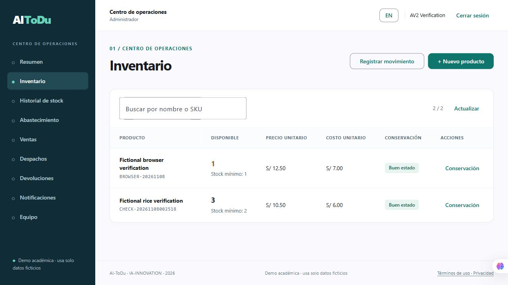

Evidencia del 8/11/2026: desde Angular se crea el producto ficticio BROWSER-20261108, se reciben dos unidades y se vende una por PEN 12,50. La recarga y el nuevo inicio de sesión conservan una unidad. El otro artículo corresponde al recorrido HTTP anterior. Los datos son sintéticos y no representan resultados comerciales.

#### 5.2.3.6. Services Documentation Evidence for Sprint Review

[Swagger UI](https://ai-todu-api-av2.onrender.com/swagger-ui.html) · [OpenAPI](https://ai-todu-api-av2.onrender.com/v3/api-docs) · [README API](https://github.com/AI-ToDu/ai-todu-api) · [Published Language v1](https://github.com/AI-ToDu/ai-todu-api/blob/main/contracts/integration-messages.v1.schema.json).

La API /api/v1 es el Open Host Service. Usa recursos JSON, Problem Details y códigos estables; Accept-Language selecciona en-US o es-419. Los eventos internos se traducen antes de cruzar contextos. Fachadas públicas y gateways delimitan la integración; no se importan agregados de otros dominios.

#### 5.2.3.7. Software Deployment Evidence for Sprint Review

| Artefacto | Publicación | Estado |
| --- | --- | --- |
| Landing | [Pages](https://ai-todu.github.io/ai-todu-platform/) | Canal estático y CTA |
| Frontend | [Pages](https://ai-todu.github.io/ai-todu-webapp/) | Workflow main aprobado |
| API | [Render / health](https://ai-todu-api-av2.onrender.com/actuator/health) | Servicio gratuito live y UP |
| PostgreSQL | Base aislada aitodu_av2 / usuario aitodu_app | Red privada y sin lectura sobre tablas de otros proyectos |

El runtime recibe solo credenciales propias. La provisión administrativa se ejecutó desde el equipo local con una regla /32 temporal, ya retirada. La instancia gratuita comparte capacidad y caducidad: Dashboard indica 28/11/2026 y la API de Render devuelve su expiración UTC equivalente al 29/11. Se requiere continuidad/exportación antes del vencimiento. El servicio gratuito puede tardar en reactivarse tras inactividad.

#### 5.2.3.8. Team Collaboration Insights during Sprint

PR y CI muestran el incremento técnico asistido autorizado por Kevin. No prueban reuniones, revisión cruzada o participación reciente de todos. Se conservan aportes AV1/TB1 y se espera el tablero y los videos existentes. La entrega distingue autoría histórica, trabajo actual, reflexión individual y comunicación.

## 5.3. Validation Interviews

### 5.3.1. Diseño de entrevistas

Validación es una fase distinta de elicitación: **3–5 personas por segmento**, con consentimiento y grabación autorizada. Para dos segmentos: 6–10 sesiones. Cada persona intenta recibir parcialmente, explicar saldo, vender y seguir entrega sin instrucciones de cada paso. Registrar éxito, errores, tiempo, ayuda y feedback contrario. No afirmar ahorro porcentual sin una referencia medida.

### 5.3.2. Registro de entrevistas

**Pendiente de recibir/verificar videos.** Los registros heredados de Carlos Mendoza y Miguel Rojas no se cuentan sin fuente. Por sesión se requiere ID anonimizado, segmento, fecha, consentimiento, enlace, minutos, tareas, resultado y mejora. Un registro no se cuenta automáticamente como elicitación y validación.

### 5.3.3. Evaluación heurística

| Principio | Criterio de revisión | Evidencia técnica | Pendiente |
| --- | --- | --- | --- |
| Visibilidad | Espera, error y resultado claros | Formularios bloquean doble envío y usan códigos | Comprensión y espera con usuarios |
| Correspondencia | Referencias entre recepción, venta y entrega | Flujo transaccional verificado | Vocabulario con ambos segmentos |
| Prevención | Cantidad, stock y estados válidos | Invariantes y rollback probados | Errores de uso no previstos |
| Control | Anulación y devolución con restricciones | Restitución una vez y retorno acotado | Comprensión y recuperación |
| Consistencia | Material, idioma y PEN | Traducciones y build | Evaluador externo |
| Accesibilidad | Teclado, foco, etiquetas y contraste | Implementación semántica y revisión navegador | Auditoría completa y usuarios |

La inspección técnica no sustituye una evaluación heurística independiente. Evaluador, fecha, severidad y hallazgos requieren registro real.

## 5.4. Video About-the-Product

**Pendiente de enlace y validación.** Requiere 1–3 minutos, Stream/YouTube y publicación embebida en landing al recibir material propio. Guion: problema/segmentos → recepción parcial → rechazo de sobreventa → venta/recibo académico → entrega/receptor → conciliación → límites. Incluir testimonios autorizados de ambos segmentos según Anexo C. No se sustituyen por testimonios generados.

## 5.5. Video About-the-Team

**Pendiente de evidencia real.** Mostrar trabajo, aportes y reflexión de cada participante que corresponda. Las grabaciones históricas se atribuyen con contexto verificable. No se simulan reuniones, integrantes activos ni contribuciones recientes. Enlace, duración, participantes y minutos se completarán al recibir videos.

---

# Conclusiones

1. El prototipo conecta recepción, saldo, venta y entrega mediante registros persistidos. La prueba técnica demuestra coherencia del recorrido ficticio; no mide reducción de pérdidas o productividad empresarial.
2. La corrección separa dominio de transporte, incorpora value objects y contrasta arquitectura TB1 con diseño AV2. El monolito modular está implementado en Java y desplegado; no se declaran microservicios inexistentes.
3. El modelo objetivo de 35 tablas organiza capacidades; las migraciones AV2 implementan 19 tablas más historial Flyway. La cobertura operativa sigue siendo parcial en lotes, ubicaciones, clientes, varios intentos/paradas, suscripciones y seguridad productiva. El conteo no sustituye un caso de uso terminado.
4. La interfaz bilingüe Material y la landing explican alcance y resultados del demo. La aceptación con usuarios, la capacidad de comunicación individual y el proceso colaborativo requieren evidencia humana auténtica.

## Mejora continua y autocrítica

| Observación del docente | Corrección aplicada | Evidencia / condición pendiente |
| --- | --- | --- |
| Student Outcome sin acciones por persona/entrega | Matriz AV1/TB1 con commits reales y acción escrita específica. | Evidencia oral y reflexión individual pendientes. |
| Repositorios faltantes | Repositorios reales enlazados; Fake API independiente y copia trazable. | Backend Java publicado y CI PostgreSQL aprobado. |
| Versiones incorrectas | Registro apoyado en fechas/commits; corrección fechada 30/10/2026. | Ratificar fecha formal de las ceremonias. |
| Imágenes rotas | Referencias ausentes sustituidas por estado explícito; fuentes históricas conservadas. | Adjuntar material real; no intercambiar identidades. |
| Seis commits y sin develop | Historial preservado, develop incorporada y bloques de corrección revisables. | Colaboración progresiva, revisión y tablero reales del equipo. |
| Landing sin enlace | URL pública y CTA real en configuración y producto. | Comprobar el CTA y la versión pública en cada entrega. |
| Falta de Mock API | Motor persistente, HTTP local, worker estático, OpenAPI y pruebas. | No equivale a servidor productivo multiusuario. |
| Orden del dominio | Épicas, historias y diagramas core → soporte → genérico; canal público al final. | Revalidar clasificación si cambia el negocio. |
| C4 débil | C1, C2 actual/futuro y C3 con responsabilidades, límites y tecnología. | C2/C3 AV2 y Design-Level Event Storming contrastados con el servidor. |
| Tipos primitivos en dominio | Sku, Quantity, Money y Address; límites de agregados. | Dominio Java agnóstico y repositorios implementados; ampliar VOs según cambien reglas. |
| Tablas con nomenclatura incorrecta | 35 tablas lowercase snake_case, claves/restricciones/diccionario/ERD. | Migraciones PostgreSQL V1–V4 y pruebas reales en CI; modelo objetivo aún parcial. |
| Sprint 1 incompleto / salto a 3 | Sprint 1 y 2 con las ocho secciones, límites históricos explícitos. | Actas, tablero y evidencias históricas pendientes. |
| Goal sin formato | Outcome/impact/customer/confirmation con estructura del enunciado. | Acuerdo del equipo y validación del impacto con usuarios. |
| BD poco funcional | Recepción parcial, recursos reales de demo, devoluciones y bandeja operativa. | Profundidad en lotes/ubicaciones/rutas y clientes. |

## Pendientes de evidencia y próxima entrega

**Para cerrar AV2:** incorporar tablero auténtico, entrevistas por segmento/fase, About-the-Product, About-the-Team, evidencias orales y reflexiones individuales; ratificar roles Scrum y matriz LACX. La presentación y el reporte de participación se preparan como borradores editables y no acreditan actividades ni calificaciones todavía no confirmadas.

**Trabajo posterior, en orden del dominio:**

1. Inventory: almacenes, ubicaciones, lotes, variantes y vencimiento, con reglas y casos completos.
2. Logistics: múltiples paradas, intentos fallidos, reprogramación, capacidad y rutas.
3. Procurement/Sales/Returns: clientes, aprobaciones, política de valorización, cambios y reexpedición. Pagos/SUNAT requieren alcance y proveedor.
4. IAM: invitaciones, recuperación/cambio de contraseña y auditoría ampliada.
5. Operación: continuidad/exportación de PostgreSQL antes de su caducidad, observabilidad y pruebas de carga acordes al uso real.

No se asignan fechas, responsables ni estimaciones como compromisos del equipo sin acuerdo y evidencia.

# Bibliografía y fuentes

- Universidad Peruana de Ciencias Aplicadas. (2026). *1ASI0729 Final Project Statement, ABET*. Documento del curso proporcionado por el equipo; formato de Sprint Goal, p. 24; entregables y evidencias según secciones correspondientes.
- Universidad Peruana de Ciencias Aplicadas. (2026). *Rúbrica ABET 3* y *Rúbrica de logro 1ASI0729*. Documentos proporcionados por el equipo. Las capturas de la evaluación TB1 son feedback, no una calificación recalculada por esta revisión.
- Angular Team. (s. f.). *Angular Material: Getting started*. https://material.angular.dev/guide/getting-started
- Mozilla. (s. f.). *Using Service Workers*. https://developer.mozilla.org/en-US/docs/Web/API/Service_Worker_API/Using_Service_Workers
- Node.js Contributors. (s. f.). *SQLite*. https://nodejs.org/api/sqlite.html
- GitHub. (s. f.). *Using custom workflows with GitHub Pages*. https://docs.github.com/en/pages/getting-started-with-github-pages/using-custom-workflows-with-github-pages
- Mermaid Contributors. (s. f.). *Mermaid CLI*. https://github.com/mermaid-js/mermaid-cli
- Brown, S. (s. f.). *The C4 model for visualising software architecture*. https://c4model.com/
- Spring Team. *Spring Boot reference*. https://docs.spring.io/spring-boot/
- JJWT. *Signed JWT creation and parsing*. https://github.com/jwtk/jjwt
- Render. *Free instances and limits*. https://render.com/docs/free
- Open-Meteo. *Weather Forecast API*. https://open-meteo.com/en/docs
- AI-ToDu. (2026). *Repositorios de producto e informe*. https://github.com/AI-ToDu

Las fuentes de mercado heredadas sin trazabilidad entre afirmación y documento no se utilizan para sostener porcentajes o resultados. El análisis competitivo vincula páginas oficiales y requiere prueba de edición/fecha antes de afirmar equivalencias de funciones o precio.

# Anexos

- [Arquitectura, decisiones y brechas](design/architecture.md).
- [Diccionario de las 35 tablas](design/database/dictionary.md) y [DDL](design/database/schema.sql).
- [Registro de investigación y fuentes heredadas](research/README.md).
- Las notas de revisión y avances se conservan localmente, fuera del repositorio.
- Diagramas: fuentes Mermaid junto a los SVG en `design/diagrams`.

El README completo se genera desde las fuentes indicadas en la introducción. `npm run check` valida sincronía, assets locales y límites de estimaciones; la exportación PDF mantiene el mismo texto. Ningún generador completa evidencias humanas pendientes automáticamente.

## Modelo físico · diagramas de detalle

Los diagramas siguientes incluyen claves y columnas. Las FK entre áreas se consultan en el DDL y diccionario; los SVG editables permiten ampliar el detalle sin pérdida de definición. El modelo de 35 tablas es una referencia de alcance futuro. El esquema AV2 desplegado se enumera en 4.8.1.1 y en las migraciones del backend.

### Inventario · core


[Fuente SVG ampliable](design/diagrams/rendered/erd-inventory.svg) · [DDL completo](design/database/schema.sql).

### Logística · core


[Fuente SVG ampliable](design/diagrams/rendered/erd-logistics.svg) · [DDL completo](design/database/schema.sql).

### Abastecimiento · soporte


[Fuente SVG ampliable](design/diagrams/rendered/erd-procurement.svg) · [DDL completo](design/database/schema.sql).

### Ventas · soporte


[Fuente SVG ampliable](design/diagrams/rendered/erd-sales.svg) · [DDL completo](design/database/schema.sql).

### Devoluciones · soporte

[Fuente SVG ampliable](design/diagrams/rendered/erd-returns.svg) · [DDL completo](design/database/schema.sql).

### Notificaciones · soporte

[Fuente SVG ampliable](design/diagrams/rendered/erd-notifications.svg) · [DDL completo](design/database/schema.sql).

### Identidad · genérico


[Fuente SVG ampliable](design/diagrams/rendered/erd-identity.svg) · [DDL completo](design/database/schema.sql).

## Anexo A. Student Outcome

La introducción, criterios, acciones por entrega, fuentes y conclusiones se encuentran en la sección inicial Student Outcome. La evidencia oral y reflexión individual pendiente se incorporará con audiencia, enlace y minuto verificables.

## Anexo B. Participación individual

El Performance Report editable del paquete de entrega mantiene la escala del enunciado (20, 16, 13, 07 o 00), sin asignar una nota automática. El coordinador debe verificar autoría, contribuciones, justificación y firma antes de emitirlo. Los commits históricos no prueban por sí solos tiempo dedicado ni aprendizaje individual.

## Anexo C. Testimonios y videos

| Evidencia | Segmento / participante | Fuente, consentimiento y minuto | Estado |
| --- | --- | --- | --- |
| Testimonio de validación | Administrador del negocio | Pendiente | No contabilizado |
| Testimonio de validación | Operario de almacén | Pendiente | No contabilizado |
| About-the-Product | Producto y ambos segmentos | Stream/YouTube, duración y permisos pendientes | Sin video propio verificado |
| About-the-Team | Participantes de la entrega | Enlaces y reflexiones individuales pendientes | Sin evidencia completa |
| Tablero Scrum | Trabajo real del equipo | URL, responsables y transiciones pendientes | Sin reconstrucción histórica |

Los datos identificables y consentimientos no se publican automáticamente en Git. Solo se adjunta material autorizado para la evaluación.
