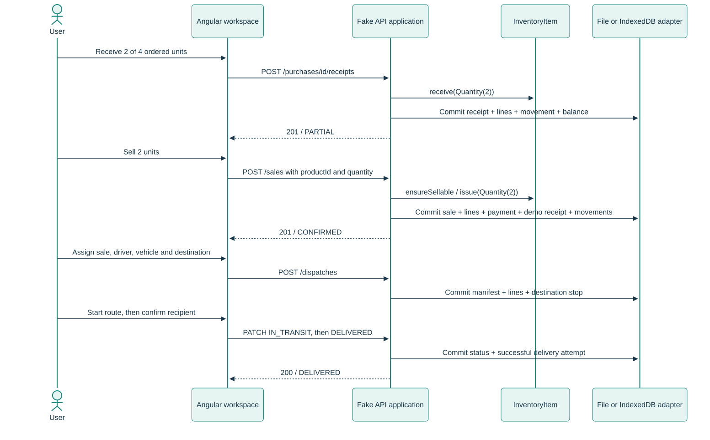

# Domain and architecture decisions

Historical baseline: TB1, 2026-10-30. Current increment: AV2, 2026-11-08. Prototype diagrams are labelled TB1; AV2 diagrams describe the implemented modular monolith.

## Bounded contexts in review order

1. **Core — Inventory, Logistics.** Inventory owns product stock and conservation. AV2 Logistics owns manifests, drivers, vehicles, delivery evidence and incidents. Multi-stop routing and repeated delivery attempts remain target-model capabilities. Dispatch references a confirmed sale; it never decrements inventory a second time.
2. **Support — Procurement, Sales, Returns, Reporting, Notifications.** Receipt increases stock. Sale issues stock atomically. Cancellation restores it once. Return cannot exceed the sold balance. Reporting derives its figures; it does not own a second transactional ledger.
3. **Generic — Identity and access.** Tenant, session and role contract is shared. A public landing is a product channel, not a domain bounded context.

Solid arrows between contexts run from consumer to provider. Dashed event arrows run from producer to consumer through the transactional Outbox and relay. The REST `/api/v1` entry point is the Open Host Service. Resources and OpenAPI describe its HTTP contract, while the [versioned integration schema](https://github.com/AI-ToDu/ai-todu-api/blob/067abc7bd2583d0286dc1cc4e84c17d292c0afc2/contracts/integration-messages.v1.schema.json) describes the Published Language delivered to Notifications.

| Consumer → provider | Pattern in the implemented flow |
| --- | --- |
| Sales → Inventory | `InventoryGateway.take` calls `InventoryContextFacade` and translates a product snapshot into a Sales `SaleLine`. |
| Logistics → Sales | `SalesGateway.claim` translates Sales lines into Logistics `DispatchLine` instances. `fulfillment` delegates the status update, and `candidates` passes through Sales snapshots. |
| Procurement → Inventory | `ProcurementService` calls the public facade to check products and receive quantities. |
| Returns → Sales and Inventory | `ReturnService` calls the public facades directly. It uses the Sales line snapshot to build `CustomerReturn` in the use case and receives stock through Inventory for `RESTOCK`. |
| Reporting → Inventory, Sales, Logistics and Returns | `MetricsQueryServiceImpl` combines public queries in a read-only transaction. |

## C4

| Level | Reviewed artifact | Boundary and status |
| --- | --- | --- |
| C1 | [System context](diagrams/rendered/c4-context.svg) | People and AI-ToDu system; no fictitious fiscal or AI provider integration. |
| C2 TB1 | [Containers](diagrams/rendered/c4-containers-tb1.svg) | Static origin, Angular SPA, self-contained browser worker and IndexedDB. Node/file is an alternative local transport, not a public backend. The worker is bundled before builds to avoid static-host `.mjs` MIME assumptions. |
| C2 AV2 | [AV2 containers](diagrams/rendered/c4-containers-av2.svg) | Java 21 / Spring Boot modular monolith, PostgreSQL and the Open-Meteo gateway, deployed on Render. |
| C3 TB1 | [Mock components](diagrams/rendered/c4-components.svg) | Historical demo dispatcher, domain objects and storage adapters. |
| C3 AV2 | [API components](diagrams/rendered/c4-components-av2.svg) | Per-context handlers, public facades, repository ports, JPA assemblers and Outbox/inbox. |

Editable `.mmd` sources are alongside the rendered SVGs. Regenerate with `npm ci && npm run diagrams`. On Windows an installed Edge executable can be selected with `MERMAID_CHROME_PATH`. The local executable path is ignored by Git.

## Tactical DDD and invariants

`Sku`, `Quantity`, `Money` and `Address` are immutable value objects. InventoryItem has stable identity; its values are validated by these objects. SaleSummary calculates in integer cents. DispatchManifest accepts only PENDING → IN_TRANSIT → DELIVERED. Primitive JSON and relational columns are serialization boundaries, not substitutes for domain rules. TB1 retains its historical shared dispatcher. AV2 has context handlers, plain Java domain objects and repository ports; JPA entities and converters remain outside the domain.

| Aggregate / boundary | Invariant enforced now | Later work |
| --- | --- | --- |
| InventoryItem | Nonnegative integer stock; unique normalized SKU; conservation independently blocks sale. | Stock by location/variant/lot and expiration policy. |
| Sale transaction | Complete validation before commit; immutable price/cost snapshots; no partial stock issue. | Payment ledger and fiscal integration; sale idempotency keys are implemented in AV2. |
| Purchase order | Positive quantities; receiving never exceeds outstanding amount; duplicate lines rejected. | Approval, supplier catalog and cost valuation policy. |
| DispatchManifest | Confirmed unassigned sale; resource conflict checks on departure; valid next state and recipient. | Multiple stops, failed delivery attempts, capacity/routing constraints. |
| Return | Bounded by sale line; restock or loss; no return during an unfinished dispatch. Returned POS sale is not dispatchable in this TB1 scope. | Exchange, actual refund, credit note and reshipment. |
| Tenant | Direct API role checks and scoped lookups; cross-tenant identifiers rejected. | Password recovery, invitations and richer audit; AV2 implements BCrypt, JWT sessions, server-side roles and workspace-scoped lookups. |

The stock ledger is recorded as movements, while a balance is updated in the same accepted draft. This is a consistency invariant in the demo, not an event-sourced implementation. TB1 evaluates low stock synchronously. AV2 translates private domain events into versioned integration messages and uses a transactional Outbox; no external broker is claimed. Money uses PEN and standard recorded product cost, not taxes, net business profit or weighted-average cost.

## ADR-001 — one engine, two demo adapters

A pure `handle(state, request)` produces either an entire accepted draft or the original state on a domain failure. The Node adapter serializes requests and persists by rename. The browser adapter uses one IndexedDB read-write transaction. This keeps demonstrations functional on static Pages and allows actual HTTP contract and concurrency tests locally. Browser data is confined to that profile/origin, can be cleared and is not shared between devices. It is an explicitly labelled Fake API, not an enterprise security boundary.

## ADR-002 — normalized SQL is a migration target

The reviewed [35-table SQL](database/schema.sql) and [dictionary](database/dictionary.md) use lowercase snake_case, integer cents, nonnegative stock, uniqueness and tenant-aware foreign keys. SQLite executes the DDL in automated validation. The demo persists JSON collections rather than executing SQL. AV2 implements a separate Flyway schema of 19 tables plus migration history; transaction/isolation tests run against PostgreSQL 17. Advanced parts of the 35-table target are future scope. The 35-table count is a coverage inventory, never a completeness metric.

## ADR-003 — application / domain / infrastructure boundaries

Angular presentation is lazy by domain. Shared application concerns provide session and translation; infrastructure holds the HttpClient adapter. Pure domain objects in `public/mock/domain` have no Angular, Node, HTTP or database dependency. The shared mock dispatcher is an application service with context branches. AV2 moves business commands into each domain and coordinates them through application services and repository ports. REST resources stay at the API boundary; persistence assemblers reconstitute plain aggregates. Do not turn each context into a separate deployable service without an operational reason.

## ADR-004 — atomic commands and workspace locking

`CommandExecutor` coordinates the unit of work through Spring's `TransactionTemplate`. It acquires a pessimistic workspace lock inside the transaction, so business commands for one workspace serialize while other workspaces use independent locks. The lock trades within-workspace concurrency for simpler coordination. A failed command rolls back its writes before `Result` returns the domain error.

| Operation | Consistency boundary | Invariant protected |
| --- | --- | --- |
| `ConfirmSaleCommand` | Strong across Sales and Inventory, including Outbox writes | The sale, line snapshots and all stock deductions commit together. Two concurrent requests cannot both sell the last unit. |
| `CancelSaleCommand` | Strong across Sales and Inventory | An eligible sale becomes cancelled and its stock is restored once in the same transaction. |
| `PrepareDispatchCommand` | Strong across Logistics and Sales | A sale claimed by a dispatch and the manifest are saved together, so a failed preparation leaves the sale available for another attempt. |
| `TransitionDispatchCommand` | Strong across Logistics and Sales, including the delivery Outbox write | Sales fulfillment and the manifest stay aligned. Return eligibility depends on fulfillment when the sale belongs to a dispatch. |
| `ReceivePurchaseCommand` | Strong across Procurement and Inventory | The received quantity and corresponding stock increase commit together, within the ordered balance. |
| `RecordReturnCommand` | Strong across Returns and Sales, and Inventory for `RESTOCK` | The returned quantity updates the sale line and return record together. Only `RESTOCK` restores stock. |
| Notifications | Eventual relative to the originating command | The producer commits its business state and pending message together. A later relay transaction registers the notification once per `eventId` and marks the message published. |

The [transaction tests](https://github.com/AI-ToDu/ai-todu-api/blob/067abc7bd2583d0286dc1cc4e84c17d292c0afc2/src/test/java/com/aitodu/platform/TransactionIntegrationTest.java) cover concurrent sales, sale rollback, partial receipts and returns. ADR-008 describes the separate consumer transaction and retry tests.

## ADR-005 — runtime credentials and network isolation

The deployed service receives only its dedicated PostgreSQL role and JWT key. Database administration remains outside the application runtime. The database was provisioned through a temporary /32 ingress rule; that rule was removed after verifying that the application role cannot read the other project's public tables. The instance is shared capacity, while database and application credentials are separate.

Free hosting may sleep after inactivity and the shared free PostgreSQL instance expires in late November 2026. Export/continuity must be arranged before expiry. These limits are deployment constraints, not demonstrated commercial availability.

## ADR-006 — implemented schema versus target model

The 35-table design remains a roadmap. The executed V1–V4 Flyway migrations define 19 application/infrastructure tables plus flyway_schema_history. No automatic migration copies browser demo records into PostgreSQL. Server and demo sessions use separate browser keys; server failure never silently switches the user to fictional local state.

The current schema uses foreign keys within aggregates, such as `sale_lines.sale_id` and `dispatch_lines.dispatch_id`. It also retains the following physical dependencies between aggregates or contexts in the shared PostgreSQL schema.

| References | What the database preserves | Coupling |
| --- | --- | --- |
| Sale, purchase and dispatch lines, plus customer returns → Inventory product | A product referenced by an operational record still exists. The product FK checks its UUID. | A product deletion must account for its references in other contexts. |
| Dispatch lines and customer returns → Sales sale and sale line | A source sale and line still exist for traceability. The return's sale FK checks `(tenant_id, sale_id)`. The line FKs check the line UUID. | Sales history must remain available while Logistics and Returns reference it. |
| Dispatch → driver and vehicle, purchase order → supplier | Composite FKs require the referenced resource to belong to the same workspace. | The dependent aggregate requires the resource to remain present. |
| Workspace-scoped records → workspace, stock movement → actor | Workspace and actor references retain links to existing IAM records wherever V1–V4 declare the FK. The movement's actor FK checks the user UUID. | Cleanup of workspace and user records must account for dependent history. |

The use cases check workspace scope and related identities through repository queries and public facades. For example, Returns loads the sale for the authenticated workspace and selects the line from that aggregate. The individual UUID constraints enforce existence. Composite constraints additionally enforce workspace membership where declared.

Single-attribute values use infrastructure converters. Multi-attribute persistence values use embeddables. Domain models contain neither JPA nor Spring annotations. Separate assemblers preserve aggregate reconstitution, without claiming that a converter replaces all object mapping.

## External service contract

Open-Meteo supplies regional conditions for fixed central-Lima coordinates. The gateway validates and translates its response, caches for ten minutes, and applies connection/request timeouts. Provider failure yields a stable 503 code; dispatch commands remain usable. Customer destinations are not sent, and the forecast is not route-specific.

## ADR-007 — CQRS contracts and HTTP outcomes

REST controllers depend on application CommandService/QueryService interfaces. Queries are domain records with authenticated workspace identity; read handlers use read-only transactions. REST FromEntity assemblers and persistence assemblers serve different boundaries. An expected Result.Failure becomes a ProblemDetail response directly, without another thrown domain exception. Transport validation returns 400 with a matching body status. Command endpoints explicitly document their success-resource and error schemas, since ResponseEntity<?> represents both possible HTTP bodies.

## ADR-008 — Transactional Outbox Pattern

Business state and the public integration message commit in the same database transaction. The originating context alone interprets its domain event and translates it into Published Language v1. JpaIntegrationOutbox requires an existing transaction. The relay reads at most 25 due PENDING rows, uses a pessimistic message lock and commits notification effects together with PUBLISHED. Failure rolls back consumption before a separate transaction records retry state, with a 300-second maximum delay. Notification identity is eventId, so repeated delivery does not repeat that effect. The tests cover rollback, failure/retry and redelivery in one process; no full-process restart or external broker is asserted.

[Outbox sequence](diagrams/rendered/transactional-outbox.svg) · [AV2 class model](diagrams/rendered/class-core-av2.svg) · [Physical dictionary extracted from V1–V4](database/dictionary-av2.md).
