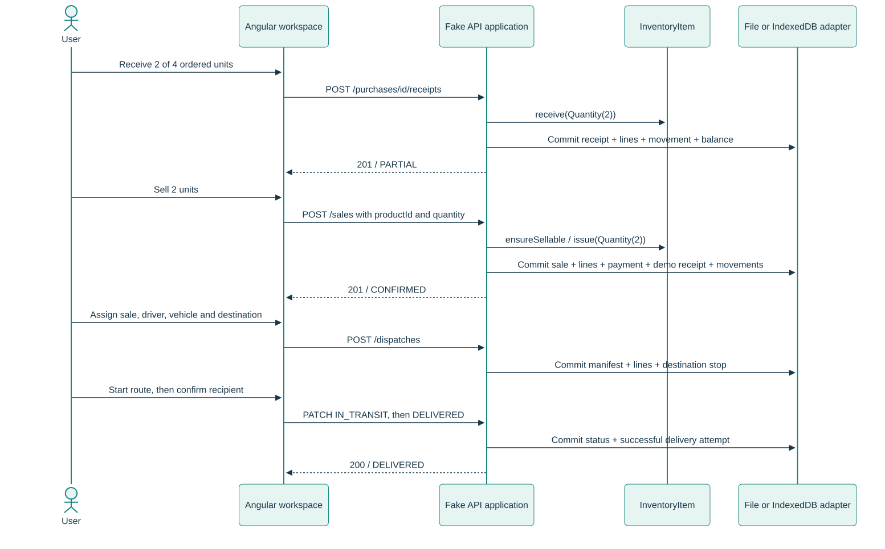

# Domain and architecture decisions

Reviewed baseline: TB1 correction, 2026-10-30. Diagrams describe the current prototype unless marked AV2 design.

## Bounded contexts in review order

1. **Core — Inventory, Logistics.** Inventory owns product stock and conservation. Logistics owns manifests, drivers, vehicles, stops and attempts. Dispatch references a confirmed sale; it never decrements inventory a second time.
2. **Support — Procurement, Commercial/Returns, Reporting, Notifications.** Receipt increases stock. Sale issues stock atomically. Cancellation restores it once. Return cannot exceed the sold balance. Reporting derives its figures; it does not own a second transactional ledger.
3. **Generic — Identity and access.** Tenant, session and role contract is shared. A public landing is a product channel, not a domain bounded context.

## C4

| Level | Reviewed artifact | Boundary and status |
| --- | --- | --- |
| C1 | [System context](diagrams/rendered/c4-context.svg) | People and AI-ToDu system; no fictitious fiscal or AI provider integration. |
| C2 TB1 | [Containers](diagrams/rendered/c4-containers-tb1.svg) | Static origin, Angular SPA, self-contained browser worker and IndexedDB. Node/file is an alternative local transport, not a public backend. The worker is bundled before builds to avoid static-host `.mjs` MIME assumptions. |
| C2 AV2 | [Future containers](diagrams/rendered/c4-containers-av2.svg) | Java/Spring Boot modular monolith and PostgreSQL. Design only. |
| C3 | [Mock components](diagrams/rendered/c4-components.svg) | Actual dispatcher, three domain objects, VOs and adapter storage; file names identify implementation boundaries. |

Editable `.mmd` sources are alongside the rendered SVGs. Regenerate with `npm ci && npm run diagrams`. On Windows an installed Edge executable can be selected with `MERMAID_CHROME_PATH`. The local executable path is ignored by Git.

## Tactical DDD and invariants

`Sku`, `Quantity`, `Money` and `Address` are immutable value objects. InventoryItem has stable identity; its values are validated by these objects. SaleSummary calculates in integer cents. DispatchManifest accepts only PENDING → IN_TRANSIT → DELIVERED. Primitive JSON and relational columns are serialization boundaries, not substitutes for domain rules. Context handlers still share one application dispatcher in TB1; there are no production Java aggregate repositories yet.

| Aggregate / boundary | Invariant enforced now | Later work |
| --- | --- | --- |
| InventoryItem | Nonnegative integer stock; unique normalized SKU; conservation independently blocks sale. | Stock by location/variant/lot and expiration policy. |
| Sale transaction | Complete validation before commit; immutable price/cost snapshots; no partial stock issue. | Idempotency keys, production payment ledger and fiscal integration. |
| Purchase order | Positive quantities; receiving never exceeds outstanding amount; duplicate lines rejected. | Approval, supplier catalog and cost valuation policy. |
| DispatchManifest | Confirmed unassigned sale; resource conflict checks on departure; valid next state and recipient. | Multiple stops, failed delivery attempts, capacity/routing constraints. |
| Return | Bounded by sale line; restock or loss; no return during an unfinished dispatch. Returned POS sale is not dispatchable in this TB1 scope. | Exchange, actual refund, credit note and reshipment. |
| Tenant | Direct API role checks and scoped lookups; cross-tenant identifiers rejected. | Real server-side authentication/authorization, audit, credential hashing and recovery. |

The stock ledger is recorded as movements, while a balance is updated in the same accepted draft. This is a consistency invariant in the demo, not an event-sourced implementation. Low-stock notification policy runs synchronously; event storming vocabulary does not imply an implemented message broker. Money uses PEN and standard recorded product cost, not taxes, net business profit or weighted-average cost.

## ADR-001 — one engine, two demo adapters

A pure `handle(state, request)` produces either an entire accepted draft or the original state on a domain failure. The Node adapter serializes requests and persists by rename. The browser adapter uses one IndexedDB read-write transaction. This keeps demonstrations functional on static Pages and allows actual HTTP contract and concurrency tests locally. Browser data is confined to that profile/origin, can be cleared and is not shared between devices. It is an explicitly labelled Fake API, not an enterprise security boundary.

## ADR-002 — normalized SQL is a migration target

The reviewed [35-table SQL](database/schema.sql) and [dictionary](database/dictionary.md) use lowercase snake_case, integer cents, nonnegative stock, uniqueness and tenant-aware foreign keys. SQLite executes the DDL in automated validation. The demo persists JSON collections rather than executing SQL. PostgreSQL/JPA migration, server transaction/isolation tests, multi-device concurrency and production authentication are AV2 work. The 35-table count is a coverage inventory, never a completeness metric.

## ADR-003 — application / domain / infrastructure boundaries

Angular presentation is lazy by domain. Shared application concerns provide session and translation; infrastructure holds the HttpClient adapter. Pure domain objects in `public/mock/domain` have no Angular, Node, HTTP or database dependency. The shared mock dispatcher is an application service with context branches. For AV2 migrate these branches to context application services and repository ports; DTOs stay at the API boundary, and controllers do not contain domain rules. Do not turn each context into a separate deployable service without an operational reason.
