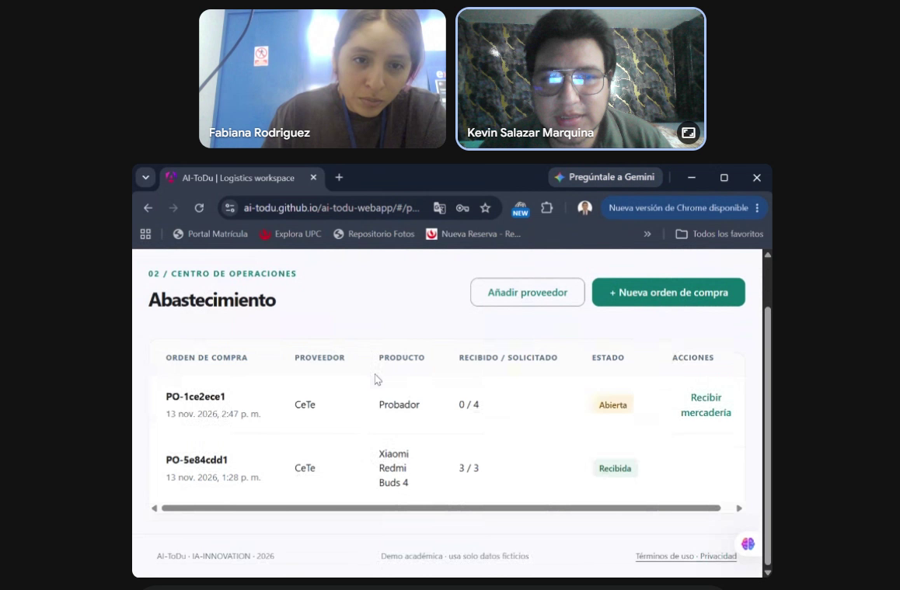
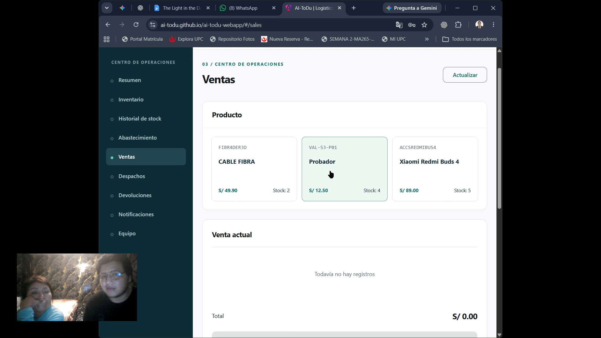

# Conclusiones

1. El prototipo conecta recepción, saldo, venta y entrega mediante registros persistidos. La prueba técnica demuestra coherencia del recorrido ficticio; no mide reducción de pérdidas o productividad empresarial.
2. La corrección separa dominio de transporte, incorpora value objects y contrasta arquitectura TB1 con diseño AV2. El monolito modular está implementado en Java y desplegado; no se declaran microservicios inexistentes.
3. El modelo objetivo de 35 tablas organiza capacidades; las migraciones AV2 implementan 19 tablas más historial Flyway. La cobertura operativa sigue siendo parcial en lotes, ubicaciones, clientes, varios intentos/paradas, suscripciones y seguridad productiva. El conteo no sustituye un caso de uso terminado.
4. Cinco sesiones guiadas aportan observaciones de administración y operación: se requieren acciones visibles, lenguaje consistente, responsable del movimiento y contexto del artículo en las alertas. Se documentan ocho problemas heurísticos y correcciones técnicas integradas y publicadas. La eficacia sin ayuda, el impacto empresarial y la reflexión individual todavía no están demostrados.

## Mejora continua y autocrítica

| Observación del docente | Corrección aplicada | Evidencia / condición pendiente |
| --- | --- | --- |
| Student Outcome sin acciones por persona/entrega | Matriz AV1/TB1 con commits reales y acción escrita específica. | Evidencia oral y reflexión individual pendientes. |
| Repositorios faltantes | Repositorios reales enlazados; Fake API independiente y copia trazable. | Backend Java publicado y CI PostgreSQL aprobado. |
| Versiones incorrectas | Registro apoyado en fechas/commits; corrección fechada 30/10/2026. | Ratificar fecha formal de las ceremonias. |
| Imágenes rotas | Referencias ausentes sustituidas por estado explícito; fuentes históricas conservadas. | Adjuntar material real; no intercambiar identidades. |
| Seis commits y sin develop | Historial preservado, develop incorporada y bloques de corrección revisables. | Colaboración progresiva, revisión y tablero reales del equipo. |
| Landing sin enlace | URL pública y CTA real en configuración y producto. | Comprobar el CTA y la versión pública en cada entrega. |
| Falta de Mock API | Motor persistente, HTTP local, worker estático, OpenAPI y pruebas. | No equivale a servidor productivo multiusuario. |
| Orden del dominio | Épicas, historias y diagramas core → soporte → genérico; canal público al final. | Revalidar clasificación si cambia el negocio. |
| C4 débil | C1, C2 actual/futuro y C3 con responsabilidades, límites y tecnología. | C2/C3 AV2 y Design-Level Event Storming contrastados con el servidor. |
| Tipos primitivos en dominio | Sku, Quantity, Money y Address; límites de agregados. | Dominio Java agnóstico y repositorios implementados; ampliar VOs según cambien reglas. |
| Tablas con nomenclatura incorrecta | 35 tablas lowercase snake_case, claves/restricciones/diccionario/ERD. | Migraciones PostgreSQL V1–V5 y pruebas reales en CI; modelo objetivo aún parcial. |
| Sprint 1 incompleto / salto a 3 | Sprint 1 y 2 con las ocho secciones, límites históricos explícitos. | Actas, tablero y evidencias históricas pendientes. |
| Goal sin formato | Outcome/impact/customer/confirmation con estructura del enunciado. | Acuerdo del equipo y validación del impacto con usuarios. |
| BD poco funcional | Recepción parcial, recursos reales de demo, devoluciones y bandeja operativa. | Profundidad en lotes/ubicaciones/rutas y clientes. |

## Pendientes de evidencia y próxima entrega

**Estado del cierre actual:** cinco originales publicados, fichas con capturas/tiempos y ocho problemas heurísticos documentados; cuatro retratos originales y seis imágenes de investigación recuperados. El tablero de seguimiento es público. El consolidado de validaciones (19:18 en YouTube), Product Navigation (7:59) y About-the-Product (2:21) están publicados en YouTube y en la carpeta institucional propia de UPC. About-the-Product también está embebido en la landing pública.

**Pendiente de evidencia real o acción externa:** grabar About-the-Team y la reflexión personal de Kevin; volver a comprobar con participantes las correcciones publicadas. El Performance Report conserva la escala sin asignar una calificación, justificación personal ni firma automática. Las ceremonias históricas y los videos iniciales sin URL auténtica no se reconstruyen.

**Trabajo posterior, en orden del dominio:**

1. Inventory: almacenes, ubicaciones, lotes, variantes y vencimiento, con reglas y casos completos.
2. Logistics: múltiples paradas, intentos fallidos, reprogramación, capacidad y rutas.
3. Procurement/Sales/Returns: clientes, aprobaciones, política de valorización, cambios y reexpedición. Pagos/SUNAT requieren alcance y proveedor.
4. IAM: invitaciones, recuperación/cambio de contraseña y auditoría ampliada.
5. Operación: continuidad/exportación de PostgreSQL antes de su caducidad, observabilidad y pruebas de carga acordes al uso real.

El seguimiento actual identifica a Kevin como responsable y usa las fechas reales de creación/avance. Las estimaciones de referencia no se presentan como horas medidas ni compromisos históricos.

# Bibliografía y fuentes

- Universidad Peruana de Ciencias Aplicadas. (2026). *1ASI0729 Final Project Statement, ABET*. Documento del curso proporcionado por el equipo; formato de Sprint Goal, p. 24; entregables y evidencias según secciones correspondientes.
- Universidad Peruana de Ciencias Aplicadas. (2026). *Rúbrica ABET 3* y *Rúbrica de logro 1ASI0729*. Documentos proporcionados por el equipo. Las capturas de la evaluación TB1 son feedback, no una calificación recalculada por esta revisión.
- Angular Team. (s. f.). *Angular Material: Getting started*. https://material.angular.dev/guide/getting-started
- Mozilla. (s. f.). *Using Service Workers*. https://developer.mozilla.org/en-US/docs/Web/API/Service_Worker_API/Using_Service_Workers
- Node.js Contributors. (s. f.). *SQLite*. https://nodejs.org/api/sqlite.html
- GitHub. (s. f.). *Using custom workflows with GitHub Pages*. https://docs.github.com/en/pages/getting-started-with-github-pages/using-custom-workflows-with-github-pages
- Mermaid Contributors. (s. f.). *Mermaid CLI*. https://github.com/mermaid-js/mermaid-cli
- Brown, S. (s. f.). *The C4 model for visualising software architecture*. https://c4model.com/
- Spring Team. *Spring Boot reference*. https://docs.spring.io/spring-boot/
- JJWT. *Signed JWT creation and parsing*. https://github.com/jwtk/jjwt
- Render. *Free instances and limits*. https://render.com/docs/free
- Open-Meteo. *Weather Forecast API*. https://open-meteo.com/en/docs
- AI-ToDu. (2026). *Repositorios de producto e informe*. https://github.com/AI-ToDu

Las fuentes de mercado heredadas sin trazabilidad entre afirmación y documento no se utilizan para sostener porcentajes o resultados. El análisis competitivo vincula páginas oficiales y requiere prueba de edición/fecha antes de afirmar equivalencias de funciones o precio.

# Anexos

- [Arquitectura, decisiones y brechas](design/architecture.md).
- [Diccionario de las 35 tablas](design/database/dictionary.md) y [DDL](design/database/schema.sql).
- [Registro de investigación y fuentes heredadas](research/README.md).
- Las notas de revisión y avances se conservan localmente, fuera del repositorio.
- Diagramas: fuentes Mermaid junto a los SVG en `design/diagrams`.

El README completo se genera desde las fuentes indicadas en la introducción. `npm run check` valida sincronía, assets locales y límites de estimaciones; la exportación PDF mantiene el mismo texto. Ningún generador completa evidencias humanas pendientes automáticamente.

## Modelo físico · diagramas de detalle

Los diagramas siguientes incluyen claves y columnas. Las FK entre áreas se consultan en el DDL y diccionario; los SVG editables permiten ampliar el detalle sin pérdida de definición. El modelo de 35 tablas es una referencia de alcance futuro. El esquema AV2 desplegado se enumera en 4.8.1.1 y en las migraciones del backend.

### Inventario · core

[Fuente SVG ampliable](design/diagrams/rendered/erd-inventory.svg) · [DDL completo](design/database/schema.sql).

### Logística · core

[Fuente SVG ampliable](design/diagrams/rendered/erd-logistics.svg) · [DDL completo](design/database/schema.sql).

### Abastecimiento · soporte

[Fuente SVG ampliable](design/diagrams/rendered/erd-procurement.svg) · [DDL completo](design/database/schema.sql).

### Ventas · soporte

[Fuente SVG ampliable](design/diagrams/rendered/erd-sales.svg) · [DDL completo](design/database/schema.sql).

### Devoluciones · soporte

[Fuente SVG ampliable](design/diagrams/rendered/erd-returns.svg) · [DDL completo](design/database/schema.sql).

### Notificaciones · soporte

[Fuente SVG ampliable](design/diagrams/rendered/erd-notifications.svg) · [DDL completo](design/database/schema.sql).

### Identidad · genérico

[Fuente SVG ampliable](design/diagrams/rendered/erd-identity.svg) · [DDL completo](design/database/schema.sql).

## Anexo A. Student Outcome

La introducción, criterios, acciones por entrega, fuentes y conclusiones se encuentran en la sección inicial Student Outcome. La evidencia oral y reflexión individual pendiente se incorporará con audiencia, enlace y minuto verificables.

## Anexo B. Participación individual

El Performance Report editable del paquete de entrega mantiene la escala del enunciado (20, 16, 13, 07 o 00), sin asignar una nota automática. El coordinador debe verificar autoría, contribuciones, justificación y firma antes de emitirlo. Los commits históricos no prueban por sí solos tiempo dedicado ni aprendizaje individual.

## Anexo C. Testimonios y videos

| Evidencia | Segmento / participante | Fuente, consentimiento y minuto | Estado |
| --- | --- | --- | --- |
| Entrevista de validación VAL-S3-01 | Junior; perfil administrador indicado por Kevin | [YouTube no listado](https://youtu.be/4JEE-XqUjrM), archivo 00:00–14:00 | Fuente, captura y ficha en §5.3.2; extracto incluido en consolidado |
| Entrevista de validación VAL-S3-02 | Fabiana; perfil operaria indicado por Kevin | [YouTube no listado](https://youtu.be/5jAaAcLhDPM), archivo 00:00–09:31 | Fuente, captura y ficha en §5.3.2; extracto incluido en consolidado |
| Entrevista de validación VAL-S3-03 | Diego; perfil operario indicado por Kevin | [YouTube no listado](https://youtu.be/o0oloMIIYdc), archivo 00:00–08:18 | Fuente, captura y ficha en §5.3.2; extracto incluido en consolidado |
| Entrevista de validación VAL-S3-04 | Kimberlin; perfil administradora indicado por Kevin | [YouTube no listado](https://youtu.be/SnLXXd2ZRlI), archivo 00:00–10:49 | Fuente, captura y ficha en §5.3.2; extracto incluido en consolidado |
| Entrevista de validación VAL-S3-05 | Shirley; administración y operación de peluquería, según Kevin | [YouTube no listado](https://youtu.be/-ITG0JFogfw), archivo 00:00–12:48 | Fuente, captura y ficha en §5.3.2; extracto incluido en consolidado |
| Validaciones consolidadas | Junior, Fabiana, Diego, Kimberlin y Shirley | [YouTube, 19:18](https://youtu.be/jyTipnKiQVY) · [Stream](https://upcedupe-my.sharepoint.com/personal/u202417747_upc_edu_pe/_layouts/15/stream.aspx?id=%2Fpersonal%2Fu202417747_upc_edu_pe%2FDocuments%2FAI-ToDu+AV2+Sprint+3+-+Evidencias%2FAI-ToDu-validacion-Sprint3-consolidado.mp4) | Cinco extractos de 3–5 min; lectura concedida al docente |
| Product Navigation | Landing y aplicación, con Kimberlin y Shirley | [YouTube, 7:59](https://youtu.be/yJ4Z1_eoIPs) · [Stream](https://upcedupe-my.sharepoint.com/personal/u202417747_upc_edu_pe/_layouts/15/stream.aspx?id=%2Fpersonal%2Fu202417747_upc_edu_pe%2FDocuments%2FAI-ToDu+AV2+Sprint+3+-+Evidencias%2FAI-ToDu-Product-Navigation-AV2-revision.mp4) | Landing 3:02; aplicación 4:51; cierre 0:05; captura y tiempos en §5.2.3.5 |
| About-the-Product | Producto y ambos segmentos | [YouTube, 2:21](https://youtu.be/nvsYXk91k4c) · [Stream](https://upcedupe-my.sharepoint.com/personal/u202417747_upc_edu_pe/_layouts/15/stream.aspx?id=%2Fpersonal%2Fu202417747_upc_edu_pe%2FDocuments%2FAI-ToDu+AV2+Sprint+3+-+Evidencias%2FAI-ToDu-About-the-Product-AV2-revision.mp4) | Publicado y embebido en landing; captura y tiempos en §5.4 |
| About-the-Team | Participantes de la entrega | Enlaces y reflexiones individuales pendientes | Sin evidencia completa |
| Tablero Scrum | Cierre actual a cargo de Kevin | [Trello público](https://trello.com/b/82JkmgZH/ai-todu-av2-sprint-3), creado 13/11/2026; acceso de lectura sin invitación | Doce tarjetas, cuatro estados; no reconstruye sprints anteriores |

### Distribución del consolidado de validación

| Participante | Inicio en el consolidado | Duración del extracto |
| --- | --- | --- |
| Junior | 00:00 | 3:58 |
| Fabiana | 03:58 | 3:15 |
| Diego | 07:13 | 3:25 |
| Kimberlin | 10:38 | 4:21 |
| Shirley | 14:59 | 4:18 |

La edición dura aproximadamente 19:17; YouTube redondea a 19:18. Los rótulos conservan participante, segmento, fecha, corte y minuto de la fuente. Los fragmentos mantienen la guía del moderador y las limitaciones de la demostración. No se convierten en cinco pruebas independientes sin asistencia.

**Repositorio institucional de evidencias:** [AI-ToDu AV2 Sprint 3 - Evidencias](https://upcedupe-my.sharepoint.com/:f:/r/personal/u202417747_upc_edu_pe/Documents/AI-ToDu%20AV2%20Sprint%203%20-%20Evidencias?d=w21e563693fa24002b7ab2dfd547653d3&csf=1&web=1&e=glswqF), en el OneDrive UPC de Kevin. Se verificaron los tres archivos y su reproducción en Stream desde la cuenta propietaria el 13/11/2026. Se concedió acceso de lectura al docente indicado por Kevin, sin enviar notificación; la carpeta conserva acceso restringido. La configuración se verificó desde la cuenta propietaria y no acredita que el docente ya la haya abierto. No se afirma que sea un canal proporcionado por el docente.

Los datos identificables y consentimientos no se publican automáticamente en Git. Solo se adjunta material autorizado para la evaluación.

## Anexo D. Evaluación de User Experience según heurísticas

**Carrera:** Ingeniería de Software. **Curso:** Desarrollo de Aplicaciones Open Source, 1ASI0729. **Sección:** NRC 7750. **Docente:** Efraín Ricardo Bautista Ubillús. **Producto:** AI-ToDu, landing y aplicación web AV2. **Preparación:** Kevin Junior Salazar Marquina, con revisión documental/técnica asistida. **Fuentes:** sesiones VAL-S3-01 a VAL-S3-05; nombres de referencia en §5.3.2. **Fecha de revisión:** 13/11/2026. **Revisión final del responsable y auditoría independiente:** no acreditadas por este documento.

### Alcance e instrumento

Se revisan comprensión de la landing, navegación, consulta de existencias, recepción, historial, venta, despacho y notificaciones. Se contrastan Usability, Inclusive Design e Information Architecture. Se excluyen facturación tributaria, pagos, transferencias entre sedes, entregas parciales, trabajo sin conexión y una auditoría integral de accesibilidad. Las tareas fueron guiadas, con cuentas preparadas y datos ficticios. La opinión favorable no elimina una dificultad observada.

La severidad usa la escala del curso: **1**, superficial; **2**, menor; **3**, mayor y de prioridad alta; **4**, impide continuar y exige corrección previa al lanzamiento. Los valores son una priorización propuesta a partir de las sesiones; no se calcula frecuencia poblacional a partir de cinco participantes. La tabla resumen se encuentra en §5.3.3.

### H-01 · Acciones de fila fuera de la vista inicial

**Severidad:** 3. **Principio:** Usability, flexibilidad y eficiencia. **Problema:** una tabla ancha exige desplazarse lateralmente para descubrir o alcanzar la acción de recepción. Fabiana lo señala en 08:59–09:11 y Diego en 07:44–07:54. La captura ilustra el desplazamiento de la tabla; no prueba que la acción falte en todos los tamaños.

**Recomendación:** mantener la columna de acciones visible durante el desplazamiento y conservar nombre/producto y cantidades accesibles. **Comprobación requerida:** a 390 px y en escritorio, alcanzar «Recibir mercadería» sin desplazar primero hasta el borde derecho; abrir/cancelar el diálogo con teclado; evitar que la columna tape todas las columnas informativas. Una prueba técnica no sustituye la comprobación con participantes.

### H-02 · Mezcla de idiomas en motivos del historial

**Severidad:** 2. **Principio:** Usability, consistencia y estándares; Inclusive Design, comprensión. **Problema:** la pantalla está en español, pero se ven motivos automáticos como confirmación de venta y recepción en inglés. Kimberlin pide traducirlos en 09:59–10:16. [Captura de la sesión](assets/validation/kimberlin-session.png).

**Recomendación:** traducir los motivos generados por el sistema y conservar intacto el texto libre escrito por la persona. No sustituir códigos ni datos persistidos para resolver una etiqueta de interfaz. **Comprobación requerida:** cambiar idioma, mostrar motivo traducido y referencia de compra; un motivo libre debe permanecer idéntico.

### H-03 · Falta de responsable visible en el historial

**Severidad:** 3. **Principio:** Information Architecture, información comprensible y útil. **Problema:** Diego busca quién recibió y en qué momento del turno (06:45–07:07; 07:44–07:54); la vista solo presenta fecha, producto, tipo, cantidad y motivo. [Captura del historial, 06:48](assets/validation/diego-session.png).

**Recomendación:** mostrar el responsable que ya viene en `actorId`, con nombre cuando exista una fuente autorizada y referencia cuando no; incluir segundos y zona horaria al revisar movimientos. No adjudicar automáticamente registros históricos a Kevin ni consultar una lista de empleados sin permiso del rol. **Comprobación requerida:** administrador y operario, registros propios/ajenos y registros antiguos sin responsable; distinguir una referencia de usuario de un nombre verificado.

### H-04 · Espera y repetición de acciones

**Severidad:** 3. **Principio:** Usability, visibilidad y prevención de errores. **Problema reportado:** Diego describe mala conectividad y solicita saber si la acción sigue procesándose para no repetirla (07:24–07:35). La sesión no aporta una medición controlada de latencia ni demuestra duplicación causada por el servidor. [Contexto de la sesión](assets/validation/diego-session.png).

**Recomendación:** indicar carga y envío, deshabilitar temporalmente el control que ejecuta la operación y conservar feedback de error. Mantener las invariantes y garantías transaccionales del backend. **Comprobación requerida:** red con espera, dos clics consecutivos y error: una solicitud mientras esté en curso; controles recuperables al terminar. Esto no declara operación sin conexión.

### H-05 · Error de stock sin contexto cuantitativo

**Severidad:** 2. **Principio:** Usability, recuperación de errores. **Problema reportado:** Fabiana solicita que el mensaje indique cuántas unidades quedan (08:59–09:11). [Captura representativa de la sesión](assets/validation/fabiana-session.png); ilustra el contexto, no una reproducción del error.

**Recomendación:** mostrar el saldo consultado del artículo al registrar una salida y actualizarlo tras un rechazo por stock. El servidor debe seguir validando concurrencia. **Comprobación requerida:** intentar retirar más unidades que las disponibles, mantener el formulario y el mensaje, volver a consultar el saldo y corregir la cantidad; ninguna unidad debe descontarse en el intento rechazado.

### H-07 · Productos frente a unidades disponibles

**Severidad:** 2. **Principio:** Information Architecture, etiquetas comprensibles. **Problema:** Fabiana inicialmente da una cantidad que el moderador corrige al precisar el producto (04:56–05:20). No se atribuye causalidad definitiva al contador, pero su etiqueta sin unidad aumenta la ambigüedad. [Contexto de la sesión](assets/validation/fabiana-session.png).

**Recomendación:** rotular el contador como cantidad de productos y la columna como unidades disponibles. **Comprobación requerida:** al filtrar, el contador cuenta artículos y la columna mantiene el saldo del artículo; no sumar ambos conceptos ni convertirlos en una única métrica.

### H-08 · Descubrimiento de agregar un producto a la venta

**Severidad:** 3. **Principio:** Usability, reconocimiento; Inclusive Design, percepción. **Problema:** Shirley duda cómo vender porque la tarjeta no presenta una acción explícita y su contraste le resulta tenue (11:22–11:52). No se afirma un incumplimiento WCAG medido solo por esta opinión.

**Recomendación:** incluir «Agregar a la venta», foco visible, contraste perceptible y explicación para producto sin stock o bloqueado por conservación. Conservar una sola acción semántica por tarjeta. **Comprobación requerida:** agregar con ratón y teclado, incrementar una unidad, no permitir exceder saldo ni agregar un artículo no vendible, y conservar cantidades durante el envío.

### H-09 · Alerta sin producto identificado

**Severidad:** 2. **Principio:** Information Architecture, contexto y referencia. **Problema reportado:** Shirley necesita identificar a qué producto corresponde la alerta de stock (12:02–12:23). [Captura representativa de la sesión](assets/validation/shirley-session.png). La interfaz y el recurso de notificación original solo muestran tipo, fecha y lectura; la captura no presenta el instante de la alerta.

**Recomendación:** transportar una referencia de producto desde el evento de integración, persistirla en la notificación y resolver nombre/SKU dentro de la empresa autorizada. Conservar compatibilidad con notificaciones antiguas sin referencia. **Comprobación requerida:** generar una alerta real por umbral, identificar el artículo correcto, aislar empresas y permitir leer registros históricos; no inferir el producto a partir de la fecha.

### Seguimiento de correcciones

Cada corrección debe vincular commit, comprobación técnica, resultado y condición pendiente. El cierre con participantes solo puede registrarse tras otra sesión real; no se deduce de una compilación o un cambio de código. Las necesidades de marcas/sedes (H-06) requieren un nuevo alcance de dominio y permanecen en el backlog de evolución.

### Comprobación técnica de las correcciones del 13/11/2026

| Hallazgo | Cambio y fuente | Comprobación realizada | Límite |
| --- | --- | --- | --- |
| H-01, H-07, H-08 | Frontend `9f0b2cc`: columna fija de acciones, unidades explícitas y «Agregar a la venta» | Navegador HTTP demo: venta desde teclado, stock 15 → 14; a 390 px acción dentro de la vista y sin desbordamiento de página | Integrado y publicado; falta comprobar con participantes |
| H-02, H-03, H-04, H-05 | Frontend `486127b` y `d36fd08`: responsable, segundos/zona, traducción de motivos, saldo consultado y espera | Se muestra Alex Morgan en datos ficticios; se conserva el formulario tras rechazo con saldo cero; 21 pruebas y compilación aprobadas | No se mide tolerancia a una red empresarial ni éxito autónomo |
| H-09 | Backend `6014719`: ProductReference y converter; V5 nullable aplicada en Render. Frontend `d36fd08`: nombre/SKU y enlace filtrado | 17 pruebas H2 y CI PostgreSQL 17/Java 21; contrato HTTP identifica el producto; una alerta demo abre el SKU correcto | Alertas anteriores sin referencia muestran estado explícito. No se infiere el artículo |

Fuentes revisables: [backend PR #4](https://github.com/AI-ToDu/ai-todu-api/pull/4), [frontend PR #7](https://github.com/AI-ToDu/ai-todu-webapp/pull/7) y [verificación PostgreSQL](https://github.com/AI-ToDu/ai-todu-api/actions/runs/43550024736). Las comprobaciones se hicieron con datos ficticios. Backend y frontend están integrados y publicados. La comprobación pública de stock y referencia del producto se detalla en §5.2.3.5; una nueva sesión con usuarios sigue pendiente.
