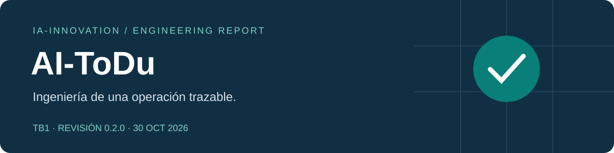

**Universidad Peruana de Ciencias Aplicadas · Ingeniería de Software** 
Desarrollo de Aplicaciones Open Source · **1ASI0729 · NRC 7750** 
Docente: **Efraín Ricardo Bautista Ubillús** 
Startup **IA-INNOVATION** · Período **2026-2**

# Informe de ingeniería · AI-ToDu

**TB1 — Corrección y preparación de AV2** 
Revisión técnica: **30 de octubre de 2026 · v0.2.0**

| Integrante | Código |
| --- | --- |
| Carlos Alberto Bernal Torres | U202420071 |
| Luis Carlos Chui Kcomt | U20241i327 |
| Fernando André Condezo Pacheco | U202411324 |
| Kevin Junior Salazar Marquina | U202417747 |
| Darikson Bill Salazar Quiche | U202422620 |

[Producto](#capítulo-i-introducción) · [Investigación](#capítulo-ii-requirements-elicitation--analysis) · [Requisitos](#capítulo-iii-requirements-specification) · [Diseño](#capítulo-iv-product-design) · [Implementación](#capítulo-v-product-implementation-validation--deployment) · [Pendientes](#pendientes-de-evidencia-y-próxima-entrega)

> **Alcance de esta revisión.** TB1 integra el frontend con una Fake REST API persistente. El servidor Java/Spring Boot, la persistencia PostgreSQL y la autenticación de producción corresponden a AV2. La revisión técnica no sustituye entrevistas, sustentaciones ni registros históricos del equipo.

## Cómo leer y mantener este informe

Este README es el informe completo **generado** desde `report-front.md`, los cinco capítulos y `report-closing.md`. Se edita cada fuente una sola vez y se ejecuta `npm run report`; `npm run check` detecta divergencias e imágenes locales rotas. Los diagramas se entregan en SVG y Mermaid editable. La exportación HTML/PDF comparte el mismo contenido.

| Estado documental | Significado |
| --- | --- |
| Implementado y verificado | Comportamiento observado en prueba automatizada o recorrido local, con alcance indicado. |
| Diseñado | Modelo, contrato o decisión revisada cuya implementación productiva aún falta. |
| Evidencia pendiente | Dato que el equipo debe sustentar con una fuente real. |

## Registro de versiones

Las fechas se apoyan en commits existentes; no se reconstruyen reuniones ni aprobaciones sin registro.

| Hito / revisión | Fecha verificable | Cambio y referencia |
| --- | --- | --- |
| AV1 · línea histórica | 19/09/2026 | Capítulos aportados por los cinco integrantes; véase Student Outcome. No se afirma que esta fecha represente la ceremonia de entrega. |
| TB1 · frontend inicial | 08/10/2026 | Seis commits originales de la webapp; módulos y README en [historial](https://github.com/AI-ToDu/ai-todu-webapp/commits/main/). |
| TB1 · informe base | 09/10/2026 | Baseline `fd8d611` del report; fuente anterior conservada en Git. |
| Corrección TB1 · v0.2.0 | 30/10/2026 | Fake API, UI/i18n, arquitectura/datos e informe en bloques de commits de `fix/tb1-readiness`. Revisión asistida ejecutada con autorización de Kevin; no atribuida a otros integrantes. |

## Student Outcome · ABET 3

**Comunicar eficazmente con diferentes audiencias, de forma oral y escrita.** Cada fila distingue una acción respaldada por Git de la evidencia oral aún pendiente. El commit acredita una contribución al archivo; no prueba por sí solo el aprendizaje individual ni una sustentación.

| Integrante | Entrega | Acción escrita realizada y fuente | Acción oral / evidencia requerida |
| --- | --- | --- | --- |
| Carlos | AV1 | Aportó el capítulo de elicitación: [e69f9e4](https://github.com/AI-ToDu/ai-todu-report/commit/e69f9e478750c3a3b981292e13bf13293c63cf93). | Adjuntar intervención, audiencia, enlace y minuto; sin registro verificado. |
| Luis | AV1 | Aportó el capítulo de implementación: [9940325](https://github.com/AI-ToDu/ai-todu-report/commit/9940325d09eef173c137a82a76201dcc5c64f345). | Adjuntar intervención y cómo explicó decisiones; sin registro verificado. |
| Fernando | AV1 | Aportó requisitos: [cf0f8c4](https://github.com/AI-ToDu/ai-todu-report/commit/cf0f8c4c93e7e789dad29682be9b851b8c618379). | Adjuntar intervención sobre requisitos y audiencia. |
| Kevin | AV1 | Aportó introducción: [93b6d8e](https://github.com/AI-ToDu/ai-todu-report/commit/93b6d8ed07031e62fa73336328b4a256cd6511d1). | Adjuntar intervención sobre problema/propuesta y minuto. |
| Darikson | AV1 | Aportó diseño: [eb5d628](https://github.com/AI-ToDu/ai-todu-report/commit/eb5d62850b1a987af937b42844c4d93be72f8020). | Adjuntar intervención sobre diseño y decisión comunicada. |
| Carlos | TB1 | Implementó IAM en frontend: [9aa7dae](https://github.com/AI-ToDu/ai-todu-webapp/commit/9aa7dae4236da015632ec7e8990e162cc4ed6654). | Adjuntar explicación de acceso/roles en sustentación TB1. |
| Luis | TB1 | Implementó logística en frontend: [b6bb6a3](https://github.com/AI-ToDu/ai-todu-webapp/commit/b6bb6a35bc04643ed1f24adcdc77ac580887c787). | Adjuntar demostración y minuto de despacho. |
| Fernando | TB1 | Implementó inventario: [9d10d5a](https://github.com/AI-ToDu/ai-todu-webapp/commit/9d10d5ac4f26c1982f0c668d9e22efd81fc65fa5). | Adjuntar demostración y explicación de reglas de stock. |
| Kevin | TB1 | Creó base de aplicación [e090d1f](https://github.com/AI-ToDu/ai-todu-webapp/commit/e090d1fda11606dc53aec8096c5feb5118a91f4d) y documentación [b05f4d7](https://github.com/AI-ToDu/ai-todu-webapp/commit/b05f4d7864c9fb07d1d80357c4649bf185622a3b). | Adjuntar explicación de integración y límites de la entrega. |
| Darikson | TB1 | Implementó POS/reporting: [427375e](https://github.com/AI-ToDu/ai-todu-webapp/commit/427375e4f19cd5a7ba481523642e01bcc194acfa). | Adjuntar demostración de venta/métricas y minuto. |

**AV2:** al realizar la entrega, añadir una fila por integrante con su acción efectivamente realizada, audiencia, decisión explicada, artefacto y evidencia oral/escrita. No registrar actividad futura como logro. La comunicación debe acompañarse de una reflexión individual sobre claridad, feedback recibido y mejora aplicada.

---
